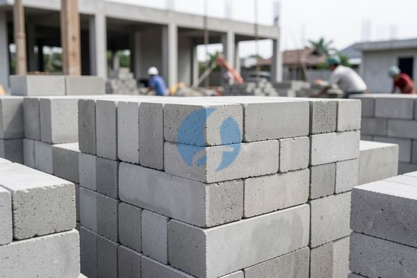

**Cara Menghindari Salah Hitung pada Harga Batako Bijian** - Mitra Sumber Material yang berbahagia, mencari harga batako bijian yang pas untuk proyek Anda? Kami mengerti betul pentingnya memilih material bangunan yang berkualitas dengan harga yang sesuai anggaran. Nah, Kami siap membantu Anda menyiapkan kebutuhan batako, dari perhitungan sampai pengiriman ke lokasi proyek.



Penting sekali untuk memastikan batako yang Anda pilih sesuai dengan kebutuhan konstruksi. Ukuran, mutu, dan jenis batako sangat memengaruhi kekuatan bangunan Anda. Tapi jangan khawatir, Mitra! Kami akan bantu memandu Anda memilih yang terbaik sebelum Anda memesan.

## Memilih Batako Bijian yang Tepat: Ukuran, Mutu, dan Kebutuhan Proyek

Sebelum membahas lebih jauh tentang harga, mari kita pahami dulu apa saja yang perlu dipertimbangkan saat memilih batako bijian. Ada beberapa faktor penting, seperti ukuran, mutu, dan tentu saja, kebutuhan proyek Anda. Ukuran batako bervariasi, mulai dari yang standar (39x19x10 cm) hingga yang lebih besar. Mutu batako juga berbeda-beda, biasanya ditandai dengan kekuatan tekan (dalam satuan MPa). Semakin tinggi angka kekuatan tekannya, semakin kuat batako tersebut.

Nah, bagaimana cara memilih yang tepat? Pertimbangkan jenis bangunan yang akan Anda buat. Untuk bangunan sederhana seperti garasi atau pagar, batako dengan kekuatan tekan standar mungkin sudah cukup. Namun, untuk bangunan yang membutuhkan kekuatan lebih, seperti dinding rumah utama, sebaiknya pilih batako dengan kekuatan tekan yang lebih tinggi. Jangan ragu untuk berkonsultasi dengan Kami, ya! Kami akan membantu Anda menganalisis kebutuhan proyek dan merekomendasikan batako yang paling sesuai.

## Jenis Batako Bijian yang Tersedia di Sumber Material

Di Sumber Material, Kami menyediakan berbagai jenis batako bijian dengan kualitas terjamin. Kami memiliki pilihan ukuran standar dan non-standar, serta berbagai mutu untuk memenuhi kebutuhan proyek Anda. Beberapa contoh yang tersedia antara lain:

- **Batako Standar (39x19x10 cm):** Cocok untuk berbagai aplikasi konstruksi, seperti dinding, pagar, dan garasi.
- **Batako Jumbo (40x20x10 cm):** Lebih efisien untuk membangun dinding karena membutuhkan lebih sedikit sambungan.
- **Batako Poros:** Memiliki lubang-lubang yang lebih besar, sehingga lebih ringan dan lebih ekonomis. Ideal untuk dinding pembatas atau pagar.
- **Batako Press:** Dibuat dengan mesin press, menghasilkan batako yang lebih padat dan kuat.

Kami juga menyediakan batako dengan mutu yang berbeda-beda, mulai dari mutu rendah hingga mutu tinggi. Untuk proyek-proyek besar, Kami sarankan untuk menggunakan batako dengan mutu tinggi agar bangunan Anda lebih kuat dan tahan lama. Tanyakan harga terbaru untuk setiap jenis dan ukuran batako lewat tombol di bawah, ya!

## Kenapa Memesan Batako Bijian di Sumber Material?

Mengapa Anda harus memilih Sumber Material untuk kebutuhan batako bijian Anda? Pertama dan terpenting, Kami selalu memastikan Anda tidak salah beli! Kami akan membantu Anda memilih ukuran, mutu, atau jenis batako yang paling pas dengan kebutuhan proyek Anda sebelum pesanan dibuat. Kedua, Kami melayani wilayah Jabodetabek dan sekitarnya, memastikan batako Anda sampai di lokasi proyek tepat waktu.

Kami juga menawarkan kemudahan dalam pemesanan dan pembayaran. Anda bisa menghubungi Kami lewat tombol **Telepon** atau **WhatsApp** di bawah untuk menanyakan harga, mendapatkan penawaran khusus, dan melakukan pemesanan. Kami juga menyediakan jasa pengiriman yang cepat dan aman, sehingga Anda tidak perlu repot mengangkut batako sendiri. Selain itu, Kami berlokasi strategis di Bogor, Jakarta, Bekasi, Karawang, Tangerang, dan Cikarang, sehingga Kami bisa melayani Anda dengan lebih cepat dan efisien.

## Cara Mudah Pesan Batako Bijian dari Sumber Material

Memesan batako bijian dari Kami sangat mudah! Cukup ikuti langkah-langkah berikut:

1.  **Hubungi Kami:** Klik tombol **Telepon** atau **WhatsApp** di bawah.
2.  **Konsultasi:** Jelaskan kebutuhan proyek Anda kepada tim Kami. Kami akan membantu Anda memilih batako yang tepat.
3.  **Pesan dan Bayar:** Setelah Anda setuju dengan penawaran harga, lakukan pembayaran sesuai metode yang tersedia.
4.  **Pengiriman:** Kami akan mengirimkan batako Anda ke lokasi proyek Anda tepat waktu.

Tunggu apa lagi? Jangan biarkan proyek Anda tertunda karena kekurangan material. Segera hubungi Kami dan dapatkan penawaran terbaik untuk batako bijian Anda!

## Menghitung Kebutuhan Batako Bijian: Contoh Praktis & Tips Akurat

Menghitung kebutuhan batako dengan tepat itu penting sekali, Mitra. Salah hitung sedikit saja bisa bikin proyek Anda molor atau kehabisan material di tengah jalan. Nah, Kami akan berikan contoh perhitungan sederhana supaya Anda bisa memperkirakan berapa banyak batako yang dibutuhkan.

Misalnya, Anda ingin membangun dinding dengan panjang 10 meter dan tinggi 3 meter. Jika menggunakan batako standar (39x19x10 cm), pertama kita hitung luas dindingnya: 10 m x 3 m = 30 m². Kemudian, hitung luas satu buah batako: 0,39 m x 0,19 m = 0,0741 m². Selanjutnya, bagi luas dinding dengan luas satu batako: 30 m² / 0,0741 m² = sekitar 405 buah batako.

### Pertimbangan Tambahan: Pecahan Batako & Sisa Material

Saat membangun, pasti ada batako yang perlu dipotong untuk menyesuaikan dengan ukuran kusen pintu atau jendela. Nah, potongan batako ini bisa Anda manfaatkan untuk mengisi celah-celah kecil atau untuk bagian-bagian lain yang membutuhkan ukuran lebih kecil. Tapi, jangan terlalu mengandalkan potongan batako, ya. Lebih baik pesan sedikit lebih banyak untuk menghindari kekurangan material.

### Hindari Kesalahan Umum Saat Menghitung Kebutuhan Batako

Banyak yang lupa memperhitungkan bukaan pintu dan jendela saat menghitung kebutuhan batako. Jadi, kurangkan dulu luas bukaan tersebut dari luas total dinding. Kesalahan umum lainnya adalah tidak memperhitungkan ketebalan plester. Plaster akan menambah ketebalan dinding, sehingga Anda perlu menyesuaikan jumlah batako yang dibutuhkan.

## Pertanyaan Seputar Batako Bijian: FAQ dari Mitra Sumber Material

Kami sering menerima pertanyaan seputar batako bijian dari para Mitra. Berikut beberapa pertanyaan yang paling umum dan jawabannya:

### Berapa Daya Tahan Batako Terhadap Cuaca?

Batako cukup tahan terhadap cuaca, terutama jika dilapisi dengan plester atau cat. Namun, batako yang tidak dilapisi bisa menyerap air dan menjadi rapuh seiring waktu. Jadi, sebaiknya lapisi batako dengan pelindung yang sesuai agar lebih awet.

### Apakah Batako Mudah Retak?

Batako bisa retak jika terkena benturan keras atau jika kualitasnya buruk. Untuk menghindari retak, pilih batako dengan mutu yang baik dan jangan menumpuk batako terlalu tinggi saat penyimpanan.

### Bagaimana Cara Merawat Batako Agar Awet?

Bersihkan batako secara berkala dari kotoran dan debu. Jika ada retakan kecil, segera perbaiki dengan semen atau plester. Pastikan batako terlindungi dari air hujan dan sinar matahari langsung. Kami sarankan juga untuk menggunakan waterproofing saat pemasangan.

### Apakah Batako Bisa Digunakan untuk Lantai?

Batako umumnya tidak direkomendasikan untuk lantai karena tidak cukup kuat menahan beban berat. Namun, ada jenis batako khusus yang dirancang untuk lantai, tetapi tetap perlu dilapisi dengan material yang lebih kuat seperti keramik atau beton.

## Jasa Urug & Pemasangan: Solusi Lengkap Proyek Mitra

Selain menyediakan material batako bijian, Kami juga menyediakan jasa urug dan pemasangan batako. Tim Kami yang berpengalaman akan membantu Anda membangun dinding dengan cepat dan rapi. Layanan ini sangat cocok bagi Mitra yang ingin menghemat waktu dan tenaga. Kami pastikan pemasangannya sesuai standar kualitas dan keamanan. Jangan ragu untuk menanyakan detail layanan ini saat menghubungi Kami.

## Memahami Kekuatan Tekan Batako: Panduan Memilih Mutu yang Tepat

Kekuatan tekan batako adalah salah satu faktor terpenting yang perlu Anda perhatikan, Mitra. Semakin tinggi kekuatan tekannya, semakin mampu batako tersebut menahan beban dan tekanan. Secara umum, batako dibagi menjadi beberapa kelas mutu berdasarkan kekuatan tekannya, misalnya:

- **Kelas A (8 MPa):** Cocok untuk bangunan non-struktural seperti pagar atau dinding pembatas.
- **Kelas B (12 MPa):** Ideal untuk dinding bangunan satu lantai atau bangunan sederhana.
- **Kelas C (15 MPa):** Direkomendasikan untuk dinding bangunan dua lantai atau bangunan yang membutuhkan kekuatan lebih.

### Bagaimana Cara Memastikan Mutu Batako?

Pastikan batako yang Anda beli memiliki sertifikasi SNI, ya. Sertifikasi ini menjamin bahwa batako tersebut telah memenuhi standar kualitas yang ditetapkan. Selain itu, perhatikan juga tampilan fisik batako. Batako yang berkualitas baik biasanya memiliki permukaan yang rata dan tidak ada retakan atau cacat lainnya.

## Pertanyaan Umum Seputar Pemesanan Batako di Sumber Material

Seringkali, Mitra Sumber Material bertanya tentang beberapa hal sebelum memesan. Berikut beberapa pertanyaan yang paling umum Kami terima:

### Berapa Lama Waktu Pengiriman?

Waktu pengiriman bervariasi tergantung jarak lokasi proyek Anda dari gudang Kami. Biasanya, Kami bisa mengirimkan pesanan dalam 1–3 hari kerja setelah pembayaran diterima.

### Apakah Bisa Memesan dalam Jumlah Kecil?

Tentu saja bisa! Kami melayani pemesanan dalam jumlah kecil maupun besar. Tidak ada batasan minimum order.

### Bagaimana Jika Batako yang Diterima Rusak?

Kami akan mengganti batako yang rusak tanpa biaya tambahan, asalkan kerusakan tersebut bukan disebabkan oleh kesalahan penanganan di lokasi proyek Anda.

Tinggal satu langkah lagi: hubungi Kami lewat tombol **Telepon** atau **WhatsApp** di bawah untuk menanyakan harga dan jadwal pengiriman proyek Mitra Sumber Material.
