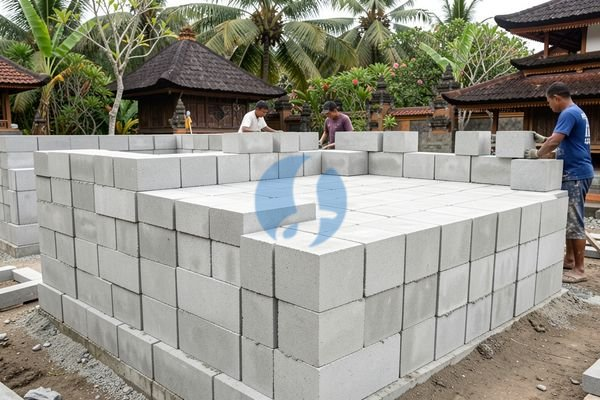

**Harga Batako di Bali dan Hal yang Perlu Dicek sebelum Memesan** - Mitra Sumber Material, siap membantu Anda mewujudkan proyek impian dengan material berkualitas!



Membangun atau renovasi di Bali? Memilih batako yang tepat adalah langkah awal yang krusial. Kami di Sumber Material siap menyediakan batako dengan kualitas terjamin, sesuai kebutuhan dan anggaran Anda.

## Bingung Pilih Batako? Kami Bantu Temukan yang Pas!

Banyaknya pilihan batako di pasaran seringkali membuat bingung, ya? Ukuran, mutu, bahkan harga bisa berbeda-beda. Nah, Mitra Sumber Material, jangan khawatir! Kami hadir untuk membantu Anda memilih batako yang paling sesuai dengan spesifikasi proyek Anda. Apakah Anda membutuhkan batako untuk dinding, pagar, atau elemen dekoratif? Kami akan memberikan rekomendasi berdasarkan kebutuhan spesifik Anda. Percayakan kebutuhan batako Anda pada Kami, dan kami akan memastikan Anda mendapatkan produk yang tepat tanpa salah beli.

## Batako Berkualitas dari Sumber Material: Pilihan Ukuran dan Mutu

Kami menyediakan berbagai jenis batako dengan berbagai ukuran dan mutu untuk memenuhi kebutuhan konstruksi Anda. Batako yang Kami sediakan memiliki keunggulan: kuat, tahan lama, presisi, dan harga bersaing. Berikut beberapa pilihan yang tersedia:

- **Batako Standar:** Ukuran 40x20x10 cm, cocok untuk dinding dan pagar. Harganya relatif terjangkau.
- **Batako Jumbo:** Ukuran 40x20x15 cm, memberikan hasil yang lebih cepat karena lebih sedikit sambungan.
- **Batako Press:** Dibuat dengan mesin press, menghasilkan batako dengan permukaan lebih halus dan kuat.
- **Batako Porous:** Batako dengan banyak pori, lebih ringan dan hemat material semen saat pemasangan.

Selain ukuran, mutu batako juga penting diperhatikan. Kami menyediakan batako dengan mutu yang terjamin, sesuai dengan standar SNI. Untuk proyek yang membutuhkan kekuatan ekstra, Kami sarankan menggunakan batako press atau batako dengan campuran bahan tambahan tertentu. Jangan ragu untuk konsultasi dengan tim Kami untuk menentukan mutu batako yang paling ideal untuk proyek Anda.

## Kenapa Harus Pesan Batako di Sumber Material?

Mitra Sumber Material, kenapa harus memilih Kami dibandingkan supplier lain? Pertama, Kami paham betul kebutuhan proyek di Bali. Kami berpengalaman melayani berbagai proyek konstruksi, mulai dari rumah tinggal hingga bangunan komersial. Kedua, Kami hanya menjual batako berkualitas dari produsen terpercaya. Kami memastikan setiap batako yang Kami jual memenuhi standar mutu yang ketat. Ketiga, Kami menawarkan harga yang kompetitif dan transparan. Keempat, Kami melayani pengiriman ke seluruh wilayah Jabodetabek dan sekitarnya, termasuk Bali. Pengiriman cepat dan aman adalah prioritas Kami. Kelima, Kami memiliki tim ahli yang siap membantu Anda memilih batako yang tepat, menghitung kebutuhan material, dan memberikan solusi terbaik untuk proyek Anda.

Keuntungan berbelanja di Sumber Material:

- **Konsultasi Gratis:** Tim Kami siap membantu Anda memilih jenis batako yang sesuai dengan kebutuhan proyek Anda.
- **Harga Bersaing:** Kami menawarkan harga yang kompetitif tanpa mengorbankan kualitas.
- **Pengiriman Tepat Waktu:** Kami menjamin pengiriman batako ke lokasi proyek Anda tepat waktu.
- **Jaminan Kualitas:** Kami hanya menjual batako berkualitas dari produsen terpercaya.
- **Layanan Luas:** Kami tidak hanya menyediakan batako, tapi juga material bangunan lainnya seperti pasir, batu, semen, dan besi. Kami juga menyediakan jasa sewa alat berat dan jasa urug.

## Pesan Batako Mudah & Cepat Hanya di Sumber Material

Memesan batako di Sumber Material sangat mudah dan cepat. Cukup hubungi Kami melalui tombol **Telepon** atau **WhatsApp** di bawah, informasikan kebutuhan batako Anda (jenis, ukuran, jumlah), dan alamat pengiriman. Tim Kami akan segera memproses pesanan Anda dan memberikan penawaran terbaik. Kami juga menyediakan layanan konsultasi gratis untuk membantu Anda menentukan jenis batako yang paling sesuai dengan proyek Anda. Jangan tunda lagi, segera wujudkan proyek impian Anda dengan batako berkualitas dari Sumber Material!

## Perhitungan Kebutuhan Batako: Jangan Sampai Kurang atau Kelebihan!

Mitra Sumber Material, seringkali kita melihat proyek konstruksi tertunda karena salah perhitungan kebutuhan material. Nah, supaya proyek Anda lancar tanpa hambatan, Kami akan bantu hitung kebutuhan batako secara akurat. Mari kita ambil contoh sederhana: Anda ingin membangun dinding dengan panjang 10 meter dan tinggi 3 meter.

Pertama, hitung luas dinding: 10 meter x 3 meter = 30 meter persegi. Kemudian, tentukan ukuran batako yang akan digunakan. Misalnya, Anda memilih batako standar dengan ukuran 40x20x10 cm. Luas satu buah batako adalah 0,4 meter x 0,2 meter = 0,08 meter persegi.

Selanjutnya, hitung jumlah batako per meter persegi: 1 meter persegi / 0,08 meter persegi/batako = 12,5 batako. Artinya, dibutuhkan 12,5 batako untuk menutupi satu meter persegi dinding.

Kami sarankan, Mitra, untuk meminta bantuan Kami dalam menghitung kebutuhan material. Tim Kami akan memberikan perhitungan yang lebih akurat berdasarkan desain dan spesifikasi proyek Anda.

## Batako Standar vs. Batako Jumbo: Mana yang Lebih Hemat?

Pilihan antara batako standar dan batako jumbo seringkali membingungkan. Mana yang lebih hemat dan efisien? Keduanya memiliki kelebihan dan kekurangan masing-masing.

Batako standar, dengan ukurannya yang lebih kecil, membutuhkan lebih banyak sambungan. Ini berarti lebih banyak pekerjaan pemasangan dan lebih banyak material semen yang dibutuhkan. Namun, harganya biasanya lebih murah dibandingkan batako jumbo.

Sebaliknya, batako jumbo memiliki ukuran yang lebih besar, sehingga lebih sedikit sambungan. Ini menghemat waktu pemasangan dan mengurangi penggunaan semen. Namun, harganya lebih mahal.

Secara umum, untuk proyek yang membutuhkan kecepatan dan efisiensi, batako jumbo lebih disarankan. Namun, jika anggaran menjadi pertimbangan utama, batako standar bisa menjadi pilihan yang lebih baik.

Untuk membantu Anda menentukan pilihan terbaik, Kami akan memberikan estimasi biaya total untuk kedua jenis batako berdasarkan proyek Anda. Dengan begitu, Anda bisa membandingkan dan memilih opsi yang paling sesuai dengan anggaran dan kebutuhan Anda.

## Pertanyaan Umum Tentang Batako: FAQ dari Mitra Sumber Material

Mitra Sumber Material, seringkali Kami menerima pertanyaan seputar batako. Berikut ini beberapa pertanyaan yang paling umum dan jawabannya:

### Berapa Daya Tahan Batako?

Daya tahan batako sangat tergantung pada kualitas bahan baku dan proses pembuatannya. Batako yang Kami sediakan terbuat dari bahan berkualitas tinggi dan diproses dengan teknologi modern, sehingga memiliki daya tahan yang sangat baik. Batako yang dipasang dengan benar dan dirawat secara berkala dapat bertahan hingga puluhan tahun.

### Apakah Batako Mudah Pecah?

Batako memang rentan terhadap benturan keras. Namun, batako yang Kami jual memiliki tingkat kepadatan yang tinggi, sehingga lebih tahan terhadap benturan. Selama proses pengiriman dan pemasangan, Kami juga memastikan batako dilindungi dengan baik agar tidak pecah.

### Bagaimana Cara Merawat Batako Agar Awet?

Perawatan batako cukup sederhana. Cukup bersihkan permukaan batako secara berkala dari debu dan kotoran. Hindari penggunaan bahan kimia keras yang dapat merusak permukaan batako. Jika ada retakan kecil, segera perbaiki dengan semen atau kompon.

### Apakah Batako Bisa Digunakan untuk Lantai?

Batako umumnya tidak direkomendasikan untuk digunakan sebagai lantai. Batako tidak memiliki permukaan yang rata dan licin, sehingga tidak nyaman untuk dipijak. Selain itu, batako juga tidak cukup kuat untuk menahan beban berat. Kami sarankan untuk menggunakan material lain yang lebih cocok untuk lantai, seperti keramik, granit, atau beton.

## Hindari Kesalahan Umum Saat Membeli Batako: Tips dari Ahlinya

Mitra Sumber Material, seringkali ada kesalahan kecil saat memilih dan memesan batako yang bisa berakibat fatal pada kualitas bangunan Anda. Salah satu yang paling umum adalah tidak memperhatikan tingkat kekeringan batako. Batako yang terlalu basah akan lebih berat, mudah retak saat pengeringan, dan mengurangi kekuatan struktur bangunan. Kami di Sumber Material memastikan batako yang Kami jual sudah melalui proses pengeringan yang optimal. Kesalahan lainnya adalah memilih batako tanpa memperhatikan standar mutu. Pastikan batako yang Anda beli memenuhi standar SNI agar kualitasnya terjamin.

## Pertanyaan Lain Seputar Batako yang Sering Kami Terima

### Apakah Batako Perlu Direndam Sebelum Dipasang?

### Berapa Ketebalan Plester yang Tepat untuk Batako?

Ketebalan plester yang ideal untuk batako adalah antara 1,5 - 2 cm. Ketebalan ini cukup untuk menutupi permukaan batako yang tidak rata dan memberikan perlindungan yang optimal.

### Bagaimana Cara Mengatasi Batako yang Retak?

Retakan kecil pada batako bisa diperbaiki dengan menggunakan semen dan pasir. Pastikan permukaan batako bersih sebelum aplikasi semen. Untuk retakan yang lebih besar, sebaiknya konsultasikan dengan ahli konstruksi.

### Apakah Batako Bisa Digunakan untuk Membuat Septik Tank?

Batako bisa digunakan untuk membuat septik tank, namun perlu dilapisi dengan lapisan kedap air seperti semen waterproofing agar tidak bocor. Pastikan juga batako yang digunakan memiliki mutu yang baik dan tahan terhadap air.

Tinggal satu langkah lagi: hubungi Kami lewat tombol **Telepon** atau **WhatsApp** di bawah untuk menanyakan harga dan jadwal pengiriman proyek Mitra Sumber Material.
