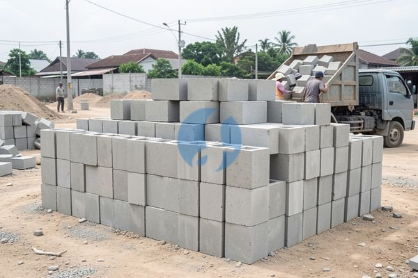

**Harga Batako per Kubik Isi Berapa? Ini Dasar yang Perlu Dipahami** - Mitra Sumber Material yang kami hormati, sedang merencanakan pembangunan atau renovasi dan bertanya-tanya berapa harga batako per kubik isi? Nah, Anda datang ke tempat yang tepat! Kami di Sumber Material siap membantu Anda mendapatkan material batako berkualitas dengan harga yang kompetitif, sekaligus menyediakan solusi lengkap untuk kebutuhan proyek Anda, mulai dari pasir, batu, hingga jasa urug dan cor.



## Pertimbangan Sebelum Membeli Batako

Sebelum membahas harga, ada beberapa hal yang perlu Anda pertimbangkan. Batako hadir dalam berbagai ukuran dan kualitas. Ukuran standar batako biasanya 40x20x10 cm, namun ada juga variasi lain. Kualitas batako dipengaruhi oleh bahan baku dan proses pembuatannya. Semakin padat dan kuat batako, semakin baik pula kualitasnya.  Penting juga untuk menyesuaikan jenis batako dengan kebutuhan proyek Anda. Untuk dinding luar, pilih batako yang lebih kuat dan tahan cuaca. Untuk dinding dalam, batako standar mungkin sudah cukup. Jika Anda masih bingung memilih, jangan ragu untuk [tanyakan spesifikasi batako](https://api.whatsapp.com/send?phone=6285776786091&text=*Halo%20sumbermaterial.com*%20%3A) kepada Kami.

### Jenis Batako dan Harganya

Batako umumnya dibagi menjadi dua jenis utama: batako pres dan batako cetak.

- **Batako Pres:** Dibuat dengan mesin press, menghasilkan batako yang lebih padat, kuat, dan presisi. Harganya umumnya sedikit lebih mahal dibandingkan batako cetak. Cocok untuk struktur bangunan yang membutuhkan kekuatan tinggi.
- **Batako Cetak:** Dibuat dengan cara dicetak, biasanya lebih ekonomis. Kekuatan dan kepadatan batako cetak bervariasi tergantung pada kualitas bahan dan proses pembuatannya.

Selain itu, ada juga batako ringan (hebel) yang semakin populer karena ringannya.  Kami menyediakan berbagai jenis batako dengan ukuran dan mutu yang berbeda-beda. Misalnya, batako ukuran 40x20x10 cm dengan mutu standar, batako press dengan kekuatan lebih tinggi, hingga batako ringan untuk kebutuhan khusus. Untuk mengetahui harga batako per kubik isi, penting untuk mengetahui dimensi batako yang Anda butuhkan.  Sebagai contoh, dengan ukuran standar 40x20x10 cm, satu kubik batako akan berisi sekitar 125 buah batako.  Harga ini bersifat estimasi dan dapat berubah sewaktu-waktu — hubungi Kami untuk penawaran terbaru dan paling akurat sesuai kebutuhan proyek Mitra.

### Mengapa Memesan Batako di Sumber Material?

Kami memahami bahwa membangun atau merenovasi rumah adalah investasi besar. Oleh karena itu, Kami berkomitmen untuk menyediakan material bangunan berkualitas dengan harga yang bersaing. Selain batako, Kami juga menyediakan material bangunan lainnya seperti pasir, batu, semen, besi, wiremesh, baja ringan, dan readymix. Kami melayani pengiriman ke wilayah Jabodetabek dan sekitarnya, termasuk Bogor, Jakarta, Bekasi, Karawang, Tangerang, dan Cikarang.

Keuntungan memesan batako di Sumber Material:

- **Kualitas Terjamin:** Kami hanya menjual batako dari produsen terpercaya.
- **Harga Bersaing:** Kami menawarkan harga yang kompetitif dan transparan.
- **Pilihan Lengkap:** Kami menyediakan berbagai jenis dan ukuran batako.
- **Pengiriman Cepat:** Kami memastikan pesanan Anda sampai tepat waktu di lokasi proyek Anda.
- **Layanan Konsultasi:** Kami siap membantu Anda memilih batako yang tepat untuk kebutuhan proyek Anda.
- **Satu Pintu untuk Semua Kebutuhan:**  Selain material, Kami juga menyediakan sewa alat berat dan jasa urug serta jasa cor, sehingga Anda bisa menghemat waktu dan biaya dengan menyelesaikan semua kebutuhan proyek di satu tempat.  Anda bisa kirim kebutuhan dan lokasi proyek Anda lewat WhatsApp untuk penawaran khusus!

### Cara Mudah Memesan Batako

Memesan batako di Sumber Material sangat mudah! Anda bisa menghubungi Kami melalui tombol **WhatsApp** atau **Telepon** yang tersedia di bawah halaman ini. Tim Kami akan dengan senang hati membantu Anda menghitung kebutuhan batako, memberikan penawaran harga, dan mengatur pengiriman ke lokasi proyek Anda.  Atau, Anda bisa langsung datang ke lokasi Kami di Bogor, Jakarta, Bekasi, Karawang, Tangerang, atau Cikarang. Kami siap melayani Anda dengan sepenuh hati.  Kami bantu hitungkan kebutuhan batako Anda secara gratis.  Yuk, segera konsultasikan proyek Anda dengan Kami!  Atau, Anda bisa melihat artikel terkait [berapa harga penjelasan](/blog/berapa-harga-batako-per-biji/) untuk memahami lebih detail tentang harga batako per biji.

Jangan tunda kebutuhan proyek Mitra Sumber Material — tanyakan harga dan ketersediaannya sekarang lewat tombol **WhatsApp** atau **Telepon** di bawah halaman ini.

ARTIKEL_SELESAI

## Kalkulasi Kebutuhan Batako: Contoh Praktis

Menghitung kebutuhan batako dengan tepat sangat penting untuk menghindari kekurangan atau kelebihan material. Mari kita ambil contoh sederhana. Anggap Anda akan membangun dinding dengan ukuran panjang 8 meter dan tinggi 3 meter. Dinding tersebut membutuhkan 1 lapis batako. Ukuran batako standar adalah 40x20x10 cm.

Pertama, hitung luas dinding: 8 meter x 3 meter = 24 meter persegi. Kemudian, hitung luas satu buah batako: 0,4 meter x 0,2 meter = 0,08 meter persegi.  Selanjutnya, bagi luas dinding dengan luas satu buah batako: 24 meter persegi / 0,08 meter persegi/buah = 300 buah batako.

Untuk mengetahui berapa kubik batako yang Anda butuhkan, ingat bahwa 1 kubik berisi sekitar 125 buah batako (ukuran standar). Jadi, 323 buah / 125 buah/kubik = 2,584 kubik.  Dengan demikian, Anda membutuhkan sekitar 2,6 kubik batako.  Perhitungan ini hanyalah contoh, dan kebutuhan Anda mungkin berbeda tergantung pada desain dan spesifikasi proyek Anda. Kami siap membantu Anda menghitung kebutuhan batako secara akurat dan menyesuaikan dengan kebutuhan spesifik proyek Anda.

## Memilih Batako: Perbandingan Batako Standar vs. Batako Ringan

Ketika memilih batako, Anda akan dihadapkan pada berbagai pilihan. Dua jenis yang paling umum adalah batako standar dan batako ringan. Keduanya memiliki kelebihan dan kekurangan masing-masing.

Batako standar, seperti yang sudah Kami bahas, umumnya lebih kuat dan cocok untuk struktur bangunan yang membutuhkan daya tahan tinggi. Namun, batako standar relatif lebih berat, yang dapat memperlambat proses pemasangan dan meningkatkan biaya transportasi. Selain itu, batako standar membutuhkan lebih banyak semen dan pasir untuk perekatannya.

Pilihan terbaik tergantung pada kebutuhan dan anggaran proyek Anda. Jika Anda membutuhkan kekuatan dan daya tahan yang maksimal, batako standar adalah pilihan yang tepat. Jika Anda mengutamakan kemudahan pemasangan dan efisiensi energi, batako ringan bisa menjadi solusi yang baik.

## Pertanyaan Umum Seputar Batako

Banyak Mitra Sumber Material yang memiliki pertanyaan serupa sebelum membeli batako. Berikut beberapa pertanyaan yang sering Kami terima beserta jawabannya:

### Berapa Daya Tahan Batako Terhadap Air?

Batako bersifat menyerap air, sehingga membutuhkan pelapisan atau pelindung yang tepat untuk mencegah kerusakan akibat kelembaban. Semen dan plester dapat membantu melindungi batako dari air.

### Apakah Batako Mudah Pecah?

Batako relatif kuat, tetapi tetap bisa pecah jika terkena benturan keras. Penanganan yang hati-hati saat pengangkutan dan pemasangan sangat penting.

### Bagaimana Cara Menyimpan Batako dengan Benar?

Batako sebaiknya disimpan di tempat yang kering dan rata, serta terlindungi dari hujan dan sinar matahari langsung. Tumpukan batako sebaiknya tidak terlalu tinggi untuk mencegah kerusakan.

### Apakah Batako Bisa Digunakan untuk Dinding Luar?

Batako bisa digunakan untuk dinding luar, tetapi sebaiknya dilapisi dengan plester atau bahan pelindung lainnya untuk meningkatkan ketahanannya terhadap cuaca.

ARTIKEL_SELESAI

## Menghindari Kesalahan Umum Saat Membeli Batako

Mitra Sumber Material, seringkali ada beberapa kesalahan umum yang terjadi saat membeli batako yang dapat menyebabkan kerugian atau keterlambatan proyek. Salah satunya adalah tidak menghitung kebutuhan dengan cermat, sehingga mengakibatkan kekurangan atau kelebihan material. Lainnya, memilih batako dengan kualitas yang tidak sesuai dengan kebutuhan proyek Anda. Misalnya, menggunakan batako cetak untuk struktur yang membutuhkan kekuatan tinggi.  Pastikan Anda mempertimbangkan beban dinding, kondisi tanah, dan iklim setempat sebelum memutuskan jenis batako yang akan digunakan.  Kami siap membantu Anda menghindari kesalahan-kesalahan ini dengan memberikan konsultasi gratis dan panduan pemilihan batako yang tepat.

## FAQ: Pertanyaan Seputar Batako yang Sering Diajukan

### Apakah Batako Perlu Direndam Sebelum Dipasang?

Tidak selalu. Perendaman dapat membantu mengurangi penyerapan air semen saat pemasangan, tetapi tidak wajib. Jika batako terlalu kering, cukup basahi permukaannya sebelum dipasang.

### Bagaimana Cara Memastikan Batako Tidak Retak Saat Pemasangan?

Hindari memukul batako terlalu keras saat pemasangan. Gunakan palu karet dan pastikan batako terpasang dengan rapat dan rata.

### Apakah Batako Bisa Dipotong?

Ya, batako bisa dipotong menggunakan mesin pemotong khusus. Namun, proses ini membutuhkan kehati-hatian dan peralatan yang tepat.

### Apa Saja Alat yang Dibutuhkan untuk Memasang Batako?

Anda membutuhkan semen, pasir, air, palu karet, meteran, benang, dan alat pengaduk semen.  Jangan ragu bertanya kepada Kami jika Anda membutuhkan rekomendasi alat yang berkualitas.
