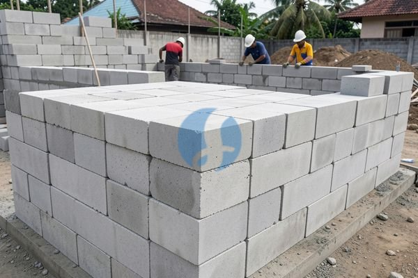

**Tanyakan Ini sebelum Menyetujui Harga Batako per Seribu** - Mitra Sumber Material, pernah nggak sih lagi semangat bangun rumah atau renovasi, eh begitu hitung kebutuhan batako malah bingung? Apalagi soal harga, bisa beda-beda tiap toko. Nah, Kami di Sumber Material siap bantu supaya proyek Mitra berjalan lancar, dari perhitungan kebutuhan batako yang tepat sampai pengiriman ke lokasi proyek di Jabodetabek dan sekitarnya.



Banyak yang bertanya-tanya, berapa sih harga batako per seribu di tahun 2026 ini? Sebelum membahas angka, penting untuk memahami dulu ada beberapa jenis batako yang beredar di pasaran. Ada batako biasa, batako hollow, batako ringan, dan lain-lain. Masing-masing punya kelebihan dan kekurangan, serta harga yang berbeda-beda. Pemilihan jenis batako yang tepat akan sangat berpengaruh pada kekuatan bangunan, efisiensi biaya, dan tentu saja, kepuasan Mitra. Nah, Kami bisa membantu Mitra memilih jenis batako yang paling sesuai dengan kebutuhan dan anggaran proyek.

## Jenis Batako dan Penggunaannya

Batako hollow, misalnya, sering dipilih karena ringan dan memiliki lubang-lubang yang bisa mengurangi beban struktur bangunan. Cocok banget buat dinding atau pagar. Sementara batako biasa, yang padat, lebih sering digunakan untuk fondasi atau struktur bangunan yang membutuhkan kekuatan lebih. Untuk proyek Mitra yang butuh batako dengan kekuatan tinggi, Kami punya batako dengan mutu terjamin. Kalau Mitra masih bingung, jangan ragu untuk konsultasi dengan tim Kami. Kami akan bantu hitung kebutuhan batako secara rinci dan berikan rekomendasi yang paling tepat.

### Harga Batako Per Seribu: Faktor yang Mempengaruhi

Harga batako per seribu bisa bervariasi tergantung beberapa faktor, nih. Pertama, jenis batako seperti yang sudah Kami bahas tadi. Kedua, kualitas bahan baku yang digunakan. Ketiga, lokasi pembelian — harga di daerah perkotaan biasanya lebih tinggi daripada di daerah pinggiran. Keempat, jumlah pesanan — biasanya ada diskon untuk pembelian dalam jumlah besar. Kelima, kondisi pasar dan permintaan material bangunan secara umum. Harga ini bersifat estimasi dan dapat berubah sewaktu-waktu — hubungi Kami untuk penawaran terbaru dan paling akurat sesuai kebutuhan proyek Mitra.

Di Sumber Material, Kami menyediakan berbagai jenis batako dengan kualitas terjamin dan harga yang kompetitif. Kami menjual batako hollow, batako biasa, dan batako ringan dalam berbagai ukuran. Ukuran yang paling umum adalah 40x20x10 cm, tapi Kami juga menyediakan ukuran lain sesuai permintaan. Misalnya, untuk proyek Mitra yang butuh batako dengan ketebalan dinding tertentu, Kami bisa sesuaikan.

### Kenapa Memesan Batako di Sumber Material?

Selain menyediakan berbagai jenis batako, Kami juga menawarkan beberapa keuntungan lain yang nggak bisa Mitra dapatkan di toko material bangunan lain. Pertama, Kami menyediakan layanan pengiriman langsung ke lokasi proyek di wilayah Jabodetabek dan sekitarnya. Jadi, Mitra nggak perlu repot-repot mengangkut batako sendiri. Kedua, Kami menyediakan jasa urug dan jasa cor — jadi, Mitra bisa mendapatkan semua kebutuhan material dan jasa dalam satu tempat. Ketiga, Kami selalu mengutamakan kualitas produk dan kepuasan pelanggan. Kami cuma menjual batako dari produsen terpercaya. Keempat, Kami berlokasi di Bogor, Jakarta, Bekasi, Karawang, Tangerang, dan Cikarang, sehingga pengiriman lebih cepat dan efisien.

Nah, ini yang bikin Kami beda. Mitra nggak perlu lagi ribet cari supplier batako dan jasa urug/cor secara terpisah. Semua bisa diurus di Sumber Material, satu pintu. Ini akan menghemat waktu dan tenaga Mitra, sehingga Mitra bisa fokus pada hal-hal yang lebih penting dalam proyek.

### Cara Mudah Pesan Batako di Sumber Material

Pesan batako di Sumber Material itu gampang banget! Cukup hubungi Kami lewat tombol **WhatsApp** atau **Telepon** di bawah halaman ini. Sampaikan kebutuhan batako Mitra (jenis, ukuran, jumlah) dan lokasi proyek. Tim Kami akan segera membalas dengan penawaran harga terbaik dan informasi lengkap lainnya. Kami juga bisa bantu hitungkan kebutuhan batako Mitra secara gratis, lho. Jadi, Mitra nggak perlu khawatir salah hitung. Kami juga menerima pesanan dengan skala kecil atau besar, jadi nggak masalah kalau proyek Mitra baru mulai atau sudah berjalan lama.

## Hitung Kebutuhan Batako: Contoh Kasus Proyek Rumah Minimalis

Nah, biar Mitra makin yakin, yuk kita lihat contoh perhitungan kebutuhan batako untuk proyek rumah minimalis ukuran 6x8 meter dengan tinggi dinding 3 meter. Asumsikan kita pakai batako hollow ukuran 40x20x10 cm. Pertama, hitung keliling rumah: (6m + 8m) x 2 = 28 meter. Kemudian, hitung luas dinding: 28 meter x 3 meter = 84 meter persegi.

Sekarang, hitung berapa banyak batako yang dibutuhkan per meter persegi. Batako hollow ukuran 40x20x10 cm, jika dipasang dengan spasi nat 1 cm, efektif menutupi area sekitar 0,4 meter persegi per biji (0,4m x 0,2m = 0,08m², lalu 5 biji batako per meter persegi = 0,08m² x 5 = 0,4m²). Jadi, kebutuhan batako per meter persegi adalah 5 biji.

## Pertanyaan Seputar Batako yang Sering Kami Terima

Seringkali, ada beberapa pertanyaan yang muncul dari Mitra sebelum memutuskan membeli batako. Yuk, kita bahas beberapa pertanyaan umum:

### Berapa Daya Tahan Batako?

Daya tahan batako tergantung pada kualitas bahan baku dan proses pembuatannya. Batako yang berkualitas baik, dengan campuran semen dan pasir yang tepat, serta proses pengeringan yang optimal, bisa bertahan hingga puluhan tahun. Penting juga untuk melindungi batako dari cuaca ekstrem dan memastikan pemasangan dilakukan dengan benar.

### Apakah Batako Mudah Retak?

Batako memang rentan terhadap retak jika terkena benturan keras atau mengalami perubahan suhu yang ekstrem. Namun, dengan perawatan yang baik dan pemasangan yang tepat, risiko retak bisa diminimalkan. Hindari menumpuk batako terlalu tinggi dan lindungi dari paparan sinar matahari langsung.

### Batako Hollow atau Batako Padat? Mana yang Lebih Baik?

Pemilihan antara batako hollow dan batako padat tergantung pada kebutuhan proyek. Batako hollow lebih ringan dan hemat biaya, cocok untuk dinding dan pagar. Sementara batako padat lebih kuat dan tahan lama, cocok untuk fondasi dan struktur bangunan yang membutuhkan kekuatan ekstra. Kami bisa membantu Mitra menentukan pilihan yang paling tepat sesuai kebutuhan.

### Bagaimana Cara Merawat Batako Agar Awet?

Perawatan batako cukup sederhana. Pastikan batako disimpan di tempat yang kering dan terlindung dari cuaca ekstrem. Bersihkan batako secara berkala dari debu dan kotoran. Jika ada retakan kecil, segera perbaiki dengan semen dan pasir. Dengan perawatan yang baik, batako bisa bertahan lama dan tetap berfungsi dengan baik.

## Hindari Kesalahan Umum Saat Membeli Batako

Banyak Mitra yang melakukan kesalahan saat membeli batako yang akhirnya merugikan. Salah satunya adalah tergiur dengan harga murah tanpa memperhatikan kualitas. Batako yang murah belum tentu berkualitas baik dan bisa jadi cepat rusak. Kesalahan lain adalah tidak menghitung kebutuhan batako dengan tepat, sehingga kekurangan atau kelebihan. Selain itu, memilih supplier yang tidak terpercaya juga bisa berakibat fatal. Pastikan supplier memiliki reputasi baik dan menyediakan batako berkualitas. Di Sumber Material, Kami menjamin kualitas batako yang Kami jual dan memberikan layanan konsultasi gratis untuk membantu Mitra menghitung kebutuhan batako secara akurat.

## Perhatikan Ukuran Batako: Standar & Dampaknya pada Biaya

Pemilihan ukuran batako juga berpengaruh pada efisiensi biaya dan waktu pemasangan, lho. Ukuran yang paling umum adalah 40x20x10 cm, tapi ada juga yang 39x19x9 cm atau bahkan ukuran khusus sesuai pesanan. Nah, ukuran batako yang tidak standar bisa jadi menyulitkan proses pemasangan dan membutuhkan lebih banyak material pengisi, seperti semen dan pasir. Jadi, pastikan ukuran batako yang Mitra pilih sesuai dengan desain bangunan dan mudah didapatkan di pasaran. Kami di Sumber Material menyediakan berbagai ukuran batako standar dan siap membantu Mitra memilih yang paling tepat.

### Pertanyaan Umum Soal Batako: Apa yang Perlu Mitra Tahu?

Seringkali ada pertanyaan yang muncul di benak Mitra sebelum membeli batako. Misalnya:

- **Apakah batako perlu direndam sebelum dipasang?** Ya, sebaiknya batako direndam dalam air selama beberapa jam sebelum dipasang. Ini bertujuan untuk mengurangi penyerapan air dari semen saat pemasangan, sehingga batako lebih kuat dan tahan lama.
- **Bagaimana cara memotong batako agar rapi?** Gunakan mesin potong batako yang dilengkapi dengan mata pisau berlian. Pastikan batako terpasang dengan kuat dan potong dengan hati-hati agar tidak pecah.
- **Apa yang harus dilakukan jika ada batako yang pecah saat pengiriman?** Segera hubungi Kami. Kami akan mengganti batako yang pecah dengan yang baru tanpa biaya tambahan.
- **Apakah batako bisa digunakan untuk bangunan bertingkat?** Batako hollow umumnya kurang cocok untuk bangunan bertingkat karena kurang kuat menahan beban. Sebaiknya gunakan batako padat atau material bangunan lain yang lebih kuat untuk struktur bangunan bertingkat.

Siap pesan atau masih mau konsultasi dulu? Tombol **WhatsApp** dan **Telepon** di bawah halaman ini langsung terhubung dengan tim Kami.
