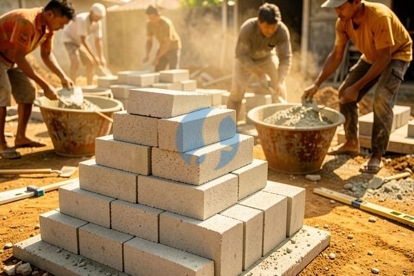

**Harga Batako Sekarang untuk Rumah Tinggal dan Ruko** - Mitra Sumber Material di mana pun berada, seringkali kita menemukan proyek konstruksi terhambat karena salah perhitungan kebutuhan material atau justru mendapat harga yang tidak sesuai. Nah, untuk menghindari hal tersebut, Kami hadir sebagai solusi lengkap kebutuhan bangunan Mitra, mulai dari batako, material lain, hingga jasa pemasangan.



Mitra, batako adalah material bangunan yang sering jadi andalan untuk pembuatan dinding, pagar, atau bahkan bangunan sementara. Harganya yang relatif terjangkau dibandingkan material lain menjadikannya pilihan populer. Tapi, harga batako sekarang ini bisa berbeda-beda tergantung beberapa faktor. Jangan sampai karena tergiur harga murah, Mitra justru mendapatkan kualitas yang buruk dan malah menambah biaya perbaikan di kemudian hari.

## Pilihan Batako yang Perlu Mitra Pertimbangkan

Sebelum membahas lebih jauh tentang harga batako sekarang, ada baiknya Mitra memahami dulu pilihan yang tersedia. Batako hadir dalam berbagai ukuran dan kualitas. Ukuran standar umumnya adalah 39x19x10 cm, namun ada juga yang lebih besar atau lebih kecil. Kualitas batako ditentukan oleh campuran material dan proses pembuatannya. Semakin padat dan kuat batako, tentu saja harganya juga akan lebih tinggi.

Nah, kalau Mitra sedang mencari batako untuk proyek yang membutuhkan kekuatan ekstra, seperti dinding penahan tanah atau pagar perimeter, sebaiknya pilih batako dengan mutu yang lebih tinggi. Tapi, jika untuk bangunan sementara atau dinding pembatas yang tidak terlalu berat, batako standar sudah cukup memadai. Kami di Sumber Material menyediakan berbagai pilihan batako sesuai kebutuhan Mitra. Yuk, tanyakan harga terbaru dan ketersediaan stok lewat **WhatsApp** atau **Telepon** di bawah!

## Batako Berkualitas & Jasa Pendukung dari Sumber Material

Sumber Material menyediakan batako dengan berbagai ukuran dan mutu. Kami memiliki beberapa jenis batako yang populer di kalangan Mitra:

- **Batako Standar:** Ukuran 39x19x10 cm, cocok untuk dinding pembatas, pagar rumah, atau bangunan sederhana.
- **Batako Jumbo:** Ukuran lebih besar, ideal untuk mempercepat proses pembangunan dinding.
- **Batako Kerangka:** Memiliki rongga yang lebih besar, sehingga lebih ringan dan hemat material.
- **Batako Presisi:** Diproduksi dengan mesin modern, menghasilkan ukuran yang lebih akurat dan permukaan yang lebih halus.

Selain batako, Kami juga menyediakan material bangunan lainnya seperti pasir, batu split, semen, besi, dan baja ringan. Kami memahami betul, proyek Mitra butuh lebih dari sekadar material. Itulah kenapa Kami menyediakan juga jasa urug dan jasa cor. Bayangkan, Mitra bisa mendapatkan semua kebutuhan proyek dalam satu tempat!

## Kenapa Pesan Batako di Sumber Material? Lebih dari Sekadar Harga

Mitra Sumber Material, kenapa harus memilih Kami? Pertama, Kami menyediakan **satu pintu solusi** untuk kebutuhan proyek Anda. Tidak perlu repot mencari supplier yang berbeda-beda untuk material dan jasa. Cukup hubungi Kami, dan semua kebutuhan Anda akan Kami tangani.

Kedua, Kami melayani pengiriman ke seluruh wilayah Jabodetabek dan sekitarnya. Jadi, Mitra tidak perlu khawatir tentang logistik. Kami akan memastikan material sampai di lokasi proyek tepat waktu. Ketiga, Kami berlokasi strategis di Bogor, Jakarta, Bekasi, Karawang, Tangerang, dan Cikarang, sehingga pengiriman bisa lebih cepat dan efisien.

Keempat, Kami selalu berusaha memberikan harga yang kompetitif dan pelayanan yang terbaik. Kami mengerti bahwa setiap proyek memiliki anggaran yang berbeda-beda, jadi Kami akan membantu Mitra menemukan solusi yang paling sesuai dengan kebutuhan dan budget Anda. Jangan ragu untuk tanyakan harga terbaru batako dan material lainnya lewat **WhatsApp** atau **Telepon** di bawah!

## Pesan Batako Sekarang, Proyek Mitra Lebih Lancar!

Proses pemesanan di Sumber Material sangat mudah. Mitra bisa langsung menghubungi Kami melalui tombol **Telepon** atau **WhatsApp** yang ada di bawah halaman ini. Sampaikan kebutuhan batako beserta volume yang dibutuhkan dan lokasi proyek. Tim Kami akan segera merespons dan memberikan penawaran terbaik. Kami juga bisa membantu menghitung kebutuhan batako secara akurat, sehingga Mitra tidak perlu khawatir kekurangan atau kelebihan material.

Siap pesan atau masih mau konsultasi dulu? Tombol **WhatsApp** dan **Telepon** di bawah halaman ini langsung terhubung dengan tim Kami.

ARTIKEL_SELESAI

## Mengukur Kebutuhan Batako: Contoh Perhitungan Nyata

Mitra Sumber Material, seringkali kita kesulitan menentukan berapa banyak batako yang dibutuhkan untuk suatu proyek. Perhitungan yang kurang tepat bisa mengakibatkan kekurangan material di tengah pekerjaan, atau justru kelebihan yang membuang-buang anggaran. Nah, supaya Mitra tidak mengalami hal tersebut, Kami akan berikan contoh perhitungan sederhana.

Misalnya, Mitra ingin membangun dinding dengan panjang 10 meter dan tinggi 2,5 meter. Kita asumsikan ketebalan dinding adalah 15 cm (setengah bata). Ukuran batako standar adalah 39x19x10 cm. Pertama, hitung luas dinding: 10 meter x 2,5 meter = 25 meter persegi. Kemudian, hitung luas satu buah batako yang akan terlihat di dinding (kita pakai dimensi 39 cm x 19 cm): 0,39 m x 0,19 m = 0,0741 meter persegi.

Selanjutnya, hitung jumlah batako per meter persegi: 1 meter persegi / 0,0741 meter persegi/batako = sekitar 13,5 batako. Jadi, untuk dinding seluas 25 meter persegi, dibutuhkan sekitar 25 meter persegi x 13,5 batako/meter persegi = 337,5 batako. Karena batako tidak bisa dibeli setengah, sebaiknya Mitra pesan 338 batako.

## Pertanyaan Umum Seputar Batako yang Sering Kami Terima

Banyak Mitra yang bertanya tentang batako. Berikut beberapa pertanyaan yang sering muncul:

### Berapa Daya Tahan Batako Terhadap Cuaca?

Batako cukup tahan terhadap cuaca, namun perlu dilapisi dengan plester atau cat untuk melindungi dari air hujan dan sinar matahari langsung. Kalau tidak dilapisi, batako bisa mengalami lumut atau retak-retak kecil seiring waktu.

### Apakah Batako Bisa Digunakan untuk Lantai?

Batako tidak direkomendasikan untuk lantai karena tidak memiliki kekuatan yang cukup untuk menahan beban. Batako lebih cocok digunakan untuk dinding atau pagar.

### Bagaimana Cara Memotong Batako?

Memotong batako membutuhkan alat yang tepat, seperti mesin potong keramik atau gergaji beton. Pastikan menggunakan alat keselamatan seperti kacamata dan masker saat memotong batako.

### Apakah Batako Bisa Dipesan dengan Warna Tertentu?

Beberapa produsen batako menyediakan opsi warna. Namun, umumnya batako yang tersedia berwarna merah alami. Mitra bisa mengecat batako sesuai dengan warna yang diinginkan setelah pemasangan.

## Tips Memilih Batako yang Tidak Bikin Rugi

Mitra Sumber Material, memilih batako yang tepat itu penting. Jangan hanya terpaku pada harga murah. Perhatikan beberapa hal berikut:

- **Perhatikan Kekompakan:** Pilih batako yang padat dan tidak mudah pecah saat ditekan. Batako yang rapuh menandakan kualitasnya kurang baik.
- **Cek Kerataan Permukaan:** Pastikan permukaan batako rata dan tidak ada retakan atau lubang yang signifikan.
- **Perhatikan Ukuran:** Pastikan ukuran batako seragam. Ukuran yang tidak seragam akan menyulitkan proses pemasangan.
- **Pilih Produsen Terpercaya:** Beli batako dari produsen yang sudah memiliki reputasi baik dan terpercaya. Dengan begitu, Mitra bisa memastikan kualitas batako yang dibeli.

Kami di Sumber Material hanya menyediakan batako dari produsen terpercaya dengan kualitas terjamin. Percayakan kebutuhan batako Mitra pada Kami, dan Kami akan bantu memilih yang terbaik!

## Kesalahan Umum Saat Membeli Batako yang Harus Dihindari Mitra

Mitra Sumber Material, seringkali ada beberapa kesalahan umum yang dilakukan saat membeli batako. Salah satunya adalah tergiur harga murah tanpa memperhatikan kualitas. Batako yang berkualitas buruk bisa menyebabkan dinding retak atau mudah rusak. Kesalahan lain adalah salah menghitung kebutuhan batako, yang bisa mengakibatkan kelebihan atau kekurangan material.

Selain itu, banyak yang lupa mempertimbangkan biaya transportasi. Harga batako di toko mungkin murah, tapi jika biaya pengiriman mahal, total biaya yang dikeluarkan bisa jadi lebih tinggi. Nah, Kami di Sumber Material siap membantu Mitra menghindari kesalahan-kesalahan ini. Kami akan memberikan rekomendasi batako yang sesuai dengan kebutuhan dan anggaran Mitra, serta membantu menghitung kebutuhan material secara akurat.

## Tanya Jawab Seputar Batako: Pertanyaan yang Sering Kami Terima

### Apakah Batako Perlu Direndam Sebelum Dipasang?

Ya, disarankan untuk merendam batako dalam air selama beberapa menit sebelum dipasang. Hal ini membantu batako menyerap air sehingga lebih kuat dan tidak menyerap air dari adukan semen terlalu cepat.

### Bagaimana Cara Mengatasi Batako yang Pecah Saat Pengiriman?

Jika ada batako yang pecah saat pengiriman, segera hubungi Kami. Kami akan mengganti batako yang rusak tersebut dengan yang baru.

### Apa Bedanya Batako Padat dan Batako Lubang?

Batako padat lebih kuat dan cocok untuk dinding penahan beban, sedangkan batako lubang lebih ringan dan hemat material, ideal untuk dinding pembatas. Pilihan tergantung kebutuhan proyek Mitra.
