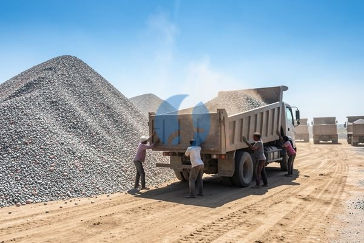

**Kenapa Harga Batu Gunung 1 Kubik Bisa Berbeda di Tiap Penjual?** - Mitra Sumber Material dimana saja berada, seringkali proyek konstruksi tertunda atau membengkak biayanya karena salah perhitungan kebutuhan material. Salah satu yang paling umum adalah kurang teliti saat menentukan volume batu gunung yang diperlukan. Nah, Kami di Sumber Material siap membantu Anda menghindari masalah ini sebelum Anda bahkan memesan!



Batu gunung adalah material penting dalam berbagai proyek konstruksi, mulai dari pondasi rumah, jalan, hingga struktur bangunan lainnya. Memahami harga batu gunung per kubik sangat krusial untuk menyusun anggaran yang tepat. Tapi, harga ini bisa bervariasi tergantung beberapa faktor penting. Mitra Sumber Material, sebelum kita membahas detailnya, perlu diingat bahwa harga yang Anda dapatkan bisa berbeda-beda tergantung lokasi proyek, jenis batu, dan tentu saja, pemasok material yang Anda pilih.

## Pilihan Batu Gunung & Estimasi Harga per Kubik

Ada beberapa jenis batu gunung yang umum digunakan dalam konstruksi, masing-masing dengan karakteristik dan harga yang berbeda. Beberapa yang paling sering dicari adalah batu split, batu belah, dan batu sirtu. Batu split biasanya digunakan untuk lapisan pondasi, jalan, atau drainase. Harganya cenderung lebih stabil karena proses produksinya yang relatif standar. Sedangkan batu belah, yang sering dipakai untuk pekerjaan dinding penahan atau pondasi, bisa lebih mahal tergantung tingkat kesulitan pembelahannya. Lalu ada batu sirtu (pasir urug) yang umumnya lebih ekonomis dan digunakan untuk pengurugan.

Untuk memberikan gambaran, harga batu gunung per kubik di wilayah Jabodetabek pada tahun 2026 ini berkisar antara Rp 180.000 hingga Rp 350.000. Harga ini bersifat estimasi dan dapat berubah sewaktu-waktu — hubungi Kami untuk penawaran terbaru dan paling akurat sesuai kebutuhan proyek Mitra. Perbedaan harga ini sangat dipengaruhi oleh jenis batu, jarak pengiriman, dan volume pemesanan. Semakin besar volume yang Anda pesan, biasanya semakin baik harga yang bisa Kami tawarkan.

## Jenis Batu Gunung yang Tersedia di Sumber Material

Kami di Sumber Material menyediakan berbagai jenis batu gunung untuk memenuhi kebutuhan proyek Anda:

- **Batu Split:** Tersedia dalam berbagai ukuran, mulai dari 5/20 mm hingga 20/40 mm. Ideal untuk lapisan pondasi jalan, base course, dan drainase.
- **Batu Belah:** Cocok untuk pekerjaan dinding penahan tanah, pondasi bangunan, dan elemen dekoratif. Tersedia dalam berbagai ukuran dan bentuk.
- **Batu Sirtu:** Material urug yang ekonomis dan serbaguna. Digunakan untuk pengurugan lahan, pembuatan jalan sementara, dan stabilisasi tanah.
- **Batu Kali:** Pilihan populer untuk pondasi bangunan, terutama untuk bangunan bertingkat rendah.

Kami juga menyediakan layanan *custom order* jika Anda membutuhkan ukuran atau jenis batu gunung yang spesifik. Jangan ragu untuk berkonsultasi dengan tim Kami untuk mendapatkan solusi terbaik untuk proyek Anda. Untuk kebutuhan volume besar, Kami sarankan untuk [tanyakan harga lewat WhatsApp](https://api.whatsapp.com/send?phone=6285776786091&text=*Halo%20sumbermaterial.com*%20%3A) agar mendapatkan penawaran khusus.

## Mengapa Memesan Batu Gunung di Sumber Material?

Mitra Sumber Material, kenapa memilih Kami sebagai pemasok batu gunung Anda? Pertama, Kami menawarkan kemudahan satu pintu. Anda bisa mendapatkan material bangunan (pasir, batu, bata, baja ringan, dan lain-lain), jasa sewa alat berat, dan bahkan jasa urug atau cor, semuanya dalam satu tempat. Ini akan menghemat waktu dan tenaga Anda dalam mengelola proyek. Kedua, Kami melayani wilayah Jabodetabek dan sekitarnya, memastikan material sampai tepat waktu di lokasi proyek Anda. Ketiga, Kami memiliki reputasi baik dalam menyediakan material berkualitas dengan harga yang kompetitif.

Kami berlokasi di Bogor, Jakarta, Bekasi, Karawang, Tangerang, dan Cikarang, sehingga pengiriman lebih cepat dan efisien. Kami memahami betul pentingnya ketepatan waktu dalam proyek konstruksi, dan Kami berkomitmen untuk memberikan layanan terbaik bagi Mitra Sumber Material. Kami juga siap membantu Anda menghitung kebutuhan material secara akurat, sehingga Anda tidak perlu khawatir kelebihan atau kekurangan material.

## Cara Mudah Memesan Batu Gunung di Sumber Material

Memesan batu gunung dari Kami sangat mudah. Anda bisa menghubungi Kami melalui tombol **WhatsApp** atau **Telepon** yang tersedia di bawah halaman ini. Ceritakan kebutuhan proyek Anda secara detail, termasuk jenis batu gunung, volume yang dibutuhkan, dan lokasi pengiriman. Tim Kami akan segera memberikan penawaran harga terbaik dan mengatur jadwal pengiriman yang sesuai. Anda juga bisa mengirimkan kebutuhan dan lokasi proyek Mitra lewat WhatsApp agar Kami bantu perhitungannya.

Jangan tunda kebutuhan proyek Mitra Sumber Material — tanyakan harga dan ketersediaannya sekarang lewat tombol **WhatsApp** atau **Telepon** di bawah halaman ini.

ARTIKEL_SELESAI

## Menghitung Kebutuhan Batu Gunung: Contoh Kasus & Rumus Praktis

Mitra Sumber Material, seringkali kesulitan terbesar bukan hanya mendapatkan harga batu gunung 1 kubik terbaik, tapi juga memperkirakan berapa banyak material yang benar-benar dibutuhkan untuk proyek Anda. Kekurangan bisa menyebabkan keterlambatan, sementara kelebihan berarti pemborosan anggaran. Nah, Kami akan berikan contoh perhitungan sederhana agar Anda lebih mudah memperkirakan kebutuhan.

Misalkan Anda akan membuat pondasi rumah dengan luas 8 meter x 10 meter dan kedalaman galian 70 cm (0,7 meter). Untuk lapisan dasar (urugan pasir) dan lapisan atas (batu split), kita asumsikan ketebalan masing-masing 10 cm (0,1 meter). Volume total galian adalah 8 m x 10 m x 0,7 m = 56 meter kubik. Volume urugan pasir adalah 8 m x 10 m x 0,1 m = 8 meter kubik. Volume batu split yang dibutuhkan adalah 8 m x 10 m x 0,1 m = 8 meter kubik. Jadi, total batu split yang Anda butuhkan adalah 8 meter kubik.

## Pertanyaan Umum Seputar Batu Gunung: Seputar Kualitas & Pengiriman

Mitra Sumber Material, sebelum Anda memutuskan memesan, mungkin ada beberapa pertanyaan yang masih mengganjal. Berikut adalah beberapa pertanyaan yang sering Kami terima beserta jawabannya:

### Berapa mutu batu gunung yang baik untuk pondasi?

### Apakah batu gunung bisa dikirim ke lokasi proyek yang sempit?

Tentu saja bisa. Kami memiliki armada truk yang beragam, termasuk truk engkel dan truk double, sehingga Kami bisa menyesuaikan dengan kondisi akses ke lokasi proyek Anda.

### Bagaimana cara memastikan kualitas batu gunung yang saya terima?

Kami menjamin kualitas batu gunung yang Kami jual. Kami selalu melakukan inspeksi visual sebelum pengiriman untuk memastikan tidak ada kotoran atau material asing. Jika Anda menemukan ketidaksesuaian, segera hubungi Kami dan Kami akan segera mencari solusinya.

### Apa perbedaan batu gunung dengan sirtu? Bisa digunakan bergantian?

Perbedaan utamanya terletak pada ukuran dan tekstur. Batu gunung umumnya lebih besar dan kasar, sedangkan sirtu lebih halus seperti pasir. Keduanya tidak bisa digunakan bergantian dalam semua aplikasi. Sirtu cocok untuk urugan, sementara batu gunung lebih cocok untuk lapisan pondasi yang membutuhkan kekuatan dan drainase yang baik.

## Hindari Kesalahan Umum Saat Membeli Batu Gunung

Mitra Sumber Material, ada beberapa kesalahan umum yang sering dilakukan saat membeli batu gunung yang bisa merugikan Anda. Pertama, jangan hanya fokus pada harga murah. Kualitas material juga sangat penting. Batu gunung yang berkualitas buruk bisa menyebabkan masalah struktural di kemudian hari. Kedua, jangan ragu untuk bertanya kepada pemasok tentang asal-usul material. Pastikan batu gunung yang Anda beli berasal dari sumber yang terpercaya. Ketiga, jangan memesan terlalu banyak atau terlalu sedikit. Hitung kebutuhan Anda dengan cermat dan pertimbangkan faktor pemadatan dan kehilangan material. Keempat, jangan abaikan biaya pengiriman. Biaya pengiriman bisa menjadi bagian signifikan dari total biaya. Kami di Sumber Material selalu memberikan transparansi harga, termasuk biaya pengiriman, sehingga Anda tidak perlu khawatir ada biaya tersembunyi.

## Memaksimalkan Efisiensi: Tips Pemadatan Batu Gunung

Mitra Sumber Material, setelah batu gunung tiba di lokasi proyek, jangan langsung memasangnya. Proses pemadatan yang baik sangat penting untuk memastikan kekuatan dan stabilitas lapisan pondasi atau drainase Anda. Pemadatan yang kurang optimal bisa menyebabkan penurunan permukaan tanah di kemudian hari, yang tentu saja akan merugikan proyek Anda. Gunakan alat pemadat yang sesuai dengan jenis batu gunung dan luas area yang dikerjakan. Untuk area kecil, stamper kodok manual mungkin cukup. Namun, untuk proyek besar, Kami sarankan menggunakan *plate compactor* atau *roller*.

## Pertanyaan Seputar Pengiriman & Ketersediaan

Mitra Sumber Material, ada beberapa pertanyaan yang sering Kami terima terkait pengiriman dan ketersediaan material.

### Bagaimana jika Saya membutuhkan pengiriman di hari yang sama?

Kami akan berusaha semaksimal mungkin untuk memenuhi permintaan pengiriman di hari yang sama, terutama jika stok tersedia dan lokasi proyek Anda berada dalam jangkauan Kami. Namun, Kami sarankan untuk memesan setidaknya satu hari sebelumnya untuk memastikan ketersediaan armada dan jadwal pengiriman yang optimal.

### Apakah ada batasan minimal pemesanan?

Tidak ada batasan minimal pemesanan untuk batu gunung. Kami melayani pemesanan dalam berbagai volume, mulai dari satu kubik hingga ratusan kubik.

### Bagaimana jika Saya membutuhkan jenis batu gunung yang tidak tercantum di website?

Jangan ragu untuk menghubungi Kami. Kami memiliki jaringan pemasok yang luas dan mungkin bisa memenuhi permintaan Anda meskipun jenis batu gunung tersebut tidak tercantum di website Kami.
