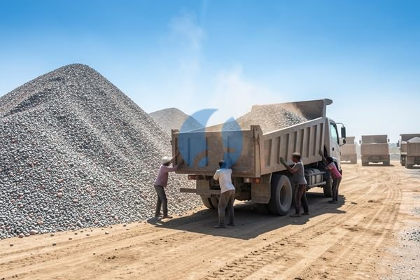

**Cek Harga Batu Gunung 1 Ret sebelum Menyusun Anggaran** - Mitra Sumber Material yang berbahagia, sedang mencari informasi harga batu gunung 1 ret untuk proyek Anda? Kami siap membantu menyiapkan kebutuhan material bangunan Anda, termasuk batu gunung dengan kualitas terbaik dan pengiriman tepat waktu ke lokasi proyek Anda di Jabodetabek dan sekitarnya.



Batu gunung 1 ret adalah material konstruksi yang sangat penting, terutama untuk pondasi, drainase, dan pekerjaan struktur lainnya. Harga batu gunung ini bervariasi tergantung ukuran, kualitas, dan lokasi. Nah, daripada bingung mencari-cari, yuk kita bahas lebih lanjut apa saja pertimbangan penting sebelum membeli, jenis batu gunung yang tersedia, serta bagaimana Sumber Material bisa menjadi solusi kebutuhan Anda.

## Mengapa Memilih Batu Gunung 1 Ret untuk Proyek Anda?

Mitra, batu gunung 1 ret punya beberapa keunggulan yang membuatnya banyak dicari. Selain kuat dan tahan lama, batu gunung juga relatif ekonomis dibandingkan material lain seperti batu kali atau batu split. Namun, penting untuk memilih supplier yang terpercaya agar kualitas batu gunung yang diterima sesuai harapan. Kalau Anda ragu, jangan sungkan untuk meminta contoh material ke Kami.

Memilih batu gunung yang tepat bisa menghemat biaya proyek Anda dalam jangka panjang. Misalnya, untuk pondasi, batu gunung yang kokoh akan meminimalkan risiko kerusakan dan biaya perbaikan di kemudian hari. Kami di Sumber Material siap memberikan konsultasi gratis untuk membantu Anda menentukan jenis dan ukuran batu gunung yang paling sesuai dengan kebutuhan proyek Anda.

## Jenis Batu Gunung 1 Ret yang Tersedia di Sumber Material

Kami menyediakan berbagai jenis batu gunung 1 ret dengan ukuran dan kualitas yang berbeda-beda. Secara umum, batu gunung yang Kami jual dikategorikan berdasarkan ukuran dan bentuknya. Biasanya, ukuran 1 ret mengacu pada diameter sekitar 5-15 cm.

Berikut beberapa pilihan yang tersedia:

- **Batu Gunung Cor:** Cocok untuk campuran beton, memberikan kekuatan ekstra pada struktur bangunan.
- **Batu Gunung Kali:** Ideal untuk drainase, pondasi, dan pembuatan jalan setapak. Bentuknya lebih pipih dan tidak terlalu tajam.
- **Batu Gunung Pecah:** Sering digunakan untuk lapisan pondasi bawah (base course) dan urugan.
- **Batu Gunung Alam:** Untuk aplikasi dekoratif seperti dinding batu atau taman.

Untuk proyek besar, Kami juga menyediakan layanan penyewaan alat berat seperti excavator dan dump truck untuk membantu mempercepat proses pengiriman dan pemasangan batu gunung.

## Keuntungan Memesan Batu Gunung 1 Ret di Sumber Material

Mitra Sumber Material, kenapa harus pesan batu gunung 1 ret di Kami? Pertama, Kami berlokasi strategis di Bogor, Jakarta, Bekasi, Karawang, Tangerang, dan Cikarang. Artinya, pengiriman lebih cepat dan biaya transportasi lebih efisien. Kedua, Kami menyediakan jasa urug dan jasa cor yang bisa memudahkan proyek Anda.

Selain itu, Kami memahami betul kebutuhan mendesak dalam proyek konstruksi. Anda bisa langsung menanyakan ketersediaan stok dan jadwal pengiriman lewat Telepon atau WhatsApp. Harga batu gunung 1 ret yang Kami tawarkan juga kompetitif. Meskipun harga ini bersifat estimasi dan dapat berubah sewaktu-waktu — hubungi Kami untuk penawaran terbaru dan paling akurat sesuai kebutuhan proyek Mitra. Kami selalu berusaha memberikan yang terbaik untuk kelancaran proyek Anda.

## Mudah dan Cepat: Cara Pesan Batu Gunung 1 Ret dari Sumber Material

Memesan batu gunung 1 ret dari Kami sangat mudah! Cukup hubungi Kami melalui tombol **WhatsApp** atau **Telepon** di bawah. Kirim kebutuhan dan lokasi proyek Anda, dan Kami akan bantu hitungkan volume material yang dibutuhkan serta estimasi biaya pengiriman. Anda juga bisa langsung menanyakan ketersediaan stok dan mendapatkan penawaran spesial untuk proyek besar.

Mau tahu harga terbaru untuk kebutuhan proyek Mitra Sumber Material? Klik tombol **WhatsApp** atau **Telepon** di bawah, kirim kebutuhan dan lokasi proyek, Kami bantu hitungkan.

ARTIKEL_SELESAI

## Hitung Kebutuhan Batu Gunung 1 Ret untuk Proyek Anda: Contoh Praktis

Mitra, seringkali kita kesulitan memperkirakan berapa banyak batu gunung 1 ret yang dibutuhkan untuk suatu proyek. Jangan khawatir, Kami akan berikan contoh perhitungan sederhana agar Anda bisa lebih akurat dalam menyusun anggaran.

Misalkan Anda akan membuat pondasi untuk rumah ukuran 8x10 meter dengan tinggi 80 cm. Pondasi akan menggunakan batu gunung 1 ret sebagai lapisan dasar dengan ketebalan 10 cm. Untuk menghitung volumenya, kita perlu menghitung luas pondasi terlebih dahulu:

- Luas pondasi = Panjang x Lebar = 8 meter x 10 meter = 80 m²
- Volume batu gunung = Luas pondasi x Ketebalan lapisan = 80 m² x 0.1 meter = 8 m³

Perhitungan ini bersifat estimasi. Kami sarankan untuk berkonsultasi dengan ahli konstruksi atau tim Kami untuk mendapatkan perhitungan yang lebih presisi sesuai dengan desain dan kondisi lapangan proyek Anda.

## Memilih Batu Gunung 1 Ret: Hindari Kesalahan Umum Ini

Mitra Sumber Material, ada beberapa kesalahan umum yang sering terjadi saat memilih batu gunung 1 ret. Mengetahui kesalahan ini bisa membantu Anda menghemat biaya dan waktu.

Pertama, jangan hanya fokus pada harga murah. Kualitas batu gunung sangat berpengaruh pada kekuatan dan ketahanan struktur bangunan Anda. Pilihlah supplier yang terpercaya dan bisa menjamin kualitas materialnya. Kedua, perhatikan ukuran dan bentuk batu gunung. Pastikan ukuran dan bentuknya sesuai dengan kebutuhan proyek Anda. Terlalu kecil atau terlalu besar bisa menyulitkan proses pemasangan dan mengurangi efisiensi penggunaan material. Ketiga, jangan abaikan faktor transportasi. Biaya transportasi bisa menjadi signifikan, terutama jika lokasi proyek Anda jauh dari sumber material.

## Pertanyaan Umum Seputar Batu Gunung 1 Ret

Banyak Mitra yang menanyakan beberapa hal terkait batu gunung 1 ret. Berikut beberapa pertanyaan yang sering Kami terima:

### Berapa Daya Tahan Batu Gunung 1 Ret?

Daya tahan batu gunung 1 ret sangat baik, terutama jika dipasang dengan benar dan dirawat secara berkala. Batu gunung secara alami tahan terhadap cuaca ekstrem, abrasi, dan tekanan. Dengan perawatan yang tepat, batu gunung bisa bertahan hingga puluhan tahun.

### Apakah Batu Gunung 1 Ret Membutuhkan Perawatan Khusus?

Secara umum, batu gunung 1 ret tidak membutuhkan perawatan khusus. Namun, untuk menjaga penampilannya tetap bersih dan menarik, Anda bisa membersihkannya secara berkala dengan air dan sabun ringan. Hindari penggunaan bahan kimia keras yang bisa merusak permukaan batu.

### Bagaimana Cara Memastikan Kualitas Batu Gunung 1 Ret?

Pastikan Anda membeli dari supplier yang terpercaya dan memiliki reputasi baik. Periksa secara visual kondisi batu gunung. Pilih batu yang tidak retak, tidak lapuk, dan memiliki bentuk yang solid. Jika memungkinkan, mintalah contoh material untuk diuji coba.

### Apa Saja Aplikasi Umum Batu Gunung 1 Ret Selain Pondasi?

Selain pondasi, batu gunung 1 ret juga banyak digunakan untuk drainase, pembuatan jalan setapak, tembok penahan tanah, dan aplikasi dekoratif seperti dinding batu atau taman. Fleksibilitas penggunaannya membuat batu gunung 1 ret menjadi pilihan populer di berbagai proyek konstruksi.

## Memahami Tingkatan Batu Gunung 1 Ret: Apa Bedanya?

Mitra, seringkali ada perbedaan kualitas pada batu gunung 1 ret yang beredar di pasaran. Perbedaan ini biasanya berkaitan dengan tingkat kekerasan dan porositas batu. Batu gunung dengan tingkat kekerasan yang lebih tinggi akan lebih tahan terhadap abrasi dan benturan. Sementara itu, porositas batu mempengaruhi kemampuannya menyerap air. Semakin tinggi porositasnya, semakin rentan batu tersebut terhadap kerusakan akibat pembekuan dan pencairan air. Kami di Sumber Material hanya menyediakan batu gunung 1 ret dengan kualitas terjamin, yang telah melalui proses seleksi ketat untuk memastikan kekerasan dan porositasnya sesuai standar.

## Pertanyaan Lain yang Sering Diajukan

### Apakah Batu Gunung 1 Ret Cocok untuk Area Berair?

Ya, batu gunung 1 ret cocok digunakan di area berair seperti drainase atau tepi sungai, asalkan dipilih yang memiliki porositas rendah. Kami bisa bantu memilihkan jenis yang tepat.

### Bagaimana Cara Menyimpan Batu Gunung 1 Ret dengan Benar?

Simpan batu gunung 1 ret di area yang kering dan terlindung dari hujan. Tumpuk secara teratur agar tidak mudah ambruk dan merusak material.

### Apakah Batu Gunung 1 Ret Bisa Digunakan untuk Jalan Masuk Kendaraan?

Bisa, Mitra. Namun, pastikan lapisan dasar di bawahnya dipadatkan dengan baik untuk menahan beban kendaraan. Batu gunung 1 ret yang berukuran lebih besar dan memiliki bentuk yang saling mengunci lebih ideal untuk aplikasi ini.
