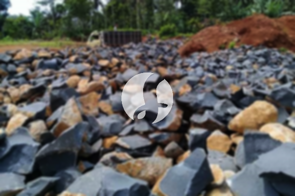

**Hal yang Memengaruhi Harga Batu Hitam untuk Pondasi di Lapangan** - Mitra Sumber Material, seringkali Mitra menghadapi kebingungan saat memilih material untuk pondasi bangunan. Banyak yang akhirnya membeli batu hitam dengan kualitas kurang sesuai atau bahkan terlalu mahal karena kurangnya informasi. Nah, Kami di Sumber Material hadir untuk membantu Anda mendapatkan batu hitam berkualitas terbaik dengan harga yang kompetitif, langsung dikirim ke lokasi proyek Anda di wilayah Jabodetabek dan sekitarnya.



## Memilih Batu Hitam yang Tepat untuk Pondasi Bangunan Anda

Mitra Sumber Material, pondasi adalah tulang punggung bangunan. Memilih batu hitam yang tidak tepat bisa berakibat fatal, seperti retak-retak atau bahkan ambruk di kemudian hari. Ada beberapa hal penting yang perlu diperhatikan. Pertama, perhatikan ukuran batu hitam yang dibutuhkan. Ukuran standar untuk pondasi biasanya berkisar antara 15-20 cm. Kedua, perhatikan kualitas batu hitam. Pilih batu hitam yang keras, padat, dan tidak mudah lapuk. Ketiga, bandingkan harga dari beberapa supplier. Jangan terpaku pada harga murah, tetapi perhatikan juga kualitasnya. Kami memahami bahwa memilih material pondasi bisa jadi rumit, jadi jangan ragu untuk konsultasi dengan tim Kami. Kami siap membantu menghitung kebutuhan batu hitam sesuai desain bangunan Anda dan memberikan penawaran terbaik.

## Jenis Batu Hitam yang Tersedia di Sumber Material

Kami menyediakan berbagai jenis batu hitam untuk pondasi, disesuaikan dengan kebutuhan proyek Anda. Ada batu hitam belah, batu hitam mesin, dan batu hitam kali. Batu hitam belah umumnya memiliki bentuk yang tidak beraturan dan cocok untuk pondasi yang membutuhkan kekuatan ekstra. Batu hitam mesin lebih rapi dan seragam, ideal untuk konstruksi yang membutuhkan tampilan yang lebih estetis. Sementara itu, batu hitam kali memiliki ukuran yang lebih kecil dan sering digunakan untuk pondasi rumah tinggal atau bangunan sederhana.

Selain jenisnya, Kami juga menyediakan berbagai ukuran dan mutu batu hitam. Untuk pondasi rumah 1 atau 2 lantai, batu hitam dengan ukuran 15-20 cm biasanya sudah cukup. Namun, untuk bangunan yang lebih tinggi atau lahan yang kurang stabil, Kami sarankan menggunakan batu hitam dengan ukuran yang lebih besar atau mutu yang lebih tinggi. Kami juga menyediakan jasa pemasangan batu hitam pondasi, jadi Anda tidak perlu repot mencari tukang.

## Keuntungan Memesan Batu Hitam di Sumber Material

Mitra Sumber Material, kenapa harus pesan batu hitam di Sumber Material? Pertama, Kami menyediakan material berkualitas tinggi yang terjamin kekuatannya. Kami hanya bekerja sama dengan supplier terpercaya yang memiliki reputasi baik. Kedua, Kami menawarkan harga yang kompetitif. Kami dapat meminimalkan biaya operasional Kami sehingga Kami bisa memberikan harga terbaik kepada Anda. Ketiga, Kami memberikan layanan pengiriman langsung ke lokasi proyek Anda di wilayah Jabodetabek dan sekitarnya. Anda tidak perlu repot mengurus transportasi sendiri — Kami yang akan mengantarkan batu hitam sampai ke lokasi proyek Anda. Keempat, Kami memiliki stok yang selalu tersedia. Anda tidak perlu khawatir kehabisan material saat dibutuhkan. Kelima, Kami siap membantu Anda menghitung kebutuhan batu hitam secara akurat, sehingga Anda tidak perlu membeli terlalu banyak atau terlalu sedikit.

## Pesan Batu Hitam Pondasi Sekarang Juga

## Estimasi Kebutuhan Batu Hitam untuk Pondasi: Contoh Perhitungan Praktis

Mitra Sumber Material, seringkali yang membuat proyek tertunda adalah ketidakpastian jumlah material yang dibutuhkan. Mari kami berikan contoh perhitungan kebutuhan batu hitam untuk pondasi rumah sederhana berukuran 6x8 meter dengan tinggi pondasi 80 cm dan lebar pondasi 50 cm.

Pertama, hitung volume pondasi: Panjang x Lebar x Tinggi = 6m x 8m x 0.8m = 38.4 m³. Selanjutnya, kita perlu memperhitungkan ruang untuk urugan pasir dan kerikil di bawah pondasi. Asumsikan ketebalan urugan 10 cm (0.1m), maka volume urugan adalah 6m x 8m x 0.1m = 4.8 m³. Total volume yang perlu digali dan diisi adalah 38.4 m³ + 4.8 m³ = 43.2 m³.

Ini adalah estimasi kasar, ya. Kondisi lapangan bisa berbeda-beda. Lebih baik lagi jika Anda berkonsultasi dengan Kami, karena Kami dapat membantu menghitung kebutuhan material secara presisi berdasarkan desain bangunan Anda. Kami juga menyediakan layanan pengiriman langsung ke lokasi proyek Anda, jadi Anda tidak perlu repot mengurus transportasi sendiri.

## Pertanyaan Umum Seputar Batu Hitam untuk Pondasi

Mitra Sumber Material, seringkali ada beberapa pertanyaan yang muncul sebelum Anda memutuskan untuk membeli batu hitam. Berikut adalah beberapa pertanyaan yang paling sering Kami terima:

### Berapa Daya Tahan Batu Hitam untuk Pondasi?

Daya tahan batu hitam sangat bergantung pada kualitas batu itu sendiri dan cara pemasangannya. Batu hitam yang berkualitas baik, padat, dan tidak mudah lapuk dapat bertahan hingga bertahun-tahun, bahkan puluhan tahun. Pastikan juga pemasangan dilakukan dengan benar dan menggunakan campuran semen yang berkualitas.

### Apakah Batu Hitam Cocok untuk Semua Jenis Tanah?

Batu hitam cocok untuk sebagian besar jenis tanah, tetapi ada beberapa hal yang perlu diperhatikan. Jika tanah di lokasi proyek Anda berpasir atau berlempung, Kami sarankan untuk menggunakan batu hitam dengan ukuran yang lebih besar atau menambahkan lapisan urugan yang lebih tebal. Untuk tanah yang kurang stabil, konsultasikan dengan ahli konstruksi untuk mendapatkan rekomendasi yang tepat.

### Bagaimana Cara Merawat Batu Hitam Setelah Dipasang?

Perawatan batu hitam relatif sederhana. Pastikan tidak ada genangan air di sekitar pondasi, karena air dapat menyebabkan erosi dan merusak struktur pondasi. Bersihkan batu hitam secara berkala dari kotoran dan lumut. Jika ada retakan, segera perbaiki untuk mencegah kerusakan yang lebih parah.

### Apa Perbedaan Batu Hitam Kali dengan Batu Hitam Mesin?

Perbedaan utama terletak pada bentuk dan proses pembuatannya. Batu hitam kali adalah batu alam yang diambil langsung dari alam dengan bentuk tidak beraturan. Sementara itu, batu hitam mesin adalah batu yang dipotong dan dibentuk menggunakan mesin, sehingga menghasilkan bentuk yang lebih rapi dan seragam. Pemilihan tergantung pada preferensi estetika dan kebutuhan proyek Anda.

## Hindari Kesalahan Umum Saat Membeli Batu Hitam

Mitra Sumber Material, membeli batu hitam tanpa perencanaan yang matang bisa berakibat fatal. Salah satu kesalahan umum yang sering Kami temui adalah membeli batu hitam dengan kualitas rendah hanya karena harganya murah. Ingat, kualitas adalah yang utama dalam pembangunan pondasi. Kesalahan lainnya adalah kurang memperhitungkan volume yang dibutuhkan, sehingga mengakibatkan kekurangan material di tengah proyek.

Pastikan juga Anda membeli batu hitam dari supplier terpercaya yang dapat menjamin kualitas materialnya. Jangan ragu untuk meminta contoh batu hitam sebelum membeli dalam jumlah besar. Kami di Sumber Material selalu siap memberikan contoh material kepada Anda. Kami juga memberikan saran dan rekomendasi berdasarkan pengalaman Kami dalam menyediakan material bangunan untuk berbagai proyek. Dengan perencanaan yang tepat dan material yang berkualitas, pondasi bangunan Anda akan kokoh dan tahan lama.

## Memahami Pengaruh Ukuran Batu Hitam terhadap Kekuatan Pondasi

Mitra Sumber Material, ukuran batu hitam yang Anda pilih akan sangat memengaruhi kekuatan dan stabilitas pondasi. Semakin besar ukuran batu, umumnya semakin baik daya dukungnya. Namun, ada juga batasan praktisnya. Batu hitam yang terlalu besar akan sulit dipasang dan membutuhkan tenaga kerja yang lebih banyak. Kami sarankan untuk berkonsultasi dengan ahli konstruksi untuk menentukan ukuran batu hitam yang paling sesuai dengan kondisi tanah dan desain bangunan Anda. Jangan ragu untuk bertanya kepada Kami, karena Kami punya pengalaman dalam memberikan solusi terbaik untuk berbagai jenis proyek.

### Perbandingan Ukuran Batu Hitam dan Daya Dukung

Berikut gambaran kasar pengaruh ukuran batu hitam terhadap daya dukung:

- **Batu Hitam Kecil (5-10 cm):** Cocok untuk bangunan ringan seperti pagar atau dinding penahan tanah.
- **Batu Hitam Menengah (10-15 cm):** Ideal untuk pondasi rumah tinggal sederhana 1-2 lantai.
- **Batu Hitam Besar (15-20 cm atau lebih):** Direkomendasikan untuk bangunan bertingkat atau pondasi yang membutuhkan kekuatan ekstra.

### Memilih Ukuran yang Tepat: Pertimbangkan Kondisi Tanah

Jika tanah di lokasi proyek Anda kurang stabil, Kami sarankan untuk menggunakan batu hitam dengan ukuran yang lebih besar. Ukuran yang lebih besar akan memberikan daya dukung yang lebih baik dan mencegah pondasi mengalami penurunan. Sebaliknya, jika tanahnya stabil, Anda bisa menggunakan batu hitam dengan ukuran yang lebih kecil.

## Tanya Jawab Seputar Pemesanan Batu Hitam di Sumber Material

Mitra Sumber Material, berikut beberapa pertanyaan yang sering Kami terima terkait pemesanan batu hitam:

### Berapa Lama Waktu Pengiriman?

Waktu pengiriman tergantung pada lokasi proyek Anda dan ketersediaan stok. Umumnya, Kami dapat mengirimkan pesanan dalam 1-3 hari kerja setelah konfirmasi pembayaran.

### Apakah Bisa Memesan dalam Jumlah Kecil?

Tentu saja. Kami melayani pemesanan dalam jumlah kecil maupun besar. Tidak ada batasan minimum order.

### Bagaimana Jika Saya Membutuhkan Bantuan untuk Menghitung Kebutuhan Batu Hitam?

Kami siap membantu Anda menghitung kebutuhan batu hitam secara akurat. Cukup kirimkan denah bangunan dan spesifikasi proyek Anda lewat WhatsApp, dan tim Kami akan segera memberikan perhitungan yang tepat.

Memesan batu hitam di Sumber Material sangat mudah! Anda bisa langsung menghubungi Kami melalui tombol **WhatsApp** atau **Telepon** di bawah halaman ini untuk mendapatkan penawaran harga terbaru. Jangan tunda kebutuhan proyek Mitra Sumber Material — tanyakan harga dan ketersediaannya sekarang lewat tombol **WhatsApp** atau **Telepon** di bawah halaman ini.
