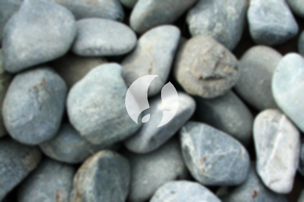

**Sebelum Membandingkan Harga Batu Kali Bulat, Cek Dulu Hal Ini** - Mitra Sumber Material yang berbahagia, jUDUL: Sebelum Membandingkan Harga Batu Kali Bulat, Cek Dulu Hal Ini



Batu kali bulat adalah pilihan populer untuk berbagai aplikasi konstruksi, mulai dari pondasi hingga dekorasi. Nah, sebelum memutuskan, mari kita bahas lebih lanjut apa yang perlu Anda pertimbangkan.

## Memilih Batu Kali Bulat: Ukuran, Mutu, dan Kebutuhan Proyek Anda

Mitra, memilih batu kali bulat yang tepat itu penting lho. Bukan cuma soal harga, tapi juga kesesuaian dengan kebutuhan proyek Anda. Ukuran batu kali bulat bervariasi, biasanya mulai dari diameter 5 cm hingga 15 cm, bahkan lebih besar. Semakin besar ukuran batu, biasanya semakin mahal harganya. Pertimbangkan fungsi batu kali bulat dalam proyek Anda. Untuk pondasi, ukuran yang lebih besar mungkin lebih ideal karena memberikan kekuatan yang lebih baik. Sedangkan untuk dekorasi taman atau landscape, ukuran yang lebih kecil akan lebih estetis.

Selain ukuran, mutu batu kali bulat juga perlu diperhatikan. Pastikan batu yang Anda pilih kuat, tidak mudah lapuk, dan bebas dari kotoran atau lumpur. Batu kali bulat berkualitas baik akan tahan lama dan meminimalkan risiko kerusakan pada bangunan Anda. Kalau Anda masih bingung menentukan pilihan, jangan ragu untuk konsultasi dengan Kami. Kami akan bantu merekomendasikan jenis batu kali bulat yang paling sesuai dengan anggaran dan kebutuhan proyek Anda.

## Jenis Batu Kali Bulat dan Aplikasinya di Proyek Anda

Ada beberapa jenis batu kali bulat yang umum digunakan dalam konstruksi. Beberapa di antaranya adalah batu kali bulat dari sungai, batu kali bulat dari pegunungan, dan batu kali bulat hasil pemecahan. Batu kali bulat dari sungai biasanya memiliki bentuk yang lebih halus dan bulat sempurna, sedangkan batu kali bulat dari pegunungan cenderung lebih kasar dan memiliki sudut yang tajam. Batu kali bulat hasil pemecahan biasanya memiliki bentuk yang tidak beraturan.

Nah, masing-masing jenis batu kali bulat ini memiliki kelebihan dan kekurangan tersendiri. Batu kali bulat dari sungai cocok untuk aplikasi yang membutuhkan estetika tinggi, seperti kolam renang atau taman. Batu kali bulat dari pegunungan cocok untuk aplikasi yang membutuhkan kekuatan tinggi, seperti pondasi atau dinding penahan tanah. Sedangkan batu kali bulat hasil pemecahan cocok untuk aplikasi yang membutuhkan volume besar dengan harga yang lebih terjangkau.

Kami di Sumber Material menyediakan berbagai jenis batu kali bulat dengan kualitas terjamin. Kami bisa menyediakan batu kali bulat dengan ukuran dan mutu sesuai dengan spesifikasi proyek Anda. Misalnya, untuk pondasi rumah 2 lantai, Kami rekomendasikan batu kali bulat dengan diameter 10-15 cm dan mutu yang terjamin kuat. Untuk taman, batu kali bulat berukuran 5-8 cm dengan warna yang menarik akan memberikan sentuhan alami yang indah.

## Keuntungan Memesan Batu Kali Bulat di Sumber Material

Mitra Sumber Material, kenapa harus pesan batu kali bulat di Kami? Pertama, Kami menawarkan kemudahan dalam pemesanan. Anda cukup kirim kebutuhan dan lokasi proyek Anda lewat WhatsApp, lalu Kami bantu hitungkan total material yang dibutuhkan. Tidak perlu repot-repot datang ke toko atau menghitung manual! Kami juga melayani pengiriman langsung ke lokasi proyek Anda di wilayah Jabodetabek dan sekitarnya.

Kedua, Kami berkomitmen untuk menyediakan material berkualitas. Kami hanya bekerja sama dengan supplier terpercaya yang menghasilkan batu kali bulat dengan mutu terbaik. Kami juga memastikan bahwa batu kali bulat yang Kami jual bebas dari kotoran dan lumpur. Ketiga, Kami memberikan pelayanan yang ramah dan profesional. Tim Kami siap membantu Anda memilih jenis batu kali bulat yang tepat dan memberikan solusi terbaik untuk kebutuhan proyek Anda. Berlokasi di Bogor, Jakarta, Bekasi, Karawang, dan Tangerang, Kami siap melayani Anda.

## Pesan Batu Kali Bulat Sekarang Juga!

Sebagai tambahan, Kami juga menyediakan material bangunan lainnya seperti pasir, batu split, besi beton, dan baja ringan. Jika Anda membutuhkan material lain selain batu kali bulat, jangan ragu untuk bertanya kepada Kami. Kami akan memberikan penawaran terbaik untuk semua kebutuhan konstruksi Anda. Kami juga menyediakan jasa sewa alat berat dan jasa urug untuk memudahkan proyek Anda.

## Menghitung Kebutuhan Batu Kali Bulat: Contoh Praktis untuk Proyek Anda

Mitra Sumber Material yang berbahagia, seringkali menghitung kebutuhan batu kali bulat terasa membingungkan. Nah, Kami akan berikan contoh perhitungan sederhana agar Anda punya gambaran yang lebih jelas. Misalnya, Anda ingin membuat pondasi rumah dengan luas 9 meter x 7 meter, dan kedalaman galian 80 cm. Asumsikan kita menggunakan batu kali bulat dengan diameter rata-rata 10 cm.

### Meminimalkan Pemborosan Batu Kali Bulat

Mitra, ada beberapa hal yang bisa Anda lakukan untuk meminimalkan pemborosan batu kali bulat. Pertama, pastikan Anda memesan jumlah yang tepat. Jangan terlalu banyak, karena akan membuang-buang biaya dan ruang penyimpanan. Kedua, susun batu kali bulat secara efisien. Hindari meninggalkan celah yang terlalu besar antara batu-batu tersebut. Ketiga, gunakan batu kali bulat yang lebih kecil untuk mengisi celah-celah kosong. Dengan melakukan hal ini, Anda bisa menghemat biaya dan mengurangi jumlah material yang dibutuhkan.

## Pertanyaan Umum Tentang Batu Kali Bulat (FAQ)

Banyak Mitra Sumber Material yang menanyakan hal serupa, jadi Kami rangkum beberapa pertanyaan umum yang sering muncul:

### Berapa Daya Tahan Batu Kali Bulat?

Daya tahan batu kali bulat sangat bervariasi tergantung jenis batuan dan kualitasnya. Secara umum, batu kali bulat yang berkualitas baik bisa bertahan hingga puluhan tahun. Namun, faktor lingkungan seperti kelembapan dan paparan sinar matahari juga bisa mempengaruhi daya tahannya.

### Apakah Batu Kali Bulat Cocok untuk Area Berair?

Ya, batu kali bulat sangat cocok untuk area berair seperti kolam renang atau drainase. Batu ini tidak mudah lapuk dan memiliki daya serap air yang rendah. Pastikan Anda memilih jenis batu kali bulat yang tahan terhadap air dan tidak mudah berlumut.

### Bagaimana Cara Membersihkan Batu Kali Bulat?

Membersihkan batu kali bulat cukup mudah. Anda bisa menggunakan sikat dan air bersih untuk menghilangkan kotoran dan lumpur. Untuk noda yang membandel, Anda bisa menggunakan sabun cuci piring yang lembut. Hindari menggunakan bahan kimia keras yang bisa merusak permukaan batu.

### Apakah Batu Kali Bulat Perlu Perawatan Khusus?

Secara umum, batu kali bulat tidak memerlukan perawatan khusus. Namun, untuk menjaga penampilannya tetap menarik, Anda bisa melapisi batu dengan sealant atau pelapis anti-lumut. Ini akan membantu melindungi batu dari kerusakan dan menjaga warna aslinya.

## Langkah-Langkah Mudah Memesan Batu Kali Bulat dari Sumber Material

Mitra, proses pemesanan di Kami sangat mudah dan cepat. Pertama, hubungi Kami lewat WhatsApp atau Telepon. Sampaikan kebutuhan Anda secara detail, termasuk jenis batu kali bulat, ukuran, jumlah, dan lokasi proyek. Kedua, tim Kami akan membantu menghitung total biaya dan memberikan penawaran terbaik. Ketiga, setelah Anda menyetujui penawaran, Kami akan mengatur pengiriman ke lokasi proyek Anda. Kami melayani pengiriman ke seluruh wilayah Jabodetabek dan sekitarnya. Kami pastikan material sampai di lokasi proyek Anda dengan aman dan tepat waktu.

## Memahami Perbedaan Batu Kali Bulat Alam vs. Buatan

Mitra, mungkin Anda bertanya-tanya, apakah ada perbedaan signifikan antara batu kali bulat yang berasal dari alam dan yang dibuat secara artifisial? Nah, ada beberapa hal yang perlu Anda ketahui. Batu kali bulat alam, seperti yang Kami sediakan, terbentuk secara alami melalui proses erosi sungai atau laut. Bentuknya cenderung lebih bervariasi dan unik, dengan tekstur yang alami dan tahan lama. Sementara itu, batu kali bulat buatan biasanya dibuat dengan mesin dan memiliki bentuk yang lebih seragam.

### Kelebihan dan Kekurangan Masing-Masing Jenis

Batu kali bulat alam menawarkan estetika yang lebih natural dan cocok untuk proyek yang mengutamakan tampilan alami. Namun, harganya mungkin sedikit lebih mahal dibandingkan batu buatan. Batu kali bulat buatan, di sisi lain, lebih terjangkau dan bentuknya lebih konsisten. Namun, teksturnya mungkin kurang alami dan daya tahannya tidak sebaik batu alam.

## Pertanyaan Lain yang Sering Diajukan Pembeli

Banyak Mitra Sumber Material yang menghubungi Kami dengan pertanyaan seputar aplikasi batu kali bulat. Berikut beberapa pertanyaan umum yang sering muncul:

### Apakah Batu Kali Bulat Cocok untuk Area yang Sering Tergenang Air?

Ya, batu kali bulat sangat cocok untuk area yang sering tergenang air karena permukaannya yang berpori memungkinkan air meresap dengan mudah.

### Bagaimana Cara Memastikan Batu Kali Bulat yang Saya Beli Tidak Mudah Rusak?

Pastikan Anda memilih batu kali bulat dengan kualitas yang baik dan tidak mudah lapuk. Perhatikan juga teksturnya – batu yang terlalu rapuh sebaiknya dihindari.

### Apakah Batu Kali Bulat Bisa Digunakan untuk Membuat Jalan Setapak?

Tentu saja! Batu kali bulat sangat ideal untuk membuat jalan setapak yang alami dan tahan lama. Susun batu secara rapat dan isi celah dengan pasir atau kerikil.

Mau tahu harga terbaru untuk kebutuhan proyek Mitra Sumber Material? Klik tombol **WhatsApp** atau **Telepon** di bawah, kirim kebutuhan dan lokasi proyek, Kami bantu hitungkan.
