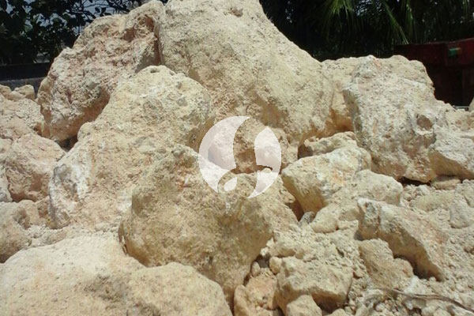

**Harga Batu Kapur per Kubik dan Faktor yang Memengaruhinya** - Mitra Sumber Material di mana pun berada, pernahkah Anda mengalami kesulitan mencari batu kapur yang sesuai kebutuhan proyek? Terlebih lagi, harga yang bervariasi di pasaran seringkali membuat bingung dan khawatir salah beli. Nah, Kami di Sumber Material siap membantu memastikan Anda mendapatkan batu kapur berkualitas dengan harga terbaik dan spesifikasi yang pas.



Sebagai kontraktor atau pemilik rumah yang berencana membangun atau merenovasi, memilih material yang tepat itu krusial. Batu kapur, misalnya, punya banyak fungsi, mulai dari bahan dasar konstruksi, material finishing, hingga bahan baku industri. Tapi, jenis dan kualitas batu kapur sangat beragam. Salah pilih bisa berakibat fatal – struktur bangunan jadi kurang kuat, hasil akhir tidak memuaskan, atau bahkan biaya proyek membengkak karena harus mengganti material.

## Pertimbangan Penting Sebelum Membeli Batu Kapur

Mitra Sumber Material, sebelum membahas lebih jauh soal harga, ada beberapa hal yang perlu Anda pertimbangkan. Pertama, tentukan jenis batu kapur yang dibutuhkan. Ada batu kapur putih, abu-abu, atau bahkan yang bercorak. Setiap jenis punya karakteristik dan kegunaan berbeda. Kedua, perhatikan ukuran dan bentuknya. Apakah Anda butuh batu kapur galian, split, atau yang sudah dipotong sesuai ukuran? Ketiga, kualitas atau mutu batu kapur sangat penting. Semakin tinggi mutunya, semakin kuat dan tahan lama material tersebut.

Memilih batu kapur yang tepat memang butuh pengetahuan khusus. Nah, kalau Anda masih bingung, jangan ragu konsultasi dengan Kami. Kami bantu analisis kebutuhan proyek Anda dan merekomendasikan jenis batu kapur yang paling sesuai. Tanyakan harga terbaru dan spesifikasi lengkapnya lewat tombol **WhatsApp** atau **Telepon** di bawah halaman ini.

## Jenis Batu Kapur yang Tersedia di Sumber Material

Kami di Sumber Material menyediakan berbagai jenis batu kapur untuk memenuhi kebutuhan proyek Anda. Berikut beberapa di antaranya:

- **Batu Kapur Galian:** Ideal untuk pondasi, dinding, atau lantai dasar. Harganya relatif terjangkau, tapi perlu proses pemotongan dan perapian lebih lanjut.
- **Batu Kapur Split:** Sudah dipotong menjadi ukuran yang lebih kecil dan seragam, memudahkan proses pemasangan. Cocok untuk jalan setapak, taman, atau lansekap.
- **Batu Kapur Ukur:** Dipotong presisi sesuai ukuran yang Anda inginkan, sangat pas untuk finishing fasad, pilar, atau elemen dekoratif.
- **Batu Kapur Putih:** Material pilihan untuk estetika bangunan modern, sering dipakai untuk dinding, lantai, atau aksen dekoratif.

Untuk proyek yang membutuhkan kekuatan ekstra, Kami juga menyediakan batu kapur dengan mutu tinggi yang telah teruji kekuatannya. Kami bisa menyesuaikan ukuran dan bentuknya sesuai permintaan Anda. Misalnya, butuh batu kapur split ukuran 20/40 untuk lapisan drainase? Atau butuh batu kapur ukur dengan ketebalan 5 cm untuk dinding eksterior? Kami siap melayani.

## Mengapa Memesan Batu Kapur di Sumber Material?

Mitra, kenapa harus memilih Kami sebagai supplier batu kapur Anda? Pertama, Kami memberikan konsultasi gratis sebelum Anda memutuskan pembelian. Kami bantu Anda menganalisis kebutuhan proyek, memilih jenis batu kapur yang tepat, dan menghitung volume yang dibutuhkan. Dengan begitu, Anda tidak akan salah beli dan bisa menghemat biaya.

Kedua, Kami menjamin kualitas batu kapur yang Kami jual. Kami hanya bekerja sama dengan produsen terpercaya yang menghasilkan batu kapur berkualitas tinggi dan sesuai standar SNI. Ketiga, Kami melayani pengiriman ke seluruh wilayah Jabodetabek dan sekitarnya. Pesanan Anda akan sampai tepat waktu di lokasi proyek. Keempat, Kami berlokasi strategis di Bogor, Jakarta, Bekasi, Karawang, Tangerang, dan Cikarang. Kelima, Kami menyediakan jasa sewa alat berat jika Anda membutuhkan untuk proses pengangkutan atau pemasangan batu kapur.

Ingat, jangan sampai salah beli batu kapur! Konsultasikan kebutuhan Anda dengan Kami sekarang juga. Hubungi Kami melalui tombol **Telepon** atau **WhatsApp** di bawah halaman ini untuk mendapatkan penawaran terbaik.

## Cara Mudah Memesan Batu Kapur di Sumber Material

Memesan batu kapur di Kami sangat mudah dan praktis. Anda bisa melakukan pemesanan melalui dua cara:

1.  **Telepon Kami:** Hubungi Kami melalui nomor telepon yang tertera di bawah halaman ini. Tim Kami akan dengan senang hati membantu Anda memilih jenis batu kapur yang tepat dan menghitung total biaya.
2.  **WhatsApp Kami:** Kirim pesan via WhatsApp ke nomor yang sama. Sertakan detail proyek Anda (jenis bangunan, luas area, jenis batu kapur yang dibutuhkan, dan lokasi proyek). Kami akan segera membalas dengan penawaran harga dan estimasi waktu pengiriman.

Jangan tunda kebutuhan proyek Mitra Sumber Material — tanyakan harga dan ketersediaannya sekarang lewat tombol **WhatsApp** atau **Telepon** di bawah halaman ini.

ARTIKEL_SELESAI

## Menghitung Kebutuhan Batu Kapur Per Kubik untuk Proyek Anda

Mitra Sumber Material, memahami kebutuhan volume batu kapur yang tepat itu penting banget untuk menghindari kelebihan atau kekurangan material. Nah, Kami akan bantu dengan contoh perhitungan sederhana. Misalkan Anda akan membuat pondasi rumah dengan ukuran panjang 10 meter, lebar 8 meter, dan tinggi 0,5 meter. Volume pondasi tersebut adalah 10 m x 8 m x 0,5 m = 40 meter kubik.

Maka, volume batu kapur yang dibutuhkan adalah 40 m³ x (1 – 0,15) = 34 meter kubik. Artinya, Anda perlu memesan sekitar 34 meter kubik batu kapur untuk proyek pondasi tersebut. Jangan lupa, ini hanya contoh kasar. Sebaiknya konsultasikan dengan Kami untuk perhitungan yang lebih akurat sesuai desain dan kondisi proyek Anda.

### Memilih Ukuran Batu Kapur yang Efisien

Ukuran batu kapur juga berpengaruh pada efisiensi penggunaan material. Batu kapur dengan ukuran yang lebih besar biasanya lebih ekonomis karena mengurangi jumlah sambungan dan material pengisi. Namun, ukuran yang terlalu besar bisa menyulitkan proses pemasangan dan membutuhkan tenaga kerja yang lebih banyak.

Batu kapur split ukuran 20/40 atau 40/70 biasanya jadi pilihan populer untuk pondasi dan drainase. Sementara untuk finishing dinding, batu kapur ukur dengan ketebalan 2–4 cm lebih sering digunakan. Kami di Sumber Material menyediakan berbagai pilihan ukuran untuk menyesuaikan dengan kebutuhan spesifik proyek Anda.

## Pertanyaan Umum Seputar Batu Kapur

Mitra Sumber Material, seringkali Kami menerima pertanyaan seputar batu kapur. Berikut beberapa pertanyaan yang paling umum dan jawabannya:

### Berapa Daya Tahan Batu Kapur?

Daya tahan batu kapur bervariasi tergantung jenis dan kualitasnya. Secara umum, batu kapur cukup tahan lama jika dirawat dengan baik. Untuk aplikasi struktural, pastikan Anda memilih batu kapur dengan mutu yang sesuai standar SNI.

### Apakah Batu Kapur Mudah Lapuk?

Batu kapur memang rentan terhadap asam dan polusi udara, yang bisa menyebabkan lapuk. Tapi, Anda bisa melindungi batu kapur dengan memberikan lapisan pelindung atau waterproofing. Selain itu, pilihlah jenis batu kapur yang lebih padat dan tahan cuaca.

### Bagaimana Cara Membersihkan Batu Kapur?

Membersihkan batu kapur cukup mudah. Gunakan air bersih dan sikat lembut untuk menghilangkan debu dan kotoran. Hindari penggunaan deterjen keras atau bahan kimia abrasif yang bisa merusak permukaan batu kapur.

### Bisakah Batu Kapur Digunakan untuk Lantai?

Bisa saja, tapi perlu diperhatikan jenis batu kapur dan finishingnya. Batu kapur putih dengan permukaan yang dipoles cocok untuk lantai interior. Namun, pastikan batu kapur tersebut memiliki tingkat kekerasan yang cukup untuk menahan abrasi.

## Hindari Kesalahan Umum Saat Membeli Batu Kapur

Mitra, ada beberapa kesalahan umum yang sering dilakukan saat membeli batu kapur. Pertama, tidak memperhatikan mutu batu kapur. Pastikan batu kapur yang Anda beli memenuhi standar SNI dan bebas dari retakan atau cacat lainnya. Kedua, salah menghitung kebutuhan volume. Hal ini bisa menyebabkan kelebihan atau kekurangan material, yang tentunya akan merugikan Anda. Ketiga, tidak mempertimbangkan faktor porositas batu kapur. Seperti yang Kami jelaskan sebelumnya, porositas bisa memengaruhi volume efektif batu kapur yang dibutuhkan. Keempat, tergiur harga murah tanpa memperhatikan kualitas. Ingat, kualitas material lebih penting daripada harga yang murah. Kami sarankan untuk selalu membandingkan beberapa supplier dan memastikan Anda mendapatkan produk berkualitas dengan harga yang wajar.
