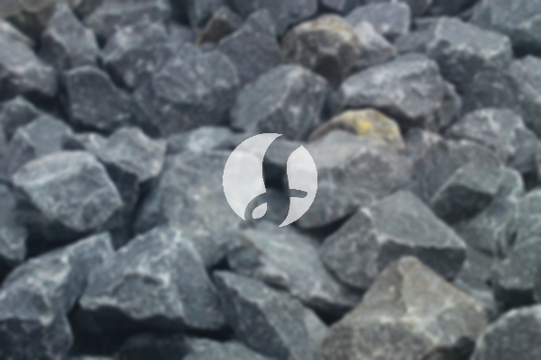

**Cara Menyusun Anggaran dari Harga Batu Pondasi 1 Truk di Cirebon** - Mitra Sumber Material yang berbahagia, apakah Anda sedang merencanakan pembangunan atau renovasi di Cirebon dan mencari informasi harga batu pondasi per truk? Kami mengerti betul, mencari material bangunan berkualitas dengan harga yang pas memang membutuhkan waktu dan tenaga. Nah, di artikel ini Kami akan bantu Anda mendapatkan gambaran harga terkini, sekaligus menjelaskan jenis batu pondasi yang cocok untuk proyek Anda.



Mitra, seringkali pemilik rumah atau kontraktor di Cirebon kesulitan memesan batu pondasi karena takut salah pilih kualitas atau kena harga mahal. Belum lagi urusan transportasi yang bikin pusing. Sumber Material hadir untuk menjadi solusi praktis bagi Anda. Kami menyediakan berbagai jenis batu pondasi dengan kualitas terjamin, siap dikirim ke lokasi proyek Anda di Cirebon dan sekitarnya.

## Memilih Batu Pondasi yang Tepat: Pertimbangkan Kebutuhan Proyek Anda

Sebelum membahas harga, penting untuk memahami bahwa ada beberapa jenis batu pondasi yang umum digunakan. Pilihan terbaik tergantung pada jenis tanah, beban bangunan, dan tentu saja, anggaran Anda. Secara umum, ada batu kali, batu split, dan batu gunung. Batu kali sering ditemukan di daerah aliran sungai, bentuknya tidak beraturan dan harganya relatif terjangkau. Batu split dihasilkan dari pemecahan batu gunung, bentuknya lebih seragam dan lebih kuat. Sedangkan batu gunung sendiri adalah batu alam yang diambil langsung dari pegunungan, biasanya memiliki ukuran yang lebih besar.

Nah, untuk proyek rumah tinggal sederhana, batu kali biasanya sudah cukup memadai. Namun, jika membangun bangunan bertingkat atau tanahnya kurang stabil, Kami sarankan menggunakan batu split atau batu gunung untuk memastikan kekuatan pondasi yang optimal. Bingung memilih? Jangan ragu untuk [tanyakan harga lewat WhatsApp](https://api.whatsapp.com/send?phone=6285776786091&text=*Halo%20sumbermaterial.com*%20%3A) dan konsultasikan kebutuhan proyek Anda dengan tim ahli Kami.

## Jenis Batu Pondasi yang Tersedia di Sumber Material

Kami di Sumber Material menyediakan berbagai jenis batu pondasi untuk memenuhi kebutuhan proyek Anda di Cirebon:

- **Batu Kali:** Cocok untuk pondasi rumah tinggal sederhana, biaya relatif terjangkau. Ukuran bervariasi, biasanya antara 5-15 cm.
- **Batu Split:** Ideal untuk pondasi bangunan bertingkat atau tanah yang kurang stabil. Bentuk lebih seragam, kekuatan lebih tinggi. Tersedia berbagai ukuran, mulai dari split 5/20 hingga split 20/40.
- **Batu Gunung:** Pilihan terbaik untuk proyek yang membutuhkan kekuatan pondasi maksimal. Ukuran lebih besar, cocok untuk bangunan berat atau lokasi dengan kondisi tanah kritis.

Sebagai gambaran, untuk proyek rumah tipe 45 di Cirebon, biasanya dibutuhkan sekitar 8-10 truk batu split ukuran 5/20. Kami selalu memastikan kualitas batu yang Kami jual memenuhi standar SNI, sehingga Anda tidak perlu khawatir dengan kekuatannya.

## Kenapa Memesan Batu Pondasi dari Sumber Material?

Mitra Sumber Material, ada beberapa alasan kuat mengapa Anda harus memesan batu pondasi dari Kami. Pertama, Kami menawarkan harga yang kompetitif dan transparan. Kami tidak akan memberikan harga yang terlalu tinggi atau menyembunyikan biaya tambahan. Harga batu pondasi 1 truk di Cirebon tentu saja akan bervariasi tergantung jenis batu, ukuran, dan jarak pengiriman. Namun, Kami selalu berusaha memberikan penawaran terbaik untuk Anda.

Kedua, Kami menjamin kualitas material yang Kami jual. Kami hanya bekerja sama dengan supplier terpercaya dan melakukan pengecekan kualitas secara ketat sebelum material dikirim ke lokasi proyek Anda. Ketiga, Kami melayani pengiriman ke seluruh wilayah Jabodetabek dan sekitarnya, termasuk Cirebon. Kami memiliki armada truk yang handal dan berpengalaman, siap mengantarkan pesanan Anda tepat waktu. Keempat, Kami berlokasi di Bogor, Jakarta, Bekasi, Karawang, Tangerang, dan Cikarang, sehingga memudahkan Kami untuk menjangkau proyek Anda di Cirebon.

## Pesan Batu Pondasi dengan Mudah Melalui Sumber Material

Memesan batu pondasi dari Sumber Material sangat mudah. Anda cukup menghubungi Kami melalui tombol **WhatsApp** atau **Telepon** yang tersedia di bawah halaman ini. Sampaikan jenis batu pondasi yang Anda butuhkan, ukuran, dan alamat pengiriman. Tim Kami akan segera memproses pesanan Anda dan memberikan penawaran harga terbaik. Atau, jika Anda ingin mengetahui estimasi biaya secara langsung, Anda bisa kirim kebutuhan dan lokasi proyek Anda lewat WhatsApp. Kami bantu hitungkan volume yang dibutuhkan dan berikan penawaran yang sesuai.

## Estimasi Kebutuhan Batu Pondasi: Contoh Perhitungan Sederhana

Mitra, seringkali pertanyaan yang muncul adalah, “Berapa banyak batu pondasi yang saya butuhkan untuk proyek saya?” Nah, untuk memberikan gambaran, Kami akan berikan contoh perhitungan sederhana. Anggaplah Anda akan membangun rumah dengan pondasi batu kali berukuran 8m x 10m dan kedalaman 80cm. Pertama, hitung volume pondasi: 8m x 10m x 0,8m = 64 m³.

Untuk memperkirakan jumlah truk yang dibutuhkan, kita perlu mengetahui kapasitas truk. Truk engkel biasanya memiliki kapasitas sekitar 6-8 m³, sedangkan truk double sekitar 12-16 m³. Jika kita menggunakan truk engkel dengan kapasitas 7 m³, maka jumlah truk yang dibutuhkan adalah 41,6 m³ / 7 m³/truk = sekitar 6 truk. Perlu diingat, ini hanya estimasi. Sebaiknya konsultasikan dengan Kami untuk perhitungan yang lebih akurat sesuai dengan desain pondasi dan kondisi tanah proyek Anda.

### Memperhitungkan Kehilangan Material Saat Pengerjaan

## Pertanyaan Umum Seputar Batu Pondasi

Mitra Sumber Material, seringkali ada beberapa pertanyaan yang muncul dari calon pembeli. Berikut Kami rangkum beberapa pertanyaan umum beserta jawabannya:

### Berapa Daya Tahan Batu Pondasi?

Daya tahan batu pondasi sangat bergantung pada jenis batu dan kualitasnya. Batu split dan batu gunung umumnya memiliki daya tahan lebih tinggi dibandingkan batu kali. Pastikan Anda memilih batu yang berkualitas baik dan memenuhi standar SNI.

### Apakah Batu Pondasi Perlu Direndam Sebelum Dipasang?

Ya, merendam batu pondasi dalam air selama beberapa jam sebelum dipasang sangat dianjurkan. Tujuannya adalah untuk mengurangi porositas batu dan mencegahnya menyerap air dari adukan semen, sehingga kekuatan pondasi lebih optimal.

### Bagaimana Cara Memastikan Kualitas Batu Pondasi?

Periksa secara visual apakah batu tidak retak, lapuk, atau mengandung kotoran organik. Pastikan juga batu memiliki bentuk yang relatif seragam dan tidak terlalu banyak pecahan kecil. Jika Anda ragu, jangan sungkan untuk meminta bantuan Kami melakukan pengecekan kualitas sebelum Anda memesan.

### Bisakah Saya Memesan Campuran Batu Pondasi?

Tentu saja bisa! Kami dapat menyediakan campuran batu pondasi sesuai dengan kebutuhan proyek Anda. Misalnya, Anda bisa memesan campuran batu kali dan batu split untuk mendapatkan kombinasi harga yang terjangkau dan kekuatan yang optimal.

## Tips Memesan Batu Pondasi Lewat Kami: Detail yang Perlu Diperhatikan

Mitra, agar pesanan Anda berjalan lancar, ada beberapa detail yang perlu diperhatikan saat menghubungi Kami. Pertama, sebutkan dengan jelas jenis batu pondasi yang Anda butuhkan (batu kali, batu split, atau batu gunung). Kedua, informasikan ukuran batu yang Anda inginkan. Ketiga, sampaikan volume yang dibutuhkan dalam satuan meter kubik (m³) atau jumlah truk. Keempat, berikan alamat lengkap lokasi proyek Anda di Cirebon agar Kami dapat menghitung biaya pengiriman dengan akurat. Kelima, jangan ragu untuk menanyakan perkiraan waktu pengiriman dan ketersediaan stok. Dengan memberikan informasi yang lengkap dan jelas, Kami dapat memproses pesanan Anda dengan cepat dan efisien.

## Memahami Pengaruh Ukuran Batu Pondasi Terhadap Biaya Truk

Mitra Sumber Material, tahukah Anda bahwa ukuran batu pondasi yang Anda pilih juga berpengaruh pada harga 1 truk yang Anda bayarkan? Semakin besar ukuran batu, biasanya semakin sedikit jumlah batu yang muat dalam satu truk, sehingga biaya per truk bisa lebih tinggi. Namun, batu berukuran besar juga bisa mempercepat proses pengerjaan karena membutuhkan lebih sedikit pemasangan. Untuk proyek yang membutuhkan kekuatan ekstra, batu gunung ukuran besar mungkin jadi pilihan tepat, meski biaya per truknya lebih tinggi. Kami siap membantu menghitung kebutuhan material dan memberikan estimasi biaya pengiriman yang akurat sesuai dengan ukuran batu yang Anda pilih.

## Pertanyaan Lain Seputar Pemesanan Batu Pondasi

Mitra, selain pertanyaan umum tadi, seringkali Kami menerima pertanyaan spesifik dari pelanggan di Cirebon. Berikut beberapa di antaranya:

### Apakah Harga Batu Pondasi Sudah Termasuk Biaya Pengiriman?

Biaya pengiriman akan Kami hitung terpisah berdasarkan jarak dari lokasi penyimpanan Kami ke lokasi proyek Anda. Kami akan berikan rincian biaya pengiriman yang jelas sebelum Anda melakukan pemesanan.

### Bagaimana Jika Saya Memesan Batu Pondasi di Luar Jam Kerja?

Anda tetap bisa memesan batu pondasi kapan saja melalui tombol **WhatsApp** atau **Telepon** di halaman ini. Tim Kami akan segera memproses pesanan Anda di jam kerja berikutnya.

### Apakah Bisa Memesan Batu Pondasi dengan Sistem Pembayaran Bertahap?

Untuk pembelian dalam jumlah besar, Kami dapat mendiskusikan opsi pembayaran bertahap. Silakan hubungi Kami untuk informasi lebih lanjut.

### Apakah Sumber Material Menyediakan Jasa Bongkar Muat Batu Pondasi?

Kami menyediakan jasa bongkar muat batu pondasi dengan biaya tambahan. Hal ini akan sangat membantu Anda menghemat waktu dan tenaga.

Siap pesan atau masih mau konsultasi dulu? Tombol **WhatsApp** dan **Telepon** di bawah halaman ini langsung terhubung dengan tim Kami.
