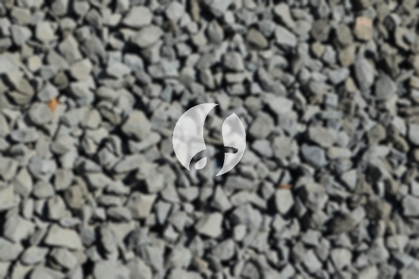

**Harga Batu Split 2 3 per kg untuk Kebutuhan Rumah dan Proyek Kecil** - Mitra Sumber Material yang kami hormati, sedang mencari informasi harga batu split 2 3 per kg untuk proyek Anda? Nah, Anda berada di tempat yang tepat! Kami dari Sumber Material siap membantu Anda mendapatkan material berkualitas dengan harga kompetitif, sekaligus memastikan pengiriman lancar ke lokasi proyek Anda di Jabodetabek dan sekitarnya.



Batu split merupakan material penting dalam konstruksi, terutama untuk campuran beton, onderlag jalan, atau bahkan sebagai drainase. Tapi, harga bisa bervariasi tergantung ukuran, kualitas, dan tentu saja, suppliernya. Mitra, daripada bingung membandingkan satu per satu, yuk kita bahas bagaimana mendapatkan penawaran terbaik dan apa saja yang perlu diperhatikan sebelum membeli batu split.

## Memilih Ukuran Batu Split yang Tepat: 2/3 atau yang Lain?

Ketika berbicara tentang batu split, ukuran langsung menjadi perhatian utama. Ukuran 2/3, yang sering disebut juga 2-3 cm, adalah salah satu yang paling umum digunakan. Ukuran ini ideal untuk berbagai aplikasi, mulai dari campuran beton hingga lapisan pondasi. Tapi, apakah ukuran ini selalu yang terbaik untuk proyek Anda?

Pertimbangkan kebutuhan spesifik proyek Anda. Untuk beton bertulang, ukuran 2/3 seringkali cukup. Namun, untuk proyek yang membutuhkan kekuatan lebih, seperti pondasi bangunan tinggi, mungkin Anda perlu mempertimbangkan ukuran yang lebih besar. Sebaliknya, jika Anda membutuhkan material untuk drainase, ukuran yang lebih kecil mungkin lebih efektif. Nah, untuk memastikan Anda memilih ukuran yang tepat, konsultasikan kebutuhan proyek Anda dengan ahli konstruksi atau langsung dengan tim Kami di Sumber Material. Kami siap membantu Anda menghitung kebutuhan material secara akurat dan memberikan rekomendasi terbaik.

## Jenis Batu Split dan Aplikasinya: Dari Agregat Hingga Drainase

Ada berbagai jenis batu split yang tersedia di pasaran, masing-masing dengan karakteristik dan aplikasi yang berbeda. Beberapa jenis yang umum meliputi:

- **Batu Split Gunung:** Paling umum digunakan untuk campuran beton dan pondasi. Harganya relatif terjangkau.
- **Batu Split Andesit:** Lebih kuat dan tahan lama dibandingkan batu split gunung. Cocok untuk proyek yang membutuhkan kekuatan ekstra.
- **Batu Split Basalt:** Memiliki karakteristik serupa dengan andesit, namun warnanya lebih gelap.
- **Batu Split Karang:** Biasanya digunakan untuk drainase dan landscaping.

Selain jenisnya, penting juga untuk memperhatikan mutu batu split. Pastikan batu split yang Anda beli memiliki kadar lumpur dan tanah yang rendah, serta bebas dari kotoran organik. Di Sumber Material, Kami hanya menyediakan batu split berkualitas tinggi yang telah melalui proses screening ketat. Untuk proyek Anda yang membutuhkan material andal, ini adalah pilihan tepat.

## Mengapa Memesan Batu Split dari Sumber Material? Kebutuhan Mendesak Teratasi!

Mitra, kenapa harus memilih Sumber Material untuk kebutuhan batu split Anda? Pertama, Kami menawarkan berbagai jenis batu split dengan ukuran dan mutu yang beragam, sehingga Anda bisa mendapatkan material yang sesuai dengan kebutuhan proyek Anda. Kedua, Kami melayani pengiriman cepat ke seluruh wilayah Jabodetabek dan sekitarnya. Artinya, Anda tidak perlu khawatir material akan terlambat datang ke lokasi proyek.

Ketiga, Kami memahami betul kebutuhan mendesak di lapangan. Anda bisa langsung menanyakan ketersediaan stok dan jadwal pengiriman lewat tombol **WhatsApp** atau **Telepon** di bawah ini. Kami akan segera merespon dan membantu Anda menyiapkan penawaran terbaik. Keempat, Kami berlokasi strategis di Bogor, Jakarta, Bekasi, Karawang, Tangerang, dan Cikarang, sehingga memudahkan Kami untuk melayani Anda dengan cepat dan efisien. Harga ini bersifat estimasi dan dapat berubah sewaktu-waktu — hubungi Kami untuk penawaran terbaru dan paling akurat sesuai kebutuhan proyek Mitra.

## Pesan Batu Split Sekarang: Mudah, Cepat, dan Terpercaya

Memesan batu split dari Sumber Material sangatlah mudah. Anda bisa langsung menghubungi Kami melalui tombol **WhatsApp** atau **Telepon** yang tersedia di halaman ini. Tim Kami akan segera membantu Anda menghitung kebutuhan material, memberikan penawaran harga terbaik, dan mengatur jadwal pengiriman sesuai dengan kebutuhan Anda.

Atau, Anda bisa langsung mengirimkan detail proyek Anda (lokasi, jenis batu split yang dibutuhkan, volume) melalui formulir permintaan penawaran di website Kami. Kami akan segera memproses permintaan Anda dan menghubungi Anda kembali dalam waktu singkat. Jangan tunda lagi, segera pastikan ketersediaan material untuk kelancaran proyek Anda!

Kirim kebutuhan dan lokasi proyek Mitra Sumber Material lewat tombol **WhatsApp** atau **Telepon** di bawah, tim Kami bantu siapkan penawarannya.

ARTIKEL_SELESAI

## Kalkulasi Kebutuhan Batu Split: Contoh Praktis untuk Proyek Anda

Nah, Mitra, seringkali pertanyaan yang muncul adalah: berapa banyak batu split yang sebenarnya dibutuhkan untuk proyek Anda? Jangan khawatir, Kami akan berikan contoh perhitungan sederhana yang bisa Anda jadikan acuan. Misalnya, Anda akan membuat lantai beton seluas 100 meter persegi dengan ketebalan 10 cm (0,1 meter).

## Perbandingan Batu Split 2/3 dengan Agregat Lain: Mana yang Paling Tepat?

Mitra, selain batu split 2/3, ada beberapa agregat lain yang sering digunakan dalam konstruksi. Memahami perbedaan antara masing-masing agregat ini akan membantu Anda memilih material yang paling sesuai dengan kebutuhan proyek Anda. Mari kita bandingkan batu split 2/3 dengan kerikil dan sirtu (pasir urug):

- **Batu Split 2/3:** Memiliki bentuk yang lebih tajam dan sudut-sudut yang jelas. Ideal untuk campuran beton karena memberikan kekuatan dan kepadatan yang lebih baik.
- **Kerikil:** Bentuknya lebih bulat dan halus. Cocok untuk aplikasi yang tidak membutuhkan kekuatan tinggi, seperti lapisan drainase atau landscaping.
- **Sirtu (Pasir Urug):** Terdiri dari campuran pasir, kerikil halus, dan tanah. Digunakan untuk pengurugan dan pembuatan jalan sementara.

Secara umum, batu split 2/3 memiliki kekuatan yang lebih tinggi dibandingkan kerikil dan sirtu. Namun, harganya juga cenderung lebih mahal. Pilihan terbaik tergantung pada aplikasi dan anggaran proyek Anda. Jika Anda membutuhkan material yang kuat dan tahan lama untuk konstruksi beton, batu split 2/3 adalah pilihan yang tepat.

## Pertanyaan Umum Seputar Batu Split: Apa yang Sering Ditanyakan Pembeli?

Kami sering menerima pertanyaan serupa dari pelanggan Kami. Berikut beberapa pertanyaan yang paling umum beserta jawabannya:

### Berapa lama batu split bisa disimpan sebelum digunakan?

Batu split bisa disimpan dalam waktu yang lama asalkan disimpan di tempat yang kering dan terlindung dari cuaca. Namun, sebaiknya gunakan dalam waktu 6 bulan untuk menjaga kualitasnya tetap optimal.

### Apakah batu split perlu dicuci sebelum digunakan?

Sebaiknya cuci batu split sebelum digunakan untuk menghilangkan debu dan kotoran yang menempel. Ini akan membantu meningkatkan kualitas campuran beton.

### Bagaimana cara mengetahui kualitas batu split yang baik?

Perhatikan bentuk dan tekstur batu split. Pilih yang memiliki bentuk yang tajam dan sudut-sudut yang jelas. Pastikan juga tidak ada lumpur atau tanah yang menempel.

### Apa perbedaan antara batu split gunung dan andesit?

Batu split gunung lebih umum dan harganya lebih terjangkau. Batu split andesit lebih kuat dan tahan lama, namun harganya juga lebih mahal. Pilihlah sesuai dengan kebutuhan proyek Anda.

ARTIKEL_SELESAI

## Menghindari Kesalahan Umum Saat Membeli Batu Split: Lindungi Proyek Anda

Mitra, seringkali kesalahan kecil saat memilih atau memesan batu split bisa berakibat fatal pada kualitas proyek Anda. Salah satu kesalahan paling umum adalah tidak memperhatikan kandungan lumpur dan tanah. Kandungan yang tinggi akan mengurangi kekuatan campuran beton dan memperpendek umur bangunan. Pastikan supplier Anda melakukan proses *screening* yang baik untuk menghilangkan kotoran tersebut. Kesalahan lain adalah memesan terlalu sedikit atau terlalu banyak. Untuk menghindari ini, lakukan perhitungan kebutuhan material dengan cermat atau minta bantuan Kami untuk menghitungnya.

## Contoh Perhitungan Kebutuhan: Lantai Kerja Area Parkir

Sebagai gambaran, mari kita hitung kebutuhan batu split untuk lantai kerja area parkir seluas 50 meter persegi dengan ketebalan 15 cm (0,15 meter). Asumsikan kita menggunakan batu split 2/3 dengan berat jenis 1,6 ton/m³.

### Langkah Perhitungan

1.  **Volume:** 50 m² x 0,15 m = 7,5 m³
2.  **Berat:** 7,5 m³ x 1,6 ton/m³ = 12 ton

Jadi, Anda membutuhkan sekitar 12 ton batu split untuk proyek ini. Penting diingat bahwa angka ini adalah estimasi dan bisa bervariasi tergantung pada kerapatan penempatan dan kehilangan material saat pengerjaan. Kami di Sumber Material siap membantu Anda menghitung kebutuhan material secara akurat berdasarkan detail proyek Anda.
