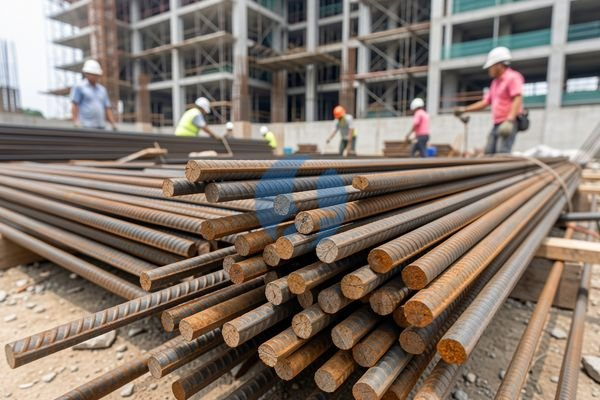

**Cara Menghindari Salah Hitung pada Harga Besi 10 Banci per Batang** - Mitra Sumber Material yang budiman, mencari harga besi 10 banci per batang yang pas di kantong? Kami siap membantu Anda mendapatkan material berkualitas dengan harga kompetitif.



Besi adalah tulang punggung konstruksi. Memilih besi yang tepat, dengan harga yang sesuai, sangat krusial untuk keberhasilan proyek Anda. Nah, di artikel ini, Kami akan membahas harga besi 10 banci per batang terbaru, faktor-faktor yang mempengaruhinya, dan tentu saja, bagaimana Sumber Material bisa menjadi solusi kebutuhan Anda.

## Pilihan Besi 10 Banci: SNI atau Bukan?

Mitra Sumber Material, sebelum membahas harga, penting untuk memahami ada dua jenis besi 10 banci yang umum di pasaran: besi polos dan besi beton. Besi polos biasanya digunakan untuk keperluan non-struktural, sementara besi beton (ulir) wajib digunakan untuk struktur bangunan yang menahan beban. Selain perbedaan fungsi, kualitas juga jadi pembeda utama. Perhatikan apakah besi tersebut sudah memiliki sertifikasi SNI (Standar Nasional Indonesia). Besi SNI menjamin kualitas dan kekuatan material, memberikan rasa aman dan tahan lama untuk bangunan Anda.

Kalau Anda masih bingung memilih, jangan ragu untuk konsultasi dengan tim Kami. Kami bantu hitungkan kebutuhan besi untuk proyek Anda, sekaligus memberikan rekomendasi jenis besi yang paling sesuai, lengkap dengan perkiraan biayanya. [tanyakan harga sekarang](https://api.whatsapp.com/send?phone=6285776786091&text=*Halo%20sumbermaterial.com*%20%3A)

## Jenis Besi 10 Banci yang Tersedia di Sumber Material

Sumber Material menyediakan berbagai jenis besi 10 banci berkualitas, termasuk:

- **Besi Beton Polos:** Ukuran 10 mm, cocok untuk berbagai aplikasi konstruksi seperti sloof, kolom, dan balok. Kami menyediakan berbagai mutu besi polos, dari BJTP 300 hingga BJTP 400.
- **Besi Beton Ulir (SNI):** Tersedia dalam ukuran 10 mm dengan standar SNI, memberikan kekuatan tarik yang lebih tinggi dibandingkan besi polos. Ideal untuk struktur utama bangunan yang memerlukan ketahanan ekstra.
- **Besi Hollow:** Meskipun bukan besi 10 banci dalam arti tradisional, besi hollow dengan ketebalan tertentu seringkali menjadi alternatif yang lebih ringan dan ekonomis untuk keperluan non-struktural.

Untuk proyek yang membutuhkan presisi dan kekuatan tinggi, Kami sangat merekomendasikan besi beton ulir SNI. Dengan memilih besi beton ulir SNI, Anda memastikan bangunan Anda tahan terhadap beban dan risiko kerusakan.

## Mengapa Memilih Sumber Material untuk Kebutuhan Besi Anda?

Mitra Sumber Material, selain menyediakan beragam jenis besi 10 banci, Kami juga menawarkan beberapa keuntungan yang akan mempermudah proyek Anda:

- **Ketersediaan Stok:** Kami selalu memastikan stok besi 10 banci tersedia dalam jumlah yang cukup untuk memenuhi kebutuhan proyek Anda, baik skala kecil maupun besar.
- **Pengiriman Cepat & Tepat Waktu:** Kami melayani pengiriman ke seluruh wilayah Jabodetabek dan sekitarnya. Kami memahami betapa pentingnya ketepatan waktu dalam proyek konstruksi, dan Kami berkomitmen untuk mengirimkan material Anda tepat waktu.
- **Harga Kompetitif:** Kami menawarkan harga besi 10 banci yang kompetitif tanpa mengorbankan kualitas. Harga ini bersifat estimasi dan dapat berubah sewaktu-waktu — hubungi Kami untuk penawaran terbaru dan paling akurat sesuai kebutuhan proyek Mitra.
- **Jasa Urug & Cor:** Selain besi, Kami juga menyediakan jasa urug dan cor untuk melengkapi kebutuhan konstruksi Anda.
- **Layanan Konsultasi Gratis:** Tim Kami siap membantu Anda menghitung kebutuhan besi, memilih jenis besi yang tepat, dan memberikan solusi terbaik untuk proyek Anda.

## Cara Mudah Memesan Besi 10 Banci dari Sumber Material

Memesan besi 10 banci dari Sumber Material sangat mudah!

1.  **Hubungi Kami:** Silakan hubungi Kami melalui tombol **WhatsApp** atau **Telepon** di bawah halaman ini untuk mendapatkan penawaran harga dan informasi ketersediaan stok.
2.  **Sampaikan Kebutuhan Anda:** Berikan informasi detail mengenai jenis besi, ukuran, jumlah yang dibutuhkan, dan lokasi pengiriman proyek Anda.
3.  **Konfirmasi Pesanan:** Setelah Kami menerima pesanan Anda, Kami akan segera memprosesnya dan menginformasikan jadwal pengiriman.
4.  **Besi Sampai di Lokasi Proyek:** Tim pengiriman Kami akan mengantarkan besi langsung ke lokasi proyek Anda dengan aman dan tepat waktu.

## Menghitung Kebutuhan Besi 10 Banci untuk Sloof: Contoh Praktis

Mitra Sumber Material, seringkali kesulitan menghitung berapa batang besi 10 banci yang dibutuhkan untuk proyek Anda? Mari kita ambil contoh perhitungan kebutuhan besi untuk sloof (pondasi beton). Asumsikan Anda akan membuat sloof dengan panjang 10 meter, lebar 30 cm, dan tinggi 40 cm. Jarak antar besi adalah 20 cm.

Pertama, hitung jumlah besi yang dibutuhkan per meter panjang sloof. Dengan jarak 20 cm, Anda membutuhkan 100 cm / 20 cm = 5 batang besi per meter. Karena panjang sloof 10 meter, total besi yang dibutuhkan adalah 5 batang/meter x 10 meter = 50 batang besi.

### Faktor yang Mempengaruhi Jumlah Besi

Ada beberapa faktor yang memengaruhi jumlah besi yang dibutuhkan, selain dimensi sloof. Misalnya, jenis tanah dan beban bangunan. Tanah yang lunak memerlukan sloof yang lebih kuat, sehingga membutuhkan lebih banyak besi. Begitu pula dengan bangunan bertingkat yang memiliki beban lebih berat. Konsultasikan dengan ahli konstruksi untuk menentukan kebutuhan besi yang tepat. Kami bisa menjadi jembatan antara Anda dan ahli tersebut, memberikan rekomendasi material berdasarkan perhitungan yang akurat.

## Pertanyaan Umum Seputar Besi 10 Banci

Mitra Sumber Material, seringkali Kami menerima pertanyaan seputar besi 10 banci. Berikut beberapa pertanyaan yang paling umum dan jawabannya:

### Berapa Panjang Standar Besi 10 Banci?

Panjang standar besi 10 banci biasanya 12 meter. Namun, ada juga yang tersedia dalam ukuran 8 meter atau 6 meter. Pilihlah ukuran yang paling efisien untuk meminimalkan pemborosan.

### Apa Perbedaan Besi Polos dan Besi Ulir?

Besi polos memiliki permukaan yang halus, sedangkan besi ulir memiliki tekstur bergelombang. Besi ulir memiliki kekuatan tarik yang lebih tinggi, sehingga lebih cocok untuk struktur yang menahan beban berat.

### Bagaimana Cara Mengetahui Kualitas Besi?

Periksa apakah besi memiliki sertifikasi SNI. Selain itu, perhatikan juga permukaannya. Besi yang berkualitas baik memiliki permukaan yang bersih, tidak berkarat, dan tidak bengkok.

### Bagaimana Cara Menyimpan Besi Agar Tidak Berkarat?

Simpan besi di tempat yang kering dan terlindung dari hujan. Jika memungkinkan, lapisi besi dengan cat anti karat untuk mencegah korosi.

## Kesalahan Umum Saat Membeli Besi 10 Banci

Mitra Sumber Material, hindari kesalahan umum ini saat membeli besi 10 banci:

- **Tidak Memperhatikan Kualitas:** Jangan hanya terpaku pada harga murah. Pastikan besi yang Anda beli memiliki kualitas yang baik dan sudah teruji kekuatannya.
- **Tidak Menghitung Kebutuhan dengan Tepat:** Salah perhitungan dapat menyebabkan kekurangan atau kelebihan besi, yang berakibat pada pemborosan biaya.
- **Tidak Memeriksa Kondisi Besi:** Periksa apakah besi dalam kondisi baik, tidak bengkok, tidak berkarat, dan memiliki sertifikasi SNI.
- **Memilih Supplier yang Tidak Terpercaya:** Pilihlah supplier yang memiliki reputasi baik dan dapat memberikan jaminan kualitas.

## Memahami Grade Besi 10 Banci: BJTP 300 vs BJTP 400

Mitra Sumber Material, tahukah Anda bahwa besi 10 banci memiliki tingkatan mutu? Dua grade yang paling umum adalah BJTP 300 dan BJTP 400. BJTP (Besi Baja Tulangan Polos) menunjukkan kekuatan tarik minimum material. BJTP 400 memiliki kekuatan tarik lebih tinggi (400 MPa) dibandingkan BJTP 300 (300 MPa). Artinya, besi BJTP 400 lebih kuat menahan beban dan lebih cocok untuk struktur yang memerlukan ketahanan ekstra, seperti kolom atau balok utama.

### Kapan Memilih BJTP 400?

BJTP 400 ideal untuk bangunan bertingkat, struktur yang menahan beban berat, atau daerah rawan gempa. Meskipun sedikit lebih mahal, investasi pada BJTP 400 akan memberikan keamanan dan ketahanan yang lebih baik dalam jangka panjang.

### Apakah BJTP 300 Kurang Baik?

Tidak selalu. BJTP 300 masih sangat baik untuk struktur non-struktural atau bangunan sederhana dengan beban ringan. Pilihlah sesuai kebutuhan spesifik proyek Anda dan konsultasikan dengan ahli konstruksi untuk mendapatkan rekomendasi terbaik.

## Pertanyaan Lain yang Sering Kami Terima

Mitra Sumber Material, selain pertanyaan yang sudah Kami bahas, ada beberapa pertanyaan lain yang sering muncul:

### Apakah Besi 10 Banci Bisa Dibengkokkan?

Tentu saja. Besi polos dapat dibengkokkan dengan mudah menggunakan alat khusus. Besi ulir juga bisa dibengkokkan, tetapi memerlukan alat dan teknik yang lebih hati-hati agar tidak merusak ulirnya.

### Bagaimana Cara Menghitung Berat Besi 10 Banci Per Meter?

Berat besi 10 banci per meter berkisar antara 0,617 kg – 0,631 kg, tergantung pada jenis dan standar produksinya. Untuk perhitungan yang lebih akurat, Kami sarankan untuk meminta data teknis dari supplier.

### Apa Itu Besi Spiral? Apakah Bisa Menggantikan Besi 10 Banci?

Besi spiral adalah jenis besi beton ulir yang dibentuk spiral. Besi spiral umumnya digunakan untuk kolom beton bertulang. Meskipun memiliki fungsi yang mirip, besi spiral tidak selalu bisa menggantikan besi 10 banci secara langsung, tergantung pada desain struktur bangunan Anda.

Jangan tunda kebutuhan proyek Mitra Sumber Material — tanyakan harga dan ketersediaannya sekarang lewat tombol **WhatsApp** atau **Telepon** di bawah halaman ini.
