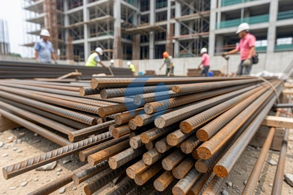

**Harga Besi 10 per Batang dan Hal yang Perlu Dicek sebelum Memesan** - Mitra Sumber Material yang berbahagia, sedang mencari informasi harga besi 10 per batang terbaru untuk proyek Anda? Mencari harga yang pas memang tricky, apalagi kalau belum tahu pasti berapa kebutuhan besi yang diperlukan. Nah, Kami di Sumber Material siap bantu Anda mendapatkan penawaran terbaik sekaligus memastikan Anda tidak kelebihan atau kekurangan material.



Mitra, besi memang material krusial dalam konstruksi. Mulai dari fondasi, kolom, hingga rangka atap, besi berperan penting dalam kekuatan dan ketahanan bangunan. Tapi, harga besi bisa fluktuatif, lho. Jadi, penting untuk tahu harga terbaru dan membandingkannya sebelum membeli. Jangan khawatir, Kami akan bantu memberikan gambaran harga dan rekomendasi jenis besi yang tepat untuk proyek Anda.

## Pilihan Besi 10: Polos atau Ulir? Mana yang Cocok untuk Proyek Anda?

Sebelum membahas harga, ada baiknya kita bedakan dulu jenis besi 10 yang umum digunakan: besi polos dan besi ulir. Besi polos biasanya dipakai untuk keperluan yang tidak terlalu menahan beban berat, seperti pagar atau railing. Sementara itu, besi ulir dengan tekstur ulir yang khas lebih kuat dan cocok untuk struktur utama bangunan seperti kolom dan balok.

Nah, untuk proyek perumahan atau bangunan bertingkat, Kami sarankan menggunakan besi ulir karena lebih aman dan tahan terhadap tekanan. Tapi, kalau proyek Anda hanya membutuhkan besi untuk keperluan dekoratif, besi polos bisa menjadi pilihan yang lebih ekonomis. Jangan ragu untuk konsultasi dengan tim Kami untuk mendapatkan rekomendasi yang paling tepat sesuai kebutuhan proyek Anda. Kami akan bantu hitung kebutuhan besi dan memberikan penawaran harga terbaik!

## Jenis Besi 10 yang Tersedia di Sumber Material

Kami di Sumber Material menyediakan berbagai jenis besi 10, baik polos maupun ulir, dengan berbagai ukuran dan mutu. Berikut beberapa pilihan yang tersedia:

- **Besi Polos Ø10 mm:** Cocok untuk pagar, railing, dan kebutuhan non-struktural lainnya. Tersedia dalam berbagai panjang, mulai dari 8 meter hingga 12 meter.
- **Besi Ulir Ø10 mm (SNI):** Pilihan paling populer untuk struktur bangunan. Kami menyediakan besi ulir dengan standar SNI yang terjamin kualitasnya.
- **Besi Ulir Ø10 mm (BJTP):** Besi ulir baja tulangan yang memiliki kekuatan tarik tinggi, ideal untuk proyek-proyek besar dan membutuhkan kekuatan ekstra.
- **Besi Ulir Ø10 mm (Import):** Kami juga menyediakan besi ulir import dengan kualitas premium untuk proyek yang membutuhkan standar internasional.

Untuk estimasi harga, besi 10 per batang pada tahun 2023 ini berkisar antara Rp 8.000,- hingga Rp 12.000,- tergantung jenis, mutu, dan supplier. Harga ini bersifat estimasi dan dapat berubah sewaktu-waktu — hubungi Kami untuk penawaran terbaru dan paling akurat sesuai kebutuhan proyek Mitra.

## Mengapa Pesan Besi 10 di Sumber Material?

Mitra Sumber Material, ada banyak alasan kenapa Anda harus memesan besi 10 di Sumber Material. Pertama, Kami menjamin kualitas produk yang Kami jual. Semua besi yang Kami sediakan sudah teruji dan memenuhi standar SNI. Kedua, Kami menawarkan harga yang kompetitif dan transparan. Ketiga, Kami melayani pengiriman ke seluruh wilayah Jabodetabek dan sekitarnya.

Selain itu, Kami juga menawarkan jasa konsultasi GRATIS. Tim Kami akan bantu Anda menghitung kebutuhan besi secara akurat, memilih jenis besi yang tepat, dan memberikan solusi terbaik untuk proyek Anda. Kami berlokasi di Bogor, Jakarta, Bekasi, Karawang, Tangerang, dan Cikarang, sehingga pengiriman lebih cepat dan efisien. Yuk, tanyakan harga terbaru besi 10 per batang lewat WhatsApp!

## Mudah dan Cepat: Cara Pesan Besi 10 di Sumber Material

Memesan besi 10 di Sumber Material sangat mudah dan cepat. Anda bisa langsung menghubungi Kami melalui tombol **WhatsApp** atau **Telepon** yang tersedia di bawah. Cukup informasikan jenis besi, ukuran, jumlah yang dibutuhkan, dan lokasi proyek Anda. Tim Kami akan segera memproses pesanan Anda dan memberikan penawaran harga terbaik.

Kami juga menyediakan layanan sewa alat berat, jasa urug, dan jasa cor untuk melengkapi kebutuhan proyek Anda. Jadi, tunggu apa lagi? Jangan ragu untuk menghubungi Kami sekarang juga!

Kirim kebutuhan dan lokasi proyek Mitra Sumber Material lewat tombol **WhatsApp** atau **Telepon** di bawah, tim Kami bantu siapkan penawarannya.

ARTIKEL_SELESAI

## Hitung Kebutuhan Besi 10: Contoh Praktis untuk Proyek Sederhana

Untuk mengetahui jumlah batang besi yang dibutuhkan, bagi luas tulangan dengan luas satu batang besi: 36 cm² / 0,785 cm²/batang = 45,86 batang. Karena tidak mungkin membeli sebagian batang, Anda perlu membulatkan ke atas menjadi 46 batang besi 10. Ini adalah perhitungan dasar, ya. Jangan lupa tambahkan kebutuhan besi untuk sengkang (beugel) dan kebutuhan lainnya sesuai desain struktur bangunan Anda. Tim Kami siap bantu hitungkan secara detail jika Anda membutuhkan.

## Perbandingan Besi Ulir BJTP dan Besi Ulir SNI: Mana yang Lebih Unggul?

Mitra, seringkali ada pertanyaan mengenai perbedaan antara besi ulir BJTP dan besi ulir SNI. Keduanya sama-sama memenuhi standar mutu, namun ada perbedaan signifikan yang perlu Anda ketahui. BJTP (Baja Tulangan Pola Ulir) lebih spesifik mengacu pada pola ulir yang konsisten dan terukur, memberikan daya rekat yang lebih baik dengan beton. Sementara SNI (Standar Nasional Indonesia) adalah sertifikasi yang menjamin mutu besi secara keseluruhan, termasuk kekuatan tarik dan komposisi kimia.

Secara umum, besi ulir BJTP cenderung memiliki kekuatan tarik yang lebih tinggi dibandingkan besi ulir SNI dengan mutu yang sama. Ini membuat BJTP lebih ideal untuk proyek-proyek yang membutuhkan kekuatan ekstra, seperti bangunan tinggi atau jembatan. Namun, besi ulir SNI tetap merupakan pilihan yang sangat baik dan memenuhi standar keamanan untuk sebagian besar proyek konstruksi perumahan dan komersial. Nah, untuk proyek Anda, jenis besi ulir mana yang paling tepat? Konsultasikan dengan Kami, ya!

## Pertanyaan Umum Tentang Besi 10

Kami sering menerima pertanyaan dari Mitra Sumber Material mengenai besi 10. Berikut beberapa pertanyaan yang paling umum dan jawabannya:

### Berapa Panjang Standar Besi 10?

Panjang standar besi 10 umumnya adalah 8 meter atau 12 meter. Namun, Kami juga menyediakan potongan besi sesuai permintaan Anda.

### Bagaimana Cara Menyimpan Besi 10 Agar Tidak Berkarat?

Simpan besi 10 di tempat yang kering dan terlindung dari hujan dan kelembaban. Jika memungkinkan, lapisi besi dengan minyak atau cat anti karat untuk mencegah korosi.

### Apakah Besi 10 Bisa Dibengkokkan?

Tentu saja! Besi 10, terutama besi ulir, bisa dibengkokkan dengan alat khusus seperti mesin bending. Namun, pastikan Anda menggunakan alat yang tepat dan mengikuti prosedur yang benar agar besi tidak patah atau rusak.

### Apa Bedanya Besi Polos dan Besi Ulir?

Seperti yang sudah Kami jelaskan sebelumnya, besi polos tidak memiliki ulir dan biasanya digunakan untuk keperluan non-struktural. Sementara besi ulir memiliki ulir yang memberikan daya rekat lebih baik dengan beton dan ideal untuk struktur bangunan.

## Kesalahan Umum Saat Membeli Besi 10: Hindari Kerugian Tak Terduga

Mitra Sumber Material, seringkali ada beberapa kesalahan umum yang terjadi saat membeli besi 10. Salah satunya adalah tidak memperhatikan mutu besi. Besi dengan mutu rendah bisa jadi tidak kuat dan cepat berkarat, sehingga membahayakan konstruksi bangunan Anda. Pastikan Anda membeli besi dari supplier terpercaya yang menjamin kualitas produknya.

Kesalahan lainnya adalah salah menghitung kebutuhan besi. Kekurangan besi bisa menghambat kelancaran proyek, sementara kelebihan besi berarti pemborosan biaya. Jangan ragu untuk berkonsultasi dengan Kami agar mendapatkan perhitungan yang akurat. Terakhir, jangan lupa untuk memeriksa kondisi besi sebelum dibeli. Pastikan tidak ada karat, bengkok, atau cacat lainnya.

## Tanya Jawab Seputar Pembelian Besi 10

Berikut beberapa pertanyaan yang sering Kami terima dari Mitra Sumber Material:

### Apakah Besi 10 Cocok untuk Pondasi Rumah?

Tentu saja! Besi 10 sangat cocok untuk pondasi rumah, terutama jika digunakan sebagai besi tulangan utama. Pastikan Anda memilih besi ulir dengan mutu yang sesuai dengan desain struktur bangunan Anda.

### Bagaimana Cara Mengetahui Mutu Besi 10?

Anda bisa mengeceknya melalui sertifikasi SNI yang tertera pada besi. Selain itu, perhatikan juga tekstur dan warna besi. Besi berkualitas baik biasanya memiliki permukaan yang halus dan warna yang seragam.

### Apa Saja Ukuran Besi yang Umum Digunakan Selain Besi 10?

Selain besi 10, ukuran besi yang umum digunakan antara lain besi 8, besi 12, dan besi 16. Pemilihan ukuran besi tergantung pada kebutuhan struktur bangunan Anda.

### Bisakah Besi 10 Dipotong Sesuai Kebutuhan?

Bisa, Mitra! Kami menyediakan layanan pemotongan besi sesuai dengan ukuran yang Anda inginkan. Ini akan memudahkan Anda dalam proses pemasangan dan mengurangi pemborosan material.
