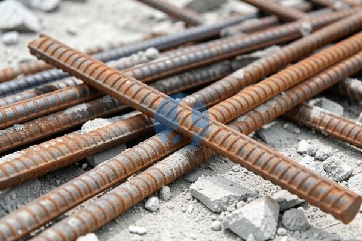

**Cek Harga Besi 12 Ulir per Batang sebelum Menyusun Anggaran** - Mitra Sumber Material dimana saja berada, apakah Anda sedang merencanakan pembangunan atau renovasi dan mencari informasi harga besi 12 ulir per batang? Mengetahui harga material adalah langkah penting untuk menyusun anggaran proyek yang tepat. Nah, Kami dari Sumber Material siap membantu Anda mendapatkan penawaran terbaik dan memastikan proyek Anda berjalan lancar.



Mitra, harga besi ulir memang fluktuatif dan dipengaruhi banyak faktor. Tapi jangan khawatir, Kami akan memberikan gambaran harga terkini serta tips memilih besi yang berkualitas tanpa membuat anggaran proyek membengkak. Kami juga menawarkan kemudahan pemesanan: cukup kirim kebutuhan dan lokasi proyek Anda lewat WhatsApp, dan Kami bantu hitungkan total material yang dibutuhkan.

## Mencari Besi 12 Ulir yang Tepat: Pilihan dan Pertimbangan

Sebelum membahas harga, penting untuk memahami bahwa besi 12 ulir memiliki beberapa variasi. Ada besi ulir polos, besi ulir SNI, dan besi ulir dengan grade yang berbeda-beda (misalnya U30, U40, U50). Grade ini menunjukkan kekuatan tarik material. Semakin tinggi angkanya, semakin kuat besi tersebut. Untuk proyek bangunan rumah, besi ulir SNI dengan grade U30 atau U40 biasanya sudah mencukupi.

Selain grade, perhatikan juga apakah besi tersebut sudah ber-SNI (Standar Nasional Indonesia). Besi bersertifikasi SNI menjamin kualitas dan kekuatannya, sehingga lebih aman digunakan. Jangan ragu untuk bertanya kepada penjual mengenai sertifikasi ini. Kalau Anda bingung memilih, jangan sungkan untuk hubungi Kami – Kami siap memberikan konsultasi gratis.

## Besi 12 Ulir dari Sumber Material: Kualitas Terjamin, Pilihan Lengkap

Kami di Sumber Material menyediakan besi 12 ulir SNI dengan berbagai grade, sesuai kebutuhan proyek Anda. Besi ulir yang Kami jual tersedia dalam potongan 12 meter dan berat per batang sekitar 7.85 kg.  Ini ideal untuk berbagai aplikasi konstruksi, mulai dari fondasi, kolom, balok, hingga pembesian pelat lantai.

Sebagai contoh, untuk membangun fondasi rumah tipe 45, Anda mungkin membutuhkan sekitar 20 batang besi 12 ulir. Untuk kolom, kebutuhan bisa bervariasi tergantung desain struktur, namun rata-rata sekitar 15 batang per kolom. Dengan besi Kami yang berkualitas, Anda bisa yakin bahwa bangunan Anda akan kokoh dan tahan lama.

## Kenapa Memesan Besi 12 Ulir di Sumber Material? Kemudahan dan Kepercayaan

Apa yang membedakan Kami dari supplier material bangunan lainnya? Pertama, Kami menawarkan kemudahan dalam pemesanan. Anda cukup kirim kebutuhan material dan lokasi proyek Anda melalui WhatsApp. Tim Kami akan segera membantu menghitung total material yang dibutuhkan, memberikan estimasi biaya, dan mengatur pengiriman langsung ke lokasi proyek Anda di wilayah Jabodetabek dan sekitarnya.

Kedua, Kami hanya menyediakan material berkualitas tinggi yang sudah teruji dan bersertifikasi SNI. Ketiga, Kami berlokasi strategis di Bogor, Jakarta, Bekasi, Karawang, Tangerang, dan Cikarang, sehingga pengiriman bisa lebih cepat dan efisien. Keempat, Kami selalu berusaha memberikan harga yang kompetitif dan transparan. Jangan ragu untuk tanyakan harga terbaru dan bandingkan dengan supplier lain – Kami yakin Anda akan mendapatkan penawaran terbaik dari Kami.

## Pesan Besi 12 Ulir Sekarang: Proses Mudah dan Cepat

Proses pemesanan di Sumber Material sangatlah mudah. Cukup hubungi Kami melalui tombol **WhatsApp** atau **Telepon** di bawah halaman ini. Sampaikan kebutuhan besi 12 ulir Anda (jumlah batang, grade yang diinginkan, dan lokasi proyek). Tim Kami akan segera merespon dan memberikan penawaran harga terbaik. Kami juga bisa membantu menghitung kebutuhan material secara akurat, sehingga Anda tidak perlu khawatir kelebihan atau kekurangan material.

Harga ini bersifat estimasi dan dapat berubah sewaktu-waktu — hubungi Kami untuk penawaran terbaru dan paling akurat sesuai kebutuhan proyek Mitra.

## Memahami Kebutuhan Besi 12 Ulir: Contoh Perhitungan Praktis

Mitra Sumber Material, seringkali kita kesulitan memperkirakan berapa banyak besi 12 ulir yang sebenarnya dibutuhkan untuk sebuah proyek. Nah, Kami akan berikan contoh perhitungan sederhana untuk membantu Anda. Misalnya, Anda akan membuat lantai beton bertulang dengan dimensi 4 meter x 6 meter dan ketebalan 12 cm. Jarak antar besi utama (tulangan memanjang) adalah 20 cm, dan jarak antar sengkang (tulangan melintang) adalah 25 cm.

Untuk besi utama, Anda membutuhkan besi sepanjang 6 meter per baris. Dengan lebar 4 meter dan jarak 20 cm, Anda membutuhkan sekitar 20 baris besi utama (400 cm / 20 cm = 20). Jadi, total panjang besi utama yang dibutuhkan adalah 20 baris x 6 meter = 120 meter. Dengan besi per batang 12 meter, Anda membutuhkan sekitar 10 batang (120 meter / 12 meter = 10 batang).

Untuk sengkang, Anda membutuhkan sengkang sepanjang 4 meter per baris. Dengan panjang 6 meter dan jarak 25 cm, Anda membutuhkan sekitar 24 baris sengkang (600 cm / 25 cm = 24). Jadi, total panjang sengkang yang dibutuhkan adalah 24 baris x 4 meter = 96 meter. Dengan besi per batang 12 meter, Anda membutuhkan sekitar 8 batang (96 meter / 12 meter = 8 batang).

Total, Anda membutuhkan sekitar 18 batang besi 12 ulir untuk lantai beton tersebut. Perlu diingat, ini hanya contoh perhitungan sederhana. Kebutuhan besi yang sebenarnya bisa berbeda tergantung desain struktur dan rekomendasi dari ahli konstruksi.

## Pertanyaan Umum Seputar Besi 12 Ulir: Panduan Singkat

Mitra, seringkali ada pertanyaan yang muncul saat memilih atau memesan besi 12 ulir. Kami kumpulkan beberapa pertanyaan umum dan jawabannya untuk membantu Anda:

### Apa perbedaan besi ulir polos dan besi ulir ulir?

Besi ulir polos memiliki permukaan halus, sedangkan besi ulir ulir memiliki tekstur bergelombang (ulir) di permukaannya. Ulir ini berfungsi untuk meningkatkan daya rekat antara besi dan beton, sehingga menghasilkan struktur yang lebih kuat.

### Bagaimana cara mengetahui apakah besi sudah ber-SNI?

Biasanya, besi yang sudah ber-SNI akan memiliki cap atau emboss SNI pada permukaannya. Pastikan untuk memeriksa cap tersebut sebelum membeli. Jika ragu, jangan sungkan untuk bertanya kepada penjual.

### Apakah besi 12 ulir bisa dibengkokkan sendiri?

Sebaiknya tidak. Pembengkokan besi sebaiknya dilakukan oleh tenaga ahli menggunakan alat yang tepat. Pembengkokan yang tidak benar bisa merusak struktur besi dan mengurangi kekuatannya.

### Bagaimana cara menyimpan besi 12 ulir agar tidak berkarat?

Simpan besi di tempat yang kering dan terlindung dari hujan. Jika memungkinkan, lapisi besi dengan minyak atau cat anti karat untuk mencegah korosi.

## Hindari Kesalahan Umum Saat Membeli Besi 12 Ulir

Mitra, ada beberapa kesalahan umum yang sering dilakukan saat membeli besi 12 ulir. Salah satunya adalah membeli besi tanpa memperhatikan grade dan sertifikasi SNI. Besi yang tidak berkualitas bisa membahayakan keamanan bangunan Anda.

Kesalahan lainnya adalah membeli terlalu sedikit atau terlalu banyak besi. Kekurangan besi bisa mengurangi kekuatan struktur, sedangkan kelebihan besi akan membuang-buang anggaran proyek Anda. Oleh karena itu, penting untuk menghitung kebutuhan besi secara akurat sebelum membeli.

Kesalahan terakhir adalah membeli besi dari supplier yang tidak terpercaya. Pastikan supplier tersebut memiliki reputasi baik dan menyediakan material berkualitas tinggi. Kami di Sumber Material selalu berusaha memberikan pelayanan terbaik dan material berkualitas untuk memastikan kepuasan Anda.

## Perbedaan Besi Ulir U30, U40, dan U50: Mana yang Cocok untuk Proyek Anda?

Mitra Sumber Material, seringkali kita mendengar istilah U30, U40, atau U50 saat berbicara tentang besi ulir. Apa sebenarnya perbedaan antara grade besi ini? Angka tersebut menunjukkan kekuatan tarik material (dalam MPa atau Megapascal). Besi U30 memiliki kekuatan tarik minimal 300 MPa, U40 minimal 400 MPa, dan U50 minimal 500 MPa. Semakin tinggi angkanya, semakin kuat besi tersebut menahan beban. Untuk proyek rumah tinggal sederhana, besi U30 atau U40 umumnya sudah cukup memadai. Namun, untuk bangunan bertingkat atau struktur yang membutuhkan kekuatan ekstra, besi U50 lebih direkomendasikan.

### Apakah Perlu Menggunakan Besi Ulir dengan Grade Lebih Tinggi?

Ini tergantung pada desain struktur bangunan Anda. Konsultasikan dengan ahli konstruksi untuk menentukan grade besi yang paling sesuai dengan kebutuhan proyek Anda. Memilih grade yang terlalu rendah bisa membahayakan keamanan bangunan, sementara memilih grade yang terlalu tinggi bisa meningkatkan biaya konstruksi tanpa manfaat signifikan.

### Bagaimana Cara Membaca Kode pada Besi Ulir?

Kode pada besi ulir biasanya mencantumkan grade (U30, U40, U50) dan standar yang digunakan (misalnya SNI). Pastikan untuk memeriksa kode ini sebelum membeli untuk memastikan besi yang Anda beli sesuai dengan spesifikasi yang dibutuhkan.

## Tips Tambahan untuk Meminimalkan Pemborosan Besi 12 Ulir

Mitra, pemborosan material adalah musuh utama anggaran proyek. Selain menghitung kebutuhan besi secara akurat, ada beberapa tips tambahan yang bisa Anda terapkan untuk meminimalkan pemborosan. Pertama, rencanakan tata letak besi dengan cermat sebelum pemasangan. Hindari pemotongan yang tidak perlu dengan menyesuaikan panjang besi dengan kebutuhan struktur. Kedua, manfaatkan sisa-sisa besi untuk membuat pengikat atau elemen struktur kecil lainnya. Ketiga, simpan besi dengan baik agar tidak berkarat atau rusak sebelum digunakan. Dengan menerapkan tips ini, Anda bisa menghemat biaya konstruksi dan mengurangi dampak lingkungan.

Jangan tunda kebutuhan proyek Mitra Sumber Material — tanyakan harga dan ketersediaannya sekarang lewat tombol **WhatsApp** atau **Telepon** di bawah halaman ini.
