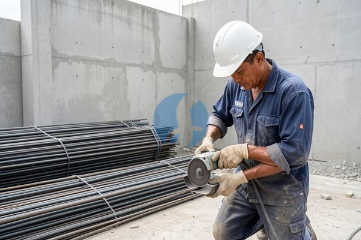

**Harga Besi 13 Ulir di Bali Berdasarkan Jenis dan Ukurannya** - Mitra Sumber Material yang kami hormati, apakah Anda sedang merencanakan pembangunan di Bali dan membutuhkan besi 13 ulir? Mencari harga yang pas dan kualitas terjamin memang seringkali bikin pusing. Nah, Kami dari Sumber Material siap membantu Anda mendapatkan solusi terbaik untuk kebutuhan besi bangunan Anda.



Mitra, harga besi konstruksi memang fluktuatif dan bisa berbeda-beda tergantung banyak faktor. Tapi jangan khawatir, Kami akan memberikan gambaran harga terkini besi 13 ulir di Bali, serta tips penting agar Anda mendapatkan penawaran yang paling menguntungkan.

## Memilih Besi 13 Ulir yang Tepat untuk Proyek Anda

Besi 13 ulir adalah pilihan populer untuk berbagai konstruksi, mulai dari rumah tinggal hingga bangunan komersial. Ukuran 13mm (atau diameter 13mm) sangat ideal untuk tulangan beton, kolom, balok, dan struktur lainnya yang membutuhkan kekuatan tarik tinggi. Tapi, sebelum membeli, ada beberapa hal yang perlu Anda pertimbangkan.

Pertama, pastikan besi yang Anda pilih sesuai dengan Standar Nasional Indonesia (SNI). Besi SNI menjamin kualitas dan keamanan bangunan Anda. Kedua, perhatikan jenis ulirnya – ulir yang baik akan memberikan daya rekat yang optimal dengan beton. Ketiga, dan yang paling penting, pilih supplier yang terpercaya dan bisa memberikan harga yang kompetitif.

Kalau Anda masih bingung memilih, jangan ragu untuk berkonsultasi dengan tim ahli Kami. Kami akan bantu mencarikan besi 13 ulir dengan mutu terbaik yang sesuai dengan kebutuhan proyek Anda. Yuk, langsung tanyakan ketersediaan dan harga terbaru lewat tombol **WhatsApp** di bawah halaman ini!

## Besi 13 Ulir: Spesifikasi, Ukuran, dan Penggunaan Umum

Besi 13 ulir tersedia dalam berbagai panjang, umumnya 8 meter atau 12 meter. Material ini terbuat dari baja karbon tinggi yang dibentuk melalui proses pengerolan panas dan kemudian diberi ulir untuk meningkatkan daya rekat dengan beton. Berikut beberapa contoh penggunaan umum besi 13 ulir:

- **Tulangan Kolom & Balok:** Memberikan kekuatan utama pada struktur vertikal dan horizontal bangunan.
- **Pondasi:** Meningkatkan kekuatan dan stabilitas pondasi bangunan.
- **Slab Beton:** Menahan beban dan mencegah retak pada lantai beton.
- **Tembok Beton Bertulang:** Memberikan kekuatan tarik pada dinding beton.

Sebagai gambaran, harga besi 13 ulir di Bali pada awal tahun 2026 ini berkisar antara Rp 10.000 – Rp 12.000 per kilogram (harga ini bersifat estimasi dan dapat berubah sewaktu-waktu — hubungi Kami untuk penawaran terbaru dan paling akurat sesuai kebutuhan proyek Mitra). Untuk proyek yang membutuhkan volume besar, Kami sarankan untuk segera menghubungi Kami agar bisa mendapatkan harga khusus.

## Kenapa Harus Pesan Besi 13 Ulir di Sumber Material?

Mitra, Kami mengerti betul betapa repotnya mengurus pengiriman material bangunan, apalagi kalau lokasi proyek Anda berada di pelosok Bali. Itulah kenapa Kami hadir untuk memberikan solusi praktis dan efisien. Kami bukan hanya menjual besi 13 ulir berkualitas SNI, tapi juga menawarkan layanan pengiriman langsung ke lokasi proyek Anda di seluruh wilayah Jabodetabek dan sekitarnya.

Dengan memesan melalui Sumber Material, Anda akan mendapatkan beberapa keuntungan:

- **Kualitas Terjamin:** Kami hanya menjual besi 13 ulir yang memenuhi standar SNI.
- **Harga Kompetitif:** Kami menawarkan harga yang bersaing dan transparan.
- **Pengiriman Cepat & Tepat Waktu:** Kami memastikan material Anda sampai di lokasi proyek sesuai jadwal.
- **Layanan Konsultasi Gratis:** Tim ahli Kami siap membantu Anda memilih besi yang tepat untuk kebutuhan proyek Anda.
- **Lokasi Strategis:** Dengan gudang yang tersebar di Bogor, Jakarta, Bekasi, Karawang, Tangerang, dan Cikarang, Kami bisa melayani pesanan dengan lebih cepat dan efisien.

Kami memahami betul, waktu adalah uang. Dengan mempercayakan kebutuhan besi bangunan Anda kepada Kami, Anda bisa fokus pada hal-hal yang lebih penting dalam proyek Anda. Jangan tunda lagi, kirim kebutuhan dan lokasi proyek Anda lewat WhatsApp sekarang juga!

## Pesan Besi 13 Ulir Sekarang – Prosesnya Mudah dan Cepat!

Pesan besi 13 ulir di Sumber Material sangat mudah dan cepat. Anda bisa melakukan pemesanan melalui:

1.  **Telepon:** Hubungi Kami melalui tombol **Telepon** di bawah halaman ini.
2.  **WhatsApp:** Kirim pesan melalui tombol **WhatsApp** di bawah halaman ini.
3.  **Website:** Isi formulir pemesanan online di website Kami.

Setelah menerima pesanan Anda, tim Kami akan segera memprosesnya dan menghubungi Anda untuk konfirmasi detail pengiriman. Kami juga siap membantu menghitung kebutuhan besi 13 ulir untuk proyek Anda – cukup informasikan detail proyek Anda, dan Kami akan memberikan perhitungan yang akurat.

Jangan tunda kebutuhan proyek Mitra Sumber Material — tanyakan harga dan ketersediaannya sekarang lewat tombol **WhatsApp** atau **Telepon** di bawah halaman ini.

ARTIKEL_SELESAI

## Perhitungan Kebutuhan Besi 13 Ulir: Contoh Kasus Proyek Rumah Minimalis

Mitra, seringkali kita kesulitan memperkirakan berapa banyak besi 13 ulir yang dibutuhkan untuk sebuah proyek. Nah, Kami akan berikan contoh perhitungan sederhana untuk proyek rumah minimalis tipe 45 dengan pondasi batu kali dan struktur beton bertulang.

Asumsikan kita akan membuat pondasi batu kali dengan ukuran 0,5m x 0,5m dan kedalaman 0,8m. Untuk tulangan pondasi, kita membutuhkan besi 13 ulir dengan jarak antar besi 20cm. Dengan lebar pondasi 50cm, maka jumlah besi yang dibutuhkan per meter panjang pondasi adalah 50cm / 20cm = 2,5 batang (dibulatkan menjadi 3 batang).

Selanjutnya, asumsikan keliling pondasi rumah tersebut adalah 30 meter. Maka total besi yang dibutuhkan untuk pondasi adalah 3 batang/meter x 30 meter = 90 batang besi 13 ulir. Ini baru untuk pondasi saja, ya.

Tentu saja, angka ini hanyalah estimasi. Untuk perhitungan yang lebih akurat, Kami sarankan untuk berkonsultasi dengan ahli konstruksi atau menggunakan software desain struktur. Kami juga siap membantu menghitung kebutuhan besi Anda secara gratis — kirimkan denah dan spesifikasi proyek Anda lewat WhatsApp, ya!

## Pertanyaan Umum Seputar Besi 13 Ulir di Bali

Seringkali Kami menerima pertanyaan serupa dari Mitra Sumber Material. Berikut beberapa pertanyaan yang paling umum dan jawabannya:

### Berapa Daya Tarik Besi 13 Ulir?

Daya tarik besi 13 ulir bervariasi tergantung pada jenis baja yang digunakan. Namun, umumnya besi 13 ulir memiliki daya tarik antara 400 MPa hingga 500 MPa. Pastikan besi yang Anda pilih memiliki sertifikasi SNI untuk menjamin kualitasnya.

### Apa Perbedaan Besi Polos dan Besi Ulir?

Perbedaan utama terletak pada permukaannya. Besi polos memiliki permukaan yang halus, sedangkan besi ulir memiliki permukaan bergelombang dengan ulir-ulir yang melingkar. Ulir pada besi ulir berfungsi untuk meningkatkan daya rekat dengan beton, sehingga lebih kuat dan tahan terhadap gaya tarik.

### Bagaimana Cara Menyimpan Besi 13 Ulir dengan Benar?

Penyimpanan besi 13 ulir yang benar sangat penting untuk mencegah karat dan kerusakan. Simpan besi di tempat yang kering, bersih, dan terlindung dari hujan dan sinar matahari langsung. Jika besi disimpan di luar ruangan, tutupi dengan terpal atau bahan pelindung lainnya.

### Apakah Besi 13 Ulir Cocok untuk Proyek di Daerah Pantai?

Besi 13 ulir yang digunakan di daerah pantai sebaiknya dilapisi dengan lapisan anti-korosi untuk mencegah karat akibat kadar garam yang tinggi. Kami menyediakan besi 13 ulir dengan lapisan anti-korosi yang khusus dirancang untuk proyek-proyek di lingkungan pesisir.

## Hindari Kesalahan Umum Saat Membeli Besi 13 Ulir

Mitra, ada beberapa kesalahan umum yang sering dilakukan saat membeli besi 13 ulir. Nah, Kami akan bagikan beberapa tips agar Anda terhindar dari masalah tersebut.

Pertama, jangan hanya terpaku pada harga murah. Kualitas besi jauh lebih penting daripada harga. Besi yang berkualitas rendah bisa menyebabkan kegagalan struktur dan membahayakan keselamatan bangunan Anda.

Kedua, periksa kondisi besi sebelum membeli. Pastikan besi tidak bengkok, berkarat, atau memiliki cacat lainnya. Kalau Anda membeli besi dalam bentuk gulungan, pastikan gulungannya rapi dan tidak kusut.

Ketiga, jangan ragu untuk bertanya kepada supplier tentang spesifikasi besi yang Anda beli. Tanyakan jenis baja yang digunakan, daya tarik, dan sertifikasi yang dimiliki. Kalau perlu, mintalah contoh besi untuk diuji di laboratorium. Kami selalu siap memberikan informasi yang lengkap dan akurat kepada Mitra Sumber Material.
