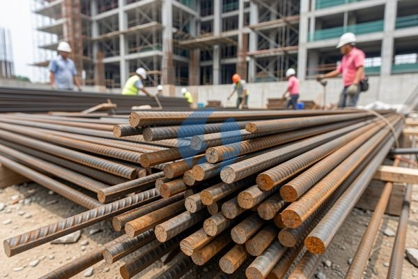

**Harga Besi 8mm per Batang dan Cara Mencocokkannya dengan Kebutuhan** - Mitra Sumber Material di mana pun berada, apakah Anda sedang merencanakan pembangunan atau renovasi dan mencari informasi harga besi 8mm per batang terbaru? Kami siap membantu menyiapkan kebutuhan besi Anda dengan kualitas terjamin dan pengiriman tepat waktu ke lokasi proyek Anda di Jabodetabek dan sekitarnya.



Besi 8mm adalah salah satu material penting dalam konstruksi. Nah, sebelum Kita membahas lebih jauh, penting untuk memahami bahwa harga besi bisa fluktuatif. Faktor-faktor seperti harga bahan baku, biaya transportasi, dan permintaan pasar sangat memengaruhi harga besi 8mm per batang di tahun 2026 ini.  Mitra, jangan khawatir, Kami di Sumber Material akan bantu pantau harga dan memberikan penawaran terbaik sesuai kebutuhan proyek Anda.

## Memilih Besi 8mm yang Tepat untuk Proyek Anda

Ada beberapa jenis besi 8mm yang tersedia di pasaran. Beberapa di antaranya adalah besi polos, besi ulir, dan besi beton. Besi polos umumnya digunakan untuk keperluan yang tidak memerlukan kekuatan tarik yang tinggi, seperti pagar atau rangka ringan. Besi ulir, dengan teksturnya yang bergaris, memberikan daya rekat yang lebih baik dengan beton dan sering digunakan untuk struktur bangunan utama. Besi beton adalah besi ulir yang memenuhi standar mutu tertentu (biasanya SNI) dan dirancang khusus untuk konstruksi beton bertulang.

Sebagai panduan, untuk proyek rumah tinggal, besi ulir 8mm seringkali menjadi pilihan yang tepat. Untuk bangunan yang lebih besar atau membutuhkan kekuatan yang lebih tinggi, besi beton dengan standar mutu yang sesuai (misalnya K8 atau K10) mungkin lebih disarankan. Anda bisa konsultasikan dengan Kami, dan Kami akan bantu memilih jenis besi yang paling sesuai dengan kebutuhan proyek Mitra Sumber Material.

## Ragam Besi 8mm yang Tersedia di Sumber Material

Kami menyediakan berbagai jenis besi 8mm yang siap memenuhi kebutuhan konstruksi Anda. Berikut beberapa pilihan yang tersedia:

- **Besi Polos 8mm:** Cocok untuk aplikasi dekoratif, rangka ringan, atau konstruksi yang tidak memerlukan kekuatan tarik tinggi.
- **Besi Ulir 8mm (SNI):** Pilihan populer untuk struktur beton bertulang, dengan daya rekat yang baik dan kekuatan yang terjamin.
- **Besi Beton 8mm (Mutu K8/K10):** Besi ulir dengan standar mutu SNI, ideal untuk fondasi, kolom, balok, dan struktur bangunan utama.

Selain ukuran 8mm, Kami juga menyediakan besi dengan diameter lain, seperti 6mm, 10mm, 12mm, dan seterusnya. Kami juga menyediakan berbagai panjang besi, mulai dari 6 meter hingga 12 meter, sesuai dengan kebutuhan proyek Anda. Nah, untuk proyek yang membutuhkan volume besar, Kami sarankan untuk menanyakan penawaran khusus ke Kami.

## Mengapa Memesan Besi 8mm di Sumber Material?

Mitra, selain menyediakan berbagai pilihan besi 8mm, Kami juga menawarkan beberapa keunggulan yang akan mempermudah dan mengefisienkan proyek Anda. Pertama, Kami melayani wilayah Jabodetabek dan sekitarnya, memastikan pengiriman tepat waktu ke lokasi proyek Anda. Kedua, Kami menjual material bangunan lengkap, termasuk pasir, batu, semen, bata, batako, hebel, dan lainnya – sehingga Anda bisa mendapatkan semua kebutuhan konstruksi Anda dalam satu tempat.

Selain itu, Kami juga menyediakan jasa sewa alat berat seperti molen, vibrator, dan pompa air untuk membantu mempercepat pekerjaan Anda.  Kami memahami betul bahwa waktu adalah uang dalam bisnis konstruksi, maka Kami berkomitmen untuk memberikan pelayanan yang cepat dan efisien. Kami juga siap membantu menghitung kebutuhan besi 8mm yang tepat untuk proyek Anda, sehingga Anda tidak perlu khawatir kelebihan atau kekurangan material.

## Mudah dan Cepat: Cara Pesan Besi 8mm di Sumber Material

Memesan besi 8mm di Sumber Material sangat mudah. Cukup hubungi Kami melalui tombol **Telepon** atau **WhatsApp** di bawah ini untuk menanyakan harga terbaru dan ketersediaan stok.  Anda juga bisa mengirimkan detail proyek Anda, seperti lokasi proyek, jenis besi yang dibutuhkan, dan perkiraan volume, agar Kami bisa memberikan penawaran yang lebih akurat.  Jangan ragu untuk berkonsultasi dengan tim Kami, Kami akan dengan senang hati membantu Anda memilih besi yang paling sesuai dengan kebutuhan proyek Anda. Kami juga melayani pengiriman ke Bogor, Jakarta, Bekasi, Karawang, Tangerang, dan Cikarang.

## Estimasi Kebutuhan Besi 8mm: Contoh Perhitungan Sederhana

Mitra Sumber Material, seringkali pertanyaan yang muncul adalah, “Berapa banyak besi 8mm yang saya butuhkan untuk proyek saya?” Nah, perhitungan ini memang penting agar tidak terjadi kekurangan atau kelebihan material. Sebagai gambaran, mari kita ambil contoh sederhana untuk membuat pondasi rumah ukuran 6x8 meter dengan tinggi 40 cm.

Asumsi: kita menggunakan besi ulir 8mm sebagai tulangan utama dan tulangan pengikat. Untuk tulangan utama, kita asumsikan jarak antar besi 20 cm, dan untuk tulangan pengikat, jaraknya 30 cm. Panjang besi utama per meter pondasi adalah 40 cm (tinggi pondasi). Jadi, untuk pondasi sepanjang 6 meter, dibutuhkan sekitar 6 / 0.2 = 30 batang besi utama. Karena keliling pondasi adalah 2 x (6 + 8) = 28 meter, total besi utama yang dibutuhkan adalah 28 x 30 = 840 batang.

Selanjutnya, untuk tulangan pengikat, kita membutuhkan 1 batang setiap 30 cm sepanjang pondasi. Jadi, 28 / 0.3 = sekitar 94 batang tulangan pengikat.  Perlu diingat, ini hanya contoh perhitungan sederhana. Kebutuhan besi sebenarnya bisa berbeda tergantung desain pondasi, kekuatan tanah, dan faktor lainnya.  Kami sarankan untuk berkonsultasi dengan ahli konstruksi atau teknisi sipil untuk mendapatkan perhitungan yang lebih akurat. Kami siap membantu menghitung estimasi kebutuhan besi proyek Anda secara gratis – jangan ragu untuk bertanya!

### Memperhatikan Wastafel Besi Saat Pemotongan

## Pertanyaan Umum Seputar Besi 8mm

Mitra, seringkali Kami menerima pertanyaan serupa dari pelanggan. Berikut beberapa pertanyaan umum seputar besi 8mm dan jawabannya:

### Berapa Berat Satu Batang Besi 8mm?

Berat satu batang besi 8mm bervariasi tergantung pada panjangnya. Umumnya, besi 8mm memiliki berat sekitar 0.693 kg per meter. Jadi, untuk besi 12 meter, beratnya sekitar 8.32 kg. Informasi ini penting untuk menghitung beban yang harus ditanggung oleh struktur bangunan Anda.

### Apa Perbedaan Besi Ulir dan Besi Polos?

Perbedaan utama antara besi ulir dan besi polos terletak pada permukaannya. Besi ulir memiliki tekstur bergaris yang memberikan daya rekat yang lebih baik dengan beton, sehingga lebih kuat dan tahan terhadap gaya tarik. Besi polos, di sisi lain, memiliki permukaan yang halus dan cocok untuk aplikasi yang tidak memerlukan kekuatan tarik yang tinggi.

### Bagaimana Cara Menyimpan Besi 8mm Agar Tidak Berkarat?

Penyimpanan besi 8mm yang tepat sangat penting untuk mencegah karat. Sebaiknya simpan besi di tempat yang kering dan terlindungi dari hujan dan kelembaban. Jika besi harus disimpan di luar ruangan, tutupi dengan terpal atau plastik untuk melindunginya dari cuaca. Karat dapat mengurangi kekuatan besi dan memperpendek umur pakainya.

### Apakah Besi 8mm Cukup Kuat untuk Struktur Utama?

Kekuatan besi 8mm cukup memadai untuk struktur utama, *tergantung pada desain struktural dan beban yang ditanggung*. Untuk beban yang lebih berat, Kami sarankan untuk menggunakan besi dengan diameter yang lebih besar atau besi beton dengan mutu yang lebih tinggi. Konsultasikan dengan ahli konstruksi untuk memastikan keamanan dan kekuatan struktur bangunan Anda.

## Memahami Standar Mutu Besi 8mm: SNI dan Kualitasnya

Mitra, saat memilih besi 8mm, penting untuk memperhatikan standar mutu yang berlaku. Di Indonesia, besi beton harus memenuhi standar SNI (Standar Nasional Indonesia). Standar ini memastikan bahwa besi memiliki kekuatan dan ketahanan yang sesuai untuk digunakan dalam konstruksi.  Besi yang sudah bersertifikasi SNI akan memiliki kekuatan tarik dan kekuatan luluh yang terjamin, sehingga lebih aman dan terpercaya. Kami di Sumber Material hanya menyediakan besi 8mm yang sudah teruji dan memenuhi standar SNI, jadi Mitra bisa tenang soal kualitasnya.

## Pertanyaan Lain yang Sering Ditanyakan

### Apakah Besi 8mm Mudah Bengkok?

Besi 8mm relatif mudah dibengkokkan, terutama besi polos. Namun, untuk besi ulir, dibutuhkan alat khusus dan keahlian agar tidak patah saat dibengkokkan.

### Bagaimana Cara Membedakan Besi Asli dan Besi Palsu?

Perhatikan tekstur dan warna besi. Besi asli biasanya memiliki warna abu-abu kehitaman dan tekstur yang seragam. Besi palsu seringkali memiliki warna yang lebih pucat dan tekstur yang tidak rata.

### Apa Itu Kekuatan Tarik Besi?

Kekuatan tarik besi adalah kemampuan besi untuk menahan gaya tarik sebelum patah. Semakin tinggi kekuatan tariknya, semakin kuat besi tersebut. Besi beton yang berkualitas memiliki kekuatan tarik yang tinggi.

### Bisakah Besi 8mm Digunakan untuk Kolom?

Besi 8mm bisa digunakan untuk kolom, tetapi jumlah dan susunannya harus disesuaikan dengan perhitungan struktur yang tepat. Konsultasikan dengan ahli konstruksi untuk memastikan keamanan dan kekuatan kolom Anda.

Tinggal satu langkah lagi: hubungi Kami lewat tombol **Telepon** atau **WhatsApp** di bawah untuk menanyakan harga dan jadwal pengiriman proyek Mitra Sumber Material.
