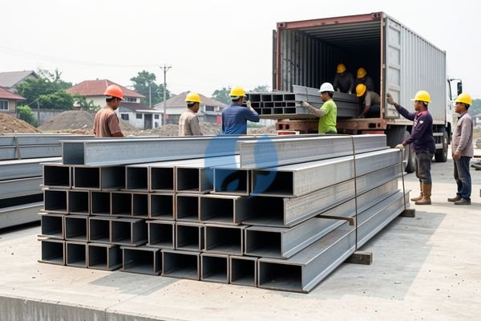

**Harga Besi Balok dan Cara Menghitung Kebutuhan Material** - Mitra Sumber Material yang budiman, jUDUL: Harga Besi Balok dan Cara Menghitung Kebutuhan Material



Memastikan kekuatan struktur bangunan adalah prioritas utama dalam setiap proyek konstruksi. Besi balok, sebagai elemen penting penyusun fondasi dan rangka bangunan, memerlukan perhitungan yang tepat agar sesuai kebutuhan. Nah, artikel ini akan membantu Anda memahami pertimbangan memilih besi balok yang tepat, sekaligus menawarkan solusi pengadaan mudah dan cepat dari Sumber Material.

## Memilih Besi Balok yang Tepat: Ukuran dan Mutu yang Perlu Diperhatikan

Sebelum membahas lebih jauh mengenai harga besi balok, penting untuk memahami jenis dan spesifikasi yang tersedia. Besi balok hadir dalam berbagai ukuran dan mutu, yang memengaruhi kekuatannya. Ukuran besi balok umumnya dinyatakan dalam milimeter (mm) atau inci. Semakin besar ukurannya, semakin besar pula daya tahannya. Mutu besi balok menunjukkan kekuatan tarik material, yang biasanya dinyatakan dalam MPa (Mega Pascal). Besi balok dengan mutu tinggi mampu menahan beban yang lebih besar.

Sebagai gambaran, besi balok dengan diameter 8mm hingga 16mm sering digunakan untuk konstruksi rumah tinggal, sementara proyek-proyek komersial atau industri mungkin memerlukan besi balok dengan diameter yang lebih besar, seperti 20mm atau 25mm. Pemilihan ukuran dan mutu besi balok harus disesuaikan dengan perhitungan beban dan desain struktur bangunan yang telah disetujui. Jangan ragu untuk berkonsultasi dengan ahli konstruksi untuk memastikan besi balok yang Anda pilih sesuai dengan kebutuhan proyek Anda. Apakah Anda sudah memiliki desain struktur bangunan? Kami bantu menghitung kebutuhan besi baloknya dengan tepat — [tanyakan harga lewat WhatsApp](https://api.whatsapp.com/send?phone=6285776786091&text=*Halo%20sumbermaterial.com*%20%3A)!

## Jenis Besi Balok yang Tersedia di Sumber Material

Kami di Sumber Material menyediakan berbagai jenis besi balok untuk memenuhi kebutuhan proyek Anda. Beberapa opsi yang tersedia meliputi:

- **Besi Balok Polos (Mild Steel):** Cocok untuk aplikasi umum yang tidak memerlukan kekuatan tarik tinggi.
- **Besi Balok U-50:** Digunakan untuk konstruksi ringan, seperti pagar atau rangka atap sederhana.
- **Besi Balok U-65:** Pilihan tepat untuk konstruksi yang memerlukan kekuatan lebih, seperti kolom dan balok.
- **Besi Balok S-40:** Ideal untuk konstruksi yang membutuhkan kekuatan tinggi, seperti struktur bangunan bertingkat.
- **Besi Balok Deformasi:** Besi balok dengan permukaan bertekstur, memberikan daya rekat yang lebih baik dengan beton.

Kami menyediakan besi balok dalam berbagai ukuran dan panjang standar, siap dikirim ke lokasi proyek Anda di Jabodetabek dan sekitarnya. Kami juga menawarkan layanan pemotongan besi balok sesuai dengan kebutuhan Anda, sehingga Anda tidak perlu membuang waktu dan tenaga untuk memotongnya sendiri. Bayangkan, Anda bisa langsung fokus pada pekerjaan utama proyek Anda tanpa repot memikirkan detail seperti pemotongan besi.

## Kenapa Memesan Besi Balok di Sumber Material?

Mitra Sumber Material, memesan besi balok dari Kami akan memberikan Anda banyak keuntungan. Pertama, Kami menawarkan harga besi balok yang kompetitif dan transparan. Kami selalu berusaha memberikan penawaran terbaik kepada pelanggan Kami, tanpa mengorbankan kualitas material. Harga ini bersifat estimasi dan dapat berubah sewaktu-waktu — hubungi Kami untuk penawaran terbaru dan paling akurat sesuai kebutuhan proyek Mitra.

Kedua, Kami memiliki stok besi balok yang selalu tersedia dalam jumlah yang cukup untuk memenuhi kebutuhan proyek skala besar sekalipun. Anda tidak perlu khawatir kehabisan material di tengah proses konstruksi. Ketiga, Kami melayani pengiriman besi balok ke seluruh wilayah Jabodetabek dan sekitarnya. Kami memastikan pesanan Anda sampai ke lokasi proyek tepat waktu dan dalam kondisi yang baik. Keempat, Kami berlokasi strategis di Bogor, Jakarta, Bekasi, Karawang, Tangerang, dan Cikarang, sehingga memudahkan Anda untuk melakukan pemesanan dan pengambilan material.

Dengan Kami, Anda bisa hemat waktu dan tenaga, karena Kami yang akan mengurus semua kebutuhan besi balok Anda. Anda bisa fokus pada hal-hal yang lebih penting, seperti memastikan kualitas pekerjaan dan menyelesaikan proyek tepat waktu.

## Pesan Besi Balok Sekarang Juga: Mudah dan Cepat!

Untuk memesan besi balok atau menanyakan harga terbaru, Anda bisa menghubungi Kami melalui tombol **WhatsApp** atau **Telepon** di bawah halaman ini. Tim Kami yang berpengalaman akan dengan senang hati membantu Anda memilih besi balok yang tepat sesuai dengan kebutuhan proyek Anda. Kami juga bisa memberikan konsultasi gratis mengenai perhitungan kebutuhan material dan solusi konstruksi yang optimal. Jangan tunda kebutuhan proyek Mitra Sumber Material — tanyakan harga dan ketersediaannya sekarang lewat tombol **WhatsApp** atau **Telepon** di bawah halaman ini.

DESCRIPTION: Harga besi balok di Sumber Material Jabodetabek. Tersedia berbagai ukuran dan mutu, pengiriman cepat dan stok selalu tersedia. Tanyakan harga sekarang!
TAGS: harga besi balok, besi balok, jual besi balok, supplier besi balok, harga besi beton

## Contoh Perhitungan Kebutuhan Besi Balok untuk Sloof

Mitra Sumber Material, memahami kebutuhan besi balok untuk proyek Anda memerlukan perhitungan yang cermat. Mari kita ambil contoh perhitungan untuk kebutuhan besi balok pada sloof bangunan rumah dengan dimensi 6m x 8m. Sloof ini akan menggunakan besi balok diameter 10mm dengan jarak antar besi 20cm.

Pertama, hitung panjang total sloof: (6m + 8m) x 2 = 28 meter. Kemudian, hitung jumlah besi balok yang dibutuhkan per meter. Dengan jarak 20cm, maka dibutuhkan 1/0.2 = 5 batang besi per meter. Jadi, total besi balok yang dibutuhkan adalah 28 meter x 5 batang/meter = 140 batang.

Perlu diingat bahwa ini adalah perhitungan dasar. Perhitungan yang lebih akurat harus mempertimbangkan faktor-faktor seperti tinggi sloof, beban bangunan, dan jenis tanah. Kami sarankan untuk berkonsultasi dengan ahli konstruksi untuk mendapatkan perhitungan yang tepat. Jika Anda belum yakin dengan perhitungannya, jangan ragu untuk mengirimkan detail proyek Anda lewat WhatsApp — Kami bantu hitungkan kebutuhan besi balok Anda secara gratis.

## Memahami Perbedaan Besi Balok Polos dan Besi Balok Ulir

Seringkali, Mitra Sumber Material bertanya tentang perbedaan antara besi balok polos dan besi balok ulir. Perbedaan utama terletak pada permukaannya. Besi balok polos memiliki permukaan yang halus, sedangkan besi balok ulir memiliki tekstur bergelombang atau ulir.

Tekstur ulir pada besi balok ulir memberikan daya rekat yang lebih baik dengan beton, sehingga meningkatkan kekuatan struktur bangunan. Karena itulah, besi balok ulir umumnya digunakan untuk aplikasi yang membutuhkan kekuatan tarik yang lebih tinggi, seperti kolom, balok, dan fondasi. Sementara besi balok polos lebih sering digunakan untuk aplikasi yang lebih ringan, seperti pagar atau rangka atap sederhana.

Pemilihan antara besi balok polos dan besi balok ulir tergantung pada kebutuhan proyek Anda. Jika Anda membangun struktur yang membutuhkan kekuatan tinggi, besi balok ulir adalah pilihan yang lebih baik. Jika Anda membangun struktur yang lebih ringan, besi balok polos mungkin sudah cukup.

## Pertanyaan Umum Tentang Besi Balok: Tanya Jawab

Banyak Mitra Sumber Material yang menanyakan pertanyaan serupa. Berikut beberapa pertanyaan yang sering muncul beserta jawabannya:

### Berapa Panjang Standar Besi Balok?

Besi balok umumnya tersedia dalam panjang standar 8 meter atau 12 meter. Kami juga menyediakan layanan pemotongan besi balok sesuai dengan kebutuhan Anda.

### Bagaimana Cara Menyimpan Besi Balok Agar Tidak Berkarat?

Simpan besi balok di tempat yang kering dan terlindung dari hujan. Jika disimpan di luar ruangan, tutupi dengan terpal atau bahan pelindung lainnya.

### Apakah Besi Balok Bisa Dibengkokkan?

Ya, besi balok dapat dibengkokkan dengan menggunakan alat yang sesuai. Namun, pembengkokan harus dilakukan dengan hati-hati agar tidak merusak struktur besi.

### Apa Perbedaan Besi Balok dengan Besi Beton?

Istilah "besi balok" dan "besi beton" sering digunakan secara bergantian, namun sebenarnya ada perbedaan. Besi beton adalah istilah yang lebih umum, yang mencakup semua jenis besi yang digunakan dalam konstruksi beton. Besi balok adalah salah satu jenis besi beton yang berbentuk batang panjang.
