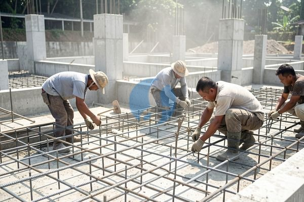

**Mengapa Harga Besi Buat Pondasi Perlu Dicek Ulang saat Memesan?** - Mitra Sumber Material yang berbahagia, seringkali biaya tak terduga jadi mimpi buruk di tengah proyek pembangunan. Salah satu yang paling sering bikin anggaran jebol adalah salah perhitungan kebutuhan besi beton untuk pondasi. Nah, Kami di Sumber Material siap membantu Anda menghindari hal itu sebelum memesan. Dengan pengalaman bertahun-tahun melayani proyek di Jabodetabek dan sekitarnya, Kami paham betul kebutuhan Anda dan memberikan solusi pengiriman langsung ke lokasi proyek, jadi Anda tidak perlu pusing mengurus transportasi sendiri.



## Pilihan Besi Beton untuk Pondasi: Apa yang Perlu Diperhatikan?

Mitra, sebelum membahas harga, penting untuk memahami pilihan besi beton yang tersedia. Ada berbagai ukuran dan mutu besi yang bisa Anda pilih, masing-masing dengan keunggulan dan kekurangannya. Misalnya, besi diameter 10mm cocok untuk struktur ringan, sementara besi diameter 16mm atau lebih besar umumnya digunakan untuk pondasi bangunan bertingkat. Mutu besi juga krusial – besi dengan mutu yang lebih tinggi (seperti SNI 400) menawarkan kekuatan tarik yang lebih baik, sehingga lebih tahan terhadap beban berat.

Nah, pemilihan besi yang tepat ini tidak hanya memengaruhi kekuatan pondasi, tapi juga biaya keseluruhan proyek. Jika Anda bingung memilih, jangan ragu untuk konsultasi dengan tim Kami. Kami akan bantu menghitung kebutuhan besi beton secara akurat dan merekomendasikan jenis yang paling sesuai dengan anggaran dan spesifikasi proyek Anda. Tanyakan harga terbaru besi beton untuk pondasi via WhatsApp atau telepon, ya!

## Jenis Besi Beton yang Tersedia di Sumber Material

Sumber Material menyediakan berbagai jenis besi beton yang siap mendukung proyek Anda. Kami memiliki besi beton polos (tanpa ulir) dan besi beton ulir, dengan berbagai diameter mulai dari 8mm, 10mm, 12mm, 14mm, hingga 16mm dan seterusnya. Untuk mutu, Kami hanya menyediakan besi SNI yang terjamin kualitasnya, termasuk SNI 400 yang paling umum digunakan untuk pondasi rumah dan bangunan komersial.

Sebagai contoh, untuk pondasi rumah 2 lantai dengan luas 100m², Anda mungkin membutuhkan sekitar 1 ton besi beton diameter 12mm dengan mutu SNI 400. Besi ini akan memberikan kekuatan yang cukup untuk menahan beban struktur bangunan di atasnya. Tentu saja, kebutuhan ini bisa bervariasi tergantung desain pondasi dan kondisi tanah. Untuk perhitungan yang lebih akurat, Kami sarankan untuk berkonsultasi dengan ahli struktur atau langsung menghubungi Kami. Kami siap memberikan penawaran harga terbaik dan membantu Anda memperkirakan kebutuhan besi beton yang tepat.

## Kenapa Membeli Besi Beton di Sumber Material?

Mitra Sumber Material, selain menyediakan berbagai jenis besi beton berkualitas, Kami juga menawarkan kemudahan dan keuntungan lainnya. Pertama, Kami melayani pengiriman langsung ke lokasi proyek Anda di wilayah Jabodetabek dan sekitarnya. Ini akan menghemat waktu dan biaya transportasi Anda, karena Anda tidak perlu lagi repot mencari truk atau mengatur logistik sendiri. Kedua, Kami selalu memastikan stok barang tersedia, sehingga Anda tidak perlu khawatir kehabisan material di tengah proyek. Ketiga, Kami memberikan layanan konsultasi gratis untuk membantu Anda memilih besi beton yang tepat dan menghitung kebutuhan secara akurat.

Kami berlokasi di Bogor, Jakarta, Bekasi, Karawang, Tangerang, dan Cikarang, sehingga pengiriman ke wilayah-wilayah tersebut bisa lebih cepat dan efisien. Kami mengutamakan kepuasan pelanggan dan berusaha memberikan pelayanan terbaik dalam setiap transaksi. Dengan pengalaman bertahun-tahun di industri material bangunan, Kami yakin bisa menjadi mitra yang terpercaya untuk proyek Anda. Jangan ragu untuk tanyakan harga besi beton terbaru dan dapatkan penawaran spesial dari Kami.

## Pesan Besi Beton Sekarang – Mudah dan Cepat!

Anda sudah tahu jenis besi beton yang dibutuhkan? Proses pemesanan di Sumber Material sangat mudah. Cukup hubungi Kami melalui tombol **WhatsApp** atau **Telepon** yang tersedia di halaman ini. Sampaikan kebutuhan material (ukuran, mutu, jumlah) dan lokasi proyek Anda. Tim Kami akan segera merespons dan memberikan penawaran harga terbaik. Kami juga bisa membantu menghitung kebutuhan besi beton secara gratis, sehingga Anda bisa mendapatkan estimasi biaya yang lebih akurat.

## Memahami Peran Besi Beton dalam Kekuatan Pondasi

Mitra, kekuatan pondasi adalah kunci utama keberhasilan sebuah bangunan. Besi beton berperan krusial dalam menahan gaya tarik yang terjadi akibat beban bangunan dan tekanan tanah. Bentuk ulirnya pada besi beton ulir memberikan daya rekat yang lebih baik dengan beton, sehingga meningkatkan kekuatan gesek dan mencegah terjadinya retak akibat tegangan tarik. Pemilihan diameter dan mutu besi beton yang tepat sangat berpengaruh pada kemampuan pondasi menahan beban.

Sebagai gambaran, mari kita lihat contoh perhitungan sederhana untuk kebutuhan besi beton pada pondasi tapak rumah sederhana berukuran 6x8 meter dengan tinggi tapak 60 cm. Dengan asumsi jarak antar besi minimal 15 cm, kita membutuhkan sekitar 12 batang besi diameter 12mm untuk setiap tapak pondasi. Jika pondasi terdiri dari 8 tapak, maka total kebutuhan besi diameter 12mm adalah 96 batang. Angka ini masih bisa berubah tergantung desain pondasi dan rekomendasi dari ahli struktur. Penting diingat, perhitungan ini hanya sebagai ilustrasi, dan Kami sarankan untuk selalu berkonsultasi dengan profesional untuk mendapatkan hasil yang akurat.

## Pertanyaan Umum Seputar Besi Beton untuk Pondasi

Banyak Mitra Sumber Material yang menanyakan hal serupa sebelum memesan besi beton. Berikut beberapa pertanyaan yang sering muncul:

### Berapa Mutu Besi Beton yang Terbaik untuk Pondasi?

Mutu besi beton yang paling umum digunakan untuk pondasi adalah SNI 400. Mutu ini menawarkan keseimbangan yang baik antara kekuatan dan harga. Namun, untuk bangunan dengan beban lebih berat atau kondisi tanah yang kurang stabil, besi beton dengan mutu lebih tinggi mungkin diperlukan.

### Bagaimana Cara Menghitung Kebutuhan Besi Beton Secara Akurat?

Perhitungan kebutuhan besi beton sebaiknya dilakukan oleh ahli struktur atau profesional yang berpengalaman. Mereka akan mempertimbangkan desain pondasi, beban bangunan, kondisi tanah, dan faktor-faktor lainnya untuk memastikan kekuatan pondasi yang optimal.

### Apa Perbedaan Besi Beton Polos dan Besi Beton Ulir?

Perbedaan utama terletak pada permukaannya. Besi beton polos memiliki permukaan yang halus, sedangkan besi beton ulir memiliki alur-alur spiral di permukaannya. Alur ini meningkatkan daya rekat antara besi beton dan beton, sehingga lebih tahan terhadap gaya tarik. Untuk pondasi, besi beton ulir umumnya lebih direkomendasikan karena kekuatan dan daya tahannya yang lebih baik.

### Apakah Besi Beton Bisa Berkarat? Bagaimana Cara Mengatasinya?

Ya, besi beton bisa berkarat jika terkena air dan oksigen. Karat dapat mengurangi kekuatan besi beton dan memperpendek umur bangunan. Untuk mencegah karat, pastikan besi beton terlindungi oleh lapisan beton yang cukup tebal dan hindari kontak langsung dengan tanah atau air.

## Kesalahan Umum yang Harus Dihindari Saat Memesan Besi Beton

Mitra, ada beberapa kesalahan umum yang sering dilakukan saat memesan besi beton yang bisa berakibat fatal pada kekuatan pondasi. Salah satunya adalah membeli besi beton tanpa SNI. Besi beton tanpa SNI seringkali memiliki mutu yang tidak terjamin dan kekuatan yang lebih rendah dari standar. Kesalahan lainnya adalah salah menghitung kebutuhan besi beton, yang bisa menyebabkan kekurangan material atau pemborosan biaya.

Selain itu, jangan lupa untuk memeriksa kondisi besi beton sebelum digunakan. Pastikan tidak ada karat, bengkok, atau cacat lainnya yang bisa mengurangi kekuatannya. Jika Anda menemukan besi beton yang rusak, jangan gunakan dan segera hubungi supplier untuk penggantian. Kami di Sumber Material selalu memastikan kualitas besi beton yang Kami jual, sehingga Anda bisa tenang dan fokus pada proses pembangunan.

## Memastikan Kualitas Besi Beton: Ciri-ciri yang Perlu Diperhatikan

Mitra, sebelum besi beton Kami kirimkan ke lokasi proyek Anda, semua material sudah melalui proses quality control yang ketat. Tapi, sebagai pembeli yang cerdas, Anda juga bisa melakukan pengecekan sederhana untuk memastikan kualitasnya. Perhatikan apakah besi beton memiliki lapisan karat yang tebal – karat tipis masih wajar, tapi karat yang berlebihan bisa mengindikasikan penurunan mutu. Selain itu, pastikan tidak ada bekas las atau sambungan yang mencurigakan, karena ini bisa menjadi titik lemah pada struktur beton. Perhatikan juga label atau stempel SNI yang tertera pada besi beton – pastikan label tersebut masih utuh dan jelas terbaca.

## Pertanyaan Lain yang Sering Diajukan Pembeli

### Apakah Besi Beton Bisa Dipotong Sendiri?

Bisa, Mitra. Tapi sebaiknya gunakan mesin potong besi yang sesuai agar hasilnya rapi dan tidak merusak struktur besi. Potongan yang kasar bisa mengurangi kekuatan besi beton.

### Bagaimana Cara Menyimpan Besi Beton dengan Benar?

Simpan besi beton di tempat yang kering dan terlindung dari hujan atau kelembaban. Jika disimpan di luar ruangan, tutupi dengan terpal atau bahan pelindung lainnya untuk mencegah karat.

### Apa Itu Besi Beton Deformasi? Apakah Perlu Digunakan?

Besi beton deformasi adalah besi beton ulir yang permukaannya memiliki pola ulir yang lebih menonjol. Jenis ini memberikan daya rekat yang lebih kuat dengan beton, sehingga sangat direkomendasikan untuk struktur yang membutuhkan kekuatan tarik tinggi, seperti pondasi bangunan bertingkat atau jembatan.

Mau tahu harga terbaru untuk kebutuhan proyek Mitra Sumber Material? Klik tombol **WhatsApp** atau **Telepon** di bawah, kirim kebutuhan dan lokasi proyek, Kami bantu hitungkan.
