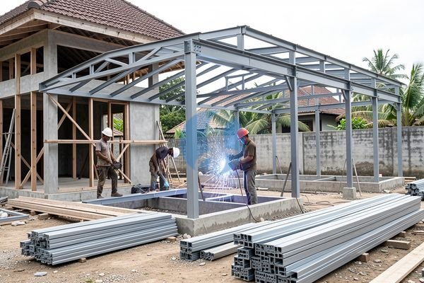

**Pertanyaan Seputar Harga Besi Kuda Kuda Rumah yang Sering Muncul** - Mitra, apakah Anda sedang merencanakan pembangunan rumah baru atau renovasi atap? Salah satu komponen penting yang perlu Anda perhatikan adalah kuda-kuda. Kuda-kuda berfungsi sebagai penopang utama atap, menjamin kekuatan dan stabilitas bangunan Anda. Nah, harga besi kuda-kuda rumah ini bervariasi tergantung jenis besi yang digunakan dan kompleksitas desain atap. Kami dari Sumber Material siap membantu Anda mendapatkan material yang tepat sesuai anggaran dan kebutuhan proyek Anda.



## Pilihan Besi Kuda-Kuda: Mana yang Paling Tepat untuk Rumah Anda?

Mitra, sebelum membahas harga, mari kita lihat dulu pilihan material besi yang umum digunakan untuk membuat kuda-kuda. Ada besi beton, besi hollow, dan baja ringan. Masing-masing memiliki kelebihan dan kekurangan. Besi beton dikenal dengan kekuatannya yang tinggi, cocok untuk bangunan besar atau area rawan gempa. Namun, pemasangannya lebih rumit dan memerlukan tukang las yang ahli. Besi hollow lebih ringan dan mudah dikerjakan, cocok untuk desain atap yang lebih sederhana. Sementara baja ringan menawarkan kombinasi kekuatan dan ringan, serta tahan karat — pilihan populer belakangan ini. Nah, untuk proyek yang membutuhkan perhitungan detail dan pengiriman tepat waktu, Kami siap membantu Anda. Dengan informasikan kebutuhan dan lokasi proyek ke Kami lewat WhatsApp, Kami akan bantu hitungkan kebutuhan besi dan material lainnya.

## Jenis Besi Kuda-Kuda & Estimasi Biayanya

Ada beberapa jenis besi yang paling sering digunakan untuk kuda-kuda rumah. Besi beton, misalnya, biasanya menggunakan ukuran diameter 10mm hingga 16mm, tergantung bentang atap. Untuk besi hollow, Anda bisa memilih ukuran 40x40mm atau 40x60mm dengan ketebalan yang bervariasi. Sedangkan baja ringan tersedia dalam berbagai profil seperti C75, C100, dan C150.

Sebagai gambaran, mari kita lihat contoh perhitungan sederhana untuk rumah dengan luas atap 100 meter persegi:

- **Besi Beton:** Membutuhkan sekitar 1 ton besi beton dengan estimasi harga Rp15.000.000 – Rp18.000.000 (harga bersifat estimasi dan dapat berubah sewaktu-waktu — hubungi Kami untuk penawaran terbaru dan paling akurat sesuai kebutuhan proyek Mitra).
- **Besi Hollow:** Membutuhkan sekitar 500 kg besi hollow dengan estimasi harga Rp8.000.000 – Rp12.000.000 (harga bersifat estimasi dan dapat berubah sewaktu-waktu — hubungi Kami untuk penawaran terbaru dan paling akurat sesuai kebutuhan proyek Mitra).
- **Baja Ringan:** Membutuhkan sekitar 300 kg baja ringan dengan estimasi harga Rp10.000.000 – Rp15.000.000 (harga bersifat estimasi dan dapat berubah sewaktu-waktu — hubungi Kami untuk penawaran terbaru dan paling akurat sesuai kebutuhan proyek Mitra).

## Kenapa Harus Pesan Besi Kuda-Kuda di Sumber Material?

Mitra Sumber Material, Kami mengerti betul tantangan dalam mendapatkan material bangunan yang berkualitas dengan harga bersaing. Itulah kenapa Kami hadir untuk mempermudah proses pengadaan material Anda. Kami menjual berbagai jenis besi, mulai dari besi beton, besi hollow, hingga baja ringan, dengan kualitas terjamin. Kami melayani pengiriman ke seluruh wilayah Jabodetabek dan sekitarnya, termasuk Bogor, Jakarta, Bekasi, Karawang, Tangerang, dan Cikarang.

Keunggulan memesan di Sumber Material:

- **Kualitas Terjamin:** Kami hanya menyediakan material dari produsen terpercaya.
- **Harga Kompetitif:** Kami menawarkan harga yang bersaing dengan kualitas yang sama.
- **Pengiriman Tepat Waktu:** Kami memastikan material sampai di lokasi proyek Anda tepat waktu.
- **Konsultasi Gratis:** Tim Kami siap membantu Anda menghitung kebutuhan material dan memberikan solusi terbaik untuk proyek Anda.
- **Kemudahan Pemesanan:** Anda cukup kirim kebutuhan dan lokasi proyek lewat WhatsApp, Kami bantu hitungkan dan arahkan pesanannya.

## Pesan Besi Kuda-Kuda Sekarang, Proyek Anda Lancar!

Yuk, jangan tunda lagi! Dapatkan penawaran harga besi kuda-kuda rumah terbaik dari Kami sekarang juga. Anda cukup mengirimkan detail proyek Anda (luas atap, jenis atap, lokasi proyek) lewat WhatsApp. Kami akan segera merespon dan memberikan penawaran yang sesuai dengan kebutuhan Anda. Kami juga menyediakan jasa sewa alat berat dan jasa urug/cor kalau Mitra membutuhkannya. Kami siap menjadi mitra terpercaya Anda dalam membangun rumah impian.

## Perhitungan Kebutuhan Besi Kuda-Kuda: Contoh Kasus Nyata

Mitra, memahami kebutuhan besi kuda-kuda secara tepat akan membantu Anda menghindari pemborosan dan memastikan kekuatan struktur atap. Mari kita ambil contoh kasus rumah dengan desain atap pelana sederhana, bentang 8 meter, dan jarak antar kuda-kuda 40 cm. Pertama, kita hitung jumlah kuda-kuda yang dibutuhkan: 8 meter / 0,4 meter = 20 buah. Selanjutnya, untuk setiap kuda-kuda, kita asumsikan kebutuhan besi beton diameter 12mm sepanjang 6 meter (ini bisa bervariasi tergantung desain dan beban atap). Jadi, total besi beton yang dibutuhkan adalah 20 kuda-kuda x 6 meter/kuda-kuda = 120 meter. Untuk besi hollow, misalnya ukuran 40x60mm dengan tebal 1.6mm, kebutuhan bisa dihitung berdasarkan panjang total yang dibutuhkan untuk seluruh rangka kuda-kuda. Jika setiap kuda-kuda membutuhkan 4 meter besi hollow, maka totalnya adalah 20 kuda-kuda x 4 meter/kuda-kuda = 80 meter. Perlu diingat, angka ini hanya estimasi. Kami sarankan untuk berkonsultasi dengan ahli konstruksi atau Kami, agar perhitungan lebih akurat sesuai desain atap Anda.

## Pertanyaan Umum Seputar Besi Kuda-Kuda

Banyak Mitra Sumber Material yang menanyakan hal serupa sebelum memesan. Berikut beberapa pertanyaan yang sering muncul:

### Berapa Jarak Ideal Antar Kuda-Kuda?

Jarak ideal antar kuda-kuda sangat bergantung pada bentang atap, jenis atap, dan beban yang ditanggung. Secara umum, jarak 40 cm hingga 60 cm sudah cukup ideal untuk rumah tinggal. Semakin besar bentang atap, semakin dekat jarak antar kuda-kuda yang dibutuhkan.

### Apakah Besi Hollow Cukup Kuat untuk Kuda-Kuda?

Besi hollow bisa menjadi pilihan yang baik jika digunakan dengan ukuran dan ketebalan yang tepat. Pastikan besi hollow yang Anda pilih memiliki kekuatan yang sesuai dengan beban atap dan desain bangunan. Konsultasikan dengan ahli konstruksi untuk memastikan keamanannya.

### Bagaimana Cara Memastikan Kualitas Besi yang Kami Beli?

Pilih besi dari supplier terpercaya seperti Kami, yang hanya menyediakan material dari produsen terpercaya. Periksa juga sertifikasi mutu besi (misalnya SNI) dan pastikan tidak ada karat atau cacat fisik pada besi.

### Apakah Besi Kuda-Kuda Perlu Di-coating Anti Karat?

Untuk besi beton, coating anti karat tidak terlalu penting karena beton akan melindunginya. Namun, untuk besi hollow atau baja ringan, coating anti karat sangat disarankan, terutama jika berada di lingkungan yang lembap atau dekat dengan air laut, untuk memperpanjang umur pakainya.

## Hindari Kesalahan Umum Saat Memesan Besi Kuda-Kuda

Mitra, ada beberapa kesalahan umum yang sering terjadi saat memesan besi kuda-kuda. Pertama, kurang teliti dalam menghitung kebutuhan besi. Akibatnya, bisa terjadi kekurangan material atau justru kelebihan yang membuang-buang anggaran. Kedua, memilih besi dengan kualitas rendah. Ini bisa membahayakan kekuatan struktur atap dan berpotensi menyebabkan kerusakan di kemudian hari. Ketiga, tidak mempertimbangkan jarak antar kuda-kuda yang ideal. Jarak yang terlalu lebar bisa membuat atap melengkung atau bahkan roboh. Keempat, lupa memastikan ketersediaan stok material. Ini bisa menunda proyek Anda. Nah, untuk menghindari masalah ini, percayakan saja pengadaan material Anda kepada Kami. Kami bantu hitungkan kebutuhan dengan tepat, sediakan material berkualitas, dan pastikan pengiriman tepat waktu.

## Tips Memilih Besi Hollow untuk Kuda-Kuda: Tebal dan Ukuran yang Tepat

Mitra, jika Anda memilih besi hollow untuk kuda-kuda, ada beberapa hal penting yang perlu diperhatikan. Jangan hanya terpaku pada harga murah, tapi pastikan ketebalan dan ukuran besi hollow sesuai dengan kebutuhan proyek Anda. Semakin besar bentang atap dan semakin berat material penutup atap (genteng, seng, dll), semakin tebal dan besar ukuran besi hollow yang dibutuhkan. Sebagai panduan, untuk bentang 6-8 meter, disarankan menggunakan besi hollow 40x60mm dengan ketebalan minimal 1.6mm. Untuk bentang lebih dari 8 meter, sebaiknya gunakan ukuran 50x100mm atau bahkan lebih besar, tergantung perhitungan beban.

## Pertanyaan Penting Sebelum Anda Memesan Besi Kuda-Kuda

Banyak Mitra Sumber Material yang bertanya hal-hal spesifik sebelum memesan. Berikut beberapa pertanyaan yang sering muncul:

### Apakah Besi SNI Wajib Digunakan?

Ya, sangat disarankan. Besi SNI (Standar Nasional Indonesia) sudah teruji kualitas dan kekuatannya, menjamin keamanan struktur atap Anda. Kami hanya menyediakan besi SNI untuk memastikan kualitas terbaik.

### Bagaimana Cara Menghitung Jumlah Besi yang Dibutuhkan dengan Akurat?

Kami sarankan untuk berkonsultasi dengan ahli konstruksi atau Kami. Perhitungan yang akurat membutuhkan data detail tentang desain atap, beban atap, dan jarak antar kuda-kuda.

### Apa Saja yang Perlu Diperhatikan Saat Menerima Pengiriman Besi?

Periksa kondisi besi dengan teliti. Pastikan tidak ada karat, penyok, atau cacat fisik lainnya. Jika ada kerusakan, segera laporkan ke Kami.

### Apakah Kami Melayani Pemotongan Besi Sesuai Ukuran?

Ya, Kami bisa memotong besi sesuai ukuran yang Anda butuhkan. Ini akan menghemat waktu dan tenaga Anda di lokasi proyek.

Tinggal satu langkah lagi: hubungi Kami lewat tombol **Telepon** atau **WhatsApp** di bawah untuk menanyakan harga dan jadwal pengiriman proyek Mitra Sumber Material.
