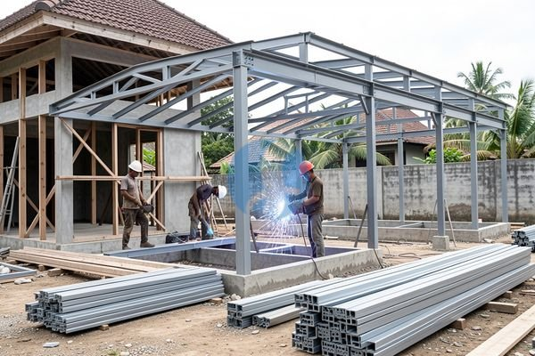

**Harga Besi Pondasi Rumah untuk Rumah Tinggal dan Ruko** - Mitra Sumber Material yang berbahagia, seringkali biaya tak terduga jadi momok proyek konstruksi, terutama soal besi pondasi. Banyak yang akhirnya kehabisan anggaran karena salah perhitungan atau harga material yang melonjak. Nah, Kami hadir untuk membantu Anda menghindari masalah ini sebelum memesan.



## Pilihan Besi Pondasi: Mana yang Paling Tepat untuk Rumah Anda?

Mitra Sumber Material, sebelum membahas harga, penting untuk memahami ada beberapa jenis besi yang bisa dipakai untuk pondasi. Pilihan utama biasanya besi beton polos (PH) dan besi beton ulir (reinforcing steel bar/rebar). Besi beton polos cocok untuk elemen yang tidak menerima tegangan tarik besar, sedangkan besi beton ulir lebih kuat dan ideal untuk menahan beban berat. Kalau proyek Anda rumah tinggal sederhana, besi beton polos mungkin sudah cukup. Tapi, untuk rumah bertingkat atau tanah kurang stabil, besi beton ulir sangat disarankan.

Pertimbangan lain adalah diameter besi. Semakin besar diameter, semakin kuat besi tersebut, tapi harganya juga semakin mahal. Pemilihan diameter besi perlu disesuaikan dengan desain struktur bangunan yang ada. Nah, untuk memastikan Anda memilih besi yang tepat, jangan ragu untuk konsultasi dengan Kami. Kami bantu hitungkan kebutuhan besi pondasi sesuai desain rumah Anda, tanpa biaya tambahan.

## Jenis Besi Pondasi yang Tersedia di Sumber Material

Kami di Sumber Material menyediakan berbagai jenis besi pondasi yang berkualitas dan sesuai standar SNI. Ada besi beton polos dengan diameter mulai dari 8mm hingga 16mm, serta besi beton ulir dengan diameter yang lebih variatif, mulai dari 10mm hingga 32mm. Untuk proyek yang membutuhkan kekuatan ekstra, Kami juga menyediakan besi baja karbon tinggi (high-strength steel bars) yang memiliki daya tahan luar biasa.

Selain itu, Kami juga menyediakan *wiremesh* yang sering digunakan sebagai pengganti atau pelengkap besi beton pada pondasi ringan. *Wiremesh* ini praktis karena sudah berbentuk lembaran atau jaring yang siap dipasang. Coba bayangkan, Mitra, Anda punya proyek pembangunan teras atau garasi – *wiremesh* bisa jadi solusi cepat dan ekonomis.

## Alasan Memilih Sumber Material untuk Kebutuhan Besi Pondasi Anda

Mengapa Mitra Sumber Material harus memilih Kami? Pertama, Kami memberikan harga yang kompetitif dan transparan. Anda bisa langsung menanyakan harga terbaru untuk berbagai jenis besi pondasi, lengkap dengan perkiraan biaya pengiriman. Kami juga memberikan penawaran khusus untuk pembelian dalam jumlah besar. Kedua, Kami selalu memastikan ketersediaan stok yang cukup. Anda tidak perlu khawatir kehabisan material di tengah proyek. Ketiga, Kami melayani pengiriman ke seluruh wilayah Jabodetabek dan sekitarnya. Besi pondasi Anda akan sampai di lokasi proyek dengan aman dan tepat waktu. Keempat, Kami berlokasi strategis di Bogor, Jakarta, Bekasi, Karawang, Tangerang, dan Cikarang, sehingga memudahkan Anda untuk survei lokasi atau mengambil material langsung.

Harga ini bersifat estimasi dan dapat berubah sewaktu-waktu — hubungi Kami untuk penawaran terbaru dan paling akurat sesuai kebutuhan proyek Mitra.

## Pesan Besi Pondasi Sekarang: Mudah dan Cepat!

## Hitung Kebutuhan Besi Pondasi Rumah: Contoh Praktis

Mitra Sumber Material, seringkali yang bikin bingung adalah menghitung berapa banyak besi yang dibutuhkan. Jangan khawatir, Kami akan berikan contoh perhitungan sederhana untuk pondasi rumah tipe 36. Anggap saja pondasi rumah Anda berbentuk persegi panjang dengan ukuran 6m x 8m dan tinggi 0,5m. Kita akan menggunakan besi beton ulir diameter 10mm dengan jarak antar besi 20cm.

Untuk menghitung kebutuhan besi, pertama kita hitung total panjang besi yang dibutuhkan untuk setiap sisi pondasi. Karena pondasi berbentuk persegi panjang, ada dua sisi dengan panjang 6m dan dua sisi dengan panjang 8m. Jadi, total panjang pondasi adalah (2 x 6m) + (2 x 8m) = 28m.

Selanjutnya, kita hitung jumlah besi yang dibutuhkan per meter. Jika jarak antar besi adalah 20cm (0,2m), maka jumlah besi per meter adalah 1m / 0,2m = 5 batang.

Jadi, total besi yang dibutuhkan untuk seluruh pondasi adalah 28m x 5 batang/m = 140 batang. Ini adalah perhitungan kasar, ya. Perlu diingat, perhitungan ini belum termasuk kebutuhan untuk *sengkang* (besi pengikat) dan kemungkinan pemotongan atau pemborosan. Untuk hasil yang lebih akurat, sebaiknya konsultasikan dengan ahli konstruksi atau langsung tanyakan kepada Kami. Kami akan bantu menghitung kebutuhan besi pondasi Anda secara detail dan presisi, sesuai dengan desain bangunan dan kondisi lahan.

### Pentingnya Memperhatikan Jarak Antar Besi

Jarak antar besi sangat krusial, Mitra. Jika terlalu rapat, besi bisa saling menghalangi dan mengurangi kekuatannya. Jika terlalu renggang, kekuatan pondasi juga berkurang dan berpotensi retak. Standar umumnya adalah 20-30cm, tergantung pada beban bangunan dan jenis tanah. Nah, Kami siap membantu Anda menentukan jarak yang ideal untuk proyek Anda.

## Pertanyaan Umum Seputar Besi Pondasi

Banyak pertanyaan menarik yang sering Kami terima dari Mitra Sumber Material. Berikut beberapa di antaranya:

### Berapa Mutu Besi Beton yang Terbaik?

Mutu besi beton biasanya ditandai dengan angka, misalnya FY400 atau FY500. Semakin tinggi angkanya, semakin kuat besi tersebut. Untuk rumah tinggal biasa, besi FY400 sudah cukup memadai. Namun, untuk bangunan bertingkat atau tanah yang kurang stabil, Kami sarankan menggunakan besi FY500.

### Bagaimana Cara Menyimpan Besi Beton Agar Tidak Berkarat?

Penyimpanan yang tepat sangat penting untuk menjaga kualitas besi beton. Idealnya, besi disimpan di tempat yang kering dan terlindung dari hujan. Jika harus disimpan di luar ruangan, lapisi besi dengan terpal atau bahan pelindung lainnya. Karat dapat mengurangi kekuatan besi dan memperpendek umur pakainya.

### Apakah Bisa Memesan Besi Beton dengan Panjang yang Spesifik?

Tentu saja bisa, Mitra! Kami menyediakan layanan pemotongan besi beton sesuai dengan kebutuhan Anda. Anda bisa memesan besi dengan panjang yang presisi, sehingga meminimalkan pemborosan dan mempercepat proses pemasangan.

### Apa Bedanya Besi Polos dan Besi Ulir?

Seperti yang Kami jelaskan sebelumnya, perbedaan utama terletak pada kekuatannya. Besi ulir memiliki permukaan bergelombang yang memberikan daya cengkeram lebih kuat dengan beton. Sehingga, besi ulir lebih cocok untuk menahan beban berat dan tegangan tarik yang besar. Besi polos, di sisi lain, lebih ekonomis dan cocok untuk aplikasi yang tidak memerlukan kekuatan tarik tinggi.

## Kesalahan Umum Saat Memilih Besi Pondasi – Hindari Kerugian!

Mitra Sumber Material, seringkali kami temui beberapa kesalahan umum yang dilakukan saat memilih besi pondasi. Salah satunya adalah membeli besi dengan mutu yang tidak sesuai dengan kebutuhan. Misalnya, menggunakan besi FY400 untuk bangunan bertingkat yang seharusnya menggunakan FY500. Ini bisa membahayakan kekuatan struktur bangunan. Kesalahan lainnya adalah kurang memperhatikan jarak antar besi, yang bisa menyebabkan pondasi retak. Selain itu, banyak juga yang tergiur dengan harga murah tapi kualitasnya diragukan. Ingat, Mitra, besi pondasi adalah elemen krusial yang menopang seluruh bangunan. Jangan sampai salah pilih demi menghemat sedikit biaya, karena dampaknya bisa sangat besar di kemudian hari.

## Tanya Jawab Seputar Besi Pondasi: Apa yang Sering Ditanyakan Mitra?

Kami sering menerima pertanyaan menarik dari Mitra Sumber Material. Berikut beberapa di antaranya:

### Berapa Lama Umur Pakai Besi Pondasi yang Baik?

Umur pakai besi pondasi yang baik tergantung pada kualitas besi, kondisi lingkungan, dan perawatan. Secara umum, besi pondasi yang berkualitas dan dirawat dengan baik bisa bertahan hingga 50 tahun atau lebih.

### Apakah Besi Bekas Masih Bisa Digunakan untuk Pondasi?

Besi bekas bisa digunakan, tetapi perlu diperiksa dengan cermat kondisinya. Pastikan tidak ada karat yang parah atau kerusakan struktural lainnya. Sebaiknya konsultasikan dengan ahli konstruksi sebelum menggunakan besi bekas.

### Bagaimana Cara Memastikan Besi yang Kami Beli Benar-Benar SNI?

Pastikan besi yang Anda beli memiliki label SNI yang jelas dan terpercaya. Kami di Sumber Material hanya menyediakan besi yang sudah teruji dan bersertifikasi SNI. Jadi, Anda tidak perlu khawatir soal kualitasnya.

### Apa Itu *Cut and Bend*? Apakah Perlu?

*Cut and bend* adalah proses pemotongan dan pembengkokan besi beton sesuai dengan desain struktur. Proses ini penting untuk memastikan besi terpasang dengan benar dan optimal. Kami bisa menyediakan layanan *cut and bend* sesuai kebutuhan proyek Anda, Mitra.

Mau tahu harga terbaru untuk kebutuhan proyek Mitra Sumber Material? Klik tombol **WhatsApp** atau **Telepon** di bawah, kirim kebutuhan dan lokasi proyek, Kami bantu hitungkan.
