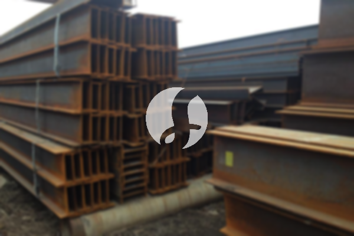

**Harga Besi T Beam per Batang, Cara Menghitung dan Memesannya** - Mitra Sumber Material yang berbahagia, seringkali proyek konstruksi terhambat karena kesalahan pemilihan besi T beam. Salah ukuran atau mutu bisa berakibat fatal, bahkan menambah biaya tak terduga. Nah, Kami di Sumber Material hadir untuk membantu Anda menghindari masalah ini sebelum pesanan dibuat – memastikan Anda mendapatkan besi T beam yang tepat untuk kebutuhan proyek Anda.



Mitra Sumber Material, besi T beam adalah elemen penting dalam struktur beton bertulang. Fungsinya menguatkan bagian atas atau bawah balok beton, menahan beban tekan dan tekuk. Memilih besi T beam yang tepat bukan hanya soal harga, tapi juga soal memastikan kekuatan dan keamanan bangunan Anda. Banyak yang langsung terpaku pada harga termurah, padahal ukuran, mutu, dan produsen berpengaruh besar pada kualitas akhir.

## Pertimbangan Utama Sebelum Membeli Besi T Beam

Sebelum memutuskan membeli, ada beberapa hal penting yang perlu Anda pertimbangkan. Pertama, **ukuran besi T beam**. Ukuran ini ditentukan oleh perhitungan struktur bangunan. Apakah proyek Anda membutuhkan dimensi kecil, sedang, atau besar? Kedua, **mutu besi**. Mutu besi dinyatakan dalam satuan MPa (Mega Pascal). Semakin tinggi angka MPa, semakin kuat besi tersebut. Ketiga, **standar SNI**. Pastikan besi T beam yang Anda beli sudah memenuhi standar SNI untuk menjamin kualitas dan keamanan.

Penting juga untuk memahami jenis beban yang akan ditahan oleh struktur. Apakah beban statis (tetap) atau dinamis (bergerak)? Pemilihan besi T beam harus disesuaikan dengan jenis beban tersebut. Kalau Anda masih ragu, jangan sungkan untuk berkonsultasi dengan ahli struktur bangunan. Atau, lebih mudah lagi, ceritakan kebutuhan proyek Anda ke Kami – Kami bantu hitungkan kebutuhan besi T beam yang pas dan berikan rekomendasi terbaik.

## Pilihan Besi T Beam di Sumber Material: Ukuran, Mutu, & Aplikasi

Kami di Sumber Material menyediakan berbagai pilihan besi T beam dengan berbagai ukuran dan mutu. Umumnya, besi T beam tersedia dalam panjang 6 meter dan 12 meter. Untuk ukuran dimensi, tersedia berbagai pilihan, mulai dari yang kecil hingga yang besar, sesuai dengan kebutuhan proyek Anda.

Berikut contoh beberapa jenis besi T beam yang tersedia di Kami:

- **Besi T Beam 6mm:** Cocok untuk struktur ringan seperti pagar atau kanopi.
- **Besi T Beam 8mm:** Sering digunakan untuk pondasi rumah sederhana.
- **Besi T Beam 10mm - 16mm:** Umumnya digunakan untuk balok dan kolom pada bangunan bertingkat.
- **Besi T Beam 20mm ke atas:** Ideal untuk proyek konstruksi berat seperti jembatan atau gedung bertingkat tinggi.

Mutu besi T beam yang Kami sediakan bervariasi, mulai dari FY 400 MPa hingga FY 500 MPa. Pemilihan mutu besi harus disesuaikan dengan kebutuhan kekuatan struktur bangunan. Kami juga menyediakan besi T beam dengan sertifikasi SNI, jadi Anda tidak perlu khawatir soal kualitasnya.

## Kenapa Memesan Besi T Beam di Sumber Material?

Memilih Sumber Material sebagai pemasok besi T beam Anda adalah keputusan cerdas. Pertama, Kami menawarkan **harga yang kompetitif** dengan kualitas terjamin. Kami bekerja sama langsung dengan produsen besi ternama, sehingga Kami bisa memberikan harga terbaik untuk Mitra Sumber Material. Kedua, Kami memberikan **bantuan konsultasi gratis**. Tim ahli Kami siap membantu Anda memilih besi T beam yang tepat sesuai dengan kebutuhan proyek Anda. Ketiga, Kami menyediakan **layanan pengiriman cepat dan tepat waktu** ke seluruh wilayah Jabodetabek dan sekitarnya.

Kami memahami betul betapa pentingnya ketepatan waktu dalam proyek konstruksi. Oleh karena itu, Kami berkomitmen untuk mengirimkan pesanan Anda secepat mungkin tanpa mengorbankan kualitas. Kami juga memiliki stok barang yang cukup untuk memenuhi kebutuhan proyek Anda, baik proyek kecil maupun besar. Selain itu, Kami berlokasi di Bogor, Jakarta, Bekasi, Karawang, Tangerang, dan Cikarang, sehingga pengiriman bisa lebih efisien dan biaya lebih hemat.

## Pesan Besi T Beam Sekarang Juga? Mudah Sekali!

Untuk memesan besi T beam di Sumber Material, Anda bisa menghubungi Kami melalui tombol **WhatsApp** atau **Telepon** yang ada di bawah halaman ini. Cukup informasikan ukuran, mutu, dan jumlah besi T beam yang Anda butuhkan, serta lokasi proyek Anda. Tim Kami akan segera memproses pesanan Anda dan memberikan penawaran harga terbaik.

## Memahami Perhitungan Kebutuhan Besi T Beam: Contoh Praktis

Mitra Sumber Material, seringkali muncul pertanyaan: berapa banyak besi T beam yang dibutuhkan untuk proyek Anda? Menghitung kebutuhan dengan tepat sangat penting untuk menghindari pemborosan atau kekurangan material. Mari Kami berikan contoh perhitungan sederhana untuk membantu Anda.

Misalkan Anda akan membuat balok beton dengan panjang 4 meter, lebar 30 cm, dan tinggi 50 cm. Balok ini akan menerima beban hidup 200 kg/m² dan beban mati 150 kg/m². Setelah melakukan perhitungan struktur (biasanya dilakukan oleh ahli sipil), diasumsikan Anda membutuhkan 4 batang besi T beam diameter 16mm sebagai tulangan utama.

Selain tulangan utama, Anda juga membutuhkan besi T beam untuk sengkang (stirrup). Jika jarak antar sengkang adalah 20 cm, maka Anda membutuhkan sengkang setiap 20 cm sepanjang 4 meter balok. Dengan asumsi setiap sengkang membutuhkan 0,8 meter besi T beam diameter 8mm, total besi T beam untuk sengkang adalah (400 cm / 20 cm) x 0,8 meter = 16 meter.

## Pertanyaan Umum (FAQ) Seputar Besi T Beam

Mitra Sumber Material, Kami sering menerima pertanyaan seputar besi T beam. Berikut beberapa pertanyaan yang paling umum dan jawabannya:

### Berapa Perbedaan Besi T Beam dengan Besi Polos?

Besi T beam memiliki profil berbentuk T, sedangkan besi polos berbentuk lingkaran padat. Bentuk T pada besi T beam memberikan kekuatan tarik yang lebih baik, terutama saat terjadi beban tekuk. Besi T beam umumnya digunakan sebagai tulangan utama pada balok dan kolom, sementara besi polos bisa digunakan untuk berbagai keperluan termasuk sengkang atau tulangan pelengkap.

### Bagaimana Cara Memastikan Besi T Beam yang Saya Beli Berkualitas?

Periksa sertifikasi SNI pada besi T beam. Pastikan juga besi tidak berkarat atau bengkok. Perhatikan juga permukaan besi, apakah halus atau kasar. Besi T beam berkualitas biasanya memiliki permukaan yang halus dan rata. Kalau ragu, mintalah bantuan ahli untuk memeriksa kualitas besi sebelum dibeli.

### Apakah Besi T Beam Bisa Dipotong Sendiri?

Besi T beam bisa dipotong, tetapi membutuhkan alat yang tepat seperti *steel cutter* atau gerinda potong besi. Memotong besi T beam sendiri tanpa alat yang memadai bisa berbahaya dan menghasilkan potongan yang tidak rapi. Kami sarankan untuk menggunakan jasa pemotongan besi profesional atau memesan besi T beam dengan ukuran yang sudah sesuai dari Kami.

### Apa Itu Fy (Yield Strength) pada Besi T Beam?

Fy (Yield Strength) adalah batas tegangan leleh besi. Semakin tinggi nilai Fy, semakin kuat besi tersebut menahan beban sebelum terjadi deformasi permanen. Besi T beam dengan Fy 400 MPa memiliki kekuatan yang cukup untuk banyak aplikasi konstruksi, tetapi untuk bangunan yang membutuhkan kekuatan ekstra, besi T beam dengan Fy 500 MPa mungkin lebih cocok.

## Tips Mencegah Kesalahan Pemesanan Besi T Beam

Mitra Sumber Material, kesalahan pemesanan besi T beam bisa menyebabkan keterlambatan proyek dan kerugian biaya. Berikut beberapa tips untuk mencegahnya:

- **Pastikan perhitungan struktur sudah benar:** Ini adalah langkah terpenting. Kesalahan dalam perhitungan akan berdampak langsung pada jumlah besi T beam yang dibutuhkan.
- **Periksa kembali spesifikasi material:** Pastikan ukuran, mutu, dan standar SNI besi T beam sesuai dengan kebutuhan proyek Anda.
- **Hindari membeli besi T beam dari sumber yang tidak jelas:** Pilih pemasok yang terpercaya dan memiliki reputasi baik.
- **Perhatikan kondisi penyimpanan besi T beam:** Besi T beam yang disimpan di tempat terbuka atau lembab rentan berkarat dan kualitasnya menurun.
- **Jangan ragu untuk bertanya:** Jika Anda memiliki pertanyaan atau keraguan, jangan ragu untuk bertanya kepada Kami atau ahli sipil.

Jangan tunda kebutuhan proyek Mitra Sumber Material — tanyakan harga dan ketersediaannya sekarang lewat tombol **WhatsApp** atau **Telepon** di bawah halaman ini.
