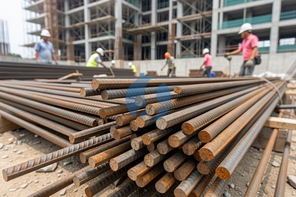

**Apa Saja yang Menentukan Harga Besi Tulangan per Batang?** - Mitra Sumber Material yang kami hormati, apakah Anda sedang mencari informasi harga besi tulangan per batang untuk proyek konstruksi Anda? Mencari material bangunan yang tepat dengan harga yang sesuai budget bisa jadi tantangan tersendiri, terutama dengan fluktuasi harga yang sering terjadi. Nah, Kami dari Sumber Material siap membantu Anda menemukan solusi terbaik untuk kebutuhan besi tulangan proyek Anda.



Besi tulangan adalah komponen krusial dalam struktur beton bertulang. Kualitas dan harga besi tulangan tentu saja menjadi pertimbangan penting. Mitra, jangan sampai salah memilih yang justru akan membahayakan kekuatan bangunan Anda. Kami mengerti betul kebutuhan Anda akan material berkualitas dengan harga yang kompetitif.

## Pilihan Besi Tulangan: Ukuran, Mutu, dan Penggunaannya

Sebelum membahas harga, penting untuk memahami berbagai jenis besi tulangan yang tersedia. Besi tulangan dibedakan berdasarkan ukuran (diameter) dan mutu (kekuatan tarik). Ukuran besi tulangan yang umum digunakan mulai dari diameter 8 mm hingga 32 mm, bahkan lebih besar untuk proyek-proyek khusus. Mutu besi tulangan biasanya dinyatakan dengan angka, seperti BJTP 300, BJTP 400, dan BJTP 500. Semakin tinggi angka tersebut, semakin kuat besi tulangan tersebut.

Untuk proyek rumah tinggal, besi tulangan BJTP 300 atau 400 seringkali sudah mencukupi. Namun, untuk bangunan bertingkat atau struktur yang membutuhkan kekuatan lebih, BJTP 500 menjadi pilihan yang lebih tepat. Pemilihan mutu besi tulangan juga perlu disesuaikan dengan perhitungan struktur dari ahli sipil.

Mitra Sumber Material, jangan ragu untuk berkonsultasi dengan Kami mengenai jenis besi tulangan yang paling sesuai dengan kebutuhan proyek Anda. Kami siap membantu memberikan rekomendasi berdasarkan spesifikasi teknis proyek Anda. Atau, jika Anda sudah tahu kebutuhan spesifik, langsung saja tanyakan harga terbaru besi tulangan per batang yang Anda butuhkan melalui tombol **WhatsApp** di bawah!

## Stok Lengkap Besi Tulangan di Sumber Material

Kami di Sumber Material menyediakan berbagai ukuran dan mutu besi tulangan untuk memenuhi kebutuhan proyek Anda. Berikut beberapa pilihan yang tersedia:

- **Besi Tulangan BJTP 300:** Tersedia dalam ukuran diameter 8 mm, 10 mm, 12 mm, 16 mm. Cocok untuk konstruksi rumah tinggal, pagar, dan struktur sederhana lainnya.
- **Besi Tulangan BJTP 400:** Tersedia dalam ukuran diameter 8 mm, 10 mm, 12 mm, 16 mm, 20 mm. Pilihan ideal untuk bangunan bertingkat rendah hingga menengah.
- **Besi Tulangan BJTP 500:** Tersedia dalam ukuran diameter 12 mm, 16 mm, 20 mm, 25 mm, 32 mm. Direkomendasikan untuk bangunan bertingkat tinggi, jembatan, dan struktur yang membutuhkan kekuatan tinggi.
- **Besi Polos:** Tersedia berbagai ukuran, digunakan untuk berbagai keperluan konstruksi seperti stirrup dan pengikat.

Selain besi tulangan, Kami juga menyediakan material konstruksi lainnya seperti pasir, batu, semen, batako, dan baja ringan. Dengan satu atap, Anda bisa mendapatkan semua kebutuhan proyek Anda di Sumber Material, sehingga menghemat waktu dan tenaga.

## Mengapa Memilih Sumber Material untuk Kebutuhan Besi Tulangan Anda?

Mitra, Kami memahami bahwa ada banyak penyedia material bangunan di luar sana. Namun, ada beberapa alasan mengapa Sumber Material menjadi pilihan yang tepat untuk kebutuhan besi tulangan Anda:

- **Ketersediaan Stok:** Kami selalu memastikan stok besi tulangan yang cukup untuk memenuhi kebutuhan proyek Anda, bahkan untuk proyek dengan skala besar.
- **Harga Kompetitif:** Kami menawarkan harga yang kompetitif dan transparan. Harga ini bersifat estimasi dan dapat berubah sewaktu-waktu — hubungi Kami untuk penawaran terbaru dan paling akurat sesuai kebutuhan proyek Mitra.
- **Kualitas Terjamin:** Kami hanya menyediakan besi tulangan dari produsen terpercaya yang memenuhi standar SNI.
- **Pengiriman Tepat Waktu:** Kami melayani pengiriman ke seluruh wilayah Jabodetabek dan sekitarnya. Kami memahami pentingnya pengiriman tepat waktu agar proyek Anda berjalan lancar.
- **Layanan Konsultasi:** Tim Kami siap membantu Anda memilih jenis besi tulangan yang paling sesuai dengan kebutuhan proyek Anda.
- **Berlokasi Strategis:** Dengan gudang yang tersebar di Bogor, Jakarta, Bekasi, Karawang, Tangerang, dan Cikarang, Kami dapat melayani Anda dengan lebih cepat dan efisien.

## Pesan Besi Tulangan Sekarang Juga!

Memesan besi tulangan dari Sumber Material sangat mudah. Anda bisa langsung menghubungi Kami melalui tombol **Telepon** atau **WhatsApp** yang tersedia di halaman ini. Sampaikan kebutuhan besi tulangan Anda (ukuran, mutu, jumlah) dan lokasi proyek Anda. Kami akan segera memberikan penawaran harga terbaik dan mengatur pengiriman ke lokasi proyek Anda. Jangan tunda lagi, segera wujudkan proyek impian Anda dengan material berkualitas dari Sumber Material!

Mau tahu harga terbaru untuk kebutuhan proyek Mitra Sumber Material? Klik tombol **WhatsApp** atau **Telepon** di bawah, kirim kebutuhan dan lokasi proyek, Kami bantu hitungkan.

ARTIKEL_SELESAI

## Menghitung Kebutuhan Besi Tulangan: Contoh Kasus Sederhana

Mitra Sumber Material, seringkali pertanyaan yang muncul adalah berapa banyak besi tulangan yang dibutuhkan untuk sebuah proyek? Nah, perhitungan ini memang penting agar tidak terjadi kekurangan atau kelebihan material. Mari kita ambil contoh sederhana perhitungan kebutuhan besi tulangan untuk sebuah kolom beton ukuran 20 cm x 20 cm dengan tinggi 3 meter.

Asumsikan kita menggunakan besi tulangan diameter 12 mm dengan jarak antar besi 15 cm. Pertama, hitung jumlah besi tulangan dalam satu bidang (lebar 20 cm). Dengan jarak 15 cm, kita membutuhkan 2 batang besi (20 cm / 15 cm = 1.33, dibulatkan menjadi 2 batang).  Kemudian, hitung panjang total besi tulangan untuk satu kolom. Panjang satu batang besi adalah 3 meter (tinggi kolom). Jadi, kebutuhan besi untuk satu kolom adalah 2 batang x 3 meter = 6 meter.

Perlu diingat, ini hanya perhitungan dasar.  Perhitungan yang akurat harus dilakukan oleh ahli struktur dengan mempertimbangkan beban bangunan, jenis tanah, dan faktor keamanan lainnya.  Tetapi, contoh ini bisa memberikan gambaran awal mengenai perkiraan kebutuhan besi tulangan.  Jika Anda kesulitan menghitung kebutuhan besi tulangan proyek Anda, jangan ragu untuk menghubungi Kami. Kami siap membantu Anda menghitungnya secara gratis.

## Pertanyaan Umum Seputar Besi Tulangan

Banyak Mitra Sumber Material yang seringkali memiliki pertanyaan serupa sebelum melakukan pemesanan. Berikut beberapa pertanyaan umum yang sering Kami terima:

### Berapa perbedaan antara besi polos dan besi ulir?

Besi polos memiliki permukaan yang halus, sedangkan besi ulir memiliki permukaan bergelombang. Besi ulir memberikan daya rekat yang lebih kuat dengan beton, sehingga lebih sering digunakan untuk struktur utama.

### Apakah besi tulangan bisa berkarat?

Ya, besi tulangan dapat berkarat jika terkena air dan udara. Karat dapat mengurangi kekuatan besi tulangan, sehingga penting untuk memberikan lapisan beton yang cukup tebal untuk melindunginya.

### Bagaimana cara menyimpan besi tulangan agar tidak berkarat?

Sebaiknya simpan besi tulangan di tempat yang kering dan terlindung dari hujan. Jika disimpan di luar ruangan, tutupi dengan terpal atau bahan pelindung lainnya.

### Apa itu SNI pada besi tulangan?

SNI (Standar Nasional Indonesia) adalah standar mutu yang harus dipenuhi oleh besi tulangan yang beredar di Indonesia. Memastikan besi tulangan memiliki sertifikasi SNI menjamin kualitas dan keamanannya.

## Hindari Kesalahan Umum Saat Memesan Besi Tulangan

Mitra, beberapa kesalahan umum saat memesan besi tulangan bisa menyebabkan kerugian waktu dan biaya. Salah satunya adalah tidak memperhatikan ukuran dan mutu besi tulangan yang dibutuhkan. Pastikan Anda mengetahui dengan pasti spesifikasi besi tulangan yang diperlukan sesuai dengan perhitungan struktur. Kesalahan lain adalah membeli besi tulangan dari supplier yang tidak terpercaya.  Ini bisa berakibat pada kualitas besi tulangan yang buruk dan berpotensi membahayakan keamanan bangunan Anda.

Pesan besi tulangan dari Sumber Material, Kami menjamin kualitas produk dan pengiriman yang tepat waktu. Jangan ragu untuk menanyakan detail spesifikasi produk kepada Kami sebelum melakukan pemesanan. Kami siap membantu Anda memastikan Anda mendapatkan besi tulangan yang sesuai dengan kebutuhan proyek Anda.
