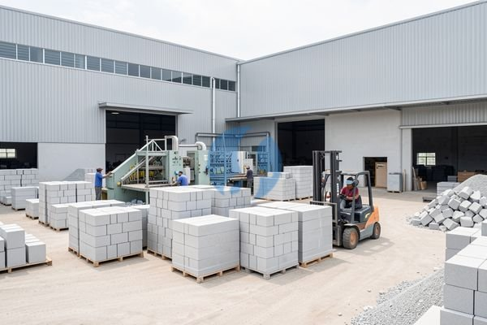

**Harga Hebel per Kubik Karawang Berdasarkan Jenis dan Ukurannya** - Mitra Sumber Material yang budiman, pernahkah Anda merasa bingung saat mencari harga hebel per kubik di Karawang? Seringkali, informasi yang didapat tidak jelas, harga berbeda-beda, dan sulit membandingkan kualitas. Nah, Kami di Sumber Material hadir untuk membantu Anda menghindari kerumitan tersebut sebelum Anda memesan.



## Mengapa Memilih Hebel dan Apa yang Mempengaruhi Harganya?

Mitra, hebel atau *Autoclaved Aerated Concrete* (AAC) adalah pilihan cerdas untuk dinding bangunan. Ringan, kuat, dan memiliki sifat insulasi termal yang baik. Namun, harga hebel per kubik di Karawang bisa bervariasi tergantung beberapa faktor. Ukuran, ketebalan, dan mutu hebel jelas berpengaruh. Hebel 7 cm tentu berbeda harganya dengan hebel 10 cm atau 12 cm. Lalu, jarak dari pabrik juga memengaruhi biaya transportasi. Kami tahu betul, waktu dan biaya pengiriman itu krusial dalam proyek Anda.

Lebih dari itu, perlu diingat bahwa kualitas hebel sangat penting. Hebel yang buruk bisa menyebabkan masalah struktural di kemudian hari. Jangan terpaku pada harga murah, tetapi perhatikan juga reputasi produsen dan standar kualitas yang mereka terapkan. Untuk itu, Kami selalu merekomendasikan hebel dengan standar SNI agar Anda mendapatkan material yang terjamin kualitasnya. Sekarang, apakah Anda ingin tahu lebih detail tentang jenis hebel yang Kami sediakan?

### Pilihan Hebel Karawang: Ukuran dan Mutu yang Tersedia di Sumber Material

Mitra Sumber Material, Kami menyediakan berbagai pilihan hebel Karawang sesuai kebutuhan proyek Anda. Mulai dari hebel ukuran standar 7 cm, 10 cm, hingga 12 cm. Ketebalan ini memengaruhi kekuatan dan insulasi termal dinding Anda. Untuk kekuatan, Kami menyediakan hebel dengan mutu yang berbeda-beda. Semakin tinggi mutu, semakin kuat hebel tersebut.

Sebagai gambaran, berikut ini adalah tabel perbandingan ukuran dan kegunaannya:

<table class="table">
  <caption>Perbandingan Ukuran Hebel</caption>
  <thead>
    <tr><th>Ukuran (cm)</th><th>Kekuatan</th><th>Kegunaan Umum</th></tr>
  </thead>
  <tbody>
    <tr><td>7</td><td>Ringan</td><td>Partisi interior, dinding non-struktural</td></tr>
    <tr><td>10</td><td>Sedang</td><td>Dinding luar rumah (dengan rangka kuat), partisi</td></tr>
    <tr><td>12</td><td>Kuat</td><td>Dinding luar rumah, dinding penahan beban</td></tr>
  </tbody>
</table>

Hebel dengan mutu yang baik akan tahan lama dan tidak mudah retak. Kami hanya menyediakan hebel dari produsen terpercaya yang memenuhi standar SNI. Butuh bantuan untuk menentukan mutu hebel yang tepat untuk proyek Anda? [tanyakan harga lewat WhatsApp](https://api.whatsapp.com/send?phone=6285776786091&text=*Halo%20sumbermaterial.com*%20%3A)

### Mengapa Memesan Hebel di Sumber Material? Penawaran Spesial untuk Mitra!

Mitra, memesan hebel di Sumber Material bukan hanya soal mendapatkan material berkualitas, tapi juga kemudahan dan harga yang kompetitif. Kami melayani pengiriman hebel ke seluruh wilayah Jabodetabek dan sekitarnya, termasuk Karawang, Bekasi, Cikarang, Bogor, Tangerang, dan Jakarta. Kami mengerti betul pentingnya ketepatan waktu dalam proyek konstruksi Anda. Itulah mengapa Kami berkomitmen untuk mengirimkan pesanan Anda tepat waktu.

Selain itu, Kami menawarkan harga yang transparan dan fleksibel. Anda bisa mendapatkan penawaran khusus untuk pembelian dalam jumlah besar. Kami juga siap membantu menghitung kebutuhan hebel per kubik untuk proyek Anda agar tidak ada sisa atau kekurangan material. Lokasi Kami yang strategis di Bogor, Jakarta, Bekasi, Karawang dan Tangerang memungkinkan Kami memberikan harga yang lebih kompetitif. Kami selalu berusaha memberikan penawaran terbaik kepada setiap Mitra — tanyakan harga terbaru dan dapatkan penawaran yang disesuaikan dengan kebutuhan proyek Anda!

[hebel 7 cm](/blog/harga-hebel-7-cm-1-kubik-isi-berapa/) – Jika Anda ingin mengetahui lebih lanjut tentang harga hebel 7 cm per kubik.

### Cara Mudah Pesan Hebel di Sumber Material

Memesan hebel di Kami sangat mudah. Cukup hubungi tim Kami melalui tombol **WhatsApp** atau **Telepon** yang tersedia di bawah halaman ini. Sampaikan kebutuhan Anda, termasuk ukuran, mutu, dan jumlah hebel yang Anda butuhkan. Kami akan dengan senang hati membantu Anda menghitung estimasi biaya dan mengatur pengiriman. Kami juga melayani konsultasi gratis untuk membantu Anda memilih jenis hebel yang paling sesuai dengan anggaran dan kebutuhan proyek Anda. Jangan ragu untuk bertanya, Kami siap membantu!

Siap pesan atau masih mau konsultasi dulu? Tombol **WhatsApp** dan **Telepon** di bawah halaman ini langsung terhubung dengan tim Kami.

ARTIKEL_SELESAI

## Hitung Kebutuhan Hebel Per Kubik: Contoh Kasus Proyek Rumah Minimalis

Mitra Sumber Material, seringkali pertanyaan “berapa hebel yang saya butuhkan?” muncul setelah memutuskan untuk membangun. Menghitung kebutuhan hebel dengan tepat itu penting, lho. Terlalu sedikit, Anda harus memesan lagi dan proyek tertunda. Terlalu banyak, modal terbuang percuma. Nah, Kami akan berikan contoh perhitungan sederhana untuk proyek rumah minimalis ukuran 6x10 meter dengan tinggi dinding 3 meter.

Asumsikan Anda menggunakan hebel 10 cm untuk dinding luar dan dalam. Pertama, hitung luas total dinding: (6m + 6m + 10m + 10m) x 3m = 72 meter persegi. Selanjutnya, hitung luas yang tidak memerlukan hebel (pintu dan jendela). Misalnya, luas pintu dan jendela total 8 meter persegi. Jadi, luas dinding yang perlu ditutup hebel adalah 72m² - 8m² = 64 meter persegi.

Sekarang, hitung kebutuhan hebel per meter persegi. Karena hebel lebar 0,1 meter (10 cm), maka dibutuhkan 10 buah hebel per meter persegi (1m / 0,1m = 10). Jadi, total hebel yang dibutuhkan adalah 64m² x 10 buah/m² = 640 buah.

Untuk mengetahui kebutuhan per kubik, kita perlu tahu volume satu buah hebel. Misalnya, ukuran hebel yang Anda pilih adalah 240cm x 60cm x 10cm. Volume satu buah hebel adalah 2,4m x 0,6m x 0,1m = 0,144 m³. Jadi, jumlah hebel per kubik adalah 1 / 0,144 m³ = sekitar 6,94 buah.

Dengan kebutuhan 640 buah hebel, volume hebel yang dibutuhkan adalah 640 buah / 6,94 buah/m³ = sekitar 92,2 m³. Jadi, Anda memerlukan sekitar 92,2 meter kubik hebel untuk proyek ini. Perlu diingat, ini hanya contoh perhitungan. Sebaiknya konsultasikan dengan Kami untuk perhitungan yang lebih akurat sesuai desain rumah Anda.

## Pertanyaan Umum Seputar Hebel Karawang: FAQ

Mitra, sebelum Anda memutuskan untuk memesan, mungkin ada beberapa pertanyaan yang masih terlintas di benak Anda. Berikut ini beberapa pertanyaan umum yang sering Kami terima:

### Berapa Daya Tahan Hebel Terhadap Gempa?

Hebel memiliki daya tahan yang cukup baik terhadap gempa, terutama jika dipasang dengan sistem struktur yang benar. Kekuatan hebel tergantung pada mutu dan ketebalannya. Kami sarankan untuk berkonsultasi dengan ahli struktur untuk memastikan keamanan bangunan Anda.

### Apakah Hebel Mudah Retak?

Hebel memang bisa retak jika terkena benturan keras. Namun, retakan pada hebel umumnya tidak sampai merusak struktur bangunan. Untuk mencegah retak, hindari memberikan beban berlebihan pada dinding hebel dan pastikan pemasangan dilakukan dengan benar.

### Bagaimana Cara Merawat Dinding Hebel Agar Awet?

Perawatan dinding hebel cukup mudah. Cukup bersihkan secara berkala dengan lap basah dan hindari penggunaan bahan kimia keras yang dapat merusak permukaan hebel. Untuk memperpanjang umur dinding hebel, Anda bisa melapisi dengan cat atau pelapis anti air.

### Apakah Hebel Bisa Dipasang di Lantai Dua?

Tentu saja bisa! Hebel sangat cocok digunakan untuk dinding lantai dua. Namun, pastikan struktur bangunan Anda mampu menahan beban hebel. Konsultasikan dengan ahli struktur untuk memastikan keamanan bangunan Anda.

## Pilihan Hebel Karawang: Perbandingan Mutu dan Kegunaan

Mitra Sumber Material, memilih mutu hebel yang tepat itu penting, lho. Mutu hebel biasanya dinyatakan dalam angka, seperti K-60, K-70, atau K-80. Semakin tinggi angka tersebut, semakin kuat hebelnya. Nah, Kami akan berikan sedikit perbandingan agar Anda lebih mudah memilih:

Hebel mutu K-60 cocok untuk partisi interior dan dinding non-struktural. Hebel ini ringan dan mudah dipotong, sehingga memudahkan proses pemasangan. Hebel mutu K-70 cocok untuk dinding luar rumah dengan rangka kuat. Hebel ini memiliki kekuatan yang cukup baik untuk menahan beban angin dan cuaca. Hebel mutu K-80 cocok untuk dinding luar rumah yang membutuhkan kekuatan ekstra, seperti dinding penahan beban atau bangunan bertingkat. Hebel ini memiliki kekuatan yang sangat tinggi dan tahan terhadap berbagai kondisi cuaca.

Penting untuk diingat, pilihan mutu hebel harus disesuaikan dengan kebutuhan dan desain bangunan Anda. Kami siap membantu Anda memilih mutu hebel yang paling tepat untuk proyek Anda. Jangan ragu untuk bertanya kepada Kami.
