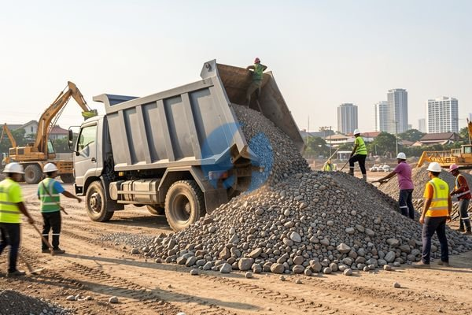

**Harga Kesik 1 Truk, Cara Menghitung dan Memesannya** - Mitra Sumber Material, ## Butuh Kesik 1 Truk? Kami Siap Kirim Langsung ke Lokasi Proyek Anda!



Mitra Sumber Material, mencari harga kesik 1 truk yang pas di kantong memang bisa jadi tantangan. Apalagi kalau Anda sedang mengejar deadline proyek dan tidak mau repot urusan transportasi. Nah, di Sumber Material, Kami paham betul kebutuhan Anda. Kami menyediakan kesik berkualitas dengan harga yang kompetitif, dan yang terpenting, Kami kirim langsung ke lokasi proyek Anda di wilayah Jabodetabek dan sekitarnya. Jadi, Anda bisa fokus mengerjakan proyek tanpa harus khawatir mencari truk atau mengatur pengiriman sendiri.

## Memilih Kesik yang Tepat: Ukuran dan Kualitas yang Perlu Diperhatikan

Sebelum memutuskan membeli kesik 1 truk, ada beberapa hal yang perlu Anda pertimbangkan. Pertama, pastikan ukuran kesik yang Anda butuhkan sesuai dengan skala proyek Anda. Kesik umumnya tersedia dalam berbagai ukuran, mulai dari yang kecil hingga yang besar. Kedua, perhatikan kualitas kesik. Kesik yang berkualitas baik biasanya memiliki tekstur yang padat, bersih dari sampah organik, dan bebas dari material berbahaya lainnya. Ingat, kualitas kesik akan sangat berpengaruh pada kekuatan dan ketahanan struktur bangunan Anda. Kalau Anda masih bingung menentukan jenis kesik yang paling sesuai, jangan ragu untuk [tanyakan harga lewat WhatsApp](https://api.whatsapp.com/send?phone=6285776786091&text=*Halo%20sumbermaterial.com*%20%3A) kepada tim Kami. Kami akan bantu berikan rekomendasi terbaik sesuai kebutuhan proyek Anda.

## Kesik Berkualitas dari Sumber Material: Solusi Urug Andal untuk Proyek Anda

Sumber Material menyediakan kesik dengan berbagai pilihan ukuran dan mutu. Kami memahami bahwa setiap proyek memiliki spesifikasi yang berbeda-beda, oleh karena itu Kami menyediakan solusi yang fleksibel dan dapat disesuaikan dengan kebutuhan Anda. Kesik yang Kami sediakan cocok digunakan untuk berbagai aplikasi, termasuk:

- **Urugan pondasi:** Kesik membantu meratakan dan memadatkan tanah sebelum pembangunan pondasi.
- **Pengisi lahan:** Kesik dapat digunakan untuk mengisi area yang rendah atau berlubang.
- **Lapisan dasar jalan:** Kesik berfungsi sebagai lapisan dasar yang kuat dan stabil untuk jalan.
- **Landscaping:** Kesik dapat digunakan untuk membentuk kontur tanah dan menciptakan area taman yang indah.

Selain kesik, Kami juga menyediakan material bangunan lainnya seperti pasir, batu, bata, batako, hebel, besi, wiremesh, baja ringan, dan readymix. Semua material Kami bersumber dari produsen terpercaya dan telah teruji kualitasnya.

## Kenapa Harus Pesan Kesik 1 Truk di Sumber Material? Hemat Waktu, Tenang Pikirannya!

Ada beberapa alasan mengapa Anda harus memilih Sumber Material sebagai pemasok kesik 1 truk Anda. Pertama, Kami menawarkan harga yang kompetitif dan transparan. Kami tidak akan memberikan harga yang berbelit-belit atau menambahkan biaya tersembunyi. Kedua, Kami memberikan pelayanan yang cepat dan responsif. Tim Kami siap membantu Anda dalam setiap tahap, mulai dari pemilihan material hingga pengiriman ke lokasi proyek. Ketiga, Kami menjamin kualitas material yang Kami jual. Kami hanya menyediakan material yang telah memenuhi standar kualitas yang ketat. Keempat, Kami melayani pengiriman langsung ke lokasi proyek Anda di wilayah Jabodetabek dan sekitarnya. Dengan begitu, Anda tidak perlu repot menyewa truk atau mengatur transportasi sendiri. Untuk informasi lebih lanjut mengenai area pengiriman, Anda bisa [truk agar anggaran 1](/blog/harga-brangkal-1-truk/) untuk mengetahui detailnya. Jangan lupa, Kami juga menyediakan jasa sewa alat berat, jasa urug, dan jasa cor untuk melengkapi kebutuhan proyek Anda.

## Pesan Kesik 1 Truk Sekarang, Proyek Anda Lancar Tanpa Hambatan!

Tidak perlu lagi pusing mencari kesik berkualitas dengan harga terbaik. Sumber Material hadir sebagai solusi praktis dan terpercaya untuk kebutuhan material bangunan Anda. Kami siap membantu Anda mewujudkan proyek impian Anda dengan menyediakan material yang berkualitas dan pelayanan yang memuaskan. Jadi, tunggu apa lagi? Yuk, segera kirim kebutuhan dan lokasi proyek Anda lewat WhatsApp. Atau, Anda bisa langsung menghubungi Kami melalui tombol **Telepon** di bawah halaman ini.

## Menghitung Kebutuhan Kesik untuk Proyek Anda: Jangan Sampai Kurang atau Kelebihan!

Mitra Sumber Material, seringkali kesalahan perhitungan kebutuhan material menjadi masalah di lapangan. Terlalu sedikit kesik bisa menghambat pekerjaan, sementara terlalu banyak berarti pemborosan biaya. Nah, Kami akan bantu Anda menghitung kebutuhan kesik secara akurat. Pertama, tentukan volume area yang akan diurug. Misalnya, Anda memiliki area seluas 100 m² yang perlu diurug setinggi 30 cm (0,3 meter). Volume yang dibutuhkan adalah 100 m² x 0,3 m = 30 m³. Kemudian, perhatikan faktor pemadatan. Kesik akan memadat setelah dipadatkan, sehingga volume aktual yang dibutuhkan akan lebih besar dari 30 m³. Biasanya, faktor pemadatan berkisar antara 1,1 hingga 1,3, tergantung pada jenis kesik dan metode pemadatan yang digunakan. Jika Kita ambil faktor pemadatan 1,2, maka total kesik yang dibutuhkan adalah 30 m³ x 1,2 = 36 m³. Ini adalah volume minimal yang sebaiknya Anda siapkan. Jangan lupa, konsultasikan dengan Kami untuk mendapatkan perhitungan yang lebih presisi sesuai kondisi proyek Anda.

## Pertanyaan Seputar Kesik yang Sering Kami Terima dari Mitra

Kami sering menerima pertanyaan seputar kesik dari Mitra seperti Anda. Berikut beberapa di antaranya:

### Berapa Daya Tahan Kesik?

Daya tahan kesik tergantung pada kualitas material dan metode pemadatan. Kesik yang berkualitas baik dan dipadatkan dengan benar dapat bertahan hingga bertahun-tahun tanpa mengalami penurunan signifikan.

### Apakah Kesik Cocok untuk Lahan Gambut?

Kesik bisa digunakan untuk memperkuat lahan gambut, tetapi perlu dilakukan perlakuan khusus, seperti penambahan geotextile untuk mencegah penurunan.

### Bagaimana Cara Memadatkan Kesik yang Benar?

Pemadatan kesik dapat dilakukan dengan menggunakan alat berat seperti stamper atau vibrator. Pastikan kesik dipadatkan secara merata dan mencapai kepadatan yang diinginkan.

### Apakah Kesik Mudah Terserang Hama?

Kesik relatif tahan terhadap hama, tetapi sebaiknya tetap dilakukan perawatan rutin untuk mencegah pertumbuhan rumput liar atau gulma.

Dengan memahami perbedaan jenis material urug dan cara menghitung kebutuhan kesik yang tepat, Anda dapat membuat keputusan yang cerdas dan efisien untuk proyek Anda. Kami di Sumber Material siap membantu Anda dalam setiap langkahnya.

## Kesalahan Umum Saat Membeli Kesik 1 Truk – dan Cara Menghindarinya

Mitra Sumber Material, pernahkah Anda mengalami masalah setelah memesan kesik 1 truk? Misalnya, kesik yang datang ternyata tidak sesuai dengan yang diharapkan, atau ada material lain tercampur di dalamnya. Nah, Kami sering mendengar keluhan seperti ini dari pelanggan. Salah satu kesalahan umum adalah tidak memeriksa kualitas kesik secara visual sebelum dipesan. Pastikan kesik yang Anda terima bersih dari sampah organik, seperti akar pohon atau plastik. Kesalahan lainnya adalah memesan terlalu sedikit atau terlalu banyak. Itulah mengapa Kami sarankan untuk menghitung kebutuhan kesik secara cermat, seperti yang sudah Kami bahas sebelumnya. Terakhir, jangan ragu untuk bertanya kepada supplier tentang asal-usul kesik dan proses produksinya. Dengan menghindari kesalahan-kesalahan ini, Anda bisa mendapatkan kesik berkualitas yang sesuai dengan kebutuhan proyek Anda.

## Tanya Jawab Seputar Pemesanan Kesik 1 Truk

Biar lebih jelas, Kami kumpulkan beberapa pertanyaan yang sering Kami terima dari Mitra:

### Berapa Lama Waktu Pengiriman Kesik 1 Truk?

Waktu pengiriman kesik 1 truk tergantung pada jarak lokasi proyek Anda dari lokasi Kami dan ketersediaan armada. Biasanya, pengiriman di wilayah Jabodetabek memakan waktu 1-3 hari kerja.

### Bisakah Saya Memesan Kesik 1 Truk dengan Jumlah yang Dibutuhkan Saja?

Tentu saja bisa! Kami melayani pemesanan kesik dengan jumlah yang Anda butuhkan. Tidak ada batasan minimal order.

### Apakah Kesik yang Dikirim Sudah Termasuk Biaya Bongkar Muat?

Biaya bongkar muat biasanya dikenakan terpisah, Mitra. Namun, Kami bisa memberikan penawaran harga yang sudah termasuk biaya bongkar muat jika Anda inginkan.

### Apa yang Harus Dilakukan Jika Kesik yang Diterima Tidak Sesuai?

Jika kesik yang Anda terima tidak sesuai dengan yang dipesan, segera hubungi Kami. Kami akan segera melakukan penggantian atau memberikan solusi terbaik lainnya.

Siap pesan atau masih mau konsultasi dulu? Tombol **WhatsApp** dan **Telepon** di bawah halaman ini langsung terhubung dengan tim Kami.
