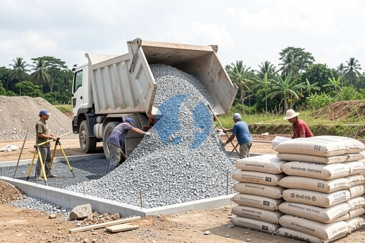

**Harga Limestone per m2 untuk Kebutuhan Rumah dan Proyek Kecil** - Mitra Sumber Material, seringkali kita jumpai proyek konstruksi mengalami pembengkakan biaya karena kurang teliti dalam menghitung kebutuhan material. Salah satunya adalah limestone, material penting untuk urugan, subbase, dan bahkan sebagian finishing. Nah, Kami hadir untuk membantu Anda menghindari kesalahan perhitungan dan mendapatkan harga limestone per m2 yang paling sesuai dengan budget proyek Anda.



## Mengapa Perlu Memperhatikan Harga Limestone Per M2?

Banyak yang hanya fokus pada harga total limestone tanpa memikirkan kebutuhan per meter persegi. Ini bisa berakibat fatal, lho. Bayangkan Anda membeli terlalu sedikit, proyek terhambat karena kekurangan material. Atau, justru terlalu banyak, akhirnya ada sisa yang menumpuk dan memakan biaya penyimpanan. Mitra Sumber Material paham betul tantangan ini. Oleh karena itu, kami selalu menyarankan untuk menghitung kebutuhan limestone per m2 secara akurat sejak awal. Setelah itu, Anda bisa langsung menanyakan harga terbaru dan menyesuaikannya dengan anggaran proyek.

### Memilih Jenis Limestone yang Tepat: Faktor Penentu Harga

Harga limestone per m2 tidak seragam. Ada beberapa jenis limestone dengan kualitas dan harga yang berbeda. Secara umum, ada limestone galian (dari pegunungan) dan limestone hasil pemecahan (agregat). Limestone galian biasanya lebih murah, tapi perlu proses pemecahan lagi. Limestone agregat sudah siap pakai, tapi harganya sedikit lebih tinggi. Selain itu, ukuran dan kualitas batu juga berpengaruh. Semakin halus dan bersih batu tersebut, semakin mahal harganya. Untuk proyek yang membutuhkan hasil akhir yang rapi, seperti paving block atau lantai, sebaiknya pilih limestone agregat yang sudah melalui proses screening.

Anda bisa menghemat waktu dan biaya dengan berkonsultasi langsung dengan Kami. Kami akan membantu Anda memilih jenis limestone yang paling tepat sesuai kebutuhan dan budget proyek Anda. Yuk, kirim kebutuhan dan lokasi proyek Mitra lewat WhatsApp!

### Limestone dari Sumber Material: Solusi Lengkap untuk Proyek Anda

Sumber Material menyediakan berbagai jenis limestone dengan kualitas terjamin. Kami memiliki limestone galian dan limestone agregat dalam berbagai ukuran, mulai dari ukuran kecil untuk urugan hingga ukuran besar untuk pondasi. Berikut beberapa contoh produk limestone yang tersedia di Sumber Material:

- **Limestone Agregat:** Tersedia dalam ukuran 5-10mm, 10-20mm, dan 20-40mm. Cocok untuk subbase jalan, pondasi, dan campuran beton.
- **Limestone Galian:** Tersedia dalam berbagai ukuran sesuai permintaan. Cocok untuk urugan dan material dasar.
- **Batu Kapur Pecah (Split):** Ideal untuk campuran aspal dan konstruksi jalan.

Kami melayani pengiriman ke seluruh wilayah Jabodetabek dan sekitarnya. Baik itu untuk proyek kecil renovasi rumah, proyek perumahan skala menengah, maupun proyek konstruksi besar yang dikerjakan oleh kontraktor. Tidak peduli seberapa besar kebutuhan Anda, Kami siap memenuhinya dengan cepat dan efisien.

### Mengapa Memesan Limestone di Sumber Material?

Ada banyak alasan mengapa Mitra Sumber Material harus memilih Kami sebagai pemasok limestone. Pertama, Kami memastikan kualitas material yang kami jual terjamin. Limestone yang Kami sediakan berasal dari sumber terpercaya dan telah melalui proses quality control yang ketat. Kedua, Kami menawarkan harga yang kompetitif dan transparan. Anda bisa mendapatkan penawaran harga terbaru dan paling akurat langsung dari Kami. Ketiga, Kami memberikan pelayanan yang responsif dan profesional. Tim Kami siap membantu Anda dalam memilih jenis limestone yang tepat, menghitung kebutuhan material, dan mengatur jadwal pengiriman. Keempat, Kami berlokasi strategis di Bogor, Jakarta, Bekasi, Karawang, Tangerang, dan Cikarang, sehingga pengiriman bisa dilakukan dengan cepat dan efisien.

Selain itu, Kami tidak hanya menjual material bangunan. Kami juga menyediakan jasa sewa alat berat seperti excavator dan bulldozer, serta jasa urug dan jasa cor. Ini akan sangat memudahkan Anda dalam menyelesaikan proyek dengan lebih cepat dan hemat biaya. Ingat, Kami melayani berbagai skala proyek, dari renovasi rumah hingga kebutuhan kontraktor besar.

### Mudah & Cepat: Cara Pesan Limestone di Sumber Material

Memesan limestone di Sumber Material sangat mudah dan cepat. Anda bisa menghubungi Kami melalui tombol **Telepon** atau **WhatsApp** yang tersedia di halaman ini. Cukup informasikan jenis limestone yang Anda butuhkan, jumlahnya, dan lokasi proyek Anda. Tim Kami akan segera memberikan penawaran harga terbaik dan mengatur jadwal pengiriman sesuai kebutuhan Anda. Atau, Anda bisa langsung datang ke lokasi Kami di Bogor, Jakarta, Bekasi, Karawang, Tangerang, atau Cikarang untuk melihat langsung contoh materialnya.

## Menghitung Kebutuhan Limestone Per M2: Studi Kasus & Contoh Praktis

Mitra Sumber Material, seringkali tantangan terbesar bukan hanya mendapatkan harga limestone per m2 yang bagus, tapi juga menentukan berapa banyak material yang benar-benar dibutuhkan. Salah hitung sedikit saja bisa berakibat pada keterlambatan proyek atau pemborosan biaya. Nah, mari kita lihat contoh perhitungan kebutuhan limestone untuk proyek urugan halaman rumah berukuran 10m x 5m dengan ketebalan urugan 10 cm (0,1 meter).

Dengan mengetahui cara menghitung kebutuhan limestone per m2 seperti ini, Anda bisa lebih yakin saat memesan material dan menghindari pemborosan. Kami bantu hitungkan lagi kalau Mitra masih ragu — tinggal kirimkan detail proyek Anda!

## Pertanyaan Umum Tentang Limestone: Panduan Singkat

Banyak pertanyaan yang sering Kami terima dari Mitra Sumber Material terkait limestone. Berikut beberapa pertanyaan umum dan jawabannya:

### Berapa Ketebalan Ideal Lapisan Limestone untuk Urugan?

Ketebalan ideal tergantung pada jenis tanah dasar dan beban yang akan ditanggung. Untuk urugan halaman rumah biasa, ketebalan 10-15 cm sudah cukup. Namun, untuk area yang akan sering dilalui kendaraan berat, sebaiknya gunakan ketebalan minimal 20 cm.

### Apakah Limestone Bisa Digunakan untuk Pondasi Bangunan?

Bisa, tapi perlu diperhatikan jenis limestone yang digunakan. Limestone agregat dengan ukuran yang sesuai dan kualitas terjamin bisa digunakan sebagai material campuran pondasi. Namun, sebaiknya konsultasikan dengan ahli konstruksi untuk memastikan keamanan dan kekuatan pondasi.

### Bagaimana Cara Membedakan Limestone Berkualitas Baik?

Perhatikan warna dan tekstur batu. Limestone berkualitas baik biasanya berwarna putih atau krem dengan tekstur yang padat dan seragam. Hindari limestone yang berwarna kusam atau memiliki banyak kotoran.

### Apakah Limestone Mudah Rusak atau Hancur?

Limestone relatif tahan lama jika dirawat dengan baik. Namun, jika terpapar cuaca ekstrem atau terkena beban berlebihan, limestone bisa mengalami kerusakan.

## Kesalahan Umum Saat Memesan Limestone dan Cara Menghindarinya

Mitra Sumber Material, ada beberapa kesalahan umum yang sering terjadi saat memesan limestone. Salah satunya adalah tidak mempertimbangkan jarak pengiriman. Semakin jauh lokasi proyek Anda dari sumber material, semakin tinggi biaya pengiriman. Selain itu, kesalahan lainnya adalah tidak memeriksa kualitas material sebelum memesan. Pastikan limestone yang Anda pesan bersih dari kotoran dan memiliki ukuran yang sesuai dengan kebutuhan proyek Anda.

Kesalahan lain yang sering terjadi adalah memesan terlalu sedikit atau terlalu banyak limestone. Untuk menghindari ini, sebaiknya hitung kebutuhan material secara akurat dan konsultasikan dengan Kami. Kami akan bantu Anda menghitung kebutuhan limestone per m2 dan memberikan rekomendasi jenis limestone yang paling tepat. Jangan ragu untuk bertanya — Kami selalu siap membantu!

## Memahami Pengaruh Ukuran Agregat Limestone Terhadap Kebutuhan Per M2

Ukuran agregat limestone yang dipilih bisa sangat memengaruhi berapa banyak material yang Anda butuhkan per meter persegi. Misalnya, untuk urugan dasar, ukuran 20-40mm biasanya lebih efisien karena rongga antar batu lebih besar, sehingga membutuhkan volume lebih sedikit dibandingkan ukuran 5-10mm untuk mencapai kepadatan yang sama. Tapi, untuk lapisan akhir atau campuran beton, ukuran yang lebih kecil akan lebih baik karena memberikan hasil yang lebih halus dan padat. Mempertimbangkan ukuran yang tepat akan membantu Anda mengoptimalkan penggunaan material dan menghemat biaya.

### Contoh Perhitungan: Perbandingan Kebutuhan Agregat 5-10mm vs. 20-40mm

Mari kita ambil contoh. Katakanlah Anda ingin mengurug area seluas 100 m2 dengan ketebalan 10 cm (0,1m). Jika menggunakan limestone agregat 5-10mm, Anda mungkin membutuhkan sekitar 1,2 m3 material per 10 m2 (angka ini bisa bervariasi tergantung kepadatan). Untuk ukuran 20-40mm, kebutuhan bisa berkurang menjadi sekitar 0,9 m3 per 10 m2. Perbedaan 0,3 m3 per 10 m2 ini, jika dikalikan dengan luas total 100 m2, bisa menghemat cukup banyak material dan biaya pengiriman.

### Seringkali Ditanyakan: Limestone dan Drainase

Banyak Mitra Sumber Material yang bertanya tentang kemampuan limestone dalam mendukung drainase. Apakah limestone membantu mencegah genangan air? Jawabannya, ya. Struktur berpori pada limestone memungkinkan air meresap ke dalam tanah, mengurangi risiko genangan. Namun, perlu diingat, efektivitas drainase juga tergantung pada jenis tanah di bawahnya. Jika tanah di bawahnya lempung padat, air akan sulit meresap dan genangan tetap bisa terjadi. Untuk kasus seperti ini, sebaiknya kombinasikan limestone dengan lapisan drainase tambahan seperti pasir kasar atau kerikil.

Tinggal satu langkah lagi: hubungi Kami lewat tombol **Telepon** atau **WhatsApp** di bawah untuk menanyakan harga dan jadwal pengiriman proyek Mitra Sumber Material.
