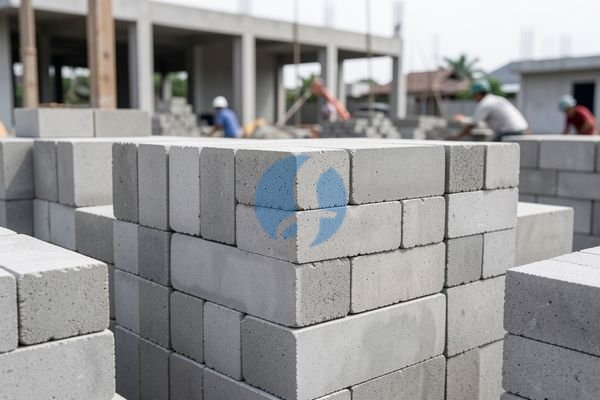

**Kenapa Harga Pasaran Batako per Biji Bisa Berbeda di Tiap Penjual?** - Mitra Sumber Material yang budiman, seringkali kita jumpai kesalahan perhitungan kebutuhan batako yang berakibat pada pemborosan anggaran proyek. Nah, Kami di Sumber Material siap membantu Anda menghindari hal itu dengan menyediakan batako berkualitas dan layanan pengiriman langsung ke lokasi proyek Anda di Jabodetabek dan sekitarnya.



Banyak pemilik proyek yang bertanya-tanya, "Berapa ya harga batako per biji saat ini?". Pertanyaan ini wajar, karena harga batako bisa berbeda-beda tergantung beberapa faktor. Memahami faktor-faktor ini akan membantu Anda membuat keputusan yang lebih cerdas dan menghemat biaya. Kami akan membahasnya, tapi sebelum itu, perlu diingat bahwa harga material konstruksi fluktuatif. Untuk mendapatkan harga terkini dan penawaran khusus, sebaiknya Anda langsung konsultasi dengan Kami. Kami selalu berusaha memberikan harga yang kompetitif tanpa mengorbankan kualitas.

## Memilih Batako yang Tepat: Ukuran dan Kualitas Jadi Kunci

Mitra, sebelum membahas lebih jauh tentang harga, penting untuk mempertimbangkan jenis batako yang Anda butuhkan. Ukuran batako standar biasanya 40x20x10 cm, namun ada juga ukuran lain seperti 39x19x10 cm. Perbedaan ukuran ini bisa memengaruhi jumlah batako yang dibutuhkan untuk proyek Anda. Selain itu, kualitas batako juga sangat penting. Batako yang berkualitas baik akan lebih tahan lama dan memberikan hasil bangunan yang lebih kokoh.

Kalau Anda sedang merencanakan pembangunan rumah tinggal, Kami sarankan untuk menggunakan batako dengan kualitas standar SNI. Untuk bangunan komersial atau yang membutuhkan kekuatan ekstra, batako dengan mutu lebih tinggi mungkin lebih cocok. Kami menyediakan berbagai pilihan batako dengan ukuran dan kualitas yang berbeda, serta siap memberikan saran terbaik sesuai kebutuhan proyek Anda. Jangan ragu untuk [tanyakan harga lewat WhatsApp](https://api.whatsapp.com/send?phone=6285776786091&text=*Halo%20sumbermaterial.com*%20%3A) untuk mendapatkan penawaran khusus.

## Batako Sumber Material: Pilihan Lengkap untuk Proyek Anda

Sumber Material menyediakan berbagai jenis batako dengan pilihan ukuran dan kualitas yang beragam. Kami memiliki batako press, batako cetak, dan batako ringan. Batako press umumnya lebih kuat dan padat, cocok untuk dinding yang membutuhkan kekuatan tinggi. Batako cetak lebih ekonomis dan mudah dipasang, ideal untuk bangunan sederhana. Sedangkan batako ringan memiliki keunggulan dalam mengurangi beban struktur bangunan.

Sebagai contoh, untuk pembangunan rumah dua lantai di area Jakarta Selatan, Anda mungkin membutuhkan batako press dengan ukuran 40x20x10 cm sebanyak 3000 biji. Atau, untuk pembangunan garasi, batako cetak ukuran 39x19x10 cm sebanyak 1500 biji bisa menjadi pilihan yang tepat. Kami juga menyediakan jasa pengiriman langsung ke lokasi proyek Anda di Jabodetabek dan sekitarnya, sehingga Anda tidak perlu repot mengurus transportasi sendiri.

## Mengapa Memesan Batako di Sumber Material? Hemat Waktu & Biaya!

Mitra Sumber Material, ada beberapa alasan mengapa Kami menjadi pilihan terbaik untuk memenuhi kebutuhan batako Anda. Pertama, Kami menawarkan harga yang kompetitif dan transparan. Harga ini bersifat estimasi dan dapat berubah sewaktu-waktu — hubungi Kami untuk penawaran terbaru dan paling akurat sesuai kebutuhan proyek Mitra. Kedua, Kami menyediakan berbagai pilihan batako dengan kualitas terjamin. Ketiga, Kami melayani pengiriman langsung ke lokasi proyek Anda di wilayah Jabodetabek dan sekitarnya. Keempat, Kami berlokasi strategis di Bogor, Jakarta, Bekasi, Karawang, Tangerang, dan Cikarang, sehingga pengiriman bisa lebih cepat dan efisien.

Dengan memesan batako di Sumber Material, Anda bisa menghemat waktu dan biaya. Anda tidak perlu lagi repot mencari supplier lain, mengurus transportasi, atau khawatir tentang kualitas produk. Kami akan memastikan bahwa batako Anda sampai di lokasi proyek tepat waktu dan sesuai dengan spesifikasi yang Anda inginkan. Kami juga siap memberikan konsultasi gratis untuk membantu Anda menghitung kebutuhan batako secara akurat.

## Pesan Batako Sekarang: Mudah dan Cepat!

Untuk memesan batako atau menanyakan harga terbaru, Anda bisa menghubungi Kami melalui tombol **Telepon** atau **WhatsApp** di bawah ini. Cukup kirim kebutuhan batako Anda (jenis, ukuran, jumlah) dan lokasi proyek Anda, dan Kami akan segera memberikan penawaran terbaik. Jangan tunda lagi, segera hubungi Kami dan wujudkan proyek impian Anda! Ingat, Kami selalu siap membantu Anda dalam setiap langkah pembangunan.

## Menghindari Kesalahan Umum Saat Membeli Batako: Jangan Sampai Rugi!

Mitra Sumber Material, seringkali ada beberapa kesalahan umum yang dilakukan saat membeli batako yang bisa berakibat pada pemborosan anggaran atau kualitas bangunan yang kurang optimal. Salah satu kesalahan yang paling sering terjadi adalah kurang teliti dalam menghitung kebutuhan batako. Banyak yang hanya memperkirakan secara kasarnya tanpa mempertimbangkan luas dinding, tinggi dinding, dan ukuran batako yang digunakan.

Kesalahan lainnya adalah memilih kualitas batako yang tidak sesuai dengan kebutuhan proyek. Memilih batako yang terlalu murah dengan kualitas rendah bisa berakibat pada dinding yang mudah retak atau bocor. Sebaliknya, memilih batako yang terlalu mahal dengan kualitas tinggi mungkin tidak diperlukan jika proyek Anda hanya bangunan sederhana. Kami sarankan untuk selalu berkonsultasi dengan ahli bangunan atau Kami sebelum memutuskan jenis batako yang akan digunakan. Kami siap membantu Anda menghitung kebutuhan batako secara akurat dan memberikan rekomendasi jenis batako yang paling tepat untuk proyek Anda.

## Contoh Perhitungan Kebutuhan Batako: Lebih Detail dan Akurat

Untuk memberikan gambaran yang lebih jelas, mari kita hitung kebutuhan batako untuk sebuah dinding dengan ukuran 4 meter panjang, 3 meter tinggi, dan tebal 15 cm. Kita asumsikan menggunakan batako ukuran standar 40x20x10 cm. Pertama, hitung luas dinding: 4 meter x 3 meter = 12 meter persegi. Kemudian, hitung luas satu buah batako: 0,4 meter x 0,2 meter = 0,08 meter persegi.

Selanjutnya, hitung jumlah batako per meter persegi: 1 meter persegi / 0,08 meter persegi/batako = 12,5 batako. Karena tidak mungkin membeli setengah batako, bulatkan ke atas menjadi 13 batako per meter persegi. Terakhir, hitung total kebutuhan batako: 12 meter persegi x 13 batako/meter persegi = 156 batako.

### Pertanyaan yang Sering Diajukan tentang Batako

Mitra, ada beberapa pertanyaan yang sering Kami terima dari pelanggan terkait batako. Berikut adalah beberapa di antaranya:

**1. Apakah batako perlu direndam sebelum digunakan?**

Ya, sebaiknya batako direndam dalam air selama beberapa jam sebelum digunakan. Hal ini bertujuan untuk mengurangi daya serap air batako, sehingga adukan semen akan lebih kuat dan tahan lama.

**2. Bagaimana cara memotong batako dengan rapi?**

Batako bisa dipotong menggunakan gergaji mesin atau alat pemotong khusus batako. Pastikan Anda menggunakan alat yang tepat dan mengikuti prosedur keselamatan yang berlaku.

**3. Apa perbedaan antara batako press dan batako cetak?**

Perbedaan utama terletak pada proses pembuatannya. Batako press dibuat dengan cara dipress menggunakan mesin press, sehingga lebih padat dan kuat. Batako cetak dibuat dengan cara dicetak menggunakan mesin cetak, sehingga lebih ekonomis dan mudah dipasang.

**4. Apakah batako bisa digunakan untuk bangunan bertingkat?**

Batako bisa digunakan untuk bangunan bertingkat, tetapi perlu dipastikan kualitas batako yang digunakan memenuhi standar SNI dan perhitungan struktur bangunan harus dilakukan oleh ahli yang kompeten.

## Memperkirakan Volume Urug Pasir untuk Pekerjaan Pondasi Batako

Mitra Sumber Material, seringkali kebutuhan pasir untuk pekerjaan pondasi batako diabaikan dalam perhitungan anggaran. Padahal, pasir merupakan komponen penting dalam campuran semen yang akan mengikat batako menjadi struktur yang kokoh. Sebagai gambaran, untuk pondasi batako dengan volume 1 meter kubik, Anda membutuhkan sekitar 0,5 hingga 0,7 meter kubik pasir.

### Berapa Banyak Pasir yang Dibutuhkan untuk Pondasi Rumah Tipe 45?

Untuk rumah tipe 45 dengan luas bangunan sekitar 45 meter persegi, perkiraan kebutuhan pasir untuk pondasi adalah sekitar 2-3 meter kubik. Angka ini bisa bervariasi tergantung pada kedalaman pondasi dan jenis tanah di lokasi proyek Anda. Kami sarankan untuk berkonsultasi dengan tukang bangunan atau ahli struktur untuk mendapatkan perhitungan yang lebih akurat.

### Jenis Pasir yang Cocok untuk Pondasi Batako

Tinggal satu langkah lagi: hubungi Kami lewat tombol **Telepon** atau **WhatsApp** di bawah untuk menanyakan harga dan jadwal pengiriman proyek Mitra Sumber Material.
