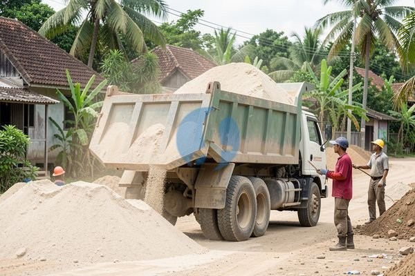

**Harga Pasir 1 Dump Truck di Cirebon untuk Rumah Tinggal dan Ruko** - Mitra Sumber Material, seringkali proyek konstruksi di Cirebon membutuhkan volume pasir yang besar. Membeli satuan kecil memang praktis, tapi untuk skala besar, menyewa dump truck pasir jauh lebih efisien. Tapi, berapa ya *harga pasir 1 dump truck di Cirebon*? Nah, sebelum Anda memutuskan, ada beberapa hal yang perlu dipertimbangkan. Jenis pasir yang dibutuhkan, jarak pengiriman, dan tentu saja, penyedia yang terpercaya. Jangan sampai Anda dapat pasir yang kualitasnya kurang oke atau malah kena biaya tambahan yang bikin anggaran membengkak. Kami dari Sumber Material siap membantu. Kami tidak hanya menyediakan pasir berkualitas, tapi juga memastikan pengiriman langsung ke lokasi proyek Anda di Cirebon dan sekitarnya.



## Pilihan Pasir untuk Proyek Anda: Mana yang Tepat?

Ada beberapa jenis pasir yang umum digunakan dalam proyek konstruksi, masing-masing dengan kelebihan dan kekurangannya. Untuk bangunan, pasir urug biasanya digunakan sebagai dasar pondasi atau untuk pengurugan lahan. Pasir beton, di sisi lain, penting untuk campuran beton yang kuat dan tahan lama. Lalu ada juga pasir muntilan yang sering dipakai untuk plester dan acian. Harga pasir 1 dump truck di Cirebon akan berbeda-beda tergantung jenis pasir yang Anda pilih. Nah, untuk memastikan Anda mendapatkan material yang tepat, konsultasikan dengan Kami. Kami bisa bantu merekomendasikan jenis pasir yang paling sesuai dengan kebutuhan proyek Anda, sekaligus memberikan perkiraan biaya yang akurat.

## Pasir Berkualitas dari Sumber Material: Solusi Praktis untuk Proyek di Jabodetabek & Cirebon

Sumber Material menyediakan berbagai jenis pasir, termasuk pasir urug, pasir beton, dan pasir muntilan. Kami memahami betul kebutuhan proyek konstruksi di Cirebon. Kami menawarkan pasir dengan mutu terjamin, bebas dari kotoran dan material organik yang dapat mengurangi kekuatan bangunan Anda. Ukuran pasir yang kami jual juga bervariasi, disesuaikan dengan kebutuhan spesifik proyek Anda.

<table class="table">
  <caption>Jenis Pasir yang Kami Sediakan</caption>
  <thead>
    <tr><th>Jenis Pasir</th><th>Kegunaan Umum</th><th>Harga Per Dump Truck (Estimasi)</th></tr>
  </thead>
  <tbody>
    <tr><td>Pasir Urug</td><td>Pengurugan lahan, dasar pondasi</td><td>Rp 350.000 - Rp 500.000</td></tr>
    <tr><td>Pasir Beton</td><td>Campuran beton, pondasi, kolom</td><td>Rp 400.000 - Rp 600.000</td></tr>
    <tr><td>Pasir Muntilan</td><td>Plester, acian, plamir</td><td>Rp 300.000 - Rp 450.000</td></tr>
  </tbody>
</table>

*Harga ini bersifat estimasi dan dapat berubah sewaktu-waktu — hubungi Kami untuk penawaran terbaru dan paling akurat sesuai kebutuhan proyek Mitra.*

## Kenapa Pesan Pasir di Sumber Material? Hemat Waktu dan Tenaga!

Memesan pasir dari Sumber Material berarti Anda mendapatkan lebih dari sekadar material bangunan. Kami menawarkan kemudahan dan kepastian. Pertama, Kami melayani pengiriman langsung ke lokasi proyek Anda di Cirebon dan sekitarnya. Anda tidak perlu repot mencari truk atau menyewa jasa pengiriman sendiri. Kedua, Kami memastikan kualitas pasir yang Kami kirim sesuai dengan standar yang Anda harapkan. Ketiga, Kami siap membantu Anda menghitung kebutuhan pasir secara akurat, sehingga Anda tidak perlu khawatir kelebihan atau kekurangan material. Keempat, Kami berlokasi di Bogor, Jakarta, Bekasi, Karawang, dan Tangerang, sehingga pengiriman ke wilayah Jabodetabek dan sekitarnya, termasuk Cirebon, lebih cepat dan efisien. [tanyakan harga sekarang](https://api.whatsapp.com/send?phone=6285776786091&text=*Halo%20sumbermaterial.com*%20%3A)

Yuk, Mitra Sumber Material, jangan tunda lagi! Hubungi Kami sekarang juga untuk mendapatkan penawaran harga pasir 1 dump truck di Cirebon yang paling kompetitif. Kami siap menjadi mitra terpercaya Anda dalam mewujudkan proyek impian Anda.

## Perhitungan Kebutuhan Pasir: Berapa Dump Truck yang Anda Butuhkan?

Sekarang, bagaimana dengan kapasitas dump truck? Dump truck umumnya memiliki kapasitas antara 8-12 m³. Artinya, untuk proyek ini, Anda mungkin hanya membutuhkan sekitar 0,5 – 0,6 dump truck. Tentu saja, ini hanya contoh. Kebutuhan Anda bisa berbeda tergantung desain bangunan, jenis pasir yang digunakan, dan efisiensi kerja tim konstruksi Anda. Kami dari Sumber Material siap membantu Anda menghitung kebutuhan pasir secara lebih akurat, disesuaikan dengan detail proyek Anda. Cukup kirimkan spesifikasi proyek Anda lewat WhatsApp, dan Kami akan memberikan estimasi yang tepat.

## Pertanyaan Umum Seputar Pasir dan Pengiriman di Cirebon

Mitra Sumber Material, Kami sering menerima pertanyaan serupa dari pelanggan di Cirebon. Berikut beberapa di antaranya:

### Berapa Lama Waktu Pengiriman Pasir ke Cirebon?

Waktu pengiriman bervariasi tergantung jarak dari lokasi Kami dan kondisi lalu lintas. Biasanya, pengiriman ke wilayah Cirebon membutuhkan waktu sekitar 4-6 jam. Kami akan selalu menginformasikan estimasi waktu pengiriman yang akurat saat Anda memesan.

### Jenis Pasir Apa yang Cocok untuk Membuat Jalan Setapak?

Untuk jalan setapak, Kami merekomendasikan penggunaan pasir urug yang dipadatkan dengan baik. Pasir urug memiliki butiran yang kasar dan mampu menahan beban dengan baik. Anda juga bisa menambahkan sedikit semen untuk meningkatkan kekuatannya.

### Bagaimana Jika Saya Tidak Yakin Jenis Pasir yang Dibutuhkan?

Jangan khawatir! Tim Kami siap membantu Anda. Jelaskan detail proyek Anda, dan Kami akan memberikan rekomendasi jenis pasir yang paling sesuai. Kami juga bisa memberikan contoh sampel pasir agar Anda bisa melihat dan merasakan kualitasnya secara langsung.

### Apakah Bisa Memesan Pasir dalam Jumlah Kecil?

Tentu saja bisa! Meskipun Kami spesialis dalam pengiriman dump truck, Kami juga melayani pemesanan dalam jumlah kecil. Minimal pemesanan mungkin berbeda-beda tergantung jarak pengiriman.

## Hindari Kesalahan Umum Saat Membeli Pasir

Mitra, ada beberapa kesalahan umum yang sering dilakukan saat membeli pasir. Salah satunya adalah tidak memperhatikan kualitas pasir. Pasir yang berkualitas buruk dapat mengurangi kekuatan bangunan dan menyebabkan masalah di kemudian hari. Pastikan pasir yang Anda beli bersih dari kotoran, lumpur, dan material organik. Kesalahan lain adalah tidak menghitung kebutuhan pasir dengan akurat. Ini bisa menyebabkan Anda kekurangan material atau justru membeli terlalu banyak, yang akan menambah biaya. Terakhir, jangan lupa untuk mempertimbangkan biaya pengiriman. Biaya pengiriman yang mahal dapat membuat harga total pasir menjadi lebih tinggi dari yang Anda harapkan. Dengan memesan dari Sumber Material, Anda bisa menghindari kesalahan-kesalahan ini. Kami menjamin kualitas pasir yang Kami jual, membantu Anda menghitung kebutuhan secara akurat, dan menawarkan layanan pengiriman yang efisien ke Cirebon dan sekitarnya.

## Perhatikan Juga: Biaya Tambahan yang Mungkin Muncul

Mitra Sumber Material, saat menghitung *harga pasir 1 dump truck di Cirebon*, jangan lupakan potensi biaya tambahan. Selain harga pasir per meter kubik, ada biaya pengiriman yang perlu dipertimbangkan. Jarak lokasi proyek Anda dari titik pengiriman Kami akan sangat mempengaruhi biaya ini. Selain itu, jika lokasi proyek Anda sulit dijangkau oleh truk besar, mungkin ada biaya tambahan untuk bongkar muat manual. Nah, untuk menghindari kejutan, sebaiknya tanyakan semua potensi biaya tambahan ini kepada Kami sebelum Anda memutuskan untuk memesan. Kami akan memberikan rincian biaya yang transparan dan akurat, sehingga Anda bisa membuat anggaran proyek dengan lebih baik.

## Contoh Perhitungan: Kebutuhan Pasir untuk Lantai Carport

Misalnya, Anda ingin membuat lantai carport berukuran 3 meter x 5 meter dengan ketebalan 10 cm. Untuk menghitung kebutuhan pasir urug, pertama-tama hitung volume carport: 3 m x 5 m x 0,1 m = 1,5 m³. Ini adalah volume pasir yang Anda butuhkan. Karena pasir urug biasanya dijual per meter kubik, Anda membutuhkan 1,5 m³ pasir urug. Jika satu dump truck berkapasitas 10 m³, Anda hanya membutuhkan sebagian kecil dari satu dump truck. Tapi, perlu diingat bahwa pasir akan menyusut saat dipadatkan. Jadi, sebaiknya Anda memesan sedikit lebih banyak dari perhitungan awal, misalnya 1,8 m³ untuk mengantisipasi penyusutan dan memastikan Anda memiliki cukup material. Kami siap membantu Anda menghitung kebutuhan material yang tepat untuk proyek Anda.

## Pertanyaan Lain yang Sering Kami Terima

### Apakah Pasir yang Dikirim Akan Lembab?

Biasanya tidak, Mitra. Kami memastikan pasir yang Kami kirim dalam kondisi kering dan bersih. Namun, jika cuaca sedang hujan, ada kemungkinan pasir sedikit lembab. Tapi, Kami akan berusaha semaksimal mungkin untuk melindungi pasir dari hujan selama proses pengiriman.

### Bagaimana Jika Saya Membutuhkan Pasir di Hari Minggu?

Kami akan berusaha mengakomodasi permintaan Anda, tetapi ketersediaan pengiriman di hari Minggu tergantung pada kondisi lalu lintas dan jadwal pengiriman Kami. Sebaiknya Anda menghubungi Kami terlebih dahulu untuk memastikan ketersediaan.

### Apakah Bisa Meminta Sampel Pasir Sebelum Memesan?

Tentu saja bisa! Kami dengan senang hati menyediakan sampel pasir agar Anda bisa melihat dan merasakan kualitasnya secara langsung sebelum memutuskan untuk memesan. Cukup hubungi Kami untuk mengatur pengiriman sampel.

### Bagaimana Cara Membayar?

Kami menerima pembayaran tunai saat pengiriman atau transfer bank. Detail rekening bank Kami akan Kami berikan saat Anda melakukan pemesanan.

Tinggal satu langkah lagi: hubungi Kami lewat tombol **Telepon** atau **WhatsApp** di bawah untuk menanyakan harga dan jadwal pengiriman proyek Mitra Sumber Material.
