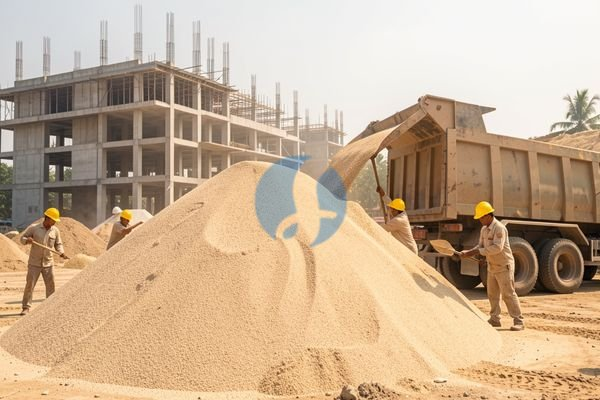

**Harga Pasir 1 Kubik Berapa? Begini Penjelasannya** - Mitra Sumber Material di mana pun berada, sedang merencanakan proyek konstruksi dan mencari tahu harga pasir 1 kubik? Menentukan anggaran material adalah langkah krusial, dan harga pasir yang fluktuatif seringkali bikin pusing. Nah, Kami di Sumber Material siap membantu Anda mendapatkan harga terbaik dan solusi material yang tepat untuk proyek Anda, dari renovasi kecil hingga pembangunan skala besar.



## Pertimbangan Sebelum Membeli Pasir 1 Kubik

Sebelum memutuskan jenis pasir yang akan dibeli, ada beberapa hal yang perlu Mitra perhatikan. Jenis pasir sangat memengaruhi harga dan kegunaannya. Pasir yang cocok untuk pondasi mungkin berbeda dengan pasir untuk plester. Selain itu, jarak lokasi proyek dengan supplier juga berpengaruh pada biaya pengiriman. Jangan lupa, volume yang dibutuhkan juga penting untuk dihitung dengan tepat agar tidak ada sisa atau kekurangan material.  Kami sarankan untuk menghitung kebutuhan material secara akurat, dan Kami siap membantu dalam perhitungan tersebut. Untuk kemudahan, Anda bisa langsung [tanyakan harga terbaru](https://api.whatsapp.com/send?phone=6285776786091&text=*Halo%20sumbermaterial.com*%20%3A) ke tim Kami.

### Jenis Pasir yang Tersedia di Sumber Material

Kami di Sumber Material menyediakan berbagai jenis pasir berkualitas untuk memenuhi kebutuhan proyek Anda:

- **Pasir Urug:** Ideal untuk pengurugan lahan, membuat lantai kerja, dan pondasi bangunan. Harganya relatif lebih terjangkau.
- **Pasir Pasang:** Cocok untuk campuran semen dalam pembuatan plesteran, acian, dan lantai kerja. Teksturnya halus dan bersih.
- **Pasir Beton:** Didesain khusus untuk campuran beton, memastikan kekuatan dan kualitas beton optimal.
- **Pasir Kali:** Lebih kasar dari pasir pasang, sering digunakan untuk campuran beton dan konstruksi jalan.
- **Pasir Putih:** Banyak digunakan untuk estetika seperti taman, hiasan, dan campuran kerajinan.

Kami menyediakan pasir dalam berbagai ukuran, mulai dari satuan kubik hingga truk dump. Untuk proyek skala besar, Kami menawarkan opsi pengiriman dengan truk yang dapat disesuaikan dengan kebutuhan volume Anda.  Sebagai gambaran, harga pasir urug per kubik biasanya lebih ekonomis dibandingkan pasir beton. Namun, harga ini bersifat estimasi dan dapat berubah sewaktu-waktu — hubungi Kami untuk penawaran terbaru dan paling akurat sesuai kebutuhan proyek Mitra.

### Mengapa Memilih Sumber Material untuk Kebutuhan Pasir Anda?

Banyaknya pilihan supplier material bangunan memang bisa membingungkan. Tapi, memilih Sumber Material memberikan beberapa keuntungan bagi Anda. Pertama, Kami melayani wilayah Jabodetabek dan sekitarnya, memastikan material sampai tepat waktu di lokasi proyek Anda. Kedua, Kami menawarkan berbagai jenis pasir dengan kualitas terjamin. Ketiga, Kami bukan hanya menjual material, tapi juga menyediakan jasa sewa alat berat seperti excavator dan truk engkel untuk mendukung kelancaran proyek Anda. Keempat, Kami melayani berbagai skala proyek, mulai dari renovasi rumah tinggal, proyek kecil, hingga kebutuhan kontraktor besar. Ditambah lagi, Kami berlokasi strategis di Bogor, Jakarta, Bekasi, Karawang, Tangerang, dan Cikarang.  Jadi, kalau Anda bertanya-tanya apakah Kami bisa melayani area Anda, jangan ragu untuk kirim kebutuhan dan lokasi proyek Anda lewat WhatsApp.

### Cara Mudah Pesan Pasir di Sumber Material

Memesan pasir di Sumber Material sangat mudah dan praktis. Anda bisa langsung menghubungi Kami melalui tombol **Telepon** atau **WhatsApp** yang tersedia di bawah halaman ini. Tim Kami akan dengan senang hati membantu Anda menentukan jenis pasir yang tepat, menghitung kebutuhan material, dan memberikan penawaran harga terbaik.  Kami juga dapat membantu Anda mengatur jadwal pengiriman sesuai dengan kebutuhan proyek Anda.  Atau, jika Anda sudah memiliki daftar material dan spesifikasi proyek yang jelas, Anda bisa langsung tanyakan harga lewat WhatsApp untuk mendapatkan penawaran cepat.

## Memperkirakan Kebutuhan Pasir: Contoh Perhitungan Nyata

### Membandingkan Pasir Urug dan Pasir Pasang: Mana yang Tepat untuk Proyek Anda?

Banyak Mitra Sumber Material yang bingung antara pasir urug dan pasir pasang. Keduanya memiliki fungsi yang berbeda. Pasir urug, dengan teksturnya yang lebih kasar, ideal untuk pengurugan area yang luas dan membuat pondasi bangunan. Harganya juga lebih ekonomis. Sedangkan pasir pasang, yang lebih halus dan bersih, sangat cocok untuk campuran semen dalam plesteran, acian, dan lantai kerja.  Jika Anda berencana membuat lantai kerja dengan ketebalan 10 cm untuk area 30 m², menggunakan pasir pasang adalah pilihan yang tepat. Volume pasir pasang yang dibutuhkan adalah 30 m² x 0,1 m = 3 m³. Kami selalu merekomendasikan penggunaan pasir pasang untuk pekerjaan finishing karena menghasilkan permukaan yang lebih halus dan kuat.

## Pertanyaan Umum Seputar Pasir dan Pemesanan

Kami sering menerima pertanyaan dari Mitra mengenai berbagai hal terkait pasir. Berikut beberapa pertanyaan yang paling umum:

### Berapa Banyak Pasir yang Muat dalam Satu Truk?

Kapasitas truk dump bervariasi tergantung ukuran truknya. Biasanya, truk dump kecil berkapasitas sekitar 6-8 kubik, sementara truk dump besar bisa memuat hingga 12-15 kubik. Untuk mengetahui kapasitas truk yang paling sesuai dengan kebutuhan Anda, jangan ragu untuk berkonsultasi dengan Kami.

### Bisakah Pasir Disimpan di Tempat Terbuka?

Pasir sebaiknya disimpan di tempat yang kering dan terlindungi dari hujan. Jika disimpan di tempat terbuka, tutupi dengan terpal untuk mencegah kontaminasi dan kehilangan material akibat angin.

### Apa Itu Pasir Zeolit dan Apa Kegunaannya?

Pasir zeolit adalah jenis pasir vulkanik yang memiliki kemampuan menyerap air dan bau. Pasir ini sering digunakan dalam pembuatan filter air, media tanam, dan sebagai penyerap bau pada kandang hewan peliharaan. Kami juga menyediakan pasir zeolit dengan kualitas terbaik.

### Bagaimana Jika Saya Tidak Yakin Jenis Pasir yang Dibutuhkan?

Jangan khawatir! Tim Kami akan dengan senang hati membantu Anda menentukan jenis pasir yang paling sesuai dengan kebutuhan proyek Anda. Cukup jelaskan jenis proyek Anda dan Kami akan memberikan rekomendasi terbaik.

## Mengatasi Kesalahan Umum Saat Membeli Pasir 1 Kubik

Seringkali, Mitra Sumber Material mengalami masalah setelah membeli pasir, entah karena kualitas tidak sesuai ekspektasi atau volume yang kurang tepat. Salah satu kesalahan umum adalah tidak menanyakan asal pasir. Pasir dari sumber yang berbeda bisa memiliki kandungan lumpur atau kotoran yang memengaruhi kualitas campuran beton atau plesteran. Hindari juga membeli pasir yang terlihat terlalu kering atau berdebu, karena ini bisa mengindikasikan kandungan tanah liat yang tinggi. Kami di Sumber Material selalu memastikan pasir yang Kami jual bersih dan bebas dari kontaminan. Kami juga menyarankan untuk selalu memeriksa kondisi fisik pasir sebelum menerima pengiriman.

## Memahami Perbedaan Pasir Merapi dan Pasir Cilegon

Banyak Mitra yang bertanya mengenai perbedaan antara pasir Merapi dan pasir Cilegon. Keduanya sering digunakan dalam konstruksi, tetapi memiliki karakteristik yang berbeda. Pasir Merapi, yang berasal dari lereng Gunung Merapi, umumnya memiliki tekstur yang lebih kasar dan kandungan mineral yang tinggi. Pasir ini ideal untuk campuran beton karena memberikan kekuatan yang lebih baik. Sementara itu, pasir Cilegon memiliki tekstur yang lebih halus dan warna yang lebih putih. Pasir ini sering digunakan untuk plesteran dan acian karena menghasilkan permukaan yang lebih halus dan rapi. Memilih antara pasir Merapi dan pasir Cilegon tergantung pada kebutuhan spesifik proyek Anda. Untuk proyek konstruksi yang membutuhkan kekuatan tinggi, pasir Merapi adalah pilihan yang tepat. Namun, untuk finishing yang membutuhkan kehalusan, pasir Cilegon lebih disarankan.

## Tanya Jawab Seputar Pemesanan Pasir di Sumber Material

### Berapa Lama Waktu Pengiriman Pasir?

Waktu pengiriman pasir tergantung pada lokasi proyek Anda dan ketersediaan armada Kami. Untuk wilayah Jabodetabek, biasanya pengiriman dapat dilakukan dalam 1-2 hari kerja setelah pemesanan dikonfirmasi.

### Apakah Ada Minimal Order untuk Pengiriman Pasir?

Kami melayani pemesanan dengan berbagai volume, mulai dari satuan kubik hingga truk penuh. Tidak ada minimal order, jadi Anda bisa memesan sesuai dengan kebutuhan proyek Anda.

### Bagaimana Jika Saya Ingin Memesan Pasir dengan Jadwal Tertentu?

Tentu saja! Kami akan berusaha mengakomodasi jadwal pengiriman yang Anda inginkan. Silakan informasikan jadwal yang Anda inginkan saat melakukan pemesanan.

### Apakah Kami Menyediakan Jasa Urug Selain Penjualan Pasir?

Ya, Kami juga menyediakan jasa urug dengan menggunakan pasir urug berkualitas. Tim Kami akan membantu Anda meratakan dan memadatkan tanah sesuai dengan kebutuhan proyek Anda.

Siap pesan atau masih mau konsultasi dulu? Tombol **WhatsApp** dan **Telepon** di bawah halaman ini langsung terhubung dengan tim Kami.
