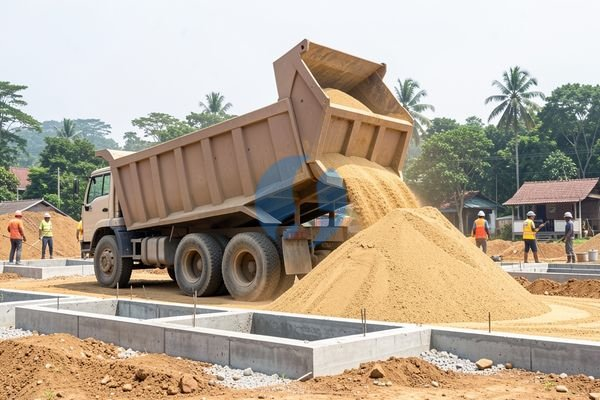

**Panduan Singkat Membaca Harga Pasir 1 Kubik di Bogor** - Mitra Sumber Material, sedang mencari tahu harga pasir per kubik di Bogor untuk proyek Anda? Kami siap membantu menyediakan material berkualitas dengan harga yang kompetitif.



Banyak hal yang perlu dipertimbangkan saat menentukan jenis pasir yang tepat untuk proyek Anda. Apakah Anda membutuhkan pasir untuk campuran semen, urugan, atau kebutuhan spesifik lainnya? Nah, sebelum memutuskan, ada baiknya Anda memahami dulu variasi harga dan kualitas yang tersedia. Dengan begitu, Anda bisa mendapatkan material yang sesuai anggaran dan memastikan hasil akhir yang optimal. Kami di Sumber Material siap memberikan konsultasi gratis untuk membantu Anda memilih jenis pasir yang paling tepat.

## Pilihan Jenis Pasir dan Pengaruhnya ke Harga Per Kubik

Mitra Sumber Material, ada beberapa jenis pasir yang umum digunakan dalam konstruksi, masing-masing dengan keunggulan dan harga yang berbeda. Pasir Bekasi, misalnya, dikenal dengan teksturnya yang kasar dan sering digunakan untuk campuran semen karena memberikan kekuatan yang baik pada bangunan. Sementara itu, pasir Cilegon memiliki tekstur yang lebih halus dan cocok untuk pekerjaan plesteran atau acian. Harga pasir 1 kubik di Bogor tentu saja dipengaruhi oleh jenis pasir yang Anda pilih.

Selain jenis, lokasi sumber pasir juga berpengaruh. Semakin jauh lokasi sumber pasir dari Bogor, biasanya biaya transportasi akan menambah harga jual. Faktor lain seperti permintaan pasar dan musim juga dapat menyebabkan fluktuasi harga. Jangan ragu untuk [tanyakan harga terbaru](https://api.whatsapp.com/send?phone=6285776786091&text=*Halo%20sumbermaterial.com*%20%3A) kepada kami, karena Kami selalu berusaha memberikan penawaran terbaik untuk Mitra Sumber Material.

## Material Pasir yang Tersedia di Sumber Material

Kami menyediakan berbagai jenis pasir untuk memenuhi kebutuhan proyek Anda:

- **Pasir Bekasi:** Cocok untuk campuran semen, pondasi, dan lantai kerja. Harganya relatif stabil dan terjangkau.
- **Pasir Cilegon:** Ideal untuk plesteran, acian, dan membuat mortar. Teksturnya yang halus menghasilkan permukaan yang lebih rata dan halus.
- **Pasir Muntilan:** Sering digunakan untuk membuat plesteran dengan kualitas tinggi. Pasir ini dikenal dengan kandungan lumpurnya yang rendah.
- **Pasir Urug:** Cocok untuk pengurugan lahan atau mengisi celah bangunan. Biasanya memiliki harga yang lebih ekonomis.

Kami menyediakan pasir dalam berbagai ukuran, mulai dari satuan kubik hingga truk engkel atau dump truck sesuai kebutuhan Anda. Kami juga menyediakan jasa pengiriman langsung ke lokasi proyek Anda di wilayah Jabodetabek dan sekitarnya. Untuk mengetahui detail lebih lanjut tentang spesifikasi dan harga, Anda bisa hubungi tim Kami.

## Mengapa Memilih Sumber Material untuk Pasir 1 Kubik di Bogor?

Mitra Sumber Material, mungkin Anda bertanya-tanya, kenapa harus memesan pasir dari Sumber Material? Pertama, Kami menawarkan konsultasi gratis sebelum Anda memutuskan membeli. Tim ahli Kami akan membantu Anda memilih jenis pasir yang paling sesuai dengan kebutuhan proyek Anda, serta menghitung estimasi volume yang dibutuhkan. Ini akan membantu Anda menghindari pemborosan material dan memaksimalkan anggaran Anda.

Kedua, Kami menjamin kualitas material yang Kami jual. Kami hanya bekerja sama dengan supplier terpercaya yang menyediakan pasir dengan kualitas terbaik. Ketiga, Kami menawarkan layanan pengiriman yang cepat dan tepat waktu. Kami memahami bahwa waktu adalah uang, oleh karena itu Kami berusaha secepat mungkin mengirimkan material ke lokasi proyek Anda. Keempat, Kami berlokasi strategis di Bogor, Jakarta, Bekasi, Karawang, Tangerang, dan Cikarang, sehingga memudahkan Kami dalam melayani pengiriman ke seluruh wilayah Jabodetabek dan sekitarnya.

Jangan lupa, Kami juga menyediakan material bangunan lainnya seperti batu, bata/batako/hebel, besi, wiremesh, baja ringan, dan readymix. Kami juga menawarkan jasa sewa alat berat serta jasa urug dan jasa cor.

## Cara Mudah Memesan Pasir di Sumber Material

Untuk memesan pasir 1 kubik di Bogor dari Sumber Material, Anda bisa menghubungi Kami melalui tombol **WhatsApp** atau **Telepon** yang tersedia di halaman ini. Cukup informasikan jenis pasir yang Anda butuhkan, volume yang Anda inginkan, dan lokasi proyek Anda. Tim Kami akan segera memproses pesanan Anda dan memberikan penawaran terbaik. Anda juga bisa menanyakan harga terbaru, konsultasi kebutuhan material, atau sekadar mendapatkan informasi lebih lanjut tentang layanan Kami.

## Memperkirakan Kebutuhan Pasir untuk Proyek Anda: Contoh Perhitungan

Mitra Sumber Material, seringkali kita kesulitan memperkirakan berapa banyak pasir yang sebenarnya dibutuhkan untuk sebuah proyek. Salah perhitungan bisa menyebabkan kelebihan material yang mubazir, atau kekurangan material yang menghambat kelancaran pekerjaan. Nah, mari kita lihat contoh perhitungan sederhana untuk membantu Anda.

Perhitungan ini bisa bervariasi tergantung pada jenis pekerjaan dan kondisi tanah. Untuk proyek yang lebih kompleks, sebaiknya konsultasikan dengan ahli konstruksi atau tim Kami. Kami siap membantu menghitung kebutuhan material secara akurat sesuai dengan spesifikasi proyek Anda.

## Pertanyaan Umum Seputar Pasir dan Harganya

Banyak pertanyaan yang sering Kami terima dari Mitra Sumber Material mengenai pasir dan harganya. Berikut beberapa pertanyaan umum dan jawabannya:

### Berapa Lama Waktu Pengiriman Pasir?

Waktu pengiriman pasir tergantung pada lokasi proyek Anda dan ketersediaan armada Kami. Untuk wilayah Jabodetabek, biasanya pengiriman dapat dilakukan dalam 1-3 hari kerja setelah pesanan Kami terima.

### Apakah Harga Pasir Sudah Termasuk Biaya Pengiriman?

Harga pasir yang Kami berikan belum termasuk biaya pengiriman. Biaya pengiriman akan Kami hitungkan secara terpisah berdasarkan jarak dan jenis armada yang digunakan.

### Apa Saja yang Perlu Diperhatikan Saat Menerima Pengiriman Pasir?

Pastikan volume pasir yang diterima sesuai dengan pesanan Anda. Periksa juga kualitas pasir, apakah sesuai dengan jenis yang Anda pesan. Jika ada ketidaksesuaian, segera hubungi Kami untuk mendapatkan solusi terbaik.

### Bagaimana Jika Saya Tidak Yakin Jenis Pasir yang Tepat untuk Proyek Saya?

Jangan ragu untuk berkonsultasi dengan tim Kami. Kami akan dengan senang hati membantu Anda memilih jenis pasir yang paling sesuai dengan kebutuhan proyek Anda.

## Memastikan Kualitas Pasir: Tips Saat Membeli

Mitra Sumber Material, kualitas pasir sangat berpengaruh terhadap kekuatan dan ketahanan bangunan Anda. Jadi, penting untuk memastikan Anda mendapatkan pasir dengan kualitas terbaik. Perhatikan beberapa hal berikut saat membeli pasir:

- **Tekstur:** Perhatikan tekstur pasir. Pasir yang baik memiliki tekstur yang seragam dan tidak mengandung terlalu banyak lumpur atau kotoran.
- **Warna:** Warna pasir juga bisa menjadi indikator kualitasnya. Pasir yang baik biasanya berwarna abu-abu atau coklat muda.
- **Kekuatan:** Uji kekuatan pasir dengan meremasnya di tangan. Pasir yang baik akan terasa padat dan tidak mudah hancur.
- **Kandungan Lumpur:** Kandungan lumpur yang terlalu tinggi dapat mengurangi kekuatan bangunan. Pastikan pasir yang Anda beli memiliki kandungan lumpur yang rendah.

Kami di Sumber Material selalu memastikan bahwa pasir yang Kami jual memenuhi standar kualitas yang berlaku. Kami bekerja sama dengan supplier terpercaya yang memiliki reputasi baik dalam menyediakan material bangunan berkualitas.

## Memahami Perbedaan Pasir Halus dan Pasir Kasar: Mana yang Cocok untuk Proyek Anda?

Mitra Sumber Material, seringkali pembeli bingung membedakan pasir halus dan pasir kasar. Nah, keduanya memiliki karakteristik dan kegunaan yang berbeda. Pasir halus, dengan butiran yang lebih kecil, ideal untuk pekerjaan plesteran, acian, dan membuat mortar karena menghasilkan permukaan yang lebih halus dan mudah diratakan. Sedangkan pasir kasar, dengan butiran yang lebih besar, lebih cocok untuk campuran beton, pondasi, dan lantai kerja karena memberikan kekuatan yang lebih baik dan drainase yang lebih efisien. Memilih yang tepat akan sangat berpengaruh pada kualitas hasil akhir proyek Anda.

## Pertanyaan Lain yang Sering Diajukan Pembeli

Kami sering menerima pertanyaan dari Mitra Sumber Material mengenai detail teknis dan pengiriman. Berikut beberapa di antaranya:

### Apakah Pasir yang Kami Jual Sudah Diayak?

Ya, sebagian besar pasir yang Kami jual sudah melalui proses pengayakan untuk menghilangkan kotoran dan material organik. Namun, untuk kebutuhan khusus, Kami juga menyediakan pasir tanpa pengayakan.

### Bagaimana Cara Menyimpan Pasir dengan Benar?

Simpan pasir di tempat yang kering dan terlindung dari hujan. Tutup dengan terpal atau plastik untuk mencegah kontaminasi dan menjaga kualitasnya.

### Apakah Sumber Material Melayani Pengiriman Pasir ke Daerah Luar Bogor?

Kami melayani pengiriman ke wilayah Jabodetabek dan sekitarnya. Untuk daerah di luar jangkauan Kami, silakan hubungi Kami untuk menanyakan ketersediaan pengiriman.

### Apa Perbedaan Pasir Beton dan Pasir Urug?

Pasir beton memiliki gradasi butiran yang lebih seragam dan kuat, cocok untuk campuran beton berkualitas tinggi. Sedangkan pasir urug memiliki gradasi yang lebih beragam dan biasanya lebih ekonomis, ideal untuk pengurugan lahan atau mengisi celah bangunan.

Kirim kebutuhan dan lokasi proyek Mitra Sumber Material lewat tombol **WhatsApp** atau **Telepon** di bawah, tim Kami bantu siapkan penawarannya.
