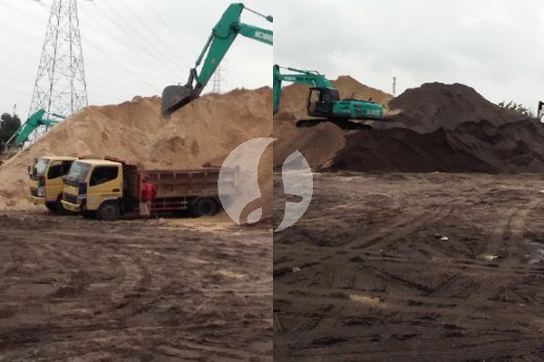

**Harga Pasir 1 Kubik di Lampung dan Faktor yang Memengaruhinya** - Mitra Sumber Material yang berbahagia, sedang mencari tahu harga pasir 1 kubik di Lampung untuk proyek Anda? Nah, Kami mengerti betul betapa pentingnya mendapatkan penawaran terbaik tanpa mengorbankan kualitas material. Sumber Material hadir sebagai solusi, menyediakan berbagai jenis pasir dengan pengiriman langsung ke lokasi proyek Anda di wilayah Lampung dan sekitarnya.



## Memilih Pasir yang Tepat: Jenis dan Pertimbangan Harga

Mitra Sumber Material, sebelum membahas harga, penting untuk memahami berbagai jenis pasir yang tersedia. Ada pasir urug, pasir bangunan, pasir cor, dan lainnya, masing-masing dengan karakteristik dan harga yang berbeda. Pasir urug biasanya merupakan pilihan paling ekonomis, cocok untuk pengurugan atau pekerjaan pondasi ringan. Sementara, pasir bangunan, terutama pasir pasang, lebih halus dan ideal untuk campuran semen dan plester. Harga pasir 1 kubik di Lampung akan sangat bergantung pada jenis pasir yang Anda pilih.

Nah, untuk memastikan Anda mendapatkan harga yang sesuai dengan kebutuhan proyek, Kami sarankan untuk selalu menanyakan spesifikasi detail dari supplier. Jangan ragu untuk meminta contoh sampel agar Anda bisa menilai kualitas pasir secara langsung. Kalau masih bingung mau pilih yang mana, jangan sungkan untuk konsultasi dengan tim Kami. Kami siap membantu Anda menemukan jenis pasir yang paling tepat untuk proyek Anda.

## Pasir Berkualitas untuk Proyek Anda: Ragam Pilihan dari Sumber Material

Sumber Material menyediakan berbagai jenis pasir untuk memenuhi kebutuhan proyek Anda. Kami memiliki:

- **Pasir Urug:** Cocok untuk pengurugan, reklamasi, atau pekerjaan pondasi ringan. Pasir ini memiliki butiran kasar dan harga yang relatif terjangkau.
- **Pasir Pasang:** Ideal untuk campuran semen, plester, dan pembuatan acian. Teksturnya halus dan bersih, sehingga menghasilkan hasil akhir yang lebih rapi.
- **Pasir Cor:** Dirancang khusus untuk campuran beton, memastikan kekuatan dan ketahanan struktur bangunan Anda.
- **Pasir Besi:** Pasir yang umumnya digunakan untuk pekerjaan keramik dan plesteran.

Kami juga menyediakan berbagai ukuran agregat sesuai kebutuhan Anda, mulai dari ukuran kecil hingga besar. Semua material Kami dijamin kualitasnya dan memenuhi standar SNI. Harga pasir 1 kubik di Lampung bervariasi tergantung jenis dan jumlah yang Anda pesan. Untuk penawaran terbaik, yuk, kirim kebutuhan dan lokasi proyek Anda lewat WhatsApp!

## Mengapa Memilih Sumber Material untuk Pasir di Lampung?

Mitra, Kami paham betul betapa repotnya mengurus pengiriman material bangunan. Itulah mengapa Sumber Material hadir untuk mempermudah pekerjaan Anda. Kami melayani pengiriman langsung ke lokasi proyek di seluruh wilayah Lampung dan sekitarnya. Anda tidak perlu lagi khawatir tentang biaya transportasi atau mencari armada pengiriman sendiri.

Selain itu, Kami juga menawarkan:

- **Harga Kompetitif:** Kami selalu berusaha memberikan harga terbaik untuk pelanggan setia Kami. Harga ini bersifat estimasi dan dapat berubah sewaktu-waktu — hubungi Kami untuk penawaran terbaru dan paling akurat sesuai kebutuhan proyek Mitra.
- **Kualitas Terjamin:** Semua material Kami diuji secara ketat untuk memastikan kualitasnya memenuhi standar yang berlaku.
- **Pelayanan Ramah dan Responsif:** Tim Kami siap membantu Anda menjawab pertanyaan dan memberikan solusi terbaik untuk kebutuhan proyek Anda.
- **Berlokasi Strategis:** Kami memiliki gudang material yang berlokasi di berbagai titik di Lampung, Jakarta, Bekasi, Karawang, Bogor, Tangerang, dan Cikarang, sehingga pengiriman bisa lebih cepat dan efisien.

[tanyakan harga lewat WhatsApp](https://api.whatsapp.com/send?phone=6285776786091&text=*Halo%20sumbermaterial.com*%20%3A)

## Pesan Pasir 1 Kubik di Lampung Sekarang Juga!

## Perhitungan Kebutuhan Pasir: Contoh Kasus Proyek Rumah Type 45

Mitra Sumber Material, seringkali pertanyaan yang muncul adalah, "Berapa banyak pasir 1 kubik yang saya butuhkan untuk proyek saya?". Nah, untuk menjawabnya, mari kita ambil contoh kasus proyek rumah type 45 dengan luas bangunan sekitar 45 meter persegi. Asumsikan kita membutuhkan pasir pasang untuk plester dinding dan acian.

Untuk plester dinding, rata-rata kebutuhan pasir pasang adalah 0,5 meter kubik per 100 meter persegi dinding. Jika tinggi dinding rata-rata 3 meter, maka luas total dinding rumah type 45 (dengan perkiraan keliling bangunan 36 meter) adalah sekitar 108 meter persegi (36m x 3m). Jadi, kebutuhan pasir pasang untuk plester dinding adalah sekitar 0,54 meter kubik (108/100 x 0,5).

Selanjutnya, untuk acian, kebutuhan pasir pasang biasanya sekitar 0,25 meter kubik per 100 meter persegi dinding. Dengan luas dinding yang sama, kebutuhan pasir pasang untuk acian adalah sekitar 0,27 meter kubik (108/100 x 0,25).

Jadi, total kebutuhan pasir pasang untuk proyek rumah type 45 ini adalah sekitar 0,81 meter kubik (0,54 + 0,27). Perlu diingat, angka ini adalah estimasi. Kebutuhan aktual bisa bervariasi tergantung ketebalan plester, jenis finishing, dan keterampilan tukang. Kami bantu hitungkan secara lebih akurat sesuai detail proyek Anda — jangan ragu untuk konsultasi!

## Hindari Kesalahan Umum Saat Membeli Pasir di Lampung

Mitra Sumber Material, ada beberapa kesalahan umum yang sering terjadi saat membeli pasir di Lampung, yang sebaiknya Anda hindari. Pertama, jangan hanya fokus pada harga. Pasir yang terlalu murah seringkali memiliki kualitas yang buruk, mengandung banyak kotoran, atau tidak sesuai dengan spesifikasi yang Anda butuhkan.

Kesalahan kedua, jangan ragu untuk bertanya detail tentang sumber pasir. Pasir dari sumber yang berbeda memiliki karakteristik yang berbeda pula. Misalnya, pasir sungai cenderung lebih bersih daripada pasir tambang.

Kesalahan ketiga, jangan memesan terlalu banyak pasir sekaligus jika Anda tidak memiliki tempat penyimpanan yang memadai. Pasir yang terkena hujan atau terpapar sinar matahari langsung dapat menjadi lembap dan menggumpal, sehingga sulit untuk digunakan.

## Pertanyaan Umum Seputar Pasir di Lampung

### Berapa lama waktu pengiriman pasir ke lokasi proyek?

Waktu pengiriman pasir 1 kubik di Lampung tergantung pada jarak lokasi proyek Anda dari gudang Kami dan ketersediaan armada. Biasanya, pengiriman memakan waktu 1-3 hari kerja.

### Apakah Sumber Material menyediakan layanan bongkar pasir di lokasi proyek?

Ya, Mitra! Kami menyediakan layanan bongkar pasir di lokasi proyek dengan biaya tambahan. Ini akan sangat memudahkan Anda karena Anda tidak perlu repot mencari tenaga bongkar sendiri.

### Bagaimana cara memastikan kualitas pasir yang saya terima?

Kami menjamin kualitas pasir yang Kami kirimkan. Namun, Anda tetap bisa melakukan pengecekan visual saat pasir tiba di lokasi proyek. Pastikan pasir bersih dari kotoran, tidak mengandung lumpur, dan memiliki tekstur yang sesuai dengan kebutuhan Anda.

### Apakah bisa memesan sampel pasir sebelum membeli dalam jumlah besar?

Tentu saja bisa! Kami sangat menyarankan Anda untuk memesan sampel pasir sebelum membeli dalam jumlah besar. Ini akan membantu Anda memastikan bahwa pasir tersebut sesuai dengan ekspektasi Anda.

## Memahami Pengaruh Jenis Tanah Terhadap Kebutuhan Pasir

Mitra Sumber Material, penting untuk diingat bahwa jenis tanah di lokasi proyek Anda juga memengaruhi jumlah pasir yang dibutuhkan. Misalnya, jika tanah di lokasi proyek Anda berjenis lempung atau berlumpur, Anda mungkin membutuhkan lebih banyak pasir urug untuk menstabilkan fondasi. Sebaliknya, jika tanahnya berpasir atau berkerikil, kebutuhan pasir urug bisa lebih sedikit. Konsultasikan dengan ahli konstruksi atau tim Kami untuk mendapatkan rekomendasi yang tepat berdasarkan kondisi tanah di lokasi Anda.

## Pertanyaan Lain yang Sering Diajukan

### Apakah pasir yang Kami jual sudah dicuci?

Sebagian besar pasir yang Kami sediakan sudah melalui proses pencucian untuk menghilangkan kotoran dan lumpur. Namun, untuk jenis pasir tertentu seperti pasir besi, proses pencucian mungkin tidak dilakukan karena karakteristik alaminya.

### Bagaimana cara menyimpan pasir agar tidak mengeras?

Simpan pasir di tempat yang kering dan terlindung dari hujan. Jika pasir disimpan di luar ruangan, tutupi dengan terpal atau plastik untuk mencegahnya terkena air.

### Apakah Kami menerima pengiriman pasir untuk proyek skala kecil?

Tentu saja, Mitra! Kami melayani pengiriman pasir untuk semua skala proyek, baik proyek kecil maupun besar. Tidak ada batasan minimum order.

### Bagaimana jika pasir yang saya terima tidak sesuai dengan pesanan?

Kami berkomitmen untuk memberikan pelayanan terbaik. Jika Anda menerima pasir yang tidak sesuai dengan pesanan, segera hubungi Kami melalui WhatsApp atau Telepon. Kami akan segera menindaklanjuti dan memberikan solusi terbaik.

Anda sudah tahu jenis pasir yang dibutuhkan dan estimasi biayanya? Bagus! Sekarang, pesanan bisa dilakukan dengan sangat mudah. Cukup hubungi Kami melalui tombol **WhatsApp** atau **Telepon** di bawah halaman ini. Tim Kami akan segera memproses pesanan Anda dan mengatur jadwal pengiriman sesuai dengan kebutuhan Anda. Kami bantu hitungkan kebutuhan pasir Anda sesuai dengan luas area dan jenis proyek Anda. Jangan tunda kebutuhan proyek Mitra Sumber Material — tanyakan harga dan ketersediaannya sekarang lewat tombol **WhatsApp** atau **Telepon** di bawah halaman ini.
