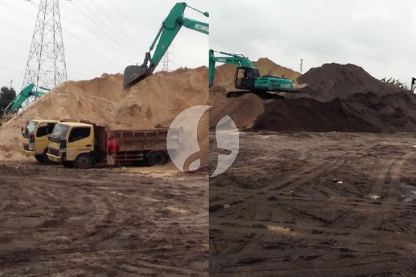

**Tanyakan Ini sebelum Menyetujui Harga Pasir 1 Rit Lampung** - Mitra Sumber Material di mana pun berada, apakah Anda sedang mencari informasi harga pasir 1 rit Lampung untuk proyek konstruksi Anda? Kami siap membantu memastikan kebutuhan material Anda terpenuhi dengan cepat dan efisien.



Seringkali, urusan material bangunan terasa rumit, apalagi kalau butuh volume besar seperti pasir. Nah, di Sumber Material, Anda bisa mendapatkan pasir berkualitas langsung dari Lampung, sekaligus solusi lengkap untuk proyek Anda — mulai dari pengiriman hingga jasa urug dan penyewaan alat berat.

## Mencari Harga Pasir 1 Rit Lampung yang Pas: Apa yang Perlu Diperhatikan?

Sebelum memutuskan, ada beberapa hal yang perlu Anda pertimbangkan saat mencari harga pasir 1 rit Lampung. Jenis pasir (pasir urug, pasir pasang, atau pasir cor), jarak pengiriman, dan volume pesanan akan sangat memengaruhi harga akhir. Selain itu, pastikan juga Anda mendapatkan pasir dengan kualitas yang sesuai standar proyek Anda. Mitra Sumber Material memahami betul pentingnya kualitas, dan kami hanya menyediakan pasir dari sumber terpercaya. Jangan ragu untuk [tanyakan harga terbaru](https://api.whatsapp.com/send?phone=6285776786091&text=*Halo%20sumbermaterial.com*%20%3A) langsung kepada kami.

## Pasir Lampung: Pilihan Material Konstruksi Unggul untuk Berbagai Kebutuhan

Kami menyediakan berbagai jenis pasir Lampung yang siap mendukung kelancaran proyek Anda:

- **Pasir Urug:** Ideal untuk pengurugan lahan, pembuatan pondasi, dan stabilisasi tanah. Pasir urug Lampung dikenal dengan teksturnya yang kasar dan kuat, memastikan hasil urugan yang stabil dan tahan lama.
- **Pasir Pasang:** Cocok untuk lapisan bawah lantai, campuran semen, dan pekerjaan plesteran. Pasir pasang Lampung memiliki kandungan lumpur yang lebih sedikit, sehingga menghasilkan campuran yang lebih kuat dan tahan retak.
- **Pasir Cor:** Digunakan sebagai campuran beton untuk menghasilkan struktur beton yang kokoh. Pasir cor Lampung memiliki gradasi yang baik, memastikan campuran beton yang homogen dan kuat.

Kami juga menyediakan pasir dalam berbagai ukuran, mulai dari 1 rit (sekitar 6-8 m3) hingga volume lebih besar sesuai kebutuhan proyek Anda. Anda bisa memperkirakan kebutuhan pasir dengan bantuan Kami.

## Mengapa Memilih Sumber Material untuk Pasir Lampung & Kebutuhan Proyek Lainnya?

Mitra Sumber Material hadir sebagai solusi *one-stop solution* untuk semua kebutuhan proyek konstruksi Anda. Kami tidak hanya menyediakan pasir berkualitas dari Lampung, tetapi juga jasa sewa alat berat (excavator, bulldozer, truk engkol) dan jasa urug yang profesional.  Dengan memesan dari Kami, Anda bisa menghemat waktu dan biaya karena tidak perlu repot mencari penyedia jasa yang berbeda.

Berikut beberapa keuntungan yang akan Anda dapatkan:

- **Kualitas Terjamin:** Kami hanya menyediakan pasir dari sumber terpercaya di Lampung, memastikan kualitas terbaik untuk proyek Anda.
- **Harga Kompetitif:** Kami menawarkan harga yang bersaing dengan kualitas yang setara.
- **Pengiriman Tepat Waktu:** Kami melayani pengiriman ke seluruh wilayah Jabodetabek dan sekitarnya, memastikan material Anda sampai tepat waktu.
- **Jasa Lengkap:** Selain pasir, Kami juga menyediakan jasa urug dan sewa alat berat untuk kelancaran proyek Anda.
- **Konsultasi Gratis:** Tim Kami siap membantu Anda menghitung kebutuhan material dan memberikan solusi terbaik untuk proyek Anda.

Kami berlokasi di Bogor, Jakarta, Bekasi, Karawang, Tangerang, dan Cikarang, sehingga pengiriman lebih cepat dan efisien.

## Pesan Pasir 1 Rit Lampung & Jasa Pendukungnya dengan Mudah

Memesan pasir 1 rit Lampung dan memanfaatkan jasa Kami sangatlah mudah. Anda bisa menghubungi Kami melalui tombol **Telepon** atau **WhatsApp** di bawah ini.  Sebutkan jenis pasir yang Anda butuhkan, volume pesanan, dan lokasi proyek Anda. Tim Kami akan segera memberikan penawaran harga terbaik dan menjadwalkan pengiriman sesuai kebutuhan Anda. Anda juga bisa bertanya mengenai jasa urug dan sewa alat berat yang tersedia. Jangan tunda, segera hubungi Kami untuk mendapatkan solusi terbaik untuk proyek Anda!

## Memperkirakan Kebutuhan Pasir: Contoh Perhitungan untuk Proyek Anda

Seringkali Mitra Sumber Material bertanya-tanya, berapa banyak pasir 1 rit Lampung yang dibutuhkan untuk proyek mereka? Nah, perhitungan ini penting agar tidak terjadi kekurangan atau kelebihan material. Mari kita ambil contoh sederhana: Anda akan membuat lantai dasar untuk rumah ukuran 8x10 meter dengan ketebalan urugan pasir 10 cm.

Pertama, hitung volume urugan yang dibutuhkan:

- Luas lantai: 8 meter x 10 meter = 80 m²
- Ketebalan urugan: 10 cm = 0,1 meter
- Volume urugan: 80 m² x 0,1 meter = 8 m³

## Pertanyaan Umum Seputar Pasir Lampung & Jasa Kami

Banyak Mitra Sumber Material yang memiliki pertanyaan sebelum memutuskan memesan. Berikut beberapa pertanyaan yang sering kami terima:

### Berapa Lama Waktu Pengiriman Pasir 1 Rit Lampung?

Waktu pengiriman bervariasi tergantung jarak lokasi proyek Anda dari sumber pasir dan kondisi lalu lintas. Secara umum, pengiriman ke wilayah Jabodetabek membutuhkan waktu 1-3 hari kerja. Kami akan memberikan estimasi waktu pengiriman yang lebih akurat saat Anda menghubungi Kami.

### Apakah Sumber Material Melayani Pengiriman Pasir ke Luar Jabodetabek?

Kami fokus melayani wilayah Jabodetabek dan sekitarnya untuk memastikan pengiriman yang cepat dan efisien. Untuk pengiriman ke luar wilayah tersebut, silakan hubungi Kami untuk menanyakan ketersediaan dan estimasi biaya pengiriman.

### Bagaimana Cara Memastikan Kualitas Pasir yang Saya Terima?

Kami hanya menyediakan pasir dari sumber terpercaya di Lampung dan melakukan kontrol kualitas secara berkala. Jika Anda memiliki keraguan, Anda dapat meminta sampel pasir sebelum melakukan pemesanan dalam jumlah besar.

### Bisakah Saya Meminta Jasa Urug Setelah Pasir Sampai di Lokasi?

Tentu saja! Kami menyediakan jasa urug yang profesional dengan tenaga kerja berpengalaman dan alat berat yang lengkap. Anda bisa memesan jasa urug sekaligus saat memesan pasir untuk kemudahan dan efisiensi.

## Memaksimalkan Efisiensi Proyek dengan Perencanaan Material yang Tepat

Perencanaan material yang matang adalah kunci keberhasilan proyek konstruksi. Selain menghitung volume pasir yang dibutuhkan, pertimbangkan juga faktor-faktor lain seperti jenis pekerjaan, kondisi tanah, dan cuaca. Nah, kesalahan umum yang sering terjadi adalah memperkirakan kebutuhan material terlalu rendah, yang dapat menyebabkan keterlambatan proyek dan biaya tambahan. Sebaliknya, memesan terlalu banyak juga akan membuang-buang anggaran.

Mitra Sumber Material sangat menyarankan untuk berkonsultasi dengan ahli konstruksi atau tim Kami sebelum memulai proyek. Kami bisa membantu Anda menghitung kebutuhan material secara akurat dan memberikan solusi terbaik untuk proyek Anda. Kami juga bisa memberikan tips tentang cara penyimpanan pasir yang tepat agar tidak terkontaminasi dan kualitasnya tetap terjaga.

## Memahami Perbedaan Jenis Pasir Lampung: Mana yang Tepat untuk Proyek Anda?

Mitra Sumber Material seringkali menerima pertanyaan tentang perbedaan jenis pasir Lampung. Memilih jenis yang tepat sangat penting untuk memastikan hasil konstruksi yang optimal. Pasir urug, pasir pasang, dan pasir cor memang sama-sama berasal dari Lampung, tetapi memiliki karakteristik yang berbeda. Pasir urug memiliki butiran yang lebih kasar dan ideal untuk pengurugan lahan karena drainase yang baik. Pasir pasang, dengan kandungan lumpur yang lebih sedikit, cocok untuk campuran semen dan plesteran. Sementara itu, pasir cor memiliki gradasi yang baik sehingga menghasilkan campuran beton yang kuat dan homogen. Jangan ragu untuk berkonsultasi dengan Kami jika Anda masih bingung memilih jenis pasir yang paling sesuai untuk proyek Anda.

## Pertanyaan Lain yang Sering Diajukan Mitra Sumber Material

### Apakah Pasir Lampung Bisa Digunakan untuk Membuat Jalan?

Ya, pasir Lampung, terutama jenis pasir urug, sering digunakan sebagai material dasar untuk pembuatan jalan. Namun, perlu dicampur dengan material lain seperti batu split dan semen untuk meningkatkan kekuatannya.

### Bagaimana Cara Menyimpan Pasir Agar Tidak Tercemar?

Penyimpanan yang tepat sangat penting untuk menjaga kualitas pasir. Simpan pasir di tempat yang kering, rata, dan terlindung dari hujan dan kotoran. Tutup pasir dengan terpal jika disimpan di luar ruangan.

### Apakah Sumber Material Menyediakan Layanan Pengiriman Pasir ke Lokasi yang Sulit Dijangkau?

Kami berusaha semaksimal mungkin untuk melayani pengiriman ke lokasi yang sulit dijangkau. Tim Kami akan melakukan survei terlebih dahulu untuk menentukan metode pengiriman yang paling tepat dan aman. Biaya pengiriman mungkin akan disesuaikan tergantung pada kondisi lokasi.

### Apa Keuntungan Memesan Pasir dalam Jumlah Besar?

Memesan pasir dalam jumlah besar biasanya lebih ekonomis karena Kami menawarkan harga yang lebih kompetitif untuk pembelian dalam skala besar. Selain itu, Anda juga bisa menghemat waktu dan biaya transportasi karena hanya perlu memesan satu kali pengiriman.

Tinggal satu langkah lagi: hubungi Kami lewat tombol **Telepon** atau **WhatsApp** di bawah untuk menanyakan harga dan jadwal pengiriman proyek Mitra Sumber Material.
