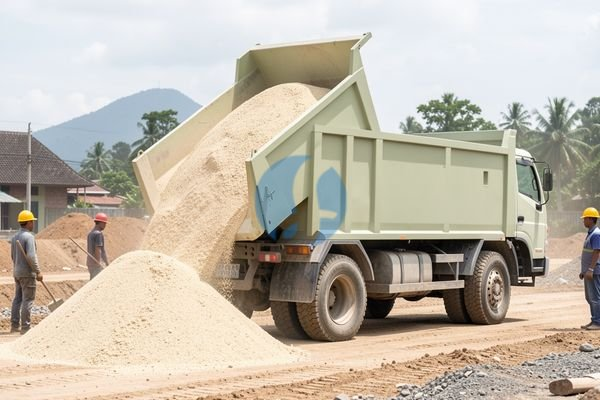

**Panduan Singkat Membaca Harga Pasir Blitar 1 Truk** - Mitra, apakah Anda sedang merencanakan proyek konstruksi dan mencari informasi harga pasir Blitar per truk? Kami di Sumber Material siap membantu menyiapkan material berkualitas untuk kebutuhan proyek Anda, termasuk pengiriman langsung ke lokasi di Jabodetabek dan sekitarnya.



Pasir Blitar memang menjadi salah satu pilihan populer di kalangan kontraktor dan pemilik rumah karena kualitasnya yang baik dan harganya yang relatif terjangkau. Namun, harga bisa bervariasi tergantung beberapa faktor. Nah, di artikel ini, Kami akan mengulas lebih detail mengenai harga pasir Blitar per truk, apa saja yang memengaruhi harga tersebut, dan bagaimana Anda bisa mendapatkan penawaran terbaik dari Kami.

## Memilih Pasir Blitar yang Tepat: Ukuran dan Jenis yang Perlu Anda Ketahui

Mitra Sumber Material, sebelum membahas lebih jauh tentang harga, penting untuk memahami dulu jenis dan ukuran pasir Blitar yang tersedia. Secara umum, ada dua jenis utama yang sering digunakan: pasir Blitar kasar dan pasir Blitar halus. Pasir Blitar kasar ideal untuk campuran beton, pondasi, dan screen, sementara pasir Blitar halus lebih cocok untuk plester, acian, dan pembuatan batako.

Ukuran pasir juga berpengaruh terhadap kualitas dan harga. Semakin halus pasirnya, biasanya harganya sedikit lebih tinggi karena proses pengolahan yang lebih rumit. Selain itu, penting juga untuk memastikan pasir Blitar yang Anda beli bebas dari kotoran seperti tanah liat, lumpur, atau material organik lainnya. Pasir berkualitas baik akan menghasilkan campuran yang lebih kuat dan tahan lama. Jangan ragu untuk bertanya detail spesifikasi pasir kepada Kami, karena Kami menyediakan berbagai pilihan sesuai kebutuhan proyek Anda.

## Pasir Blitar, Besi Beton, dan Material Konstruksi Lainnya dari Sumber Material

Kami di Sumber Material menyediakan berbagai jenis material bangunan termasuk pasir Blitar dengan kualitas terjamin. Kami juga menyediakan material pendukung lainnya yang mungkin Anda butuhkan, seperti besi beton (rebar) berbagai ukuran, wiremesh, baja ringan, batako, hebel, dan readymix.

Untuk pasir Blitar, Kami menawarkan beberapa opsi:

- **Pasir Blitar Kasar:** Ideal untuk struktur beton, pondasi, dan lantai kerja.
- **Pasir Blitar Halus:** Cocok untuk plesteran, acian, dan pembuatan batako.
- **Volume:** Tersedia dalam berbagai volume, termasuk pengiriman per truk dengan muatan standar sekitar 6-8 kubik (tergantung jenis truk).

Selain itu, Kami juga menyediakan jasa urug pasir dan jasa cor beton untuk proyek Anda. Bayangkan, Mitra, semua kebutuhan material dan jasa dalam satu atap!  [tanyakan harga terbaru](https://api.whatsapp.com/send?phone=6285776786091&text=*Halo%20sumbermaterial.com*%20%3A)  Ini akan sangat menghemat waktu dan tenaga Anda.

## Kenapa Memesan Pasir Blitar di Sumber Material? Satu Pintu untuk Semua Kebutuhan Proyek Anda

Mitra, kenapa harus repot mencari supplier berbeda untuk setiap material yang Anda butuhkan? Di Sumber Material, Anda bisa mendapatkan semua material konstruksi, sewa alat berat, dan jasa urug/cor dalam satu tempat. Kami melayani pengiriman ke seluruh wilayah Jabodetabek dan sekitarnya, termasuk Bogor, Jakarta, Bekasi, Karawang, dan Tangerang.

Kami memahami betul pentingnya kualitas dan ketepatan waktu dalam proyek konstruksi. Itulah mengapa Kami hanya menyediakan material bangunan dari sumber yang terpercaya dan memiliki standar kualitas tinggi.  Kami juga memiliki armada truk yang siap mengantarkan pasir Blitar dan material lainnya langsung ke lokasi proyek Anda. Anda tidak perlu khawatir lagi tentang logistik dan transportasi.

Selain itu, Kami juga menawarkan layanan konsultasi gratis. Tim Kami akan dengan senang hati membantu Anda menghitung kebutuhan material, memberikan rekomendasi produk yang sesuai, dan menjawab semua pertanyaan Anda.  [cimalaka 1 truk,](/blog/harga-pasir-cimalaka-1-truk/) untuk informasi lebih lanjut tentang jenis pasir yang tersedia!

## Pesan Pasir Blitar Sekarang: Mudah, Cepat, dan Terpercaya

Memesan pasir Blitar di Sumber Material sangatlah mudah. Anda bisa menghubungi Kami melalui tombol **Telepon** atau **WhatsApp** yang tersedia di halaman ini. Sampaikan kebutuhan proyek Anda, termasuk jenis pasir, volume yang dibutuhkan, dan alamat pengiriman. Tim Kami akan segera memberikan penawaran harga terbaik dan mengatur jadwal pengiriman yang sesuai dengan kebutuhan Anda.

Atau, Anda bisa mengirimkan detail proyek Anda lewat WhatsApp, termasuk denah lokasi dan spesifikasi material yang dibutuhkan. Kami akan segera merespons dan memberikan solusi terbaik untuk proyek Anda.  Tahukah Anda, banyak Mitra Kami juga memanfaatkan jasa urug pasir Kami setelah memesan pasir Blitar? Ini sangat efisien dan menghemat waktu!

## Menghitung Kebutuhan Pasir Blitar: Contoh Kasus Proyek Rumah 2 Lantai

Mitra, seringkali pertanyaan yang muncul adalah: berapa banyak pasir Blitar yang dibutuhkan untuk proyek rumah 2 lantai? Nah, Kami akan berikan contoh perhitungan sederhana untuk membantu Anda memperkirakan kebutuhan material. Asumsikan Anda akan membangun rumah dengan luas bangunan 100 meter persegi per lantai (total 200 meter persegi).

Untuk pondasi, rata-rata dibutuhkan sekitar 0,15 meter kubik pasir Blitar per meter persegi. Jadi, untuk pondasi rumah 200 meter persegi, Anda membutuhkan sekitar 30 meter kubik pasir Blitar. Selanjutnya, untuk pembuatan scree (lantai dasar sebelum pemasangan keramik), dibutuhkan sekitar 0,05 meter kubik pasir Blitar per meter persegi. Artinya, Anda membutuhkan 10 meter kubik pasir Blitar untuk scree.

Kemudian, untuk plesteran dinding (luar dan dalam), dibutuhkan sekitar 0,03 meter kubik pasir Blitar per meter persegi dinding. Jika total luas dinding rumah Anda sekitar 200 meter persegi, maka Anda membutuhkan 6 meter kubik pasir Blitar untuk plesteran. Terakhir, untuk pembuatan acian, dibutuhkan sekitar 0,01 meter kubik pasir Blitar per meter persegi dinding. Artinya, Anda membutuhkan 2 meter kubik pasir Blitar untuk acian.

## Pertanyaan Umum Seputar Pasir Blitar: FAQ untuk Proyek Anda

Mitra Sumber Material, seringkali Kami menerima pertanyaan serupa dari pelanggan. Berikut beberapa pertanyaan umum beserta jawabannya:

### Berapa Daya Angkut Pasir Blitar 1 Truk?

Daya angkut pasir Blitar per truk bervariasi tergantung jenis truk yang digunakan. Umumnya, truk engkel mengangkut sekitar 6-8 kubik, truk sedang sekitar 10-12 kubik, dan truk tronton sekitar 15-20 kubik.

### Apa Bedanya Pasir Blitar dengan Pasir Lain?

Pasir Blitar dikenal memiliki butiran yang relatif kasar, bersih, dan memiliki daya rekat yang baik. Ini membuatnya ideal untuk campuran beton dan konstruksi bangunan. Dibandingkan pasir pantai, pasir Blitar memiliki kandungan garam yang lebih rendah, sehingga lebih tahan terhadap korosi.

### Bagaimana Cara Menyimpan Pasir Blitar agar Tidak Tercemar?

Simpan pasir Blitar di area yang kering, rata, dan terlindung dari hujan. Tutupi dengan terpal atau plastik untuk mencegah kontaminasi dari debu, kotoran, atau material organik lainnya. Hindari menumpuk pasir terlalu tinggi agar tidak terjadi pengerasan.

### Apakah Pasir Blitar Cocok untuk Pembuatan Batako?

Ya, pasir Blitar halus sangat cocok untuk pembuatan batako karena teksturnya yang mudah dicampur dan menghasilkan batako yang kuat dan tahan lama.

## Memastikan Kualitas Pasir Blitar: Tips Mengecek di Lokasi Pengiriman

Mitra, setelah memesan pasir Blitar, ada beberapa hal sederhana yang bisa Anda lakukan untuk memastikan kualitasnya saat pengiriman tiba. Pertama, perhatikan warna pasir. Pasir Blitar yang baik umumnya berwarna krem atau abu-abu muda, bukan coklat kemerahan yang mengindikasikan kandungan tanah liat tinggi. Kedua, lakukan tes sederhana dengan menggenggam pasir. Jika pasir mudah menyatu dan menggumpal, itu menandakan kandungan lumpur yang berlebihan. Ketiga, periksa apakah ada kotoran organik seperti daun atau ranting.

## Pertanyaan yang Sering Muncul: Lebih Dalam tentang Pasir Blitar

Banyak Mitra Sumber Material yang bertanya lebih detail tentang penggunaan pasir Blitar. Berikut beberapa pertanyaan umum yang sering Kami terima:

### Apakah Pasir Blitar Cocok untuk Lantai Carport?

Ya, pasir Blitar kasar sangat cocok untuk lantai carport karena memiliki daya dukung yang baik dan tahan terhadap beban kendaraan. Pastikan Anda menggunakan campuran yang tepat dengan semen dan air agar lantai carport Anda kuat dan awet.

### Bagaimana Jika Pasir Blitar Terkontaminasi Lumpur?

Jika pasir Blitar terkontaminasi lumpur, Anda bisa melakukan penyaringan menggunakan ayakan atau saringan pasir. Namun, jika kontaminasi terlalu parah, sebaiknya konsultasikan dengan Kami untuk mendapatkan solusi terbaik.

### Apakah Pasir Blitar Bisa Digunakan untuk Membuat Adukan?

Tentu saja. Pasir Blitar halus sangat ideal untuk membuat adukan plester atau acian karena teksturnya yang halus dan mudah dicampur dengan semen dan air. Pastikan perbandingan campuran sesuai dengan standar yang berlaku.

### Bisakah Pasir Blitar Disimpan di Luar Ruangan dalam Jangka Panjang?

Meskipun pasir Blitar relatif tahan terhadap cuaca, sebaiknya hindari menyimpannya di luar ruangan dalam jangka panjang tanpa perlindungan. Tutupi dengan terpal untuk mencegah kontaminasi dan menjaga kualitasnya.

Tinggal satu langkah lagi: hubungi Kami lewat tombol **Telepon** atau **WhatsApp** di bawah untuk menanyakan harga dan jadwal pengiriman proyek Mitra Sumber Material.
