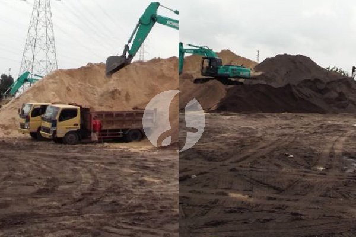

**Harga Pasir di Bandar Lampung, Apa yang Sudah dan Belum Termasuk?** - Mitra Sumber Material yang budiman, sedang merencanakan proyek pembangunan di Bandar Lampung dan butuh pasokan pasir yang tepat? Kami tahu betul betapa pentingnya mendapatkan harga yang sesuai anggaran, kualitas terjamin, dan pengiriman yang lancar. Nah, di artikel ini, Kami akan membahas secara rinci harga pasir di Bandar Lampung, jenis-jenis pasir yang umum digunakan, serta bagaimana Sumber Material bisa menjadi solusi terbaik untuk kebutuhan Anda.



Mitra, seringkali tantangan utama dalam proyek konstruksi adalah mengelola biaya material. Estimasi yang meleset bisa mengganggu cash flow dan jadwal proyek. Harga pasir yang fluktuatif juga bisa jadi masalah. Bayangkan, Anda sudah merencanakan anggaran, tapi begitu pesan, harganya tiba-tiba naik? Sumber Material hadir untuk memberikan kejelasan harga dan penawaran yang bisa disesuaikan dengan volume dan lokasi proyek Anda.

## Memilih Pasir yang Tepat: Jenis dan Kegunaannya di Proyek Anda

Sebelum membahas harga, penting untuk memahami berbagai jenis pasir yang tersedia dan kegunaannya. Ada pasir urug, pasir bangunan, pasir cor, dan lain-lain. Masing-masing memiliki karakteristik dan harga yang berbeda. Pasir urug, misalnya, biasanya digunakan untuk pengurugan lahan dan memiliki harga yang relatif lebih terjangkau. Sementara itu, pasir cor, yang digunakan untuk campuran beton, memiliki standar kualitas yang lebih tinggi dan harganya pun lebih mahal. Anda juga perlu mempertimbangkan ukuran butiran pasir – apakah Anda butuh pasir halus, sedang, atau kasar.

Nah, jangan bingung memilih! Kami bantu menyederhanakan. Tim Kami siap memberikan konsultasi gratis untuk menentukan jenis pasir yang paling sesuai dengan kebutuhan proyek Anda. Cukup kirim detail proyek dan lokasi pengiriman Anda lewat WhatsApp, dan Kami akan berikan rekomendasi terbaik.

## Pasir Berkualitas dari Sumber Material: Pilihan Terbaik untuk Proyek Anda

Sumber Material menyediakan berbagai jenis pasir berkualitas untuk proyek Anda di Bandar Lampung dan sekitarnya. Kami memiliki:

- **Pasir Urug:** Ideal untuk pengurugan lahan, membuat dasar bangunan, atau menimbun area tertentu. Tersedia dalam berbagai ukuran butiran.
- **Pasir Bangunan:** Cocok untuk campuran semen, plesteran, dan acian. Memiliki daya rekat yang baik dan menghasilkan hasil akhir yang halus.
- **Pasir Cor:** Dirancang khusus untuk campuran beton, memberikan kekuatan dan ketahanan yang optimal. Tersedia dengan mutu yang sesuai standar SNI.
- **Pasir Putih:** Digunakan untuk keperluan khusus seperti pembuatan taman, dekorasi, atau lapisan finishing.

Kami tidak hanya menyediakan berbagai jenis pasir, tetapi juga memastikan kualitasnya terjamin. Pasir yang Kami jual telah melalui proses penyaringan dan pencucian untuk menghilangkan kotoran dan material organik yang dapat mengurangi kualitas bangunan Anda.

## Kenapa Harus Pesan Pasir di Sumber Material? Keunggulan yang Akan Anda Rasakan

Mitra Sumber Material, kenapa Anda harus memilih Kami sebagai supplier pasir Anda di Bandar Lampung? Ada beberapa alasan kuat:

- **Harga Kompetitif:** Kami menawarkan harga yang bersaing dan transparan. Anda bisa menanyakan harga terbaru dan mendapatkan penawaran khusus sesuai volume pesanan.
- **Kualitas Terjamin:** Kami hanya menyediakan pasir berkualitas tinggi yang sesuai standar SNI.
- **Pengiriman Tepat Waktu:** Kami memiliki armada pengiriman yang handal untuk memastikan pasir Anda sampai ke lokasi proyek tepat waktu.
- **Jangkauan Luas:** Kami melayani pengiriman ke seluruh wilayah Bandar Lampung, serta kota-kota lain di Jabodetabek dan sekitarnya. Kami berlokasi di Bogor, Jakarta, Bekasi, Karawang, dan Tangerang, sehingga memudahkan pengiriman ke berbagai lokasi.
- **Konsultasi Gratis:** Tim Kami siap memberikan konsultasi gratis untuk membantu Anda memilih jenis pasir yang tepat dan menghitung kebutuhan material.
- **Kejelasan Harga:** Kami memahami pentingnya anggaran yang terencana. Hubungi Kami untuk mendapatkan penawaran harga terbaru dan paling akurat sesuai kebutuhan proyek Anda. Harga ini bersifat estimasi dan dapat berubah sewaktu-waktu — hubungi Kami untuk penawaran terbaru dan paling akurat sesuai kebutuhan proyek Mitra.

## Pesan Pasir Sekarang: Mudah, Cepat, dan Terpercaya

Memesan pasir di Sumber Material sangat mudah. Anda bisa menghubungi Kami melalui tombol **WhatsApp** atau **Telepon** yang ada di bawah halaman ini. Tim Kami akan segera merespons dan membantu Anda mendapatkan pasir berkualitas dengan harga terbaik. Anda bisa langsung menanyakan harga terbaru, konsultasi mengenai kebutuhan proyek Anda, atau melakukan pemesanan.

## Hitung Kebutuhan Pasir untuk Proyek Anda: Contoh Praktis & Tips Akurat

Mitra Sumber Material, seringkali menghitung kebutuhan pasir menjadi tantangan tersendiri. Kekurangan bisa menghambat kelancaran proyek, kelebihan berarti pemborosan anggaran. Nah, Kami akan berikan contoh perhitungan sederhana untuk membantu Anda memperkirakan kebutuhan pasir untuk beberapa jenis pekerjaan umum.

Sebagai contoh, mari kita hitung kebutuhan pasir untuk membuat lantaian (screed) seluas 50 meter persegi dengan ketebalan 5 cm. Anggap saja, kebutuhan pasir untuk 1 meter persegi lantaian adalah sekitar 0,05 meter kubik (5 cm x 1 m² = 0,05 m³). Maka, total pasir yang dibutuhkan adalah 50 m² x 0,05 m³ = 2,5 meter kubik. Perlu diingat, angka ini adalah estimasi kasar. Faktor lain seperti tingkat kepadatan pasir dan kehilangan material selama pengerjaan juga perlu diperhitungkan. Jika Anda ragu, jangan sungkan untuk berkonsultasi dengan tim Kami. Kami bantu hitungkan kebutuhan pasir Anda secara akurat sesuai spesifikasi proyek.

Contoh lain, untuk membuat 1 meter kubik beton dengan rasio 1:2:3 (semen:pasir:kerikil), Anda membutuhkan sekitar 0,67 meter kubik pasir. Jadi, untuk membuat 5 meter kubik beton, Anda membutuhkan 5 x 0,67 = 3,35 meter kubik pasir. Penting untuk selalu menyesuaikan rasio campuran beton dengan kebutuhan kekuatan dan jenis konstruksi Anda.

## Pertanyaan Umum Seputar Pasir: Jawaban Singkat & Padat

Mitra, seringkali Kami menerima pertanyaan seputar pasir. Berikut beberapa pertanyaan yang paling umum beserta jawabannya:

### Berapa lama waktu pengiriman pasir ke Bandar Lampung?

Waktu pengiriman bervariasi tergantung pada jarak lokasi proyek Anda dari gudang Kami dan ketersediaan armada. Umumnya, pengiriman dalam wilayah Bandar Lampung memakan waktu 1-3 hari kerja.

### Jenis pasir apa yang paling cocok untuk membuat fondasi rumah?

Untuk fondasi rumah, Kami rekomendasikan menggunakan pasir cor yang berkualitas tinggi. Pasir cor memiliki kekuatan dan daya tahan yang optimal untuk menopang struktur bangunan Anda.

### Bagaimana cara memastikan kualitas pasir yang Kami terima?

Kami selalu memastikan kualitas pasir yang Kami jual memenuhi standar SNI. Anda bisa meminta contoh pasir untuk diuji di laboratorium jika diperlukan.

### Apakah bisa memesan pasir dalam jumlah kecil?

Tentu saja bisa! Kami melayani pemesanan pasir dalam berbagai volume, mulai dari jumlah kecil untuk proyek renovasi hingga volume besar untuk proyek konstruksi.

## Hindari Kesalahan Umum Saat Memesan Pasir: Tips dari Ahlinya

Mitra Sumber Material, ada beberapa kesalahan umum yang sering dilakukan saat memesan pasir. Pertama, jangan hanya fokus pada harga murah. Kualitas pasir sangat penting untuk memastikan kekuatan dan ketahanan bangunan Anda. Kedua, pastikan Anda memesan jumlah pasir yang sesuai dengan kebutuhan proyek Anda. Lebih baik sedikit lebih dari pada kekurangan. Ketiga, perhatikan reputasi supplier pasir. Pilih supplier yang terpercaya dan memiliki pengalaman yang baik.

Salah satu kesalahan yang sering terjadi adalah tidak memperhatikan jenis pasir yang sesuai dengan kebutuhan proyek. Misalnya, menggunakan pasir urug untuk campuran beton dapat mengurangi kekuatan dan kualitas beton. Pastikan Anda berkonsultasi dengan ahli atau supplier pasir yang berpengalaman untuk mendapatkan rekomendasi yang tepat. Dengan menghindari kesalahan-kesalahan ini, Anda dapat memastikan proyek Anda berjalan lancar dan menghasilkan bangunan yang berkualitas.

## Memahami Perbedaan Pasir Lokal dan Pasir Import: Mana yang Lebih Cocok untuk Proyek Anda?

Mitra Sumber Material, seringkali ada pertanyaan tentang perbedaan antara pasir lokal dan pasir import. Secara umum, pasir lokal lebih ekonomis dan mudah didapatkan, namun kualitasnya bisa bervariasi tergantung sumbernya. Pasir import, di sisi lain, biasanya memiliki kualitas yang lebih terstandarisasi dan konsisten, tetapi harganya tentu lebih mahal.

Untuk proyek-proyek yang membutuhkan kekuatan dan ketahanan tinggi, seperti fondasi bangunan bertingkat, Kami sarankan untuk mempertimbangkan pasir import. Namun, untuk proyek-proyek yang lebih sederhana, seperti pembuatan lantai atau dinding, pasir lokal berkualitas baik sudah cukup memadai. Penting untuk diingat, kualitas pasir adalah faktor utama, bukan asal-usulnya.

## Pertanyaan Lebih Lanjut Seputar Pasir: Kami Siap Membantu!

Ada beberapa pertanyaan lain yang sering Kami terima dari Mitra. Mari Kita bahas:

### Apakah pasir harus dicuci sebelum digunakan?

Sebaiknya ya, Mitra. Mencuci pasir membantu menghilangkan kotoran, debu, dan material organik yang dapat mengurangi kualitas campuran.

### Bagaimana cara menyimpan pasir agar tidak tercampur kotoran?

Simpan pasir di tempat yang kering dan terlindung dari hujan. Tutup dengan terpal atau plastik untuk mencegah kontaminasi.

### Apa perbedaan pasir kasar dan pasir halus?

Pasir kasar memiliki butiran yang lebih besar dan umumnya digunakan untuk campuran beton. Pasir halus memiliki butiran yang lebih kecil dan cocok untuk plesteran atau acian.

### Bisakah Kami meminta sampel pasir sebelum memesan?

Tentu saja bisa! Kami dengan senang hati menyediakan sampel pasir agar Anda bisa menilai kualitasnya secara langsung.

Siap pesan atau masih mau konsultasi dulu? Tombol **WhatsApp** dan **Telepon** di bawah halaman ini langsung terhubung dengan tim Kami.
