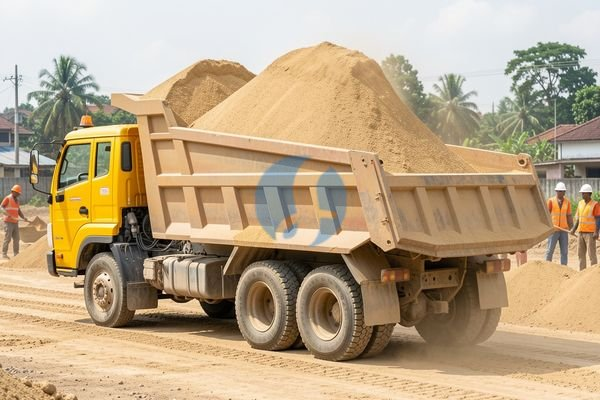

**Cara Membaca Harga Pasir Kasar 1 Truk agar Anggaran Tidak Meleset** - Mitra Sumber Material yang berbahagia, apakah Anda sedang merencanakan proyek konstruksi dan membutuhkan pasir kasar dalam jumlah besar? Mencari tahu harga pasir kasar 1 truk bisa jadi langkah awal yang membingungkan, karena harga bisa bervariasi tergantung beberapa faktor. Nah, Kami di Sumber Material siap membantu Anda menemukan solusi terbaik untuk kebutuhan pasir kasar proyek Anda.



Mitra, memilih jenis pasir yang tepat sangat penting untuk memastikan kekuatan dan kualitas bangunan Anda. Pasir kasar umumnya digunakan untuk campuran beton, pondasi, dan pekerjaan konstruksi lainnya. Tapi, bagaimana cara mendapatkan harga terbaik dan memastikan kualitasnya? Yuk, simak ulasan lengkapnya di artikel ini!

## Perbedaan Pasir Kasar dan Pasir Halus: Mana yang Tepat untuk Proyek Anda?

Sebelum kita membahas lebih lanjut soal harga, penting untuk memahami perbedaan antara pasir kasar dan pasir halus. Pasir kasar memiliki butiran yang lebih besar dan tekstur yang lebih kasar, sedangkan pasir halus memiliki butiran yang lebih kecil dan tekstur yang lebih lembut. Pemilihan jenis pasir yang tepat akan sangat memengaruhi kualitas campuran beton dan hasil akhir proyek Anda.

Untuk proyek-proyek yang membutuhkan kekuatan ekstra, seperti pondasi bangunan atau kolom beton, pasir kasar adalah pilihan yang paling ideal. Sementara itu, pasir halus lebih cocok digunakan untuk plesteran dinding atau membuat acian. Jika Anda masih bingung jenis pasir mana yang paling sesuai dengan kebutuhan proyek Anda, jangan ragu untuk berkonsultasi dengan tim Kami. Kami akan bantu berikan rekomendasi terbaik sesuai dengan spesifikasi proyek Anda. [tanyakan kebutuhan pasir Anda](https://api.whatsapp.com/send?phone=6285776786091&text=*Halo%20sumbermaterial.com*%20%3A)

## Pasir Kasar: Jenis, Ukuran, dan Aplikasi Nyata

Ada beberapa jenis pasir kasar yang umum digunakan dalam konstruksi, di antaranya pasir sungai, pasir tambang, dan pasir mekanis. Masing-masing jenis memiliki karakteristik dan keunggulannya sendiri. Pasir sungai dikenal memiliki kualitas yang baik karena telah melalui proses alami pemilahan, namun ketersediaannya semakin terbatas. Sementara itu, pasir tambang dan pasir mekanis lebih mudah didapatkan namun perlu dipastikan kualitasnya memenuhi standar SNI.

Ukuran pasir kasar juga bervariasi, mulai dari 2 mm hingga 5 mm. Semakin besar ukuran pasir, semakin baik drainasenya. Namun, pasir yang terlalu kasar juga bisa membuat campuran beton menjadi kurang padat. Untuk proyek bangunan rumah, pasir kasar dengan ukuran 2-3 mm biasanya sudah cukup memadai. Untuk proyek yang lebih besar dan membutuhkan kekuatan yang lebih tinggi, pasir kasar dengan ukuran 3-5 mm mungkin lebih direkomendasikan.

## Mengapa Memilih Sumber Material untuk Pasir Kasar 1 Truk?

Mitra Sumber Material, Kami memahami betul betapa pentingnya mendapatkan material bangunan berkualitas dengan harga yang kompetitif. Itulah mengapa Kami di Sumber Material hadir untuk memberikan solusi terbaik bagi kebutuhan proyek Anda. Kami menyediakan berbagai jenis pasir kasar dengan kualitas terjamin dan harga yang bersaing.

Kami melayani pengiriman pasir kasar 1 truk ke seluruh wilayah Jabodetabek dan sekitarnya. Dengan armada yang lengkap dan tim yang berpengalaman, Kami memastikan pesanan Anda sampai tepat waktu dan dalam kondisi terbaik. Selain itu, Kami juga menyediakan jasa urug dan jasa cor untuk memudahkan proyek konstruksi Anda. Harga ini bersifat estimasi dan dapat berubah sewaktu-waktu — hubungi Kami untuk penawaran terbaru dan paling akurat sesuai kebutuhan proyek Mitra.

Kami bukan hanya sekadar supplier material bangunan, tetapi juga mitra yang siap membantu Anda mewujudkan proyek impian. Kami selalu berusaha memberikan pelayanan terbaik dan solusi yang tepat untuk setiap kebutuhan Anda.

## Cara Mudah Memesan Pasir Kasar 1 Truk dari Sumber Material

Memesan pasir kasar 1 truk dari Kami sangatlah mudah dan praktis. Anda bisa langsung menghubungi Kami melalui tombol **WhatsApp** atau **Telepon** yang tersedia di bawah halaman ini. Tim Kami akan segera merespons pertanyaan Anda dan memberikan penawaran harga terbaik sesuai dengan kebutuhan proyek Anda.

Anda juga bisa mengirimkan detail proyek Anda (jenis pasir yang dibutuhkan, volume, lokasi pengiriman) melalui WhatsApp. Kami akan bantu menghitung estimasi biaya dan memberikan solusi terbaik untuk anggaran Anda. Kami juga siap memberikan konsultasi gratis mengenai jenis pasir yang paling sesuai dengan kebutuhan proyek Anda.

Jangan tunda kebutuhan proyek Mitra Sumber Material — tanyakan harga dan ketersediaannya sekarang lewat tombol **WhatsApp** atau **Telepon** di bawah halaman ini.

ARTIKEL_SELESAI

## Menghitung Kebutuhan Pasir Kasar untuk Proyek Anda: Contoh Praktis

Mitra Sumber Material, seringkali kita hanya fokus pada harga pasir kasar 1 truk tanpa memperhitungkan berapa banyak material yang sebenarnya dibutuhkan untuk proyek. Akibatnya, bisa terjadi kelebihan atau kekurangan material yang tentu saja akan menimbulkan kerugian. Nah, agar anggaran proyek Anda lebih terkontrol, mari kita pelajari cara menghitung kebutuhan pasir kasar secara praktis.

Sebagai contoh, kita akan menghitung kebutuhan pasir kasar untuk membuat lantai beton seluas 100 meter persegi dengan ketebalan 10 cm. Pertama, kita perlu menghitung volume beton yang dibutuhkan. Volume = Panjang x Lebar x Tinggi = 10 m x 10 m x 0.1 m = 10 meter kubik.

Selanjutnya, kita perlu mengetahui perbandingan campuran beton yang akan digunakan. Untuk beton bertulang biasa, perbandingan yang umum digunakan adalah 1:2:3 (semen : pasir : kerikil). Ini berarti, untuk setiap 1 bagian semen, dibutuhkan 2 bagian pasir dan 3 bagian kerikil. Dengan demikian, volume pasir yang dibutuhkan adalah 2/6 dari total volume beton, yaitu (2/6) x 10 m³ = 3.33 meter kubik.

### Memilih Ukuran Agregat yang Tepat untuk Kebutuhan Proyek

Ukuran agregat (pasir dan kerikil) sangat memengaruhi kualitas dan kekuatan beton. Terlalu besar bisa membuat beton retak, sedangkan terlalu kecil bisa mengurangi daya rekat. Untuk lantai beton seperti contoh di atas, ukuran agregat 20-40 mm umumnya sudah cukup ideal. Pastikan juga pasir yang Anda gunakan bebas dari lumpur dan kotoran organik, karena dapat mengurangi kekuatan beton.

## Pertanyaan Umum Seputar Pasir Kasar dan Pemesanannya

Mitra, seringkali ada beberapa pertanyaan yang muncul saat hendak memesan pasir kasar. Berikut ini beberapa pertanyaan yang sering Kami terima beserta jawabannya:

### Berapa Lama Waktu Pengiriman Pasir Kasar 1 Truk?

Waktu pengiriman biasanya tergantung pada jarak lokasi proyek dan ketersediaan armada Kami. Untuk wilayah Jabodetabek, umumnya pengiriman bisa dilakukan dalam 1-2 hari kerja setelah pesanan Kami terima.

### Apakah Sumber Material Melayani Pengiriman Sampai Lokasi yang Sulit Dijangkau?

Kami akan berusaha semaksimal mungkin untuk mengirimkan pesanan Anda sampai lokasi yang sulit dijangkau. Namun, untuk beberapa lokasi yang sangat terpencil atau aksesnya terbatas, mungkin diperlukan biaya tambahan atau penyesuaian cara pengiriman.

### Bagaimana Jika Saya Tidak Yakin Berapa Banyak Pasir Kasar yang Dibutuhkan?

Jangan khawatir! Tim Kami siap membantu Anda menghitung kebutuhan pasir kasar secara akurat. Anda bisa memberikan detail proyek Anda, dan Kami akan memberikan estimasi yang tepat.

### Apa Perbedaan Pasir Kasar yang Dijual di Sumber Material?

Kami menyediakan berbagai jenis pasir kasar sesuai kebutuhan proyek Anda. Mulai dari pasir sungai, pasir tambang, hingga pasir mekanis. Setiap jenis memiliki karakteristik dan keunggulannya masing-masing. Kami selalu memastikan kualitas pasir yang Kami jual memenuhi standar SNI dan bebas dari kotoran.

## Tips Menghemat Biaya Pasir Kasar 1 Truk: Hindari Kesalahan Umum Ini

Mitra Sumber Material, selain harga, ada beberapa hal yang bisa memengaruhi total biaya pengadaan pasir kasar 1 truk. Salah satu kesalahan umum yang sering terjadi adalah memesan terlalu banyak atau terlalu sedikit. Akibatnya, Anda bisa mengeluarkan biaya tambahan untuk penyimpanan atau justru harus memesan lagi, yang tentu saja akan memakan waktu dan biaya tambahan.

Selain itu, pastikan Anda memilih supplier yang terpercaya dan menawarkan kualitas yang sesuai dengan kebutuhan proyek Anda. Pasir kasar yang berkualitas buruk bisa mengurangi kekuatan bangunan dan bahkan menyebabkan kerusakan di kemudian hari. Jangan ragu untuk meminta sampel sebelum memesan dalam jumlah besar.

## Pertanyaan Lain yang Sering Kami Terima

### Apakah Harga Pasir Kasar 1 Truk Sudah Termasuk Biaya Pengiriman?

Harga biasanya belum termasuk biaya pengiriman, Mitra. Biaya akan disesuaikan dengan jarak lokasi proyek Anda.

### Bagaimana Jika Saya Membutuhkan Pasir Kasar dengan Spesifikasi Khusus?

Kami siap memenuhi kebutuhan spesifikasi khusus Anda. Silakan informasikan detailnya kepada tim Kami, dan Kami akan berusaha mencarikan solusi terbaik.

### Apa Saja Pembayaran yang Diterima Sumber Material?

Kami menerima berbagai metode pembayaran yang umum digunakan, termasuk transfer bank dan pembayaran tunai di tempat (COD). Detail lebih lanjut bisa Anda tanyakan saat memesan.

### Bisakah Saya Memesan Pasir Kasar 1 Truk di Luar Jam Kerja?

Tentu saja bisa! Anda tetap bisa menghubungi Kami melalui WhatsApp atau telepon kapan saja. Tim Kami akan segera merespons pertanyaan Anda.
