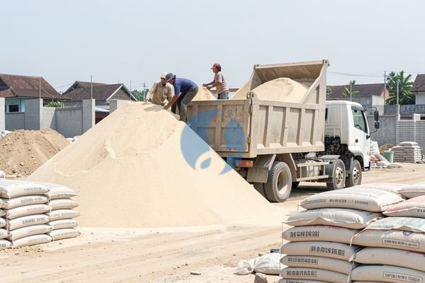

**Sebelum Membandingkan Harga Pasir Pantai 1 Truk, Cek Dulu Hal Ini** - Mitra Sumber Material, mitra Sumber Material, apakah Anda sedang mencari informasi harga pasir pantai per truk untuk proyek konstruksi Anda? Kami siap membantu menyiapkan material pasir pantai berkualitas dengan harga yang kompetitif, lengkap dengan layanan pengiriman ke lokasi proyek Anda di Jabodetabek dan sekitarnya.



## Memilih Pasir Pantai yang Tepat: Mana yang Paling Cocok untuk Proyek Anda?

Pasir pantai memang menjadi pilihan populer untuk berbagai kebutuhan konstruksi, mulai dari membuat plesteran, acian, hingga campuran beton. Namun, tidak semua pasir pantai sama. Ada perbedaan kualitas dan harga yang perlu Anda pertimbangkan. Beberapa faktor yang memengaruhi harga pasir pantai 1 truk antara lain lokasi sumber pasir, tingkat kehalusan, kandungan lumpur, dan jarak pengiriman. Nah, sebelum memutuskan, penting untuk mengetahui jenis-jenis pasir pantai yang umum digunakan. Apakah Anda membutuhkan pasir pantai halus untuk acian, atau pasir pantai kasar untuk campuran beton? Pertimbangkan juga kebutuhan volume proyek Anda. Jangan ragu untuk [tanyakan harga terbaru](https://api.whatsapp.com/send?phone=6285776786091&text=*Halo%20sumbermaterial.com*%20%3A) kepada Kami.

## Material Pasir Pantai dari Sumber Material: Jenis, Ukuran, dan Kegunaan

Kami di Sumber Material menyediakan pasir pantai dengan berbagai ukuran dan mutu untuk memenuhi kebutuhan proyek Anda. Pasir pantai yang Kami sediakan umumnya memiliki karakteristik sebagai berikut:

- **Pasir Pantai Halus:** Cocok untuk plesteran, acian, dan membuat mortar. Ukuran butirannya yang halus menghasilkan tekstur yang lebih lembut dan mudah diaplikasikan.
- **Pasir Pantai Sedang:** Ideal untuk campuran beton ringan, lantai kerja, dan pengurugan.
- **Pasir Pantai Kasar:** Cocok untuk campuran beton struktur, pondasi, dan pekerjaan yang membutuhkan kekuatan ekstra.

Satu truk pasir pantai umumnya memiliki kapasitas sekitar 6-8 kubik, namun ini bisa bervariasi tergantung jenis truk yang digunakan. Harga pasir pantai 1 truk bervariasi tergantung kualitas dan jarak pengiriman. Sebagai gambaran kasar, harga berkisar antara Rp 300.000 – Rp 500.000 per truk (estimasi 2026). Harga ini bersifat estimasi dan dapat berubah sewaktu-waktu — hubungi Kami untuk penawaran terbaru dan paling akurat sesuai kebutuhan proyek Mitra.

## Mengapa Memilih Sumber Material untuk Kebutuhan Pasir Pantai Anda?

Mitra Sumber Material, Kami memahami betul pentingnya mendapatkan material bangunan berkualitas dengan harga yang bersahabat. Itulah mengapa Kami hadir untuk memberikan solusi lengkap bagi kebutuhan proyek Anda. Selain menyediakan pasir pantai dengan berbagai jenis dan ukuran, Kami juga menawarkan:

- **Harga Kompetitif:** Kami berkomitmen untuk memberikan harga yang kompetitif tanpa mengorbankan kualitas.
- **Jangkauan Luas:** Kami melayani pengiriman ke seluruh wilayah Jabodetabek dan sekitarnya, termasuk Bogor, Jakarta, Bekasi, Karawang, Tangerang, dan Cikarang.
- **Layanan Lengkap:** Kami tidak hanya menyediakan material bangunan, tetapi juga sewa alat berat serta jasa urug dan jasa cor. Jadi, Anda bisa mendapatkan semua kebutuhan proyek Anda dalam satu tempat!
- **Konsultasi Gratis:** Tim ahli Kami siap membantu Anda memilih jenis pasir pantai yang paling sesuai dengan kebutuhan proyek Anda.
- **Pengiriman Tepat Waktu:** Kami menjamin pengiriman yang tepat waktu agar proyek Anda berjalan lancar.

Kami di Sumber Material bangga menjadi mitra terpercaya bagi para kontraktor, pengembang, dan pemilik rumah di Jabodetabek. Dengan pengalaman bertahun-tahun di industri ini, Kami selalu berusaha memberikan pelayanan terbaik kepada pelanggan Kami. Untuk pertanyaan seputar harga 1 truk, Anda bisa langsung [cimalaka 1 truk,](/blog/harga-pasir-cimalaka-1-truk/) atau [jebrod 1 truk](/blog/harga-pasir-jebrod-1-truk/).

## Pesan Pasir Pantai Sekarang: Mudah, Cepat, dan Terpercaya!

Memesan pasir pantai dari Sumber Material sangat mudah dan cepat. Anda bisa menghubungi Kami melalui tombol **WhatsApp** atau **Telepon** di bawah halaman ini. Cukup informasikan jenis pasir pantai yang Anda butuhkan, volume yang diinginkan, dan lokasi proyek Anda. Tim Kami akan segera memproses pesanan Anda dan memberikan penawaran terbaik. Jangan tunda kebutuhan proyek Mitra Sumber Material — tanyakan harga dan ketersediaannya sekarang lewat tombol **WhatsApp** atau **Telepon** di bawah halaman ini.

ARTIKEL_SELESAI

## Menghitung Kebutuhan Pasir Pantai untuk Proyek Anda: Contoh Nyata

Mitra Sumber Material, seringkali pertanyaan yang muncul adalah: berapa banyak pasir pantai yang dibutuhkan untuk proyek saya? Nah, menghitung kebutuhan material secara tepat itu penting, lho. Selain menghindari pemborosan, Anda juga bisa memperkirakan anggaran dengan lebih akurat. Mari kita ambil contoh sederhana: Anda ingin membuat pondasi untuk rumah ukuran 8x10 meter dengan tinggi 50 cm.

Untuk menghitung volume pasir yang dibutuhkan, pertama kita hitung volume pondasi. Asumsikan pondasi berbentuk persegi panjang, maka volumenya adalah panjang x lebar x tinggi. Dalam kasus ini: 8 meter x 10 meter x 0,5 meter = 40 meter kubik.

Jika Anda memesan pasir pantai dalam bentuk truk, dengan rata-rata kapasitas 6-8 kubik per truk, maka Anda membutuhkan sekitar 6-7 truk pasir pantai. Perlu diingat bahwa ini hanyalah contoh perhitungan sederhana. Untuk proyek yang lebih kompleks, sebaiknya konsultasikan dengan ahli konstruksi atau tim Kami untuk mendapatkan perhitungan yang lebih akurat.

## Pertanyaan Umum Seputar Pasir Pantai: Kami Jawab!

Mitra Sumber Material, seringkali ada pertanyaan-pertanyaan yang muncul sebelum Anda memutuskan untuk membeli pasir pantai. Berikut ini beberapa pertanyaan umum yang sering Kami terima:

### Apakah Pasir Pantai Cocok untuk Semua Jenis Tanah?

Tidak selalu. Pasir pantai lebih cocok digunakan untuk tanah yang berpasir atau tanah yang membutuhkan drainase yang baik. Untuk tanah lempung yang padat, sebaiknya konsultasikan dengan ahli konstruksi untuk menentukan jenis material yang paling tepat.

### Bagaimana Cara Memastikan Kualitas Pasir Pantai yang Saya Beli?

Periksa visual pasir pantai tersebut. Pastikan tidak ada banyak lumpur, kerikil, atau sampah organik. Pasir yang berkualitas baik biasanya memiliki warna yang bersih dan tekstur yang seragam.

### Apakah Pasir Pantai Mudah Tercampur dengan Material Lain?

Ya, pasir pantai relatif mudah tercampur dengan material lain seperti semen, kapur, atau air. Namun, pastikan Anda menggunakan proporsi yang tepat sesuai dengan kebutuhan proyek Anda.

### Berapa Lama Pasir Pantai Bisa Disimpan Sebelum Digunakan?

Pasir pantai bisa disimpan dalam waktu yang cukup lama asalkan disimpan di tempat yang kering dan terlindung dari hujan. Jika pasir pantai terkena air, sebaiknya segera gunakan karena kualitasnya bisa menurun.

## Hindari Kesalahan Umum Saat Memesan Pasir Pantai

Mitra Sumber Material, ada beberapa kesalahan umum yang sering dilakukan saat memesan pasir pantai. Berikut beberapa hal yang perlu Anda hindari:

- **Tidak Memperhatikan Kualitas Pasir:** Membeli pasir pantai dengan harga murah namun kualitasnya buruk justru akan merugikan Anda di kemudian hari. Pastikan pasir pantai yang Anda beli bersih dari kotoran dan memiliki tekstur yang sesuai dengan kebutuhan proyek Anda.
- **Tidak Memperhitungkan Jarak Pengiriman:** Jarak pengiriman yang jauh akan menambah biaya transportasi. Pilih supplier yang lokasinya dekat dengan lokasi proyek Anda untuk menghemat biaya.
- **Tidak Memesan dalam Jumlah yang Cukup:** Kekurangan material di tengah proyek bisa menyebabkan keterlambatan dan biaya tambahan. Hitung kebutuhan material dengan cermat dan pesan dalam jumlah yang cukup.
- **Tidak Meminta Rekomendasi dari Ahli:** Jika Anda tidak yakin jenis pasir pantai mana yang paling sesuai dengan kebutuhan proyek Anda, jangan ragu untuk meminta rekomendasi dari ahli konstruksi.

## Tips Memeriksa Pasir Pantai Sebelum Digunakan

Setelah menerima pengiriman, ada baiknya Anda melakukan pemeriksaan sederhana. Coba perhatikan beberapa hal berikut:

### Apakah Ada Bau Tidak Sedap?

Bau tidak sedap bisa mengindikasikan adanya kandungan organik yang membusuk.

### Apakah Ada Kerikil atau Batu Karang?

Keberadaan kerikil atau batu karang berlebihan dapat mengganggu proses pencampuran dan mengurangi kekuatan material.

### Bagaimana Tekstur Pasir Saat Digenggam?

Pasir yang baik seharusnya terasa lembut dan tidak menggumpal saat digenggam.

### Apakah Warnanya Seragam?

Warna yang seragam menandakan kualitas pasir yang konsisten.

## Biaya Tambahan yang Perlu Dipertimbangkan Saat Memesan 1 Truk Pasir Pantai

Mitra Sumber Material, selain harga per truk, ada beberapa biaya tambahan yang mungkin timbul. Biaya ini perlu Anda pertimbangkan agar tidak ada kejutan di kemudian hari. Misalnya, biaya bongkar muat jika lokasi proyek Anda sulit dijangkau oleh truk. Atau, biaya penumpukan jika Anda membutuhkan waktu lebih lama untuk menggunakan pasir yang sudah dikirim. Kami di Sumber Material selalu memberikan informasi yang transparan mengenai semua biaya yang mungkin timbul.
