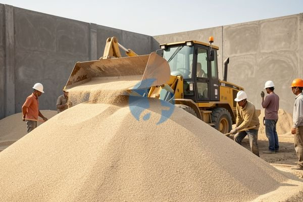

**Harga Pasir Pasang per m3 dan Perhitungan Kebutuhan Proyek** - Mitra Sumber Material di mana pun berada, pernahkah Anda merasa pusing menghitung kebutuhan pasir pasang untuk proyek konstruksi? Apalagi soal harga, yang bisa bikin anggaran membengkak kalau salah beli. Nah, Kami di Sumber Material siap membantu! Bayangkan Anda sedang mengerjakan proyek rumah atau kontraktor yang sedang menangani renovasi besar. Anda butuh pasir pasang berkualitas dengan harga terbaik, cepat, dan langsung diantar ke lokasi proyek. Itulah yang Kami sediakan.



## Mencari Pasir Pasang yang Tepat: Pilihan dan Pertimbangan

Mitra Sumber Material, memilih pasir pasang yang tepat itu penting lho. Ada beberapa jenis yang umum digunakan, seperti pasir sungai, pasir mekanis, dan pasir cor. Masing-masing punya kelebihan dan kekurangan. Pasir sungai biasanya lebih bersih, tapi harganya juga lebih mahal. Sementara pasir mekanis lebih terjangkau, tapi perlu dipastikan kualitasnya. Nah, sebelum memutuskan, sebaiknya Anda pertimbangkan jenis proyek, anggaran, dan ketersediaan material di wilayah Anda. Kalau bingung, jangan ragu konsultasi dengan Kami. Kami bantu carikan solusi terbaik sesuai kebutuhan Anda.

## Pasir Pasang Berkualitas dari Sumber Material: Jenis, Ukuran, dan Aplikasi

Kami menyediakan berbagai jenis pasir pasang yang sesuai standar SNI. Mulai dari pasir pasang yang cocok untuk pekerjaan plesteran, acian, hingga untuk lantai kerja. Ukuran yang tersedia juga bervariasi, mulai dari ukuran sedang hingga halus, tergantung kebutuhan proyek Anda. Untuk proyek rumah minimalis, pasir pasang halus biasanya menjadi pilihan utama karena mudah merata dan menghasilkan permukaan yang lebih halus. Sementara untuk proyek yang lebih besar seperti pembangunan gedung, pasir pasang dengan ukuran sedang lebih direkomendasikan karena lebih kuat dan tahan lama.

Berikut ini beberapa contoh aplikasi pasir pasang yang bisa Anda manfaatkan:

- **Plesteran dan Acian:** Pasir pasang halus sangat ideal untuk menghasilkan permukaan dinding yang rata dan halus.
- **Lantai Kerja:** Pasir pasang dengan ukuran sedang memberikan kekuatan dan stabilitas pada lantai kerja.
- **Pembuatan Screed:** Pasir pasang juga digunakan dalam pembuatan screed untuk meratakan permukaan lantai sebelum pemasangan keramik atau parket.
- **Urugan:** Untuk urugan ringan, pasir pasang bisa menjadi pilihan yang ekonomis.

## Pesan Pasir Pasang Mudah dan Cepat: Keuntungan dari Sumber Material

Mitra, kenapa repot mencari pasir pasang ke sana kemari kalau bisa pesan langsung ke Kami? Kami menawarkan kemudahan dalam pemesanan. Cukup kirimkan kebutuhan pasir pasang dan lokasi proyek Anda lewat WhatsApp, dan Kami akan bantu menghitung volume yang dibutuhkan serta memberikan penawaran harga terbaik. Kami melayani pengiriman ke seluruh wilayah Jabodetabek dan sekitarnya. Bayangkan betapa hemat waktu dan tenaga Anda!

Selain itu, Kami juga memberikan beberapa keuntungan lain:

- **Kualitas Terjamin:** Kami hanya menyediakan pasir pasang yang sudah teruji kualitasnya dan sesuai standar SNI.
- **Harga Kompetitif:** Kami menawarkan harga yang bersaing tanpa mengorbankan kualitas.
- **Pengiriman Tepat Waktu:** Kami memahami pentingnya ketepatan waktu dalam proyek konstruksi, jadi Kami pastikan pengiriman dilakukan sesuai jadwal.
- **Layanan Konsultasi:** Tim Kami siap membantu Anda memilih jenis pasir pasang yang tepat sesuai kebutuhan proyek Anda.
- **Berlokasi Strategis:** Dengan gudang yang tersebar di Bogor, Jakarta, Bekasi, Karawang, Tangerang, dan Cikarang, Kami bisa menjangkau proyek Anda dengan lebih cepat.

## Cara Mudah Memesan Pasir Pasang di Sumber Material

Tertarik untuk memesan pasir pasang dari Kami? Sangat mudah! Berikut langkah-langkahnya:

1.  **Hubungi Kami:** Lewat tombol **Telepon** atau **WhatsApp** di bawah.
2.  **Sampaikan Kebutuhan Anda:** Informasikan jenis pasir pasang, volume yang dibutuhkan, dan lokasi proyek.
3.  **Dapatkan Penawaran Harga:** Tim Kami akan segera memberikan penawaran harga terbaik.
4.  **Konfirmasi Pesanan:** Setelah Anda setuju dengan penawaran harga, Kami akan segera proses pesanan Anda.
5.  **Pesanan Dikirim:** Pasir pasang akan diantar langsung ke lokasi proyek Anda sesuai jadwal.

## Menghitung Kebutuhan Pasir Pasang: Contoh Praktis untuk Proyek Anda

Mitra Sumber Material, seringkali kita kesulitan memperkirakan berapa banyak pasir pasang yang dibutuhkan untuk sebuah proyek. Salah perhitungan bisa berakibat fatal: bisa-bisa kekurangan di tengah pekerjaan atau malah kelebihan yang membuang-buang anggaran. Nah, Kami akan berikan contoh perhitungan sederhana untuk membantu Anda.

Misalkan Anda akan membuat lantai kerja seluas 50 meter persegi dengan ketebalan 10 cm (0,1 meter). Pertama, hitung volume total yang dibutuhkan: 50 m² x 0,1 m = 5 m³. Tapi ingat, ini hanya volume pasir. Karena pasir akan mengalami pemadatan saat dipasang, kita perlu memperhitungkan faktor pemadatan. Biasanya, faktor pemadatan pasir pasang berkisar antara 1,1 hingga 1,3. Mari kita gunakan faktor 1,2 untuk contoh ini. Jadi, volume pasir pasang yang harus dipesan adalah: 5 m³ x 1,2 = 6 m³.

### Faktor yang Mempengaruhi Kebutuhan Pasir Pasang

Ada beberapa faktor yang perlu Anda perhatikan saat menghitung kebutuhan pasir pasang, antara lain:

- **Jenis Pekerjaan:** Jenis pekerjaan akan menentukan ketebalan lapisan pasir yang dibutuhkan. Lantai kerja biasanya membutuhkan lapisan yang lebih tebal dibandingkan dengan pekerjaan plesteran.
- **Kondisi Tanah:** Kondisi tanah di lokasi proyek juga mempengaruhi perhitungan. Jika tanahnya lunak, Anda mungkin membutuhkan lapisan pasir yang lebih tebal untuk memberikan fondasi yang stabil.
- **Faktor Pemadatan:** Seperti yang sudah Kami jelaskan sebelumnya, faktor pemadatan sangat penting untuk diperhitungkan.

## Pertanyaan Umum Seputar Pasir Pasang: Apa yang Sering Ditanyakan Mitra?

Mitra Sumber Material, seringkali ada beberapa pertanyaan yang muncul saat Anda akan membeli pasir pasang. Berikut ini beberapa pertanyaan umum beserta jawabannya:

### Apakah Pasir Pasang Harus Dicuci?

Tergantung pada kualitas pasirnya. Jika pasir pasang mengandung banyak kotoran, seperti lumpur atau tanah liat, sebaiknya dicuci terlebih dahulu untuk mendapatkan kualitas yang lebih baik. Namun, jika pasir pasang sudah bersih, Anda tidak perlu mencucinya.

### Bagaimana Cara Membedakan Pasir Pasang yang Berkualitas?

Perhatikan warna dan teksturnya. Pasir pasang yang berkualitas biasanya berwarna abu-abu muda hingga cokelat muda dan memiliki tekstur yang kasar. Hindari pasir pasang yang berwarna gelap atau mengandung banyak kotoran.

### Apakah Bisa Memesan Pasir Pasang dalam Jumlah Kecil?

Tentu saja! Kami melayani pemesanan pasir pasang dalam berbagai jumlah, mulai dari satu rit hingga beberapa truk. Kami sesuaikan dengan kebutuhan proyek Anda.

### Apa Saja yang Perlu Diperhatikan Saat Menerima Pengiriman Pasir Pasang?

Periksa kualitas pasirnya. Pastikan pasir pasang yang Anda terima bersih, tidak tercampur dengan kotoran, dan sesuai dengan jenis yang Anda pesan. Periksa juga volume pengiriman untuk memastikan sesuai dengan jumlah yang Anda pesan.

## Meminimalisir Pemborosan: Tips Cermat Saat Mengangkut Pasir Pasang

Mitra Sumber Material, seringkali biaya pengiriman pasir pasang bisa jadi signifikan dalam anggaran proyek Anda. Nah, ada beberapa tips yang bisa Anda terapkan untuk meminimalkan pemborosan dan menghemat biaya pengiriman. Pertama, pastikan Anda memesan volume yang tepat sesuai kebutuhan. Jangan terlalu berlebihan karena akan menambah biaya pengiriman dan juga biaya penyimpanan. Kedua, perhatikan jenis kendaraan yang digunakan untuk pengiriman. Gunakan kendaraan yang sesuai dengan volume pesanan Anda. Untuk pesanan kecil, kendaraan bak terbuka mungkin sudah cukup. Namun, untuk pesanan besar, sebaiknya gunakan truk engkel atau truk tronton.

## Hindari Kesalahan Umum Saat Memilih Pasir Pasang

Mitra, ada beberapa kesalahan umum yang sering dilakukan saat memilih pasir pasang yang bisa berdampak pada kualitas proyek Anda. Salah satunya adalah tidak memperhatikan kandungan lumpur dan tanah liat. Pasir pasang yang mengandung terlalu banyak lumpur dan tanah liat akan mengurangi kekuatan dan daya tahan bangunan Anda. Kesalahan lainnya adalah memilih pasir pasang yang terlalu halus. Pasir pasang yang terlalu halus akan sulit untuk menyatu dengan semen dan air, sehingga menghasilkan campuran yang kurang kuat. Pastikan Anda memilih pasir pasang yang memiliki gradasi yang tepat dan sesuai dengan kebutuhan proyek Anda.

## Pertanyaan Lain yang Sering Muncul dari Mitra Kami

### Apakah Pasir Pasang Bisa Menyebabkan Korosi pada Besi?

Ya, jika pasir pasang mengandung kadar garam yang tinggi, hal ini bisa menyebabkan korosi pada besi. Pastikan Anda memilih pasir pasang yang bebas dari garam, terutama jika akan digunakan untuk pekerjaan beton bertulang.

### Bagaimana Cara Menyimpan Pasir Pasang dengan Benar?

Simpan pasir pasang di tempat yang kering dan terlindung dari hujan. Tutupi dengan terpal atau plastik untuk mencegah kontaminasi dari debu dan kotoran.

### Apa Bedanya Pasir Pasang dengan Pasir Urug?

Pasir pasang biasanya lebih bersih dan memiliki ukuran butiran yang lebih halus dibandingkan dengan pasir urug. Pasir pasang digunakan untuk pekerjaan konstruksi yang membutuhkan kualitas yang lebih tinggi, seperti plesteran dan acian, sedangkan pasir urug digunakan untuk pekerjaan urugan dan pengurugan.

Tinggal satu langkah lagi: hubungi Kami lewat tombol **Telepon** atau **WhatsApp** di bawah untuk menanyakan harga dan jadwal pengiriman proyek Mitra Sumber Material.
