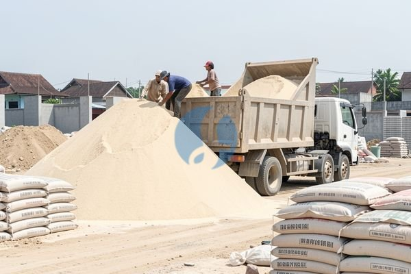

**Hal yang Memengaruhi Harga Pasir per Kubik di Jakarta di Lapangan** - Mitra Sumber Material yang kami hormati, sedang mencari tahu harga pasir per kubik di Jakarta untuk proyek Anda? Kami siap membantu!



Mempertimbangkan biaya material adalah kunci keberhasilan proyek konstruksi, termasuk memilih harga pasir yang tepat. Nah, artikel ini akan mengulas kisaran harga terbaru, jenis-jenis pasir yang umum digunakan, dan kenapa memilih Sumber Material bisa jadi solusi terbaik untuk kebutuhan Anda.

## Pilihan Pasir dan Pertimbangan Harga di Jakarta

Mitra, sebelum membahas angka, penting untuk tahu kalau harga pasir per kubik di Jakarta itu bervariasi. Faktornya banyak, mulai dari jenis pasir, jarak pengiriman, sampai kondisi pasar. Ada pasir putih, pasir kuning, pasir urug, dan lainnya — masing-masing punya kegunaan berbeda dan harga yang berbeda pula. Misalnya, pasir putih biasanya lebih mahal karena kualitasnya yang lebih baik dan sering dipakai untuk pekerjaan finishing atau membuat plesteran. Pasir urug, di sisi lain, umumnya lebih terjangkau karena digunakan untuk pengurugan atau pondasi yang tidak memerlukan kekuatan tinggi.

Penting juga untuk memperhatikan volume pemesanan. Semakin besar volume yang Anda pesan, biasanya harga per kubik akan semakin kompetitif. Nah, kalau Anda ragu jenis pasir mana yang paling pas untuk proyek Anda, jangan sungkan untuk berkonsultasi dengan tim Kami. Kami bantu berikan rekomendasi terbaik sesuai kebutuhan dan anggaran Anda. [tanyakan harga lewat WhatsApp](https://api.whatsapp.com/send?phone=6285776786091&text=*Halo%20sumbermaterial.com*%20%3A)

## Material Pasir yang Tersedia di Sumber Material

Kami menyediakan berbagai jenis pasir dengan kualitas terjamin, siap mendukung kelancaran proyek Anda:

- **Pasir Urug:** Ideal untuk pengurugan, pembuatan pondasi, atau stabilisasi tanah. Tersedia dalam berbagai ukuran butiran.
- **Pasir Pasang:** Cocok untuk pekerjaan pemasangan keramik, batu alam, atau paving block. Memiliki tekstur yang halus dan bersih.
- **Pasir Cor:** Dirancang khusus untuk campuran beton, memastikan kekuatan dan kualitas beton yang optimal.
- **Pasir Putih:** Digunakan untuk plesteran, acian, atau pekerjaan finishing yang membutuhkan tampilan yang rapi dan bersih.

Untuk volume, Kami melayani pemesanan mulai dari beberapa kubik untuk renovasi rumah, hingga puluhan bahkan ratusan kubik untuk proyek skala besar. Semua material Kami sudah melalui proses sortir dan pengujian kualitas, jadi Anda tidak perlu khawatir dengan kualitasnya.

## Kenapa Memilih Sumber Material untuk Kebutuhan Pasir Anda?

Mitra Sumber Material, ada beberapa alasan kenapa memilih Kami akan menguntungkan proyek Anda. Pertama, kami fokus pada kualitas. Kami hanya menyediakan material yang terjamin kualitasnya, termasuk pasir. Kedua, Kami melayani wilayah Jabodetabek dan sekitarnya, jadi pengiriman lebih cepat dan efisien. Ketiga, Kami menyediakan jasa sewa alat berat seperti truk engkel, truk tronton, dan excavator, sehingga Anda bisa mendapatkan solusi lengkap dalam satu tempat.

Selain itu, Kami memahami betul kebutuhan kontraktor dan pemilik proyek. Kami siap memberikan solusi yang fleksibel dan sesuai dengan anggaran Anda. Kami juga selalu berusaha memberikan harga yang kompetitif tanpa mengorbankan kualitas. Harga ini bersifat estimasi dan dapat berubah sewaktu-waktu — hubungi Kami untuk penawaran terbaru dan paling akurat sesuai kebutuhan proyek Mitra.

## Pesan Pasir Mudah, Proyek Lancar

Memesan pasir dari Sumber Material sangat mudah. Anda bisa menghubungi Kami melalui tombol **Telepon** atau **WhatsApp** yang ada di bawah halaman ini. Tim Kami akan siap membantu Anda menghitung kebutuhan pasir, memberikan penawaran harga, dan mengatur jadwal pengiriman.  Atau, Anda bisa mengirimkan detail proyek dan lokasi pengiriman Anda melalui WhatsApp, dan Kami akan segera merespon. Kami melayani pengiriman ke lokasi proyek di Bogor, Jakarta, Bekasi, Karawang, Tangerang, dan Cikarang.

## Perhitungan Kebutuhan Pasir: Contoh Kasus Proyek Rumah 2 Lantai

Mitra, seringkali kita kesulitan memperkirakan berapa banyak pasir yang dibutuhkan untuk suatu proyek. Nah, mari kita ambil contoh kasus sederhana: membangun rumah 2 lantai dengan luas bangunan 100 meter persegi per lantai (total 200 meter persegi). Asumsikan kita membutuhkan pasir untuk:

- **Pondasi:** Volume pondasi sekitar 80 meter kubik (tergantung desain dan kedalaman).
- **Urug:** Volume urug sekitar 40 meter kubik (tergantung ketinggian dan kontur tanah).
- **Pasir Cor:** Untuk kolom, balok, dan pelat lantai, diperkirakan membutuhkan sekitar 30 meter kubik.
- **Pasir Pasang:** Untuk lantai keramik (100 meter persegi per lantai x 2 lantai) dibutuhkan sekitar 6 meter kubik.

Total kebutuhan pasir, secara kasar, adalah 80 + 40 + 30 + 6 = 156 meter kubik. Angka ini hanyalah estimasi, ya. Sebaiknya selalu konsultasikan dengan arsitek atau kontraktor Anda untuk perhitungan yang lebih akurat. Perlu diingat juga, jenis pasir yang digunakan untuk masing-masing keperluan bisa berbeda-beda, jadi pastikan Anda memilih jenis yang tepat.

## Hindari Kesalahan Umum Saat Membeli Pasir

Mitra Sumber Material, ada beberapa kesalahan umum yang sering dilakukan saat membeli pasir yang sebaiknya dihindari. Pertama, **tergiur harga murah tanpa memperhatikan kualitas**. Pasir yang murah belum tentu bagus. Pastikan pasir yang Anda beli bersih dari kotoran, lumpur, atau material organik lainnya. Kedua, **tidak menanyakan asal pasir**. Pasir dari sumber yang berbeda memiliki karakteristik yang berbeda pula. Ketahui dari mana pasir itu berasal agar sesuai dengan kebutuhan proyek Anda. Ketiga, **tidak memesan dalam jumlah yang cukup**. Lebih baik memesan sedikit lebih banyak daripada kekurangan di tengah jalan. Keempat, **tidak memperhatikan biaya pengiriman**. Biaya pengiriman bisa menjadi komponen biaya yang signifikan, jadi pastikan Anda sudah memperhitungkannya.

## Pertanyaan Umum seputar Pasir dan Harganya

Banyak Mitra Sumber Material yang menanyakan hal-hal berikut:

### Berapa lama waktu pengiriman pasir ke Jakarta?

Waktu pengiriman tergantung pada jarak dan kondisi lalu lintas. Biasanya, pengiriman dalam wilayah Jabodetabek memakan waktu 1-3 hari kerja. Kami akan informasikan estimasi waktu pengiriman yang lebih akurat saat Anda memesan.

### Apakah Sumber Material menyediakan layanan pengiriman ke lokasi proyek yang sulit dijangkau?

Ya, tentu saja! Kami memiliki armada truk yang beragam, termasuk truk engkel dan tronton, yang bisa menjangkau hampir semua lokasi proyek di Jabodetabek. Kami juga berpengalaman dalam menangani pengiriman ke lokasi yang sulit dijangkau.

### Bagaimana cara memastikan kualitas pasir yang saya pesan?

Kami selalu memastikan kualitas pasir yang Kami jual. Sebelum dikirim, pasir akan Kami sortir dan periksa untuk memastikan tidak ada kotoran atau material organik. Jika Anda masih ragu, Anda bisa meminta sampel pasir sebelum memesan dalam jumlah besar.

### Bisakah saya memesan pasir dalam jumlah kecil?

Tentu saja bisa. Kami melayani pemesanan dalam berbagai volume, mulai dari beberapa kubik untuk renovasi rumah hingga puluhan bahkan ratusan kubik untuk proyek besar. Kami akan sesuaikan dengan kebutuhan Anda.

## Memahami Perbedaan Pasir Alam dan Pasir Cuci

Mitra Sumber Material, seringkali ada kebingungan antara pasir alam dan pasir cuci. Keduanya sering digunakan dalam konstruksi, namun memiliki perbedaan signifikan yang memengaruhi kualitas dan harga. Pasir alam, seperti namanya, diambil langsung dari sumbernya (sungai atau danau) tanpa proses pengolahan lebih lanjut. Akibatnya, pasir ini biasanya mengandung kotoran, lumpur, dan material organik. Sementara itu, pasir cuci melalui proses pencucian untuk menghilangkan kotoran tersebut, sehingga menghasilkan pasir yang lebih bersih dan berkualitas.

### Kapan Harus Memilih Pasir Cuci?

Pasir cuci sangat ideal untuk pekerjaan yang membutuhkan kekuatan dan daya rekat tinggi, seperti pembuatan beton bertulang. Kotoran dalam pasir alam dapat mengurangi kekuatan beton dan menyebabkan retakan. Jadi, untuk struktur bangunan yang memerlukan kekuatan maksimal, pasir cuci adalah pilihan yang lebih baik.

### Kapan Pasir Alam Bisa Menjadi Pilihan?

Untuk pekerjaan seperti pengurugan atau pembuatan lantai kerja, pasir alam bisa menjadi pilihan yang lebih ekonomis. Namun, pastikan pasir alam yang Anda gunakan sudah disortir dan dibersihkan dari kotoran besar. Dengan begitu, Anda bisa mendapatkan harga yang lebih terjangkau tanpa mengorbankan kualitas secara signifikan.

## Pertanyaan Lain yang Sering Diajukan Mitra

### Apakah Sumber Material menerima pemesanan di luar wilayah Jabodetabek?

Kami fokus melayani wilayah Jabodetabek dan sekitarnya untuk memastikan pengiriman yang cepat dan efisien. Untuk wilayah di luar Jabodetabek, Mitra bisa menanyakan ketersediaan pengiriman ke tim Kami melalui WhatsApp atau Telepon.

### Bagaimana cara mengetahui mutu pasir yang saya pesan?

Kami selalu memberikan informasi detail mengenai mutu pasir yang Kami jual. Tim Kami juga siap memberikan contoh sampel jika Mitra membutuhkan. Selain itu, Kami hanya bekerja sama dengan supplier yang terpercaya dan memiliki standar kualitas yang tinggi.

### Apakah bisa meminta faktur pajak?

Tentu saja! Kami menyediakan faktur pajak untuk setiap transaksi. Silakan informasikan kebutuhan Anda saat melakukan pemesanan.

### Bagaimana jika pasir yang saya terima tidak sesuai dengan pesanan?

Kami akan segera mengganti pasir tersebut tanpa biaya tambahan. Kepuasan Mitra adalah prioritas utama Kami.

Siap pesan atau masih mau konsultasi dulu? Tombol **WhatsApp** dan **Telepon** di bawah halaman ini langsung terhubung dengan tim Kami.
