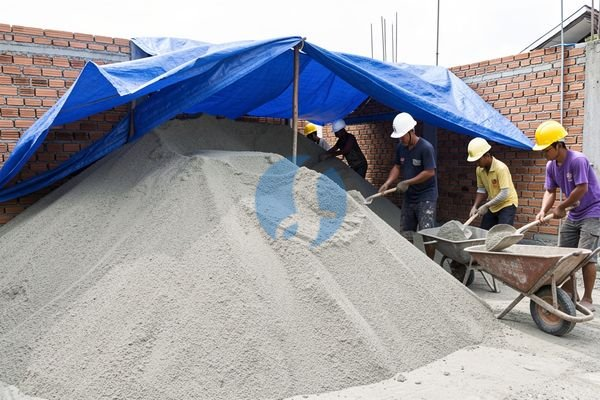

**Cek Harga Pasir Plester 1 Kubik sebelum Menyusun Anggaran** - Mitra Sumber Material di mana pun berada, sedang merencanakan pekerjaan plester untuk rumah baru atau renovasi dan ingin tahu perkiraan biayanya? Mengetahui harga pasir plester 1 kubik adalah langkah awal yang cerdas untuk menyusun anggaran proyek yang akurat. Nah, Kami hadir untuk membantu Anda mendapatkan informasi ini, sekaligus menawarkan solusi pengadaan material yang praktis dan terpercaya.



## Mencari Harga Pasir Plester 1 Kubik yang Pas: Apa Saja Pilihannya?

Sebelum membahas angka, penting untuk memahami bahwa ada beberapa jenis pasir yang umum digunakan untuk plester. Masing-masing memiliki karakteristik dan harga yang berbeda-beda. Beberapa pilihan yang sering dijumpai adalah pasir sungai, pasir urug, dan pasir mesin. Pasir sungai biasanya memiliki butiran yang lebih halus dan bersih, sehingga ideal untuk plesteran. Namun, ketersediaannya mungkin terbatas di beberapa daerah. Pasir urug cenderung lebih kotor dan perlu dicuci sebelum digunakan. Sementara pasir mesin, yang dihasilkan dari proses penghancuran batu, menawarkan konsistensi yang lebih baik dan seringkali menjadi pilihan ekonomis. Untuk mendapatkan harga terbaik, sebaiknya Anda membandingkan beberapa penawaran dari supplier terpercaya. Kami di Sumber Material siap memberikan penawaran yang kompetitif dan disesuaikan dengan kebutuhan proyek Anda. [tanyakan harga lewat WhatsApp](https://api.whatsapp.com/send?phone=6285776786091&text=*Halo%20sumbermaterial.com*%20%3A)

## Pasir Plester Berkualitas dari Sumber Material: Jenis, Ukuran, dan Aplikasi

Kami menyediakan berbagai jenis pasir plester yang sesuai dengan standar kualitas SNI. Pasir yang Kami jual tersedia dalam ukuran dan mutu yang beragam, mulai dari pasir halus untuk plester dinding interior, hingga pasir kasar untuk plester dinding eksterior. Berikut beberapa contoh yang bisa Anda pertimbangkan:

- **Pasir Pasang:** Cocok untuk campuran semen plester dinding, memiliki gradasi butiran yang pas untuk menghasilkan plester yang kuat dan tahan lama.
- **Pasir Urug Halus:** Setelah melalui proses penyaringan, pasir urug halus ini bisa digunakan sebagai campuran plester dengan harga yang lebih terjangkau.
- **Pasir Silika:** Pilihan premium untuk plester dengan kebutuhan khusus, seperti aplikasi pada dinding yang sering terpapar air atau kelembapan.

Kami juga menyediakan layanan konsultasi gratis untuk membantu Anda memilih jenis pasir yang paling sesuai dengan jenis dinding, iklim, dan anggaran proyek Anda. Mitra, jangan ragu untuk bertanya!

## Mengapa Memilih Sumber Material untuk Kebutuhan Pasir Plester Anda?

Ada beberapa alasan mengapa Mitra Sumber Material sebaiknya mempercayakan kebutuhan pasir plester Anda kepada Kami. Pertama, Kami menawarkan harga yang transparan dan kompetitif. Harga ini bersifat estimasi dan dapat berubah sewaktu-waktu — hubungi Kami untuk penawaran terbaru dan paling akurat sesuai kebutuhan proyek Mitra. Kedua, Kami menjamin kualitas pasir yang Kami jual, sesuai dengan standar SNI. Ketiga, Kami melayani pengiriman ke seluruh wilayah Jabodetabek dan sekitarnya, termasuk Bogor, Jakarta, Bekasi, Karawang, Tangerang, dan Cikarang. Keempat, Kami juga menyediakan jasa sewa alat berat seperti truk engkel dan dump truck untuk mempermudah proses pengangkutan material ke lokasi proyek Anda. Kelima, Kami berlokasi di berbagai titik strategis di Jabodetabek, sehingga waktu pengiriman lebih cepat dan efisien. Kami memahami betul betapa pentingnya pengiriman tepat waktu, dan Kami berkomitmen untuk memberikan pelayanan terbaik kepada setiap pelanggan. Kalau Anda pernah bertanya-tanya berapa? begini penjelasannya 1, Kami akan dengan senang hati memberikan penjelasan detail.

## Pesan Pasir Plester Sekarang: Mudah dan Cepat

Memesan pasir plester dari Sumber Material sangatlah mudah. Anda dapat menghubungi Kami melalui tombol **WhatsApp** atau **Telepon** di bawah halaman ini untuk mendapatkan penawaran harga terbaru. Cukup informasikan jenis pasir yang Anda butuhkan, volume yang dipesan, dan lokasi pengiriman proyek Anda. Tim Kami akan segera merespons dan memberikan solusi terbaik untuk kebutuhan Anda. Anda juga bisa mengirimkan kebutuhan dan lokasi proyek Mitra lewat WhatsApp, dan Kami bantu hitungkan volume pasir yang dibutuhkan secara akurat.

## Menghitung Kebutuhan Pasir Plester: Contoh Kasus Nyata

Mitra Sumber Material, seringkali pertanyaan yang muncul adalah: berapa banyak pasir plester yang sebenarnya dibutuhkan untuk proyek Anda? Menghitung kebutuhan material dengan tepat akan membantu Anda menghindari pemborosan atau kekurangan material. Mari kita lihat contoh perhitungan untuk proyek plester dinding rumah dengan ukuran standar.

Anggaplah Anda akan melakukan plester dinding pada ruangan berukuran 4 meter x 3 meter dengan tinggi 3 meter. Luas total dinding adalah (4m x 3m) x 4 sisi = 48 meter persegi (anggap dinding full, tanpa jendela/pintu untuk penyederhanaan). Ketebalan plester yang umum digunakan adalah 1,5 cm atau 0,015 meter. Volume plester yang dibutuhkan adalah 48 m² x 0,015 m = 0,72 meter kubik.

Namun, perlu diingat bahwa perhitungan ini hanya untuk lapisan plester saja. Anda juga perlu memperhitungkan campuran semen dan pasir. Umumnya, perbandingan campuran semen dan pasir untuk plester adalah 1:3 atau 1:4 (1 bagian semen, 3 atau 4 bagian pasir). Jika Anda menggunakan perbandingan 1:3, maka volume pasir yang dibutuhkan adalah 3 x 0,72 m³ = 2,16 meter kubik. Jika menggunakan perbandingan 1:4, volumenya menjadi 4 x 0,72 m³ = 2,88 meter kubik.  Jadi, perkiraan kebutuhan pasir plester untuk ruangan ini adalah antara 2,16 hingga 2,88 meter kubik. Tentu saja, angka ini bisa bervariasi tergantung pada ketebalan plester, kualitas material, dan teknik pengerjaan. Kami bantu hitungkan kebutuhan material Anda secara lebih akurat, cukup informasikan detail proyek Anda.

### Faktor yang Mempengaruhi Volume Pasir yang Dibutuhkan

Selain perhitungan dasar di atas, ada beberapa faktor lain yang perlu diperhatikan:

- **Kualitas Pasir:** Pasir yang lebih kasar mungkin membutuhkan volume yang lebih besar untuk mencapai ketebalan yang sama.
- **Teknik Pengerjaan:** Tukang yang berpengalaman biasanya lebih efisien dalam menggunakan material, sehingga dapat mengurangi pemborosan.
- **Kondisi Dinding:** Dinding yang tidak rata atau berpori membutuhkan lebih banyak plester untuk menutupi permukaan.

## Pertanyaan Umum Seputar Pasir Plester: Kami Jawab!

Mitra Sumber Material, seringkali ada beberapa pertanyaan yang sering Kami terima terkait pasir plester. Berikut adalah beberapa pertanyaan umum beserta jawabannya:

### Apakah Semua Jenis Pasir Bisa Digunakan untuk Plester?

Tidak, tidak semua jenis pasir cocok untuk plester. Pasir yang ideal harus bersih dari kotoran organik, lumpur, dan material anorganik lainnya. Pasir halus dengan butiran yang merata umumnya memberikan hasil plester yang lebih halus dan kuat.

### Bagaimana Cara Mengetahui Kualitas Pasir Plester?

Perhatikan warna dan tekstur pasir. Pasir yang berkualitas baik biasanya berwarna krem atau abu-abu muda dan memiliki tekstur yang halus. Anda juga bisa melakukan uji sederhana dengan meremas pasir dalam genggaman. Jika pasir mudah menggumpal dan terasa lengket, itu tandanya pasir tersebut mengandung terlalu banyak lumpur.

### Apakah Perlu Mencuci Pasir Sebelum Digunakan?

Sebaiknya, ya. Mencuci pasir akan menghilangkan kotoran dan lumpur yang dapat mengurangi kekuatan dan daya rekat plester. Terutama jika Anda menggunakan pasir urug atau pasir sungai.

### Bagaimana Cara Menyimpan Pasir Plester Agar Tidak Tercemar?

Simpan pasir di tempat yang kering dan terlindung dari hujan. Tutup tumpukan pasir dengan terpal atau plastik untuk mencegah kontaminasi.

## Hindari Kesalahan Umum Saat Membeli Pasir Plester

Mitra, ada beberapa kesalahan umum yang sering terjadi saat membeli pasir plester yang perlu Anda hindari. Kesalahan pertama adalah membeli pasir tanpa mengetahui kebutuhan yang tepat. Pastikan Anda menghitung volume pasir yang dibutuhkan dengan cermat sebelum melakukan pemesanan. Kesalahan kedua adalah memilih supplier yang tidak terpercaya. Pastikan supplier yang Anda pilih memiliki reputasi yang baik dan menyediakan pasir berkualitas. Kesalahan ketiga adalah mengabaikan biaya pengiriman. Biaya pengiriman dapat menjadi komponen biaya yang signifikan, jadi pastikan Anda mempertimbangkannya saat membandingkan harga dari berbagai supplier. Kami di Sumber Material berkomitmen menyediakan pasir berkualitas dan pengiriman yang tepat waktu ke lokasi proyek Anda.

Jangan tunda kebutuhan proyek Mitra Sumber Material — tanyakan harga dan ketersediaannya sekarang lewat tombol **WhatsApp** atau **Telepon** di bawah halaman ini.
