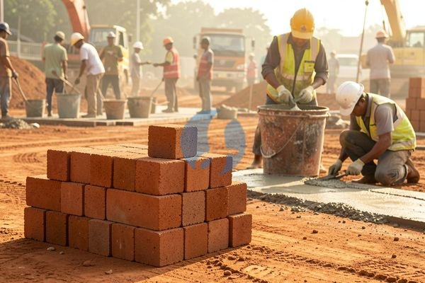

**Cara Membandingkan Harga Satu Batako dari Beberapa Penjual** - Mitra Sumber Material dimana saja berada, mencari tahu harga batako? Kami siap membantu menyiapkan batako berkualitas untuk proyek Mitra, lengkap dengan pengiriman ke lokasi proyek di Jabodetabek dan sekitarnya.



Batako, atau batako press, adalah material bangunan populer untuk dinding, pagar, atau elemen dekoratif. Harganya relatif terjangkau dan pemasangannya cukup mudah. Tapi, harga satu batako bisa bervariasi cukup signifikan, tergantung beberapa faktor. Nah, supaya Mitra Sumber Material tidak salah beli, yuk kita bahas lebih lanjut!

## Pilihan Batako: Ukuran & Jenis yang Perlu Diperhatikan

Sebelum fokus ke harga, penting untuk tahu ada beberapa jenis batako yang tersedia. Secara umum, batako dibedakan berdasarkan ukurannya. Ukuran standar batako adalah 40x20x10 cm, tapi ada juga yang lebih besar atau lebih kecil. Selain itu, ada juga batako press, batako semi-hollow, dan batako hollow. Perbedaan utama terletak pada jumlah lubang dan kekuatan materialnya.

Memilih jenis batako yang tepat tergantung kebutuhan proyek Mitra. Untuk dinding pagar yang tidak menahan beban berat, batako press standar sudah cukup. Tapi, kalau untuk dinding rumah yang butuh kekuatan lebih, batako semi-hollow atau hollow bisa jadi pilihan lebih baik. Kami sarankan, jangan ragu untuk konsultasi dengan tim Kami — Kami bantu memilih jenis batako yang paling sesuai dengan kebutuhan dan anggaran Mitra.

## Material Batako & Jasa Sumber Material untuk Proyek Mitra

Sumber Material menyediakan berbagai jenis batako dengan kualitas terjamin, termasuk:

- **Batako Press Standar:** Ukuran 40x20x10 cm, ideal untuk pagar, dinding pembatas, atau proyek DIY.
- **Batako Semi-Hollow:** Lebih kuat dari batako press, cocok untuk dinding yang membutuhkan ketahanan lebih baik.
- **Batako Hollow:** Paling kuat di antara ketiganya, sering digunakan untuk struktur dinding utama rumah.

Selain menyediakan material, Kami juga menyediakan **jasa urug** dan **jasa cor** yang sering dibutuhkan bersamaan dengan pemasangan batako. Bayangkan, Mitra bisa mendapatkan batako berkualitas dan tenaga ahli untuk pemasangannya dalam satu atap. Praktis, kan?

## Kenapa Memesan Batako di Sumber Material? Lebih dari Sekadar Harga Murah

Banyak toko bangunan yang menawarkan harga batako murah, tapi seringkali kualitasnya diragukan. Di Sumber Material, Kami tidak hanya berkomitmen memberikan harga yang kompetitif, tapi juga kualitas yang terjamin. Kami hanya menjual batako dari produsen terpercaya yang sudah memenuhi standar SNI.

**Keuntungan memesan batako di Sumber Material:**

- **Kualitas Terjamin:** Kami hanya menjual batako berkualitas tinggi.
- **Pilihan Lengkap:** Tersedia berbagai ukuran dan jenis batako.
- **Pengiriman Cepat & Aman:** Kami melayani pengiriman ke seluruh wilayah Jabodetabek dan sekitarnya.
- **Konsultasi Gratis:** Tim Kami siap membantu memilih batako yang tepat untuk proyek Mitra.
- **Layanan Tambahan:** Tersedia jasa urug dan jasa cor untuk kelancaran proyek.

Kami berlokasi di Bogor, Jakarta, Bekasi, Karawang, Tangerang, dan Cikarang. Jangan ragu untuk menanyakan jangkauan pengiriman Kami ke lokasi proyek Mitra.

## Cara Mudah Pesan Batako di Sumber Material

Proses pemesanan batako di Sumber Material sangat mudah dan cepat:

1.  **Hubungi Kami:** Tanyakan harga dan ketersediaan batako lewat tombol **WhatsApp** atau **Telepon** di bawah halaman ini.
2.  **Sampaikan Kebutuhan:** Informasikan jenis, ukuran, dan jumlah batako yang dibutuhkan.
3.  **Dapatkan Penawaran:** Tim Kami akan memberikan penawaran harga terbaik.
4.  **Konfirmasi & Pengiriman:** Setelah disetujui, Kami akan segera proses pengiriman ke lokasi proyek Mitra.

Harga ini bersifat estimasi dan dapat berubah sewaktu-waktu — hubungi Kami untuk penawaran terbaru dan paling akurat sesuai kebutuhan proyek Mitra.

## Perhitungan Kebutuhan Batako: Jangan Sampai Kurang atau Kelebihan!

Nah, Mitra Sumber Material, setelah tahu jenis batako yang tersedia, penting juga untuk menghitung kebutuhan batako yang tepat untuk proyek Mitra. Salah perhitungan bisa berakibat fatal — kekurangan batako bisa menghambat proyek, sementara kelebihan batako berarti pemborosan.

Untuk memudahkan, kita ambil contoh perhitungan untuk dinding dengan ukuran panjang 10 meter, tinggi 3 meter, dan tebal 15 cm (setengah bata). Ukuran standar batako adalah 40x20x10 cm. Pertama, kita hitung luas dinding: 10 meter x 3 meter = 30 meter persegi. Kemudian, kita hitung luas satu batako dalam meter persegi: 0,4 meter x 0,2 meter = 0,08 meter persegi.

Selanjutnya, kita hitung jumlah batako per meter persegi: 1 / 0,08 = 12,5 batako. Karena kita tidak bisa membeli setengah batako, kita bulatkan ke atas menjadi 13 batako per meter persegi. Jadi, total batako yang dibutuhkan adalah: 30 meter persegi x 13 batako/meter persegi = 390 batako.

## Batako Press vs. Batako Hollow: Mana yang Lebih Cocok untuk Proyek Mitra?

Mitra Sumber Material mungkin bertanya-tanya, apa perbedaan signifikan antara batako press dan batako hollow, selain harga? Keduanya punya kelebihan dan kekurangan masing-masing. Batako press lebih ekonomis dan mudah dipasang, tapi kekuatannya lebih rendah. Cocok untuk bangunan yang tidak menahan beban berat, seperti pagar atau dinding pembatas.

Sementara itu, batako hollow memiliki kekuatan yang lebih tinggi karena strukturnya yang berongga-rongga. Lubang-lubang tersebut mengurangi berat batako tanpa mengurangi kekuatannya. Batako hollow ideal untuk dinding rumah, gudang, atau bangunan lain yang membutuhkan ketahanan lebih baik.

Berikut perbandingan singkatnya:

- **Batako Press:** Harga lebih murah, pemasangan lebih mudah, kekuatan standar, cocok untuk pagar/dinding pembatas.
- **Batako Hollow:** Harga lebih mahal, pemasangan sedikit lebih rumit, kekuatan lebih tinggi, cocok untuk dinding rumah/bangunan yang menahan beban.

Penting untuk mempertimbangkan jenis bangunan dan beban yang akan ditahan sebelum memilih jenis batako. Kami siap membantu Mitra Sumber Material menentukan pilihan yang tepat sesuai kebutuhan proyek.

## Pertanyaan Umum Tentang Batako (FAQ)

Banyak Mitra Sumber Material yang menanyakan hal-hal berikut:

### Berapa Daya Tahan Batako Terhadap Cuaca?

Batako cukup tahan terhadap cuaca, tapi tetap membutuhkan perlindungan tambahan, terutama jika terkena hujan dan panas langsung dalam waktu lama. Pelapisan dengan cat atau plester dapat meningkatkan daya tahan batako terhadap cuaca ekstrem.

### Apakah Batako Mudah Retak?

Batako bisa retak jika terkena benturan keras atau jika kualitas batako buruk. Pilih batako dari produsen terpercaya dan hindari penumpukan batako yang terlalu tinggi untuk mencegah retak.

### Bagaimana Cara Merawat Dinding Batako Agar Awet?

Rutin bersihkan dinding batako dari kotoran dan debu. Periksa secara berkala apakah ada retakan atau kerusakan. Lakukan perbaikan segera jika ditemukan kerusakan.

### Bisakah Batako Digunakan untuk Lantai?

Sebaiknya tidak. Batako tidak dirancang untuk menahan beban berat seperti lantai. Ada material lain yang lebih cocok untuk lantai, seperti keramik atau beton.

Kami selalu siap menjawab pertanyaan Mitra Sumber Material tentang batako — jangan ragu untuk menghubungi Kami!

## Kesalahan Umum Saat Membeli Batako: Hindari Kerugian Tak Perlu

Mitra Sumber Material, seringkali ada kesalahan kecil yang bisa membuat proyek jadi lebih mahal atau membuang waktu. Salah satunya adalah tidak memperhatikan kualitas batako. Batako yang mudah remuk atau tidak presisi ukurannya akan menyulitkan proses pemasangan dan mengurangi kekuatan struktur. Pastikan batako yang dipilih memiliki permukaan yang rata dan tidak ada retakan.

## Tanya Jawab Seputar Batako: Pertanyaan yang Sering Kami Terima

### Apakah Batako Perlu Direndam Sebelum Dipasang?

Sebaiknya ya, Mitra. Merendam batako selama beberapa menit sebelum dipasang akan mengurangi daya serap air batako, sehingga adukan semen lebih mudah menempel dan mengurangi risiko retak.

### Bagaimana Cara Mengatasi Batako yang Pecah Saat Pengiriman?

Segera hubungi Kami, Mitra Sumber Material. Kami bertanggung jawab atas kondisi barang saat diterima. Kami akan mengganti batako yang pecah dengan yang baru.

### Apakah Batako Bisa Dipotong?

Bisa, tapi membutuhkan alat yang tepat seperti mesin potong keramik atau gergaji beton. Pastikan untuk menggunakan alat pelindung diri saat memotong batako.

### Apa Bedanya Batako dengan Bata Merah?

Batako lebih ringan dari bata merah, sehingga lebih mudah dipasang dan mengurangi beban struktur bangunan. Bata merah lebih kuat dan tahan lama, tapi juga lebih mahal dan membutuhkan lebih banyak tenaga untuk pemasangan. Pilihan tergantung kebutuhan dan anggaran Mitra.

Jangan tunda kebutuhan proyek Mitra Sumber Material — tanyakan harga dan ketersediaannya sekarang lewat tombol **WhatsApp** atau **Telepon** di bawah halaman ini.
