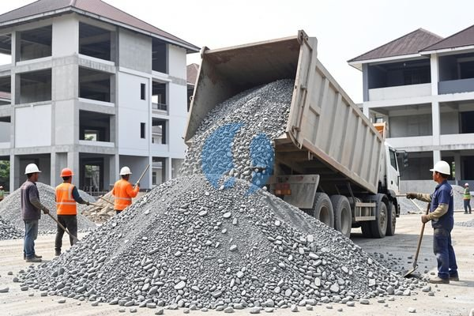

**Harga Split 1 Kubik dan Cara Mencocokkannya dengan Kebutuhan** - Mitra Sumber Material dimana saja berada, sedang merencanakan pembangunan atau renovasi? Memperkirakan kebutuhan material adalah langkah krusial. Kami siap membantu Anda mendapatkan split berkualitas dengan harga terbaik.



Memilih split yang tepat untuk proyek Anda bisa jadi bikin pusing. Nah, Kami hadir untuk menyederhanakannya. Split adalah material penting dalam campuran beton, pondasi, dan berbagai aplikasi konstruksi lainnya. Mengetahui perkiraan harga split 1 kubik akan membantu Anda menyusun anggaran proyek dengan lebih akurat.

## Jenis Split yang Tersedia & Penggunaannya

Ada beberapa jenis split yang umum digunakan, masing-masing dengan karakteristik dan harga yang berbeda. Split Andesit, misalnya, dikenal dengan kekuatan dan daya tahannya yang tinggi, cocok untuk konstruksi berat seperti jalan dan jembatan. Split Granit juga merupakan pilihan populer karena kekuatannya, sering digunakan untuk pondasi dan lantai. Sementara itu, split Kalianda lebih ekonomis, ideal untuk pekerjaan yang tidak memerlukan kekuatan ekstrem.

Pilihan tergantung pada kebutuhan proyek Anda. Untuk struktur yang menahan beban berat, seperti kolom atau balok, split Andesit atau Granit adalah pilihan yang lebih baik. Namun, untuk pekerjaan yang lebih ringan, split Kalianda bisa menjadi solusi yang hemat biaya. Kami dapat membantu Anda menentukan jenis split yang paling sesuai dengan kebutuhan dan anggaran proyek Anda. [tanyakan harga terbaru](https://api.whatsapp.com/send?phone=6285776786091&text=*Halo%20sumbermaterial.com*%20%3A)

## Harga Split 1 Kubik dan Jasa Pengiriman Langsung

Harga split 1 kubik bervariasi tergantung pada jenis, ukuran, dan lokasi Anda di wilayah Jabodetabek. Estimasi harga split per kubik saat ini berkisar antara Rp 350.000 hingga Rp 700.000. Harga ini bersifat estimasi dan dapat berubah sewaktu-waktu — hubungi Kami untuk penawaran terbaru dan paling akurat sesuai kebutuhan proyek Mitra.

Di Sumber Material, Kami menyediakan berbagai jenis split dengan ukuran dan mutu yang terjamin. Kami melayani pengiriman langsung ke lokasi proyek Anda di Bogor, Jakarta, Bekasi, Karawang, Tangerang, dan Cikarang. Dengan layanan pengiriman langsung ini, Mitra tidak perlu repot mengurus transportasi sendiri dan bisa fokus pada penyelesaian proyek. Selain split, Kami juga menyediakan material bangunan lainnya seperti pasir, batu, bata/batako/hebel, besi, wiremesh, baja ringan, readymix, dan aspal.

## Keuntungan Memesan Split dari Sumber Material

Mengapa memilih Sumber Material untuk kebutuhan split Anda? Selain menyediakan berbagai jenis split berkualitas, Kami juga menawarkan beberapa keuntungan yang akan memudahkan proyek Anda. Pertama, Kami memberikan layanan pengiriman langsung ke lokasi proyek di wilayah Jabodetabek dan sekitarnya. Kedua, Kami memiliki stok material yang selalu tersedia, sehingga Anda tidak perlu khawatir kehabisan pasokan. Ketiga, Kami didukung oleh tim yang berpengalaman dan siap membantu Anda dalam memilih jenis split yang tepat untuk proyek Anda.

Kami memahami betul bahwa waktu adalah uang dalam proyek konstruksi. Dengan layanan pengiriman cepat dan material yang selalu tersedia, Kami membantu Anda memastikan proyek berjalan lancar dan sesuai jadwal. Selain itu, Kami juga menyediakan jasa sewa alat berat serta jasa urug dan jasa cor untuk melengkapi kebutuhan proyek Anda.

## Pesan Split Sekarang dengan Mudah

Memesan split dari Kami sangat mudah. Cukup hubungi Kami lewat tombol **Telepon** atau **WhatsApp** di bawah dan sampaikan kebutuhan dan lokasi proyek Anda. Kami akan memberikan penawaran harga terbaik dan mengatur jadwal pengiriman yang sesuai dengan kebutuhan Anda. Jangan tunda lagi! Segera hubungi Kami dan dapatkan split berkualitas untuk proyek Anda.

Tinggal satu langkah lagi: hubungi Kami lewat tombol **Telepon** atau **WhatsApp** di bawah untuk menanyakan harga dan jadwal pengiriman proyek Mitra Sumber Material.

ARTIKEL_SELESAI

## Memilih Ukuran Split yang Tepat untuk Proyek Anda

Ukuran split sangat berpengaruh terhadap kualitas dan kekuatan beton. Secara umum, split tersedia dalam berbagai ukuran, mulai dari 5/8 inch (sekitar 16 mm) hingga 1 1/2 inch (sekitar 38 mm). Split dengan ukuran lebih kecil (5/8 inch) biasanya digunakan untuk pekerjaan yang membutuhkan permukaan yang lebih halus, seperti lantai atau trotoar. Sementara itu, split dengan ukuran lebih besar (1 1/2 inch) lebih cocok untuk pekerjaan konstruksi berat, seperti pondasi atau jalan.

Nah, untuk proyek rumah biasa, ukuran split 3/4 inch (sekitar 19 mm) seringkali menjadi pilihan yang ideal karena menawarkan keseimbangan antara kekuatan dan kemudahan dalam pengerjaan. Jika Anda ragu memilih ukuran yang tepat, jangan sungkan bertanya kepada Kami. Kami akan dengan senang hati memberikan saran berdasarkan kebutuhan spesifik proyek Anda.

## Pertanyaan Umum Seputar Split dan Pemesanannya

Banyak Mitra Sumber Material yang bertanya tentang split. Berikut beberapa pertanyaan yang sering Kami terima:

### Berapa lama waktu pengiriman split ke lokasi proyek?

Waktu pengiriman tergantung pada jarak lokasi proyek dan ketersediaan armada Kami. Biasanya, pengiriman di wilayah Jabodetabek memakan waktu 1-3 hari kerja. Kami selalu berusaha memberikan pelayanan yang cepat dan tepat waktu.

### Bagaimana cara memastikan kualitas split yang Kami terima?

Kami hanya menyediakan split berkualitas tinggi yang telah melalui proses sortir dan pengujian mutu. Anda bisa meminta contoh split sebelum melakukan pemesanan untuk memastikan kualitasnya sesuai dengan harapan Anda.

### Apakah Kami bisa memesan split dalam jumlah kecil?

Tentu saja! Kami melayani pemesanan split dalam berbagai jumlah, mulai dari 1 kubik hingga puluhan kubik. Tidak ada batasan minimum pemesanan.

### Bagaimana jika split yang Kami terima rusak atau tidak sesuai pesanan?

## Menghitung Kebutuhan Split untuk Proyek Anda: Contoh Praktis

Seringkali, Mitra Sumber Material kesulitan memperkirakan berapa banyak split yang dibutuhkan untuk proyek mereka. Perhitungan yang tepat akan membantu Anda menghindari sisa material yang terbuang percuma atau kekurangan material yang bisa menunda penyelesaian proyek. Mari kita ambil contoh sederhana: Anda akan membuat lantai beton dengan ukuran 4 meter x 5 meter dan ketebalan 10 cm.

## Tips Hindari Kesalahan Umum Saat Membeli Split

Banyak Mitra Sumber Material yang mengalami masalah setelah membeli split. Salah satu kesalahan umum adalah tidak memperhatikan ukuran split yang sesuai dengan kebutuhan proyek. Seperti yang sudah Kami bahas, ukuran split memengaruhi kekuatan dan kualitas beton. Kesalahan lainnya adalah membeli split dari sumber yang tidak terpercaya, yang bisa mengakibatkan kualitas material yang buruk.

Pastikan Anda membeli split dari supplier yang memiliki reputasi baik dan menyediakan material berkualitas. Periksa juga apakah split yang Anda terima bersih dari kotoran dan sampah organik. Jangan ragu untuk meminta contoh split sebelum melakukan pemesanan dalam jumlah besar. Kami selalu memastikan split yang Kami jual bersih, bebas kotoran, dan sesuai dengan standar mutu yang berlaku.

## Tanya Jawab Seputar Split: Pertanyaan yang Sering Diajukan

### Apakah split bisa digunakan untuk membuat jalan setapak?

Tentu saja! Split ukuran 5/8 inch atau 3/4 inch sangat cocok untuk membuat jalan setapak. Pastikan Anda memadatkan split dengan baik agar jalan setapak tahan lama dan tidak mudah bergeser.

### Bagaimana cara menyimpan split agar tidak tercampur dengan kotoran?

Simpan split di tempat yang kering dan bersih, jauh dari sumber kotoran dan sampah organik. Jika memungkinkan, tutupi split dengan terpal untuk melindunginya dari hujan dan debu.

### Apa perbedaan antara split basah dan split kering?

Split basah adalah split yang masih mengandung kadar air, sedangkan split kering adalah split yang sudah dikeringkan. Split kering lebih mudah dicampur dengan semen dan material lainnya. Kami umumnya menyediakan split kering untuk memudahkan proses pengerjaan Anda.

### Bisakah split digunakan untuk membuat pondasi rumah?

Split dengan ukuran yang tepat (biasanya 3/4 inch atau 1 inch) dapat digunakan untuk membuat pondasi rumah. Namun, pastikan Anda menggunakan split yang berkualitas tinggi dan sesuai dengan standar teknis yang berlaku.

Kami menjamin kualitas split yang Kami kirimkan. Jika terjadi kerusakan selama pengiriman atau split yang Kami kirimkan tidak sesuai pesanan, segera hubungi Kami dan Kami akan segera menggantinya tanpa biaya tambahan.
