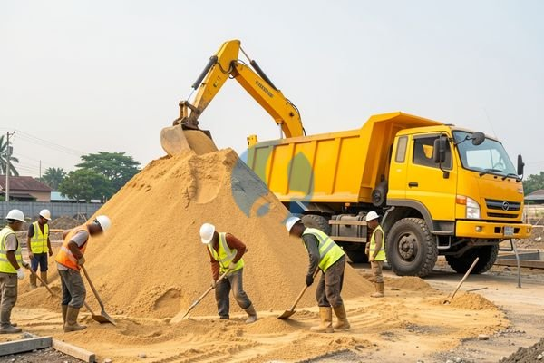

**Cara Membaca Harga Urug 1 Dam agar Anggaran Tidak Meleset** - Mitra Sumber Material yang berbahagia, sedang merencanakan proyek pembangunan dan butuh melakukan urug? Pertanyaan pertama yang pasti muncul adalah: berapa ya harga urug 1 dam? Nah, Kami dari Sumber Material siap membantu Anda menghitung estimasi biaya, memilih material yang tepat, dan mendapatkan penawaran terbaik untuk kebutuhan proyek Anda.



## Pilihan Material Urug: Mana yang Paling Sesuai Proyek Anda?

Sebelum membahas harga, penting untuk memahami pilihan material urug yang tersedia. Setiap material memiliki kelebihan dan kekurangan, serta harga yang berbeda-beda. Pilihan umum meliputi tanah urug biasa, sirtu (pasir, lumpur, dan batu), serta pasir urug. Tanah urug biasa biasanya yang paling ekonomis, namun kurang stabil untuk beban berat. Sirtu menawarkan campuran yang lebih padat dan stabil, ideal untuk pondasi ringan. Sementara pasir urug, terutama pasir pasang atau pasir urug C, menawarkan drainase yang baik dan cocok untuk area yang membutuhkan sirkulasi air yang lancar.

Sebagai panduan awal, Anda bisa mulai menghitung kebutuhan material dengan memperkirakan volume urugan yang dibutuhkan. Namun, jangan khawatir jika perhitungan ini terasa rumit — Kami siap membantu Anda menghitung volume yang tepat dan merekomendasikan material terbaik sesuai jenis proyek Anda. [tanyakan harga lewat WhatsApp](https://api.whatsapp.com/send?phone=6285776786091&text=*Halo%20sumbermaterial.com*%20%3A)

## Jenis Material Urug yang Kami Sediakan & Estimasi Biayanya

Kami dari Sumber Material menyediakan berbagai jenis material urug dengan kualitas terjamin. Berikut beberapa pilihan yang populer di wilayah Jabodetabek dan estimasi harganya (per m³):

- **Tanah Urug Biasa:** Cocok untuk pengurugan lahan yang tidak memerlukan daya dukung tinggi. Estimasi harga: Rp 150.000 – Rp 250.000 per m³.
- **Sirtu (Pasir, Lumpur, Batu):** Campuran ideal untuk urugan dasar bangunan atau area yang membutuhkan stabilitas sedang. Estimasi harga: Rp 200.000 – Rp 350.000 per m³.
- **Pasir Urug C:** Pilihan tepat untuk urugan yang membutuhkan drainase baik, seperti area taman atau lapangan olahraga. Estimasi harga: Rp 250.000 – Rp 400.000 per m³.

Harga ini bersifat estimasi dan dapat berubah sewaktu-waktu — hubungi Kami untuk penawaran terbaru dan paling akurat sesuai kebutuhan proyek Mitra. Perlu diingat, harga urug 1 dam (10.000 m³) akan sangat bergantung pada volume pemesanan, lokasi proyek, dan aksesibilitas lokasi.

## Mengapa Memesan Material Urug di Sumber Material?

Mitra Sumber Material, Kami memahami betul pentingnya mendapatkan material urug yang berkualitas dan pengiriman yang tepat waktu. Itulah mengapa Kami menawarkan beberapa keunggulan:

- **Konsultasi Gratis:** Tim ahli Kami siap membantu Anda memilih material urug yang paling sesuai dengan jenis proyek dan anggaran Anda.
- **Harga Kompetitif:** Kami menawarkan harga yang bersaing tanpa mengorbankan kualitas material.
- **Pengiriman Tepat Waktu:** Kami melayani pengiriman ke seluruh wilayah Jabodetabek dan sekitarnya, memastikan material sampai di lokasi proyek Anda tepat waktu.
- **Jasa Urug & Alat Berat:** Selain material urug, Kami juga menyediakan jasa urug lengkap dengan operator berpengalaman dan armada alat berat yang memadai.
- **Terpercaya & Berpengalaman:** Kami telah melayani berbagai proyek konstruksi, dari perumahan hingga gedung komersial.

Kami berlokasi di Bogor, Jakarta, Bekasi, Karawang, Tangerang, dan Cikarang, sehingga pengiriman ke lokasi proyek Anda menjadi lebih efisien. Agar anggaran tidak m3, jangan ragu untuk berkonsultasi dengan Kami terlebih dahulu.

## Mudah & Cepat: Cara Memesan Material Urug di Sumber Material

Memesan material urug di Sumber Material sangat mudah dan cepat. Berikut langkah-langkahnya:

1.  **Hubungi Kami:** Sampaikan kebutuhan material urug Anda (jenis material, volume, lokasi proyek) melalui tombol **WhatsApp** atau **Telepon** di bawah halaman ini.
2.  **Dapatkan Penawaran Harga:** Tim Kami akan segera memberikan penawaran harga yang kompetitif dan sesuai dengan kebutuhan Anda.
3.  **Konfirmasi Pesanan:** Setelah menyetujui penawaran, konfirmasikan pesanan Anda dan jadwal pengiriman.
4.  **Material Sampai di Lokasi:** Kami akan mengirimkan material urug ke lokasi proyek Anda tepat waktu dan dengan kondisi yang baik.

## Menghitung Kebutuhan Urug: Contoh Kasus Proyek Rumah 2 Lantai

Mitra Sumber Material, seringkali tantangan terbesar dalam proyek urug adalah menentukan volume material yang dibutuhkan. Kesalahan perhitungan bisa mengakibatkan pemborosan biaya atau kekurangan material di tengah pekerjaan. Nah, Kami akan berikan contoh perhitungan sederhana untuk proyek rumah 2 lantai dengan luas bangunan 100m² dan ketinggian urug rata-rata 50 cm (0,5 meter).

Asumsikan area yang perlu diurug adalah area pondasi dan sekitarnya, dengan luas total 150m². Volume urugan yang dibutuhkan adalah luas area dikalikan dengan ketinggian urug: 150 m² x 0,5 m = 75 m³. Ini adalah volume urugan bersih. Namun, perlu diingat bahwa akan ada pemadatan material selama proses pengurugan. Faktor pemadatan biasanya berkisar antara 1,1 hingga 1,3, tergantung jenis material dan metode pemadatan.

Untuk perhitungan yang lebih akurat, kita gunakan faktor pemadatan 1,2. Maka, volume material urug yang perlu dipesan adalah 75 m³ x 1,2 = 90 m³. Itulah mengapa penting untuk berkonsultasi dengan Kami, karena Kami akan membantu Anda menghitung kebutuhan material dengan lebih presisi, mempertimbangkan faktor pemadatan dan kondisi lahan Anda.

## Perbandingan Sirtu dan Pasir Urug C: Mana yang Lebih Unggul?

Mitra Sumber Material, seringkali Anda dihadapkan pada pilihan antara sirtu dan pasir urug C. Keduanya memiliki keunggulan masing-masing. Sirtu, dengan campuran pasir, lumpur, dan batu, menawarkan stabilitas yang baik dan biaya yang relatif lebih terjangkau. Namun, sirtu memiliki drainase yang kurang baik, sehingga kurang ideal untuk area yang rentan tergenang air.

Di sisi lain, pasir urug C, yang terdiri dari pasir bersih dan bergradasi baik, memiliki drainase yang sangat baik. Ini menjadikannya pilihan yang tepat untuk area taman, lapangan olahraga, atau area yang membutuhkan sirkulasi air yang lancar. Meskipun demikian, pasir urug C cenderung lebih mahal daripada sirtu.

Berikut perbandingan singkatnya:

| Fitur        | Sirtu                      | Pasir Urug C             |
|--------------|---------------------------|--------------------------|
| Stabilitas    | Baik                      | Cukup                    |
| Drainase     | Kurang Baik                | Sangat Baik              |
| Biaya        | Lebih Terjangkau          | Lebih Mahal              |
| Penggunaan    | Pondasi ringan, urugan dasar | Area taman, lapangan     |

Jadi, pilihan terbaik tergantung pada kebutuhan spesifik proyek Anda. Jika Anda masih bingung, jangan ragu untuk bertanya kepada Kami — Kami akan membantu Anda memilih material yang paling sesuai.

## Pertanyaan Umum Seputar Harga Urug 1 Dam

Mitra Sumber Material, berikut beberapa pertanyaan yang sering Kami terima seputar harga urug 1 dam:

### Berapa Lama Waktu yang Dibutuhkan untuk Mengurug 1 Dam?

Waktu yang dibutuhkan untuk mengurug 1 dam sangat bervariasi, tergantung pada volume material, jenis material, jarak tempuh, dan kondisi lokasi. Secara umum, untuk pengurugan dengan volume 1 dam, dibutuhkan waktu minimal 3 hari hingga 1 minggu, tergantung faktor-faktor tersebut.

### Apakah Harga Sudah Termasuk Biaya Pengiriman?

Harga yang Kami berikan biasanya belum termasuk biaya pengiriman. Biaya pengiriman akan disesuaikan dengan jarak tempuh dan jenis kendaraan yang digunakan. Kami akan memberikan rincian biaya pengiriman secara transparan sebelum Anda melakukan pemesanan.

### Bagaimana Jika Saya Membutuhkan Jasa Pemadatan?

Kami juga menyediakan jasa pemadatan dengan berbagai jenis alat berat, seperti stamper, vibrator, dan roller. Biaya jasa pemadatan akan disesuaikan dengan luas area yang akan dipadatkan dan jenis alat yang digunakan.

### Bisakah Saya Memesan Material Urug Secara Bertahap?

Tentu saja bisa. Kami fleksibel dalam melayani kebutuhan Anda. Anda dapat memesan material urug secara bertahap sesuai dengan kebutuhan proyek Anda. Ini membantu Anda mengelola anggaran proyek dengan lebih baik.

Jangan tunda kebutuhan proyek Mitra Sumber Material — tanyakan harga dan ketersediaannya sekarang lewat tombol **WhatsApp** atau **Telepon** di bawah halaman ini.
