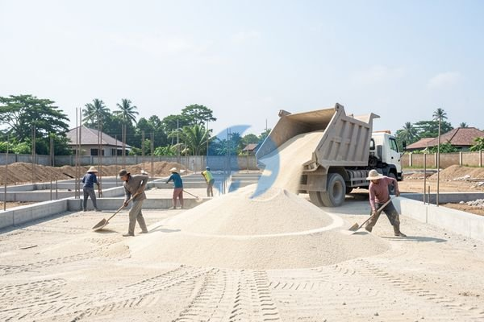

**Cara Membandingkan Harga Urugan Pasir per m3 dari Beberapa Penjual** - Mitra Sumber Material, apakah Anda sedang merencanakan proyek pembangunan dan membutuhkan informasi harga urugan pasir per m3? Kami siap membantu Anda menyiapkan material pasir urug berkualitas dengan harga kompetitif dan pengiriman tepat waktu ke lokasi proyek Anda di Jabodetabek dan sekitarnya.



Banyak hal yang perlu diperhatikan saat menentukan kebutuhan urugan pasir, mulai dari jenis pasir yang sesuai, volume yang dibutuhkan, hingga biaya pengiriman. Jangan khawatir, Kami akan memandu Anda dalam memilih material yang tepat agar proyek Anda berjalan lancar dan efisien.

## Pilihan Pasir Urugan: Mana yang Paling Cocok Untuk Proyek Anda?

Mitra Sumber Material, ada beberapa jenis pasir urug yang umum digunakan dalam konstruksi, masing-masing dengan karakteristik dan harga yang berbeda. Pasir urug yang paling sering digunakan adalah pasir urug biasa, pasir sungai, dan pasir mekanis.

- **Pasir Urug Biasa:** Biasanya merupakan campuran berbagai jenis pasir dengan harga yang paling ekonomis. Cocok untuk pengurugan umum yang tidak memerlukan kekuatan khusus.
- **Pasir Sungai:** Memiliki butiran yang lebih bulat dan bersih dari kotoran organik. Ideal untuk pekerjaan urugan yang membutuhkan drainase baik dan kekuatan yang lebih tinggi.
- **Pasir Mekanis:** Dihasilkan dari proses penghancuran batu. Memiliki butiran yang lebih tajam dan padat, sehingga memberikan kekuatan yang lebih baik untuk urugan pondasi.

Nah, untuk menghindari salah beli, Kami sarankan Anda berkonsultasi dengan Kami terlebih dahulu. [tanyakan jenis pasir yang cocok](https://api.whatsapp.com/send?phone=6285776786091&text=*Halo%20sumbermaterial.com*%20%3A) untuk proyek Anda. Dengan begitu, Anda bisa mendapatkan material yang sesuai dengan kebutuhan dan anggaran Anda.

## Material Pasir Urugan & Jasa Urug dari Sumber Material

Kami menyediakan berbagai jenis pasir urug dengan kualitas terjamin, sesuai dengan standar SNI. Berikut adalah beberapa pilihan yang tersedia:

- **Pasir Urug Biasa:** Tersedia dalam berbagai ukuran dan mutu. Cocok untuk pengurugan halaman, jalan setapak, atau area parkir.
- **Pasir Pasang:** Ukuran lebih halus dan bersih, ideal untuk campuran semen dan plester.
- **Pasir Cor:** Kandungan lumpur minimal, cocok untuk campuran beton dan pondasi.
- **Pasir Hitam:** Umumnya digunakan untuk urugan pondasi dan konstruksi bangunan yang membutuhkan kekuatan tinggi.

Selain menyediakan material, Kami juga menawarkan **jasa urug pasir** dengan menggunakan alat berat modern. Kami melayani pengurugan untuk berbagai proyek, mulai dari perumahan, gedung komersial, hingga infrastruktur jalan. Untuk estimasi harga urugan pasir per m3, tergantung pada jenis pasir, volume, dan lokasi proyek Anda. Harga ini bersifat estimasi dan dapat berubah sewaktu-waktu — hubungi Kami untuk penawaran terbaru dan paling akurat sesuai kebutuhan proyek Mitra.

## Mengapa Memesan Urugan Pasir di Sumber Material?

Mitra Sumber Material, ada banyak alasan mengapa memilih Kami sebagai mitra dalam proyek Anda:

- **Kualitas Terjamin:** Kami hanya menyediakan material pasir urug berkualitas tinggi yang telah melalui proses seleksi ketat.
- **Pilihan Lengkap:** Kami menawarkan berbagai jenis pasir urug sesuai dengan kebutuhan spesifik proyek Anda.
- **Harga Kompetitif:** Kami memberikan harga yang bersaing dan transparan.
- **Pengiriman Tepat Waktu:** Kami menjamin pengiriman material tepat waktu ke lokasi proyek Anda di wilayah Jabodetabek dan sekitarnya.
- **Konsultasi Gratis:** Kami siap membantu Anda memilih jenis pasir yang tepat dan menghitung volume yang dibutuhkan.
- **Layanan Sewa Alat Berat:** Kami juga menyediakan layanan sewa alat berat untuk membantu mempercepat pekerjaan urugan Anda.

Kami berlokasi di Bogor, Jakarta, Bekasi, Karawang, Tangerang, Cikarang, sehingga pengiriman lebih cepat dan efisien. Jangan ragu untuk bertanya tentang ketersediaan stok dan penawaran khusus untuk proyek Anda.

## Pesan Urugan Pasir Sekarang – Proses Mudah & Cepat

Memesan urugan pasir dari Kami sangat mudah! Berikut adalah langkah-langkahnya:

1.  **Hubungi Kami:** Telepon atau WhatsApp Kami untuk menanyakan harga dan ketersediaan stok.
2.  **Konsultasi:** Diskusikan kebutuhan proyek Anda dengan tim Kami untuk mendapatkan rekomendasi material yang tepat.
3.  **Pemesanan:** Konfirmasikan pesanan Anda dan berikan informasi lokasi proyek.
4.  **Pengiriman:** Kami akan mengirimkan material pasir urug tepat waktu ke lokasi proyek Anda.

## Memperkirakan Kebutuhan Pasir Urugan: Contoh Perhitungan Sederhana

Mitra Sumber Material, seringkali pertanyaan yang muncul adalah, “Berapa banyak pasir urug yang saya butuhkan?” Nah, memperkirakan volume pasir urug yang dibutuhkan memang penting agar tidak terjadi kekurangan atau kelebihan material. Mari kita lihat contoh perhitungan sederhana untuk area persegi panjang.

Misalnya, Anda ingin mengurug area seluas 100 meter persegi dengan tinggi urugan 30 cm (0,3 meter). Volume pasir yang dibutuhkan dapat dihitung dengan rumus:

Volume = Panjang x Lebar x Tinggi

Dalam kasus ini: Volume = 10 meter x 10 meter x 0,3 meter = 30 meter kubik.

### Faktor yang Mempengaruhi Kebutuhan Pasir Urugan

Ada beberapa faktor yang bisa memengaruhi jumlah pasir urug yang dibutuhkan. Pertama, jenis tanah dasar. Jika tanahnya lunak atau berpasir, Anda mungkin membutuhkan lapisan urugan yang lebih tebal. Kedua, tingkat pemadatan yang diinginkan. Semakin tinggi tingkat pemadatan, semakin banyak pasir yang akan menyusut. Ketiga, kontur lahan. Lahan yang tidak rata akan membutuhkan lebih banyak pasir untuk meratakan permukaan.

## Pertanyaan Umum Seputar Urugan Pasir

Mitra Sumber Material, berikut beberapa pertanyaan yang sering Kami terima seputar urugan pasir:

### Berapa Tingkat Pemadatan Pasir Urugan yang Ideal?

### Apakah Pasir Urug Perlu Disiram?

Ya, penyiraman pasir urug dapat membantu proses pemadatan. Air akan mengisi ruang-ruang kosong antar butiran pasir, sehingga memudahkan pemadatan dengan alat berat. Namun, jangan menyiram terlalu banyak air, karena dapat menyebabkan lumpur dan mengurangi kekuatan urugan.

### Bagaimana Cara Memastikan Kualitas Pasir Urug?

Pastikan pasir urug yang Anda beli berasal dari supplier terpercaya. Periksa visual pasir tersebut, apakah bersih dari kotoran organik, akar tanaman, atau material anorganik lainnya. Jika memungkinkan, lakukan uji laboratorium untuk memastikan pasir tersebut memenuhi standar mutu yang berlaku.

### Bisakah Urugan Pasir Dilakukan Secara Manual?

Tentu saja bisa, tetapi akan membutuhkan waktu dan tenaga yang lebih besar. Urugan manual biasanya hanya cocok untuk proyek kecil dengan volume yang sedikit. Untuk proyek besar, Kami sarankan untuk menggunakan jasa urug dengan alat berat untuk efisiensi dan hasil yang lebih baik.

## Memahami Perbedaan Harga Pasir Urug per M3 Berdasarkan Lokasi

Mitra Sumber Material, harga urugan pasir per m3 bisa bervariasi tergantung pada lokasi proyek Anda. Faktor utama yang memengaruhi perbedaan harga ini adalah biaya transportasi. Semakin jauh lokasi proyek dari sumber pasir atau gudang Kami, semakin tinggi biaya transportasinya. Selain itu, kondisi jalan dan aksesibilitas lokasi juga dapat memengaruhi biaya pengiriman. Untuk wilayah yang sulit dijangkau, Kami mungkin memerlukan biaya tambahan untuk menggunakan kendaraan khusus atau tenaga kerja ekstra.

## Hindari Kesalahan Umum Saat Memesan Pasir Urug

Mitra Sumber Material, ada beberapa kesalahan umum yang sering dilakukan saat memesan pasir urug. Salah satunya adalah tidak menghitung volume yang dibutuhkan dengan akurat. Hal ini dapat menyebabkan kekurangan atau kelebihan material, yang tentunya akan berdampak pada anggaran proyek Anda. Kesalahan lainnya adalah tidak memperhatikan kualitas pasir. Pastikan pasir yang Anda beli bersih dari kotoran organik dan material anorganik lainnya. Terakhir, jangan tergiur dengan harga yang terlalu murah, karena kualitas pasirnya mungkin tidak terjamin.

## Tanya Jawab Seputar Pemesanan Pasir Urug

### Berapa Lama Waktu Pengiriman Pasir Urug?

Waktu pengiriman tergantung pada jarak lokasi proyek dan ketersediaan armada Kami. Biasanya, pengiriman untuk wilayah Jabodetabek dan sekitarnya membutuhkan waktu 1-3 hari kerja.

### Apakah Sumber Material Menyediakan Layanan Pengiriman di Luar Jabodetabek?

Kami melayani pengiriman ke wilayah Jabodetabek dan sekitarnya. Untuk wilayah di luar jangkauan Kami, silakan hubungi Kami untuk menanyakan ketersediaan layanan pengiriman.

### Bagaimana Jika Saya Membutuhkan Pasir Urug dalam Jumlah yang Sangat Besar?

Kami siap melayani pesanan dalam jumlah besar. Silakan hubungi Kami untuk mendapatkan penawaran khusus dan jadwal pengiriman yang disesuaikan dengan kebutuhan Anda.

### Apakah Saya Bisa Meminta Sampel Pasir Urug Sebelum Memesan?

Tentu saja bisa. Kami dengan senang hati menyediakan sampel pasir urug agar Anda dapat memeriksa kualitasnya secara langsung sebelum melakukan pemesanan.

Tinggal satu langkah lagi: hubungi Kami lewat tombol **Telepon** atau **WhatsApp** di bawah untuk menanyakan harga dan jadwal pengiriman proyek Mitra Sumber Material.
