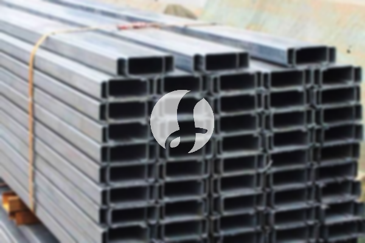

**Jasa Pasang Baja Ringan Bogor, dari Survei sampai Pengerjaan** - Mitra Sumber Material yang kami hormati, apakah Anda sedang merencanakan pembangunan atau renovasi di wilayah Bogor dan membutuhkan solusi rangka atap yang ringan, kuat, dan tahan lama? Kami dari Sumber Material siap membantu mewujudkan proyek Anda dengan layanan jasa pasang baja ringan Bogor yang profesional dan terpercaya.



Pasti, Anda ingin hasil pemasangan yang rapi, kokoh, dan sesuai dengan anggaran. Nah, di sini Kami menawarkan solusi lengkap — mulai dari penyediaan material baja ringan berkualitas, tenaga ahli berpengalaman, hingga layanan pemasangan yang cepat dan tepat. Dengan Kami, Anda tidak perlu repot mencari kontraktor terpisah atau khawatir dengan kualitas pemasangan.

## Mencari Jasa Pasang Baja Ringan Bogor yang Tepat: Apa yang Perlu Diperhatikan?

Memilih jasa pasang baja ringan Bogor yang tepat itu penting, lho. Jangan sampai salah pilih yang malah bikin pusing dan merugikan. Beberapa hal yang perlu Anda perhatikan adalah reputasi penyedia jasa, pengalaman kerja, kualitas material yang digunakan, dan tentu saja, harga yang ditawarkan. Apakah Anda sudah membandingkan beberapa penawaran?

Mitra, Kami mengerti bahwa setiap proyek memiliki kebutuhan yang berbeda-beda. Itulah mengapa Kami selalu memberikan solusi yang fleksibel dan disesuaikan dengan anggaran dan spesifikasi proyek Anda. Jangan ragu untuk berkonsultasi dengan tim Kami untuk mendapatkan penawaran terbaik dan paling sesuai. Sekarang, yuk kita bahas lebih detail tentang pilihan material dan layanan yang Kami tawarkan.

## Baja Ringan Bogor: Jenis, Ukuran, dan Aplikasi yang Perlu Anda Tahu

Baja ringan hadir dalam berbagai jenis dan ukuran, masing-masing dengan kelebihan dan kekurangannya sendiri. Secara umum, ada dua jenis baja ringan yang paling umum digunakan: baja ringan Z purlin dan baja ringan C purlin. Z purlin biasanya digunakan untuk rangka atap dengan bentang yang lebih besar, sementara C purlin lebih cocok untuk bentang yang lebih kecil.

Untuk ketebalan, baja ringan tersedia dalam berbagai pilihan, mulai dari 0.75 mm hingga 1.2 mm. Semakin tebal baja ringan, semakin kuat dan tahan lama, namun juga semakin berat dan mahal. Pilihan ketebalan yang tepat tergantung pada beban atap, bentang atap, dan kondisi lingkungan setempat.

Sebagai ilustrasi, untuk proyek rumah tinggal dengan bentang atap 6 meter dan beban atap ringan, Kami biasanya merekomendasikan baja ringan C purlin dengan ketebalan 0.75 mm. Untuk bangunan komersial dengan beban atap lebih berat dan bentang lebih besar, Kami akan merekomendasikan baja ringan Z purlin dengan ketebalan 1.0 mm atau 1.2 mm. Nah, bagaimana dengan proyek Anda? Kami siap membantu menghitung kebutuhan material yang tepat.

## Kenapa Memilih Jasa Pasang Baja Ringan Sumber Material?

Mitra Sumber Material, ada beberapa alasan mengapa memilih Kami untuk jasa pasang baja ringan Bogor adalah keputusan yang tepat. Pertama, Kami hanya menggunakan material baja ringan berkualitas tinggi yang sudah teruji kekuatannya dan sesuai dengan standar SNI. Kedua, tim Kami terdiri dari tenaga ahli yang berpengalaman dan terlatih dalam pemasangan baja ringan. Mereka akan memastikan pemasangan dilakukan dengan rapi, kokoh, dan aman.

Ketiga, Kami menawarkan harga yang kompetitif dan transparan. Tidak ada biaya tersembunyi atau jebakan harga. Keempat, Kami melayani pengiriman material dan pemasangan ke seluruh wilayah Jabodetabek dan sekitarnya, termasuk Bogor, Jakarta, Bekasi, Karawang, Tangerang, dan Cikarang. Kelima, Kami juga menyediakan layanan konsultasi gratis untuk membantu Anda memilih jenis dan ukuran baja ringan yang tepat untuk proyek Anda.

Ingat, Kami bukan sekadar penyedia material, tapi juga mitra solusi konstruksi Anda. Kami hadir untuk membantu Anda menyelesaikan proyek tepat waktu, dengan kualitas terbaik, dan sesuai dengan anggaran.

## Pesan Jasa Pasang Baja Ringan Bogor Sekarang: Mudah dan Cepat!

Proses pemesanan jasa pasang baja ringan Bogor dari Kami sangat mudah dan cepat. Cukup hubungi Kami melalui tombol **WhatsApp** atau **Telepon** yang ada di halaman ini, sampaikan kebutuhan dan lokasi proyek Anda. Tim Kami akan segera membalas dan memberikan penawaran terbaik.

Kami juga menyediakan layanan sewa alat berat jika Anda membutuhkan. Selain itu, Kami juga melayani jasa urug dan jasa cor untuk melengkapi kebutuhan konstruksi Anda. Jangan tunda lagi, segera wujudkan proyek impian Anda bersama Kami!

## Perhitungan Kebutuhan Baja Ringan: Contoh Kasus Proyek Rumah Type 45

Mitra, seringkali pertanyaan yang muncul adalah, “Berapa sih baja ringan yang saya butuhkan untuk proyek rumah type 45?” Nah, mari kita lihat contoh perhitungan sederhana untuk memberikan gambaran. Asumsikan rumah type 45 memiliki luas atap sekitar 63 meter persegi (9m x 7m). Kita akan menggunakan baja ringan C purlin dengan jarak antar rangka 40 cm.

Untuk menghitung jumlah baja ringan utama (rafter), kita bagi luas atap dengan jarak rangka: 63 m² / 4 m = 15.75 batang. Karena tidak mungkin membeli 0.75 batang, kita bulatkan menjadi 16 batang. Kemudian, untuk baja ringan sekunder (kaso), kita perlu memperhitungkan jarak antar kaso, misalnya 80 cm. Dengan lebar atap 9 meter, kita membutuhkan 9m / 0.8m = 11.25 batang, dibulatkan menjadi 12 batang.

Perlu diingat, ini hanya contoh perhitungan kasar. Kebutuhan sebenarnya bisa berbeda tergantung pada desain atap, kemiringan atap, beban atap (genteng, penutup atap lainnya), dan kondisi cuaca setempat. Jangan ragu untuk berkonsultasi dengan tim Kami agar Kami bisa menghitung kebutuhan material yang lebih akurat sesuai dengan proyek Anda. Kami bantu hitungkan secara detail tanpa biaya!

## Pertanyaan Umum (FAQ) Seputar Jasa Pasang Baja Ringan Bogor

Mitra Sumber Material, seringkali ada beberapa pertanyaan yang sering Kami terima dari calon pelanggan. Berikut ini beberapa pertanyaan umum beserta jawabannya:

### Berapa Lama Waktu Pemasangan Baja Ringan untuk Rumah Type 45?

Waktu pemasangan baja ringan untuk rumah type 45 biasanya memakan waktu 2–3 hari kerja, tergantung pada tingkat kesulitan desain dan kondisi lapangan.

### Apakah Baja Ringan Tahan Terhadap Gempa?

Ya, baja ringan memiliki sifat elastisitas yang tinggi sehingga mampu meredam goncangan gempa. Namun, pemasangan harus dilakukan dengan benar sesuai standar SNI untuk memastikan ketahanannya.

### Bagaimana Cara Merawat Rangka Atap Baja Ringan Agar Awet?

Perawatan rangka atap baja ringan cukup mudah. Cukup bersihkan secara berkala dari debu dan kotoran, serta periksa secara rutin apakah ada karat atau kerusakan pada lapisan pelindung.

### Apakah Baja Ringan Cocok Untuk Semua Jenis Atap?

Ya, baja ringan cocok untuk berbagai jenis atap, termasuk genteng, seng, asbes, dan spandek. Namun, perlu diperhatikan jenis dan berat atap untuk memilih jenis dan ukuran baja ringan yang tepat.

## Hindari Kesalahan Umum Saat Memesan Jasa Pasang Baja Ringan

Mitra, ada beberapa kesalahan umum yang sering dilakukan saat memesan jasa pasang baja ringan yang sebaiknya Anda hindari. Pertama, jangan tergiur dengan harga yang terlalu murah tanpa memperhatikan kualitas material dan pengalaman kontraktor. Harga murah seringkali mengorbankan kualitas dan keamanan.

Kedua, jangan lupa untuk meminta penawaran harga secara tertulis yang mencantumkan detail pekerjaan, material yang digunakan, dan biaya tambahan (jika ada). Ini akan membantu Anda membandingkan penawaran dari beberapa penyedia jasa dan menghindari kesalahpahaman di kemudian hari.

Ketiga, pastikan kontraktor memiliki izin usaha dan sertifikasi yang relevan. Ini menunjukkan bahwa mereka memiliki kompetensi dan kredibilitas yang terpercaya. Dan yang terakhir, jangan ragu untuk bertanya dan berkonsultasi dengan kontraktor sebelum membuat keputusan. Semakin banyak informasi yang Anda dapatkan, semakin baik keputusan yang akan Anda ambil.

Kirim kebutuhan dan lokasi proyek Mitra Sumber Material lewat tombol **WhatsApp** atau **Telepon** di bawah, tim Kami bantu siapkan penawarannya.
