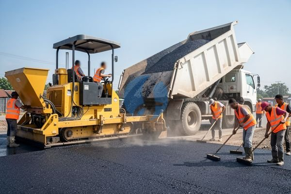

**Jasa Pengaspalan Purwakarta untuk Rumah Tinggal dan Usaha** - Mitra Sumber Material di mana pun berada, pernahkah Anda membayangkan proyek jalan, parkiran, atau area outdoor lainnya yang mulus, tahan lama, dan tidak cepat rusak? Seringkali, kegagalan pengaspalan bukan karena kualitas aspalnya, tapi karena pemilihan jenis dan ketebalan yang kurang tepat. Nah, Kami dari Sumber Material siap membantu Anda! Kami tidak hanya menyediakan jasa pengaspalan Purwakarta, tapi juga memastikan Anda mendapatkan solusi yang paling pas dengan kebutuhan dan anggaran.



## Bingung Pilih Jenis Aspal yang Tepat? Kami Bantu!

Mitra, memilih jenis aspal untuk proyek Anda memang bisa bikin pusing. Ada aspal hotmix, aspal dingin, aspal buton, dan masih banyak lagi. Masing-masing punya kelebihan dan kekurangan, serta cocok untuk aplikasi yang berbeda. Misalnya, aspal hotmix umumnya lebih kuat dan tahan lama, ideal untuk jalan raya atau area dengan lalu lintas padat. Sementara aspal dingin lebih fleksibel dan mudah diaplikasikan, cocok untuk perbaikan kecil atau area parkir. Jangan sampai salah pilih, karena bisa berakibat pada biaya perbaikan yang membengkak di kemudian hari.

Daripada bingung sendiri, kenapa tidak konsultasi langsung dengan tim Kami? Kami akan membantu Anda menganalisis kebutuhan proyek Anda, mempertimbangkan volume lalu lintas, kondisi tanah, dan anggaran yang tersedia, lalu merekomendasikan jenis aspal yang paling optimal. Selain itu, Kami juga memberikan perkiraan biaya pengaspalan Purwakarta yang transparan, jadi Anda tidak ada biaya tersembunyi. [tanyakan harga lewat WhatsApp](https://api.whatsapp.com/send?phone=6285776786091&text=*Halo%20sumbermaterial.com*%20%3A)

## Material Aspal Berkualitas dan Jasa Urug Purwakarta Lengkap dari Kami

Kami menyediakan berbagai jenis material aspal berkualitas tinggi yang siap untuk proyek Anda di Purwakarta dan sekitarnya. Berikut beberapa pilihan yang tersedia:

- **Aspal Hotmix:** Tersedia berbagai grade (misalnya, aspal hotmix AC-WC untuk jalan umum, aspal hotmix SMA untuk jalan tol) dengan mutu sesuai standar SNI.
- **Aspal Emulsi:** Cocok untuk aplikasi di area yang membutuhkan fleksibilitas dan daya rekat yang baik.
- **Aspal Buton:** Alternatif yang lebih ramah lingkungan dan tahan lama, ideal untuk proyek berkelanjutan.
- **Batu Split:** Tersedia berbagai ukuran sesuai kebutuhan proyek Anda.
- **Sirtu (Pasir, Batu, dan Tanah):** Material dasar yang penting untuk lapisan pondasi.

Selain material, Kami juga menyediakan **jasa urug Purwakarta** untuk meratakan dan memadatkan lahan sebelum proses pengaspalan dimulai.  Ini penting untuk memastikan hasil pengaspalan yang kuat dan tahan lama.

## Kenapa Memesan Jasa Pengaspalan Purwakarta Lewat Sumber Material?

Mitra Sumber Material, ada beberapa alasan mengapa Anda harus memilih Kami untuk kebutuhan pengaspalan di Purwakarta:

- **Konsultasi Gratis:** Kami bantu Anda memilih material dan perencanaan yang tepat sebelum pesanan dibuat. Tidak salah beli, tidak ada penyesalan!
- **Material Berkualitas:** Kami hanya menggunakan material aspal dan agregat yang sesuai dengan standar SNI.
- **Harga Kompetitif:** Kami menawarkan harga pengaspalan Purwakarta yang bersaing, tanpa mengorbankan kualitas. (Harga ini bersifat estimasi dan dapat berubah sewaktu-waktu — hubungi Kami untuk penawaran terbaru dan paling akurat sesuai kebutuhan proyek Mitra.)
- **Pengerjaan Profesional:** Tim Kami terdiri dari tenaga ahli yang berpengalaman dan terpercaya.
- **Jangkauan Luas:** Kami melayani pengiriman material dan pengerjaan di seluruh wilayah Purwakarta dan sekitarnya.
- **Layanan Lengkap:** Kami tidak hanya menyediakan jasa pengaspalan, tapi juga jasa urug dan penyediaan material bangunan lainnya seperti pasir, batu, dan hebel.
- **Lokasi Strategis:** Berlokasi di Bogor, Jakarta, Bekasi, Karawang, Tangerang, dan Cikarang, Kami siap melayani kebutuhan Anda dengan cepat dan efisien.

## Mudah dan Cepat: Begini Cara Pesan Jasa Pengaspalan Purwakarta dari Kami

Proses pemesanan jasa pengaspalan Purwakarta dari Kami sangat mudah dan cepat:

1.  **Hubungi Kami:** Klik tombol **WhatsApp** atau **Telepon** di bawah, atau langsung hubungi Kami melalui nomor yang tertera di website.
2.  **Konsultasi:** Jelaskan detail proyek Anda kepada tim Kami, termasuk luas area, jenis aspal yang diinginkan, dan anggaran yang tersedia.
3.  **Penawaran Harga:** Kami akan memberikan penawaran harga yang transparan dan terperinci.
4.  **Pengerjaan:** Setelah Anda menyetujui penawaran, Kami akan segera menjadwalkan pengerjaan.
5.  **Penyelesaian:** Kami pastikan proyek pengaspalan Anda selesai tepat waktu dan sesuai dengan standar kualitas yang tinggi.

Mau tahu harga terbaru untuk kebutuhan proyek Mitra Sumber Material? Klik tombol **WhatsApp** atau **Telepon** di bawah, kirim kebutuhan dan lokasi proyek, Kami bantu hitungkan.

ARTIKEL_SELESAI

## Perkiraan Kebutuhan Material: Contoh Kasus Proyek Parkiran

Mitra Sumber Material, seringkali yang membuat proyek pengaspalan jadi terlambat adalah kurangnya perhitungan material yang tepat. Nah, untuk membantu Anda, Kami berikan contoh perhitungan kebutuhan material untuk proyek parkiran sederhana. Misalkan Anda ingin mengaspal area parkir seluas 100 meter persegi dengan ketebalan aspal hotmix AC-WC 4 cm (0,04 meter).

Pertama, hitung volume aspal yang dibutuhkan: Luas x Ketebalan = 100 m² x 0,04 m = 4 m³. Ini adalah volume aspal hotmix yang Anda butuhkan. Namun, jangan lupa memperhitungkan kebutuhan material lain seperti base course (lapisan dasar) dan prime coat (lapisan pengikat).

Untuk base course, umumnya dibutuhkan ketebalan 10 cm (0,1 meter). Jadi, volumenya adalah 100 m² x 0,1 m = 10 m³.  Material yang biasa digunakan untuk base course adalah sirtu atau batu split. Untuk prime coat, biasanya digunakan emulsi aspal dengan dosis 0,5 – 1 liter per meter persegi. Jadi, kebutuhan emulsi aspal adalah 100 m² x 0,5 liter/m² = 50 liter (angka ini bisa disesuaikan tergantung rekomendasi teknis).

Perhitungan ini adalah estimasi kasar. Kondisi lapangan yang sebenarnya (misalnya, kemiringan, jenis tanah) bisa mempengaruhi kebutuhan material. Itulah mengapa konsultasi dengan Kami sangat penting, karena Kami akan melakukan survei lokasi dan memberikan perhitungan yang lebih akurat.

## Pertanyaan Umum Seputar Jasa Pengaspalan Purwakarta

Mitra, seringkali Kami menerima pertanyaan serupa dari calon pelanggan. Berikut beberapa pertanyaan yang paling umum dan jawabannya:

### Berapa Lama Waktu Pengerjaan Pengaspalan?

Waktu pengerjaan sangat bervariasi, tergantung pada luas area, kondisi lahan, dan jenis aspal yang digunakan. Untuk area parkir kecil (misalnya 100 m²), biasanya membutuhkan waktu 2-3 hari kerja. Untuk proyek yang lebih besar, tentu saja akan membutuhkan waktu yang lebih lama.

### Apakah Harga Sudah Termasuk Biaya Transportasi?

Biaya transportasi akan Kami informasikan secara terpisah dalam penawaran harga. Biaya ini bergantung pada jarak lokasi proyek dari gudang Kami dan jenis material yang dipesan.

### Apa Saja yang Harus Dipersiapkan Sebelum Pengaspalan?

Persiapan lahan sangat penting untuk keberhasilan pengaspalan. Pastikan area yang akan diaspal bersih dari sampah, batu, dan benda-benda lain.  Jika ada genangan air, harus dikeringkan terlebih dahulu.  Selain itu, pastikan kemiringan lahan sudah sesuai dengan standar drainase.

### Bagaimana Jika Ada Kerusakan Setelah Pengaspalan?

## Hindari Kesalahan Ini Saat Memilih Jasa Pengaspalan

Mitra Sumber Material, ada beberapa kesalahan umum yang sering dilakukan orang saat memilih jasa pengaspalan Purwakarta. Jangan sampai Anda mengalaminya:

## Tips Memastikan Daya Tahan Aspal Purwakarta: Perawatan Rutin yang Wajib Dilakukan

Mitra Sumber Material, pengaspalan yang baik bukan hanya soal pemilihan material dan pengerjaan yang tepat, tapi juga perawatan rutin setelahnya. Dengan perawatan yang benar, Anda bisa memperpanjang umur aspal dan menghemat biaya perbaikan di masa depan. Misalnya, lakukan pembersihan rutin dari debu, kotoran, dan minyak yang bisa merusak lapisan aspal. Hindari memarkir kendaraan dengan beban berlebih di area yang baru diaspal, terutama dalam beberapa hari pertama.

### Apa yang Harus Dilakukan Jika Muncul Retakan Kecil?

Retakan kecil pada aspal memang sering terjadi, terutama akibat perubahan suhu atau beban berlebih. Jangan biarkan retakan ini membesar! Segera lakukan penambalan dengan material aspal dingin atau hotmix. Penambalan dini akan mencegah air masuk ke dalam lapisan aspal dan menyebabkan kerusakan yang lebih parah.

### Bagaimana Cara Mencegah Genangan Air di Permukaan Aspal?

Genangan air bisa mempercepat kerusakan aspal. Pastikan permukaan aspal memiliki kemiringan yang cukup untuk mengalirkan air hujan. Jika perlu, buat saluran drainase yang memadai untuk membuang air dari area yang diaspal.

## Memahami Pentingnya Base Course yang Kuat

Mitra, seringkali kita fokus pada lapisan aspal saja, padahal lapisan *base course* (lapisan dasar) juga sangat penting. Base course berfungsi sebagai pondasi yang kuat untuk menopang beban lalu lintas dan mencegah aspal retak atau bergelombang. Kami merekomendasikan penggunaan base course dengan ketebalan minimal 10 cm, terbuat dari sirtu yang dipadatkan dengan baik. Semakin padat base course, semakin tahan lama aspal Anda. Jangan ragu untuk bertanya kepada Kami tentang jenis base course yang paling sesuai dengan kondisi tanah di lokasi Anda.

- **Tergiur Harga Terlalu Murah:** Harga yang terlalu murah seringkali mengindikasikan kualitas material yang rendah atau pengerjaan yang asal-asalan. Ingat, kualitas lebih penting daripada harga!
- **Tidak Meminta Penawaran Tertulis:** Penawaran tertulis akan memberikan kejelasan mengenai ruang lingkup pekerjaan, material yang digunakan, dan harga yang disepakati.
- **Tidak Melakukan Survei Lokasi:** Survei lokasi penting untuk menentukan jenis aspal yang tepat dan memperhitungkan kondisi lahan yang sebenarnya.
- **Tidak Memeriksa Reputasi Penyedia Jasa:** Pastikan penyedia jasa memiliki reputasi yang baik dan pengalaman yang memadai. Cari testimoni dari pelanggan sebelumnya.
