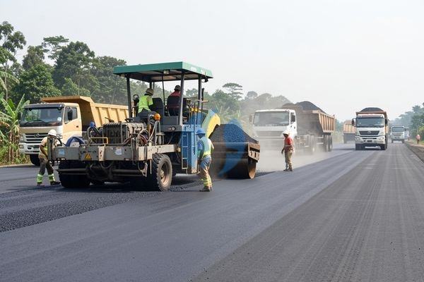

**Jasa Pengaspalan Sukabumi dan Cara Menyiapkan Lokasi Kerja** - Mitra, pernahkah Anda membayangkan proyek jalan atau parkiran yang mulus, tahan lama, dan bebas perawatan berlebihan? Kami dari Sumber Material hadir untuk mewujudkannya. Kami menawarkan jasa pengaspalan Sukabumi yang komprehensif, mulai dari perencanaan hingga pelaksanaan, dengan fokus pada kualitas dan kepuasan Mitra.



Apakah Anda sedang merencanakan pengaspalan jalan desa, area parkir, atau bahkan area industri di Sukabumi dan sekitarnya? Memilih jasa pengaspalan yang tepat sangat krusial untuk memastikan hasil yang optimal dan investasi yang tidak sia-sia. Nah, Kami menyediakan solusi mudah dan terpercaya. Kami tidak hanya menyediakan jasa pengaspalan, tetapi juga material berkualitas tinggi seperti aspal hotmix yang siap dikirim langsung ke lokasi proyek Mitra.

## Memilih Jasa Pengaspalan Sukabumi yang Tepat: Apa yang Perlu Diperhatikan?

Mitra Sumber Material yang cerdas, sebelum memutuskan penyedia jasa, ada beberapa hal penting yang perlu dipertimbangkan. Pertama, pengalaman dan reputasi perusahaan. Pastikan mereka memiliki rekam jejak yang baik dan portofolio proyek yang relevan dengan kebutuhan Anda. Kedua, kualitas material yang digunakan. Aspal yang berkualitas akan menghasilkan permukaan yang lebih tahan lama dan minim perawatan. Ketiga, harga yang kompetitif dan transparan. Jangan ragu untuk membandingkan penawaran dari beberapa penyedia jasa.

Penting juga untuk mempertimbangkan jangkauan layanan. Apakah mereka melayani area Sukabumi dan sekitarnya? Kami di Sumber Material bangga melayani wilayah Jabodetabek dan sekitarnya, termasuk Sukabumi. Artinya, Anda tidak perlu repot mencari penyedia jasa lain jika proyek Anda berada di area tersebut. Untuk proyek yang membutuhkan material tambahan seperti readymix, Kami juga menyediakan pengiriman langsung ke lokasi proyek Anda. [tanyakan harga lewat WhatsApp](https://api.whatsapp.com/send?phone=6285776786091&text=*Halo%20sumbermaterial.com*%20%3A)

## Material Pengaspalan Berkualitas dari Sumber Material

Kami menyediakan berbagai jenis material pengaspalan yang sesuai dengan kebutuhan proyek Mitra. Beberapa di antaranya adalah:

- **Aspal Hotmix:** Campuran aspal dan agregat yang dipanaskan dan dicampur secara merata. Ideal untuk jalan, parkiran, dan area lalu lintas tinggi. Kami menyediakan berbagai mutu aspal hotmix, disesuaikan dengan beban lalu lintas dan kondisi lapangan.
- **Aspal Emulsi:** Aspal yang dicampur dengan air dan emulsifier. Lebih ramah lingkungan dan mudah diaplikasikan. Cocok untuk perbaikan jalan yang kecil atau pelapisan permukaan.
- **Agregat:** Batu pecah, pasir urug, dan material granular lainnya yang digunakan sebagai lapisan dasar dan permukaan dalam pengaspalan. Kami menyediakan berbagai ukuran dan mutu agregat sesuai dengan standar SNI.

Sebagai contoh, untuk pengaspalan jalan desa dengan lalu lintas ringan, Kami merekomendasikan penggunaan aspal hotmix dengan mutu AC-2. Sementara untuk jalan utama atau area parkir yang menahan beban berat, Kami sarankan penggunaan AC-10 atau AC-14.  Harga aspal hotmix bervariasi tergantung mutu dan volume pemesanan. Harga ini bersifat estimasi dan dapat berubah sewaktu-waktu — hubungi Kami untuk penawaran terbaru dan paling akurat sesuai kebutuhan proyek Mitra.

## Keuntungan Memesan Jasa Pengaspalan Sukabumi Lewat Sumber Material

Mitra, mengapa memilih Kami untuk proyek pengaspalan Anda? Pertama, Kami menawarkan layanan yang komprehensif, mulai dari konsultasi, perencanaan, hingga pelaksanaan. Kami akan membantu Anda memilih material yang tepat dan memastikan proses pengaspalan berjalan lancar dan efisien. Kedua, Kami menjamin kualitas material yang Kami gunakan. Semua material Kami bersumber dari produsen terpercaya dan memenuhi standar SNI. Ketiga, Kami menawarkan harga yang kompetitif dan transparan. Anda akan mendapatkan penawaran harga yang jelas dan terperinci tanpa biaya tersembunyi. Keempat, Kami melayani pengiriman langsung ke lokasi proyek Anda di wilayah Jabodetabek dan sekitarnya. Anda tidak perlu repot mengurus transportasi material sendiri. Kelima, Kami berlokasi di Bogor, Jakarta, Bekasi, Karawang, Tangerang, dan Cikarang, sehingga memudahkan koordinasi dan pengiriman.

Kami memahami bahwa setiap proyek memiliki kebutuhan yang unik. Itulah mengapa Kami selalu berusaha memberikan solusi yang disesuaikan dengan anggaran dan spesifikasi proyek Anda. Selain jasa pengaspalan, Kami juga menyediakan jasa urug dan jasa cor untuk melengkapi kebutuhan konstruksi Anda.  Bahkan, jika Anda membutuhkan alat berat untuk proyek Anda, Kami juga menyediakan [batasan baja ringan](/blog/baja-ringan-sukabumi/) sewa alat berat dengan berbagai pilihan yang bisa Anda sesuaikan dengan kebutuhan.

## Pesan Jasa Pengaspalan Sukabumi dengan Mudah

Proses pemesanan jasa pengaspalan dari Kami sangat mudah dan cepat. Cukup hubungi Kami melalui tombol **WhatsApp** atau **Telepon** di bawah ini. Sampaikan kebutuhan dan lokasi proyek Anda, dan tim Kami akan segera menghubungi Anda untuk memberikan penawaran harga terbaik.  Kami akan bantu hitungkan volume material yang dibutuhkan dan memberikan solusi pengaspalan yang paling efisien untuk proyek Anda.

Mau tahu harga terbaru untuk kebutuhan proyek Mitra Sumber Material? Klik tombol **WhatsApp** atau **Telepon** di bawah, kirim kebutuhan dan lokasi proyek, Kami bantu hitungkan.

ARTIKEL_SELESAI

## Memahami Ketebalan Aspal: Menentukan Daya Tahan Jalan dan Parkiran

Mitra, pernahkah Anda bertanya-tanya, berapa ketebalan aspal yang ideal untuk jalan desa atau area parkir di Sukabumi? Ketebalan lapisan aspal sangat berpengaruh terhadap daya tahan dan kualitas hasil pengaspalan. Ketebalan minimum yang direkomendasikan bervariasi tergantung pada jenis jalan dan beban lalu lintas. Untuk jalan desa dengan lalu lintas ringan, ketebalan lapisan aspal biasanya berkisar antara 3-5 cm. Sementara untuk jalan utama atau area parkir yang menahan beban berat, disarankan menggunakan ketebalan minimal 6-8 cm.

Perlu diingat, ketebalan ini hanya untuk lapisan aspal hotmix. Lapisan dasar (base course) dan sub-base course juga memiliki peran penting dalam menahan beban dan mencegah kerusakan jalan. Kami di Sumber Material siap membantu Anda menghitung kebutuhan material dan menentukan ketebalan lapisan yang tepat sesuai dengan kondisi tanah dan beban lalu lintas di lokasi proyek Anda.

## Pertanyaan Umum Seputar Jasa Pengaspalan Sukabumi

Banyak Mitra Sumber Material yang sering bertanya mengenai proses pengaspalan. Berikut beberapa pertanyaan umum beserta jawabannya:

### Berapa Lama Waktu yang Dibutuhkan untuk Pengaspalan?

Waktu pengerjaan pengaspalan bervariasi tergantung pada luas area, kondisi permukaan, dan cuaca. Namun, secara umum, pengaspalan area seluas 100 m² membutuhkan waktu sekitar 1-2 hari kerja.

### Apakah Pengaspalan Bisa Dilakukan Saat Musim Hujan?

Pengaspalan sebaiknya tidak dilakukan saat hujan deras karena dapat mempengaruhi kualitas campuran aspal dan menyebabkan kerusakan pada permukaan jalan. Namun, jika hujan ringan, pekerjaan tetap bisa dilanjutkan dengan langkah-langkah pencegahan tertentu.

### Bagaimana Cara Merawat Jalan Aspal Agar Awet?

Perawatan jalan aspal yang rutin, seperti pembersihan dari sampah dan debu, serta penambalan retakan kecil, dapat memperpanjang umur jalan. Hindari memarkirkan kendaraan berat di atas jalan aspal yang baru selesai dikerjakan.

### Apa Saja Jenis-Jenis Kerusakan Jalan Aspal yang Umum Terjadi?

Beberapa jenis kerusakan jalan aspal yang umum terjadi antara lain retak, lubang, dan amblas. Kerusakan ini biasanya disebabkan oleh beban lalu lintas yang berlebihan, drainase yang buruk, atau kualitas material yang rendah. Kami siap membantu Anda memperbaiki kerusakan jalan aspal dengan cepat dan efisien.

## Contoh Perhitungan Kebutuhan Material Aspal untuk Parkiran Sederhana

Mitra, untuk memberikan gambaran yang lebih jelas, mari kita hitung kebutuhan material aspal untuk parkiran sederhana berukuran 5 meter x 10 meter dengan ketebalan lapisan aspal 5 cm.

Pertama, hitung luas area parkiran: 5 m x 10 m = 50 m².

Kemudian, ubah ketebalan lapisan aspal ke dalam meter: 5 cm = 0,05 m.

Selanjutnya, hitung volume aspal yang dibutuhkan: 50 m² x 0,05 m = 2,5 m³.

Asumsi berat jenis aspal hotmix adalah 2,4 ton/m³, maka berat aspal yang dibutuhkan adalah: 2,5 m³ x 2,4 ton/m³ = 6 ton.

Perhitungan ini bersifat estimasi dan dapat bervariasi tergantung pada kepadatan aspal dan faktor lainnya. Kami sarankan untuk berkonsultasi dengan tim Kami agar mendapatkan perhitungan yang lebih akurat sesuai dengan kondisi proyek Anda. Kami juga menyediakan jasa pengiriman pasir urug dan material lainnya yang dibutuhkan untuk persiapan area parkiran Anda.
