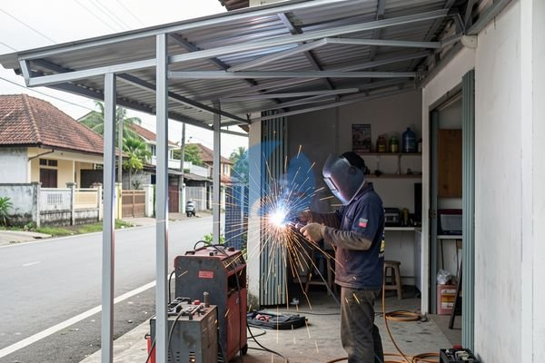

**Kapan Waktu yang Tepat Memakai Jasa Tukang Las Kanopi?** - Mitra Sumber Material yang kami hormati, seringkali Mitra menghadapi dilema saat ingin memasang kanopi: ukuran yang tidak sesuai, material yang kurang kuat, atau bahkan tukang las yang kurang profesional. Akibatnya, bisa ada biaya tambahan karena perbaikan, atau kanopi yang cepat rusak dan harus diganti. Nah, Kami di Sumber Material hadir untuk membantu Mitra menghindari semua masalah itu sebelum pesanan dibuat.



## Pilihan Kanopi: Besi, Baja Ringan, atau Kombinasi?

Memilih material kanopi memang bikin bingung. Besi memang kuat, tapi berat dan rentan karat kalau tidak dirawat dengan baik. Baja ringan lebih ringan dan tahan karat, tapi mungkin kurang kokoh untuk bentang yang terlalu lebar atau desain yang rumit. Kombinasi keduanya bisa jadi solusi, dengan besi sebagai rangka utama dan baja ringan untuk penutup.

Mitra Sumber Material, jangan khawatir salah pilih. Konsultasikan kebutuhan proyek Anda dengan Kami. Kami akan membantu menentukan material yang paling sesuai dengan anggaran, desain, dan kondisi cuaca di lokasi proyek Mitra. Kami juga bisa memberikan estimasi biaya awal, sehingga Mitra bisa merencanakan anggaran dengan lebih baik.

## Solusi Kanopi Lengkap dari Sumber Material

Kami menyediakan jasa tukang las kanopi untuk berbagai kebutuhan, termasuk:

- **Kanopi Carport:** Lindungi kendaraan kesayangan dari panas matahari dan hujan deras. Kami bisa membuat kanopi carport dengan berbagai ukuran dan desain, mulai dari yang sederhana hingga yang mewah.
- **Kanopi Teras:** Ciptakan area relaksasi yang nyaman di teras rumah. Kanopi teras bisa membantu melindungi dari sinar matahari langsung dan menciptakan suasana yang lebih teduh.
- **Kanopi Balkon:** Nikmati pemandangan dari balkon tanpa khawatir terpapar panas atau hujan. Kami menawarkan berbagai pilihan desain kanopi balkon yang sesuai dengan gaya arsitektur rumah Mitra.
- **Kanopi Toko/Ruko:** Tingkatkan daya tarik toko atau ruko dengan kanopi yang menarik. Kami bisa membuat kanopi toko dengan logo atau desain khusus sesuai permintaan.

Untuk material, Kami menawarkan pilihan besi hollow, baja ringan SNI, dan atap spandek/polycarbonate dengan berbagai ketebalan dan warna. Misalnya, baja ringan C75.75 dengan ketebalan 0.75mm sering digunakan untuk kanopi dengan bentang sedang. Atau, atap spandek dengan ketebalan 0.30mm yang ringan dan ekonomis untuk carport. Kami juga menyediakan jasa pemasangan atap polycarbonete untuk tampilan yang lebih modern dan tahan lama.

## Kenapa Memesan Jasa Las Kanopi Lewat Sumber Material?

Ada banyak penyedia jasa tukang las kanopi di Jabodetabek, tapi Kami menawarkan lebih dari sekadar pemasangan. Pertama, Kami membantu memilih material yang tepat agar tidak salah beli dan sesuai dengan anggaran. Kedua, Kami memberikan harga yang transparan dan kompetitif. Ketiga, Kami menyediakan tenaga tukang las yang berpengalaman dan terpercaya. Keempat, Kami melayani wilayah Jabodetabek dan sekitarnya, sehingga proyek Mitra akan sampai ke lokasi tepat waktu.

Kami berlokasi strategis di Bogor, Jakarta, Bekasi, Karawang, Tangerang, dan Cikarang. Ini memungkinkan Kami memberikan respon cepat dan layanan yang lebih efisien. Kami juga menawarkan layanan konsultasi gratis untuk membantu Mitra merencanakan proyek kanopi yang ideal.

[tanyakan harga terbaru](https://api.whatsapp.com/send?phone=6285776786091&text=*Halo%20sumbermaterial.com*%20%3A)

## Pesan Jasa Tukang Las Kanopi Kami Sekarang Juga!

Proses pemesanannya sangat mudah. Cukup kirimkan kebutuhan dan lokasi proyek Mitra lewat WhatsApp atau Telepon. Kami akan segera memberikan penawaran terbaik. Atau, Mitra bisa langsung menghubungi Kami untuk konsultasi gratis. Jangan tunda lagi, lindungi aset Mitra dengan kanopi berkualitas dari Sumber Material!

## Kesalahan Umum Saat Memasang Kanopi: Hindari Biaya Tak Terduga!

Mitra Sumber Material, seringkali Kami menemukan kesalahan-kesalahan kecil yang bisa berakibat fatal pada kualitas dan umur kanopi. Salah satu yang paling sering terjadi adalah kurangnya perhitungan beban. Misalnya, kanopi carport untuk dua mobil dengan bentang 6 meter perlu rangka yang lebih kuat daripada kanopi teras dengan bentang 3 meter. Kalau rangkanya kurang kuat, bisa melengkung atau bahkan patah saat hujan deras atau angin kencang.

Kesalahan lain yang umum adalah pemilihan atap yang kurang tepat. Atap polycarbonate memang bagus untuk tampilan modern, tapi kurang tahan terhadap benturan dibandingkan atap spandek. Kalau lokasi proyek Mitra rawan terkena batu atau benda jatuh lainnya, sebaiknya pilih atap spandek. Atau, perhatikan juga kemiringan atap. Kemiringan yang terlalu datar bisa membuat air hujan menggenang dan merusak struktur kanopi. Kami sarankan kemiringan minimal 10 derajat untuk memastikan air hujan mengalir lancar.

## Pertanyaan yang Sering Diajukan (FAQ) Tentang Jasa Las Kanopi

Banyak Mitra yang bertanya seputar jasa las kanopi. Berikut beberapa pertanyaan yang paling sering Kami terima:

### Berapa Lama Waktu Pengerjaan Kanopi?

Waktu pengerjaan tergantung pada ukuran dan kompleksitas desain kanopi. Untuk kanopi carport standar ukuran 3x5 meter, biasanya membutuhkan waktu 2-3 hari kerja. Untuk desain yang lebih rumit atau ukuran yang lebih besar, bisa memakan waktu lebih lama.

### Apakah Kanopi Harus Diperkuat dengan Angkur?

Ya, penggunaan angkur sangat penting, terutama untuk kanopi dengan bentang lebar. Angkur berfungsi untuk menahan kanopi agar tidak bergeser atau roboh saat terkena angin kencang. Angkur biasanya ditanam di dinding atau lantai beton dengan jarak yang disesuaikan dengan ukuran kanopi.

### Bagaimana Cara Merawat Kanopi Agar Awet?

Perawatan kanopi cukup sederhana. Untuk kanopi besi, lapisi secara berkala dengan cat anti karat. Untuk kanopi baja ringan, bersihkan dari debu dan kotoran secara rutin. Periksa juga kondisi atap dan rangka kanopi secara berkala untuk memastikan tidak ada kerusakan.

### Apakah Bisa Meminta Desain Kanopi Sesuai Selera?

Tentu saja bisa! Kami melayani pembuatan kanopi dengan desain custom sesuai selera Mitra. Mitra bisa memberikan contoh desain yang diinginkan, atau Kami bisa membantu memberikan ide dan saran desain yang sesuai dengan kebutuhan dan anggaran.

## Memahami Beban Kerja Kanopi: Contoh Perhitungan Sederhana

Memahami beban kerja kanopi penting untuk memastikan kekuatannya. Sebagai contoh, mari kita hitung kebutuhan rangka baja ringan untuk kanopi carport ukuran 4x6 meter.

Asumsikan beban mati (berat rangka, atap, dan material lain) adalah 20 kg/m². Asumsikan juga beban hidup (angin, hujan, salju – kami asumsikan beban angin dominan di Jabodetabek) adalah 30 kg/m².

Total beban = Beban mati + Beban hidup = 20 kg/m² + 30 kg/m² = 50 kg/m².

Luas kanopi = 4 m x 6 m = 24 m².

Total beban keseluruhan = 50 kg/m² x 24 m² = 1200 kg.

Ini berarti rangka kanopi harus mampu menahan beban minimal 1200 kg. Pemilihan profil baja ringan (C75.75, C100.100, dll.) harus didasarkan pada perhitungan ini, dengan mempertimbangkan jarak antar rangka dan jenis atap yang digunakan. Kami akan melakukan perhitungan detail untuk memastikan kanopi Mitra aman dan kuat. Perlu diingat, perhitungan ini hanyalah contoh sederhana. Perhitungan beban kerja yang akurat memerlukan pertimbangan lebih banyak faktor dan sebaiknya dilakukan oleh profesional.

## Memastikan Keamanan Kanopi: Pentingnya Penggunaan Las Listrik yang Tepat

Mitra Sumber Material, kualitas las adalah kunci kekuatan dan keamanan kanopi. Kami sering menemukan kanopi yang sambungannya kurang kuat karena penggunaan las listrik yang tidak tepat. Misalnya, penggunaan ampere yang terlalu rendah bisa menyebabkan penetrasi las yang kurang baik, sehingga sambungan menjadi rapuh. Sebaliknya, ampere yang terlalu tinggi bisa membakar material dan melemahkan struktur kanopi. Tukang las Kami terlatih menggunakan berbagai teknik pengelasan (SMAW, MIG/MAG) dan memilih ampere yang sesuai dengan jenis dan ketebalan material.

## Pertanyaan Umum Lainnya Seputar Pemasangan Kanopi

Banyak Mitra yang menanyakan hal-hal praktis sebelum memesan jasa Kami. Berikut beberapa di antaranya:

### Apakah Kanopi Membutuhkan Izin Bangunan?

Tergantung pada peraturan daerah setempat dan ukuran kanopi. Untuk kanopi yang relatif kecil (misalnya, carport standar) biasanya tidak memerlukan izin. Namun, untuk kanopi yang lebih besar atau permanen, sebaiknya Mitra cek dulu ke kantor kelurahan atau dinas perizinan setempat.

### Bagaimana Jika Ada Perubahan Desain di Tengah Pengerjaan?

Kami sangat fleksibel dan siap mengakomodasi perubahan desain selama masih memungkinkan secara teknis. Namun, perubahan desain yang signifikan mungkin akan memerlukan penyesuaian biaya dan waktu pengerjaan.

### Apa Saja Garansi yang Kami Berikan?

Tinggal satu langkah lagi: hubungi Kami lewat tombol **Telepon** atau **WhatsApp** di bawah untuk menanyakan harga dan jadwal pengiriman proyek Mitra Sumber Material.
