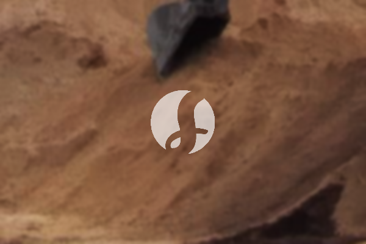

**Jual Pasir Putih Terdekat? Cek Dulu Hal Ini** - Mitra Sumber Material, apakah Anda sedang mencari supplier pasir putih terpercaya untuk proyek konstruksi Anda? Kami siap membantu menyiapkan material pasir putih berkualitas dengan harga yang kompetitif, langsung dikirim ke lokasi proyek Anda di Jabodetabek dan sekitarnya.



Banyak yang bertanya-tanya, kenapa harus memilih pasir putih? Nah, pasir putih ini punya beberapa keunggulan dibandingkan jenis pasir lainnya, terutama dalam hal estetika dan kekuatan. Pasir putih seringkali digunakan untuk pekerjaan finishing, pembuatan paving block, atau bahkan sebagai bahan campuran dalam pembuatan beton dekoratif. Tapi, memilih supplier yang tepat itu penting banget, lho. Jangan sampai kualitas pasirnya mengecewakan atau harganya malah bikin kantong jebol.

## Memilih Pasir Putih yang Tepat: Apa yang Perlu Diperhatikan?

Sebelum memutuskan untuk membeli, ada beberapa hal yang perlu Anda perhatikan, Mitra Sumber Material. Pertama, pastikan pasir putih yang Anda pilih memiliki tingkat kebersihan yang baik. Pasir yang bersih akan menghasilkan campuran yang lebih kuat dan tahan lama. Kedua, perhatikan ukuran butiran pasirnya. Ukuran yang seragam akan memudahkan proses pengerjaan dan menghasilkan hasil yang lebih rapi. Ketiga, dan yang paling penting, pastikan Anda mendapatkan harga yang sesuai dengan kualitas yang ditawarkan. Jangan ragu untuk membandingkan harga dari beberapa supplier sebelum membuat keputusan. Nah, untuk mempermudah pencarian Anda, Kami dari Sumber Material siap menyediakan berbagai pilihan pasir putih dengan kualitas terjamin dan harga yang bersaing. Yuk, tanyakan harga terbaru lewat tombol **WhatsApp** atau **Telepon** di bawah!

### Jenis Pasir Putih yang Kami Sediakan & Aplikasinya

Kami di Sumber Material menyediakan berbagai jenis pasir putih yang bisa Anda sesuaikan dengan kebutuhan proyek Anda. Beberapa jenis yang paling populer di antaranya:

- **Pasir Putih Bangka:** Dikenal dengan butirannya yang halus dan bersih, ideal untuk pekerjaan finishing dan pembuatan paving block. Pasir ini sangat bagus untuk meningkatkan estetika visual.
- **Pasir Putih Cilegon:** Memiliki kandungan silika yang tinggi, sehingga cocok digunakan untuk pembuatan beton dekoratif dan plesteran. Pasir Cilegon juga memberikan kekuatan ekstra pada struktur bangunan.
- **Pasir Putih Lokal:** Pilihan yang ekonomis untuk proyek-proyek yang tidak membutuhkan standar kualitas yang terlalu tinggi. Meskipun demikian, Kami tetap memastikan pasir lokal yang Kami jual memiliki kualitas yang cukup baik untuk berbagai aplikasi konstruksi.

Sebagai gambaran, untuk proyek paving block di area seluas 100 meter persegi, Anda mungkin membutuhkan sekitar 5-7 kubik pasir putih, tergantung ketebalan lapisan yang diinginkan. Untuk pekerjaan plesteran dinding seluas 50 meter persegi, kebutuhan pasir putihnya bisa mencapai 2-3 kubik. Estimasi ini bisa bervariasi, jadi jangan ragu untuk konsultasi dengan tim Kami untuk mendapatkan perhitungan yang lebih akurat.

### Mengapa Memilih Sumber Material untuk Pasir Putih Anda?

Mitra Sumber Material, kenapa harus repot mencari ke mana-mana kalau Anda bisa mendapatkan pasir putih berkualitas dari Kami? Pertama, Kami menyediakan berbagai jenis pasir putih dengan pilihan ukuran dan mutu yang beragam. Kedua, Kami menjamin kualitas produk yang Kami jual, karena Kami hanya bekerja sama dengan supplier terpercaya. Ketiga, Kami melayani pengiriman ke seluruh wilayah Jabodetabek dan sekitarnya, termasuk Bogor, Jakarta, Bekasi, Karawang, Tangerang, dan Cikarang. Keempat, Kami selalu berusaha memberikan harga yang kompetitif dan transparan. Kelima, dan yang terpenting, Kami siap memberikan pelayanan yang ramah dan responsif. Anda bisa menghubungi Kami kapan saja untuk bertanya harga terbaru, berkonsultasi tentang kebutuhan proyek Anda, atau meminta penawaran khusus. Jangan tunda lagi, segera hubungi Kami untuk mendapatkan penawaran terbaik!

Kami juga menyediakan jasa sewa alat berat seperti excavator, bulldozer, dan wheel loader untuk membantu kelancaran proyek Anda. Selain itu, Kami juga menawarkan jasa urug dan jasa cor untuk berbagai kebutuhan konstruksi. Kami bisa menjadi solusi satu atap untuk semua kebutuhan material dan jasa konstruksi Anda.

### Pesan Pasir Putih Sekarang: Mudah, Cepat, dan Terpercaya

Memesan pasir putih dari Sumber Material itu mudah banget, lho! Anda bisa langsung menghubungi Kami melalui tombol **WhatsApp** atau **Telepon** yang tersedia di halaman ini. Tim Kami akan dengan senang hati membantu Anda memilih jenis pasir putih yang tepat, menghitung kebutuhan material, dan menyiapkan penawaran harga yang sesuai dengan anggaran Anda. Kami juga bisa membantu Anda mengatur jadwal pengiriman agar sesuai dengan waktu yang Anda inginkan. Dengan Kami, Anda bisa fokus pada pengerjaan proyek Anda tanpa perlu khawatir tentang ketersediaan material.

Kirim kebutuhan dan lokasi proyek Mitra Sumber Material lewat tombol **WhatsApp** atau **Telepon** di bawah, tim Kami bantu siapkan penawarannya.

ARTIKEL_SELESAI

## Menghitung Kebutuhan Pasir Putih: Contoh Kasus Nyata

Mitra Sumber Material, seringkali kita kesulitan memperkirakan berapa banyak pasir putih yang sebenarnya dibutuhkan untuk sebuah proyek. Nah, biar tidak kekurangan atau kelebihan, yuk kita lihat contoh perhitungan nyata. Misalnya, Anda ingin membuat lantai kerja (lean concrete) untuk fondasi rumah seluas 7x10 meter dengan tebal 5 cm. Pertama, kita hitung volumenya: 7 meter x 10 meter x 0,05 meter = 3,5 meter kubik.

Untuk campuran lean concrete, rasio yang umum digunakan adalah 1:3:5 (semen:pasir:kerikil). Jadi, dari 3,85 meter kubik pasir putih, Anda juga membutuhkan semen dan kerikil dengan proporsi yang sesuai. Jangan ragu untuk konsultasi dengan Kami, ya. Kami bantu hitungkan kebutuhan material secara keseluruhan agar proyek Anda berjalan lancar.

### Pertanyaan Umum Tentang Pasir Putih: FAQ

Banyak Mitra Sumber Material yang menanyakan beberapa hal terkait pasir putih. Berikut beberapa pertanyaan yang sering muncul:

### Apa perbedaan pasir putih Bangka dengan pasir putih Cilegon?

Pasir putih Bangka umumnya lebih halus dan bersih, ideal untuk finishing. Sementara pasir putih Cilegon memiliki kandungan silika lebih tinggi, membuatnya lebih kuat untuk campuran beton. Pilihan tergantung pada aplikasi yang Anda butuhkan.

### Apakah pasir putih bisa langsung digunakan tanpa dicuci?

Sebaiknya dicuci terlebih dahulu untuk menghilangkan kotoran dan debu. Pasir yang bersih akan menghasilkan campuran yang lebih kuat dan tahan lama.

### Bagaimana cara mengetahui kualitas pasir putih yang baik?

Perhatikan warna, tekstur, dan kebersihan pasir. Pasir yang baik seharusnya berwarna putih bersih, memiliki tekstur yang seragam, dan bebas dari kotoran organik.

### Bisakah Kami memesan sampel pasir putih sebelum membeli dalam jumlah besar?

Tentu saja bisa! Kami dengan senang hati menyediakan sampel pasir putih agar Anda bisa melihat dan merasakan kualitasnya secara langsung sebelum membuat keputusan.

## Hindari Kesalahan Umum Saat Membeli Pasir Putih

Mitra Sumber Material, ada beberapa kesalahan umum yang sering dilakukan saat membeli pasir putih. Pertama, tergiur dengan harga yang terlalu murah tanpa memperhatikan kualitas. Ingat, kualitas material sangat berpengaruh terhadap kekuatan dan daya tahan bangunan Anda. Kedua, tidak memperhitungkan faktor kehilangan akibat pemadatan dan sisa material. Akibatnya, Anda bisa kekurangan material di tengah proyek. Ketiga, tidak memastikan ketersediaan stok dari supplier. Hal ini bisa menyebabkan penundaan proyek. Nah, dengan memesan dari Kami, Anda tidak perlu khawatir akan hal-hal tersebut. Kami menjamin kualitas produk, memberikan perhitungan kebutuhan yang akurat, dan selalu memastikan ketersediaan stok yang cukup.

## Tips Tambahan: Penyimpanan Pasir Putih yang Benar

Mitra Sumber Material, setelah mendapatkan pasir putih berkualitas dari Kami, penting juga untuk menyimpannya dengan benar agar kualitasnya tetap terjaga. Simpan pasir putih di tempat yang kering dan terlindung dari hujan dan paparan langsung sinar matahari. Gunakan terpal atau penutup lainnya untuk melindungi pasir dari kontaminasi debu dan kotoran. Kalau memungkinkan, buat tumpukan pasir tidak terlalu tinggi agar tidak terjadi pemadatan yang berlebihan. Dengan penyimpanan yang tepat, Anda bisa memastikan pasir putih tetap dalam kondisi prima saat dibutuhkan.

## Memperkirakan Biaya Transportasi Pasir Putih

Nah, selain harga pasir putih itu sendiri, Anda juga perlu memperhitungkan biaya transportasi, lho. Biaya ini bisa bervariasi tergantung jarak pengiriman dan jenis kendaraan yang digunakan. Untuk pengiriman dalam kota Jabodetabek, biasanya Kami menggunakan truk engkel atau truk engkel double. Untuk volume yang lebih besar, Kami bisa menyediakan truk tronton. Jangan ragu untuk menanyakan perkiraan biaya transportasi kepada tim Kami saat Anda memesan. Dengan begitu, Anda bisa mendapatkan gambaran yang lebih jelas tentang total biaya yang perlu Anda keluarkan.

### Apakah Pasir Putih Cocok untuk Kolam Renang?

Bisa saja, Mitra! Pasir putih yang halus dan bersih bisa digunakan untuk melapisi dasar kolam renang, tapi perlu diproses lebih lanjut untuk memastikan kehalusannya dan menghilangkan kandungan zat-zat yang bisa mengganggu kualitas air.

### Bagaimana Jika Pasir Putih yang Sampai Ternyata Kotor?

Jangan khawatir! Segera hubungi Kami. Kami akan segera mengganti pasir tersebut dengan yang baru. Kepuasan Mitra adalah prioritas Kami.

### Apakah Pasir Putih Bisa Menyebabkan Debu Berterbangan?

Memang bisa, terutama saat proses pengerjaan. Pastikan pekerja menggunakan masker dan area kerja disiram air secara berkala untuk mengurangi debu.
