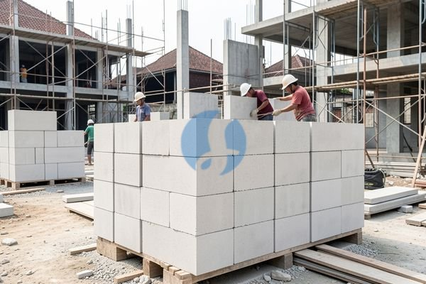

**Cara Memilih Jumlah Hebel 7 cm per Kubik yang Sesuai Kebutuhan** - Mitra Sumber Material di mana pun berada, sedang merencanakan membangun rumah atau renovasi, dan mempertimbangkan hebel sebagai material dinding? Seringkali muncul pertanyaan, berapa banyak hebel ukuran 7 cm yang dibutuhkan untuk satu kubik? Nah, Kami dari Sumber Material siap membantu Anda menghitung kebutuhan material secara akurat dan memastikan pesanan sampai di lokasi proyek Anda tepat waktu.



## Menghitung Kebutuhan Hebel 7 cm: Faktor yang Perlu Diperhatikan

Sebelum menghitung jumlah hebel 7 cm per kubik, ada beberapa hal yang perlu Mitra perhatikan. Ukuran hebel memang standar, tetapi kerapatan susunan dan kemungkinan adanya potongan saat pemasangan bisa memengaruhi total kebutuhan. Umumnya, hebel 7 cm memiliki dimensi 7 cm (tebal) x 30 cm (lebar) x 60 cm (panjang). Dengan ukuran ini, satu lembar hebel memiliki volume 0.0126 m³ (7/1000 x 0.3 x 0.6).

Untuk mengetahui jumlah hebel per kubik, kita bisa menggunakan perhitungan sederhana: 1 m³ / 0.0126 m³/lembar = sekitar 79.37 lembar. Artinya, dalam satu kubik, Anda membutuhkan sekitar 79-80 lembar hebel 7 cm. Tapi ingat, angka ini adalah perhitungan teoritis. Untuk menghindari kekurangan material, sebaiknya Anda menambahkan toleransi sekitar 5-10% untuk potongan dan kemungkinan kerusakan. [tanyakan harga lewat WhatsApp](https://api.whatsapp.com/send?phone=6285776786091&text=*Halo%20sumbermaterial.com*%20%3A)

## Pilihan Hebel 7 cm Berkualitas dari Sumber Material

Mitra Sumber Material, Kami menyediakan berbagai pilihan hebel 7 cm dari produsen terpercaya. Hebel yang Kami jual memiliki kualitas terjamin, kuat, ringan, dan presisi dalam ukurannya. Ada beberapa pilihan mutu yang bisa Anda sesuaikan dengan kebutuhan proyek Anda:

- **Hebel Standar:** Cocok untuk dinding internal dan eksternal yang tidak memerlukan kekuatan struktural tinggi.
- **Hebel Kuat:** Ideal untuk dinding eksternal yang membutuhkan kekuatan lebih, atau untuk dinding penahan beban.
- **Hebel Ringan:** Pilihan tepat untuk mengurangi beban struktur bangunan, terutama untuk bangunan bertingkat.

Kami juga menyediakan hebel dengan berbagai finishing, mulai dari polos hingga bertekstur, sehingga Anda bisa memilih yang paling sesuai dengan desain bangunan Anda. Penggunaan hebel 7 cm juga memberikan banyak manfaat, seperti insulasi termal yang baik, mengurangi penggunaan energi untuk pendinginan ruangan, serta mempersingkat waktu pengerjaan karena ukurannya yang besar.

## Kenapa Pesan Hebel 7 cm di Sumber Material?

Memilih Sumber Material sebagai supplier hebel 7 cm Anda memberikan banyak keuntungan. Pertama, Kami memastikan ketersediaan stok yang cukup untuk memenuhi kebutuhan proyek Anda, baik proyek kecil maupun besar. Kedua, Kami memberikan harga yang kompetitif dan transparan. Anda bisa langsung mendapatkan penawaran harga terbaru dan penawaran yang disesuaikan dengan volume pesanan dan lokasi pengiriman Anda. Ketiga, Kami melayani pengiriman ke seluruh wilayah Jabodetabek dan sekitarnya dengan armada yang lengkap dan terpercaya.

Kami juga menyediakan jasa konsultasi gratis untuk membantu Anda menghitung kebutuhan material secara akurat dan memilih jenis hebel yang paling sesuai dengan anggaran dan spesifikasi proyek Anda.  Selain hebel, Kami juga menyediakan material bangunan lainnya seperti pasir, batu, batako, besi, wiremesh, baja ringan, dan readymix. Jadi, Anda bisa mendapatkan semua kebutuhan material bangunan Anda dalam satu tempat.

## Pesan Hebel 7 cm Sekarang: Mudah dan Cepat

Untuk memesan hebel 7 cm atau menanyakan harga terbaru, Mitra Sumber Material bisa langsung menghubungi Kami lewat tombol **Telepon** atau **WhatsApp** di bawah ini. Tim Kami siap membantu Anda kapan saja. Jangan ragu untuk menyampaikan kebutuhan dan lokasi proyek Anda agar Kami bisa memberikan penawaran yang paling akurat dan efisien. Kami akan bantu hitungkan kebutuhan hebel 7 cm per kubik, serta memberikan solusi material bangunan yang tepat untuk proyek Anda.

## Contoh Perhitungan Kebutuhan Hebel 7 cm untuk Proyek Nyata

Mitra Sumber Material, untuk memberikan gambaran yang lebih jelas, mari kita lihat contoh perhitungan kebutuhan hebel 7 cm untuk sebuah proyek sederhana, yaitu pembangunan dinding rumah dengan luas 20 meter persegi dan tinggi 3 meter. Asumsikan kita menggunakan hebel 7 cm standar.

Pertama, hitung total luas dinding: 20 m² x 3 m = 60 m². Selanjutnya, hitung luas satu lembar hebel: 0.3 m x 0.6 m = 0.18 m². Kemudian, bagi total luas dinding dengan luas satu lembar hebel: 60 m² / 0.18 m²/lembar = sekitar 333 lembar.

Perlu diingat bahwa perhitungan ini adalah estimasi. Jika ada banyak bukaan jendela atau pintu, jumlah hebel yang dibutuhkan akan berkurang. Sebaliknya, jika desain dinding memiliki banyak sudut atau detail yang rumit, jumlah hebel yang dibutuhkan akan bertambah. Kami sarankan untuk selalu berkonsultasi dengan Kami agar mendapatkan perhitungan yang lebih akurat sesuai dengan desain proyek Anda.

## Pertanyaan Umum Seputar Hebel 7 cm

Mitra Sumber Material, seringkali Kami menerima pertanyaan seputar hebel 7 cm. Berikut beberapa pertanyaan yang paling umum diajukan beserta jawabannya:

### Berapa Berat Satu Lembar Hebel 7 cm?

Satu lembar hebel 7 cm memiliki berat sekitar 13-15 kg, tergantung pada kepadatan materialnya. Bobot ini relatif ringan, sehingga memudahkan proses pemasangan dan mengurangi beban struktur bangunan.

### Apakah Hebel 7 cm Mudah Pecah?

Hebel 7 cm cukup kuat dan tahan terhadap benturan, tetapi tetap perlu ditangani dengan hati-hati saat pengangkutan dan pemasangan. Pastikan hebel disimpan di tempat yang kering dan terlindung dari benturan keras.

### Bagaimana Cara Memotong Hebel 7 cm?

Hebel 7 cm dapat dipotong menggunakan gergaji mesin khusus hebel atau gergaji tangan dengan mata pisau yang tajam. Pastikan Anda menggunakan alat pelindung diri seperti kacamata dan masker saat memotong hebel.

### Apakah Hebel 7 cm Cocok untuk Daerah Beriklim Tropis?

Ya, hebel 7 cm sangat cocok untuk daerah beriklim tropis seperti Indonesia. Hebel memiliki sifat insulasi termal yang baik, sehingga dapat menjaga suhu ruangan tetap sejuk dan nyaman. Selain itu, hebel juga tahan terhadap air dan tidak mudah lapuk.

## Tips Memilih dan Memesan Hebel 7 cm yang Tepat

Mitra Sumber Material, untuk memastikan Anda mendapatkan hebel 7 cm yang berkualitas dan sesuai dengan kebutuhan proyek Anda, perhatikan beberapa tips berikut:

- **Periksa Kualitas:** Pastikan hebel yang Anda beli memiliki permukaan yang rata, tidak retak, dan memiliki ukuran yang presisi.
- **Pilih Produsen Terpercaya:** Beli hebel dari produsen yang memiliki reputasi baik dan terpercaya.
- **Hitung Kebutuhan dengan Akurat:** Lakukan perhitungan kebutuhan material dengan cermat atau minta bantuan Kami untuk menghitungnya.
- **Pesan Lebih Awal:** Pesan hebel lebih awal sebelum proyek dimulai untuk menghindari keterlambatan pengiriman.
- **Perhatikan Jangkaun Pengiriman:** Pastikan supplier dapat mengirimkan material ke lokasi proyek Anda. Kami, Sumber Material, melayani pengiriman ke seluruh wilayah Jabodetabek dan sekitarnya.

## Pertanyaan Lain Seputar Kebutuhan Hebel 7 cm

Kami sering menerima pertanyaan seputar kebutuhan hebel 7 cm dari Mitra Sumber Material. Berikut beberapa di antaranya:

### Apakah Perlu Memesan Hebel Lebih Banyak untuk Lantai Atas?

### Bagaimana Cara Menghitung Kebutuhan Hebel untuk Dinding yang Tidak Lurus?

Untuk dinding yang tidak lurus, ukur panjang setiap bagian dinding dengan akurat, lalu hitung luas masing-masing bagian. Jumlahkan semua luas bagian dinding untuk mendapatkan total luas dinding. Selanjutnya, hitung kebutuhan hebel seperti biasa.

### Apakah Hebel 7 cm Bisa Digunakan untuk Membuat Partisi?

Tentu saja. Hebel 7 cm sangat cocok untuk membuat partisi karena ringan, mudah dipotong, dan memiliki sifat insulasi yang baik. Pastikan Anda menggunakan perekat khusus untuk memasang hebel pada partisi.

### Bagaimana Jika Ada Sisa Hebel Setelah Pembangunan Selesai?

Sisa hebel bisa dimanfaatkan untuk berbagai keperluan, seperti membuat pot bunga, meja kecil, atau elemen dekoratif lainnya. Anda juga bisa menyimpannya untuk perbaikan kecil di kemudian hari.

Tinggal satu langkah lagi: hubungi Kami lewat tombol **Telepon** atau **WhatsApp** di bawah untuk menanyakan harga dan jadwal pengiriman proyek Mitra Sumber Material.
