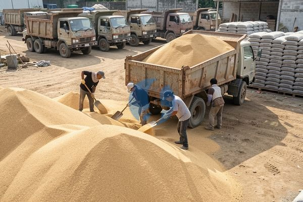

**Lapak Pasir Terdekat untuk Renovasi dan Bangunan Baru** - Mitra Sumber Material dimana saja berada, sedang mencari pasir untuk proyek konstruksi Anda? Nah, Anda berada di tempat yang tepat! Kami menyediakan berbagai jenis pasir berkualitas dengan harga bersaing, siap diantar langsung ke lokasi proyek Anda di Jabodetabek dan sekitarnya.



Pasti sering bertanya-tanya, pasir jenis apa yang paling cocok untuk proyek Anda? Atau, bagaimana cara memastikan kualitas pasir yang akan dibeli? Tenang, Mitra Sumber Material. Kami akan bantu menjawab pertanyaan-pertanyaan itu. Lebih dari itu, Kami bisa langsung menyediakan pasir sesuai kebutuhan Anda, tanpa perlu repot mencari ke sana kemari.

## Memilih Lapak Pasir Terdekat: Kualitas & Harga Jadi Prioritas

Ketika mencari lapak pasir terdekat, ada dua hal utama yang perlu diperhatikan: kualitas dan harga. Kualitas pasir sangat krusial karena memengaruhi kekuatan dan ketahanan bangunan Anda. Pasir yang berkualitas buruk bisa menyebabkan retak, rembes, atau bahkan kegagalan struktur. Sementara itu, harga tentu menjadi pertimbangan penting agar anggaran proyek Anda tetap terkendali.

Tapi, seringkali harga murah mengorbankan kualitas. Nah, di Sumber Material, Kami berusaha menyeimbangkan keduanya. Kami hanya menyediakan pasir dari sumber terpercaya, dengan seleksi ketat untuk memastikan kualitasnya sesuai standar. Untuk memastikan harga terbaik, jangan ragu untuk langsung tanyakan penawaran khusus ke Kami. Kami akan berikan harga yang kompetitif dan sesuai dengan volume yang Anda butuhkan.

## Jenis Pasir yang Tersedia di Sumber Material & Kegunaannya

Kami menyediakan berbagai jenis pasir untuk memenuhi kebutuhan proyek yang berbeda-beda. Berikut beberapa jenis pasir yang tersedia di Sumber Material:

- **Pasir Pasang:** Pasir ini bertekstur kasar dan bersih, ideal untuk campuran semen dalam pembuatan plesteran, acian, dan pondasi. Ukurannya yang kasar membantu menciptakan plesteran yang kuat dan tidak mudah retak.
- **Pasir Urug:** Pasir urug bertekstur kasar dan mengandung sedikit lumpur. Cocok digunakan untuk mengisi lahan, membuat pondasi, atau sebagai lapisan dasar sebelum pengecoran.
- **Pasir Cor:** Pasir cor memiliki butiran yang keras dan bersih, dengan kandungan lumpur minimal. Pasir ini sangat penting untuk campuran beton agar menghasilkan beton yang kuat dan tahan lama. Pastikan pasir cor yang Anda gunakan memenuhi standar SNI untuk hasil yang optimal.
- **Pasir Putih:** Pasir putih memiliki warna cerah dan tekstur halus, sering digunakan untuk keperluan dekoratif seperti taman, lantai, atau kolam renang.

Selain jenis-jenis di atas, Kami juga menyediakan pasir khusus sesuai permintaan. Hubungi Kami via WhatsApp atau Telepon untuk menanyakan ketersediaan jenis pasir yang Anda butuhkan.

## Mengapa Memesan Pasir di Sumber Material?

Mitra Sumber Material, ada banyak alasan mengapa Anda harus memilih Kami sebagai pemasok pasir terpercaya:

- **Kualitas Terjamin:** Kami hanya menyediakan pasir dari sumber yang terpercaya dan melalui proses seleksi ketat.
- **Harga Bersaing:** Kami menawarkan harga yang kompetitif dan penawaran khusus untuk pembelian dalam jumlah besar.
- **Pengiriman Cepat & Tepat Waktu:** Kami melayani pengiriman pasir ke seluruh wilayah Jabodetabek dan sekitarnya, tepat waktu sesuai kesepakatan.
- **Layanan Lengkap:** Kami bukan hanya menyediakan pasir, tetapi juga menyediakan sewa alat berat (excavator, bulldozer, dump truck) dan jasa urug serta jasa cor — semua kebutuhan proyek Anda, ada di satu tempat!
- **Konsultasi Gratis:** Tim Kami siap membantu Anda memilih jenis pasir yang tepat untuk proyek Anda, serta memberikan perhitungan kebutuhan yang akurat.
- **Berlokasi Strategis:** Dengan gudang yang tersebar di Bogor, Jakarta, Bekasi, Karawang, Tangerang, dan Cikarang, Kami dapat melayani Anda dengan lebih cepat dan efisien.

## Pesan Pasir Sekarang, Proyek Lancar!

Memesan pasir di Sumber Material sangat mudah. Cukup hubungi Kami melalui tombol **WhatsApp** atau **Telepon** di bawah. Sampaikan kebutuhan pasir Anda (jenis, volume, lokasi proyek), dan Kami akan segera memberikan penawaran terbaik. Kami bantu hitungkan semua kebutuhan material dan layanan Anda.

## Hitung Kebutuhan Pasir: Contoh Praktis untuk Proyek Anda

Nah, Mitra Sumber Material, seringkali kita kesulitan memperkirakan berapa banyak pasir yang dibutuhkan untuk sebuah proyek. Jangan khawatir, Kami akan berikan contoh perhitungan sederhana untuk membantu Anda. Misalnya, Anda akan membuat pondasi rumah dengan ukuran 6 meter x 8 meter dan kedalaman 50 cm.

Untuk pondasi, biasanya kita menggunakan campuran pasir dan semen dengan perbandingan 1:3 (1 bagian semen, 3 bagian pasir). Pertama, hitung volume pondasi: 6 m x 8 m x 0,5 m = 24 m³. Kemudian, hitung volume pasir yang dibutuhkan: 24 m³ / 4 (total bagian campuran) x 3 (bagian pasir) = 18 m³.

Jadi, Anda membutuhkan sekitar 18 meter kubik pasir untuk proyek pondasi tersebut. Perlu diingat, angka ini adalah estimasi dan bisa berbeda tergantung pada tingkat kepadatan material dan faktor lainnya. Untuk perhitungan yang lebih akurat, jangan ragu untuk konsultasi dengan tim Kami. Kami akan bantu menghitung kebutuhan material Anda secara detail.

## Perbandingan Pasir Pasang vs. Pasir Urug: Kapan Menggunakan yang Mana?

Mitra Sumber Material, seringkali ada kebingungan antara pasir pasang dan pasir urug. Keduanya memang terlihat mirip, tapi memiliki perbedaan signifikan yang menentukan penggunaannya. Pasir pasang, dengan teksturnya yang lebih halus dan bersih, sangat ideal untuk pekerjaan finishing seperti plesteran dan acian. Gunakan pasir pasang jika Anda menginginkan hasil akhir yang halus dan kuat.

Sementara itu, pasir urug lebih cocok untuk pekerjaan yang membutuhkan volume besar dan tidak memerlukan kekuatan struktural yang tinggi, seperti pengurugan lahan atau pembuatan dasar jalan. Pasir urug memiliki kandungan lumpur yang lebih tinggi dan harga yang lebih terjangkau.

Berikut tabel perbandingan singkatnya:

Memilih jenis pasir yang tepat akan memastikan kualitas dan efisiensi proyek Anda. Jika Anda masih ragu, jangan sungkan untuk bertanya kepada Kami.

## Pertanyaan Umum Seputar Pasir & Pemesanan di Sumber Material

Banyak Mitra Sumber Material yang menanyakan hal serupa. Berikut beberapa pertanyaan umum dan jawabannya:

### Berapa lama waktu pengiriman pasir ke lokasi proyek?

Waktu pengiriman bervariasi tergantung jarak dan ketersediaan armada Kami. Biasanya, pengiriman di wilayah Jabodetabek membutuhkan waktu 1-2 hari kerja setelah pemesanan dikonfirmasi.

### Apakah Sumber Material menyediakan jasa pengiriman ke luar Jabodetabek?

Untuk wilayah di luar Jabodetabek, Kami sarankan untuk menghubungi Kami terlebih dahulu melalui WhatsApp atau Telepon untuk menanyakan ketersediaan dan biaya pengiriman.

### Bagaimana jika saya membutuhkan jenis pasir yang tidak tertera di website?

Kami selalu berusaha memenuhi kebutuhan spesifik pelanggan. Silakan hubungi Kami melalui WhatsApp atau Telepon, dan Kami akan cek ketersediaan jenis pasir yang Anda butuhkan.

### Bagaimana cara memastikan kualitas pasir yang saya pesan?

Kami menjamin kualitas pasir yang Kami jual. Sebelum dikirim, pasir akan Kami sortir dan pastikan sesuai dengan standar kualitas yang berlaku. Jika Anda menemukan masalah dengan kualitas pasir, segera hubungi Kami, dan Kami akan segera memberikan solusi terbaik.

## Mengatasi Kesalahan Umum Saat Membeli Pasir

Mitra Sumber Material, seringkali ada beberapa kesalahan umum yang terjadi saat membeli pasir, dan hal ini bisa berdampak pada kualitas bangunan Anda. Salah satunya adalah tidak memperhatikan kadar lumpur dalam pasir. Kadar lumpur yang tinggi dapat mengurangi kekuatan campuran semen dan menyebabkan retak pada bangunan. Pastikan pasir yang Anda pilih bersih dari lumpur dan kotoran lainnya.

Kesalahan lainnya adalah membeli pasir dalam jumlah yang tidak sesuai kebutuhan. Terlalu sedikit pasir akan menghambat kelancaran proyek Anda, sementara terlalu banyak pasir akan membuang-buang anggaran. Itulah mengapa perhitungan yang akurat sangat penting. Jika Anda kesulitan menghitung, jangan ragu untuk meminta bantuan Kami.

## Tanya Jawab Seputar Pasir: Pertanyaan yang Sering Diajukan

### Apakah pasir yang sudah lama disimpan masih bisa digunakan?

Ya, tapi kualitasnya mungkin sudah menurun. Pasir yang disimpan terlalu lama bisa menyerap kelembapan dari udara, yang dapat mengurangi kekuatannya. Sebaiknya gunakan pasir secepatnya setelah pembelian.

### Bagaimana cara mengetahui apakah pasir sudah sesuai standar SNI?

Anda bisa meminta sertifikat uji dari pemasok. Selain itu, perhatikan tekstur dan warna pasir. Pasir yang berkualitas baik biasanya memiliki tekstur kasar dan warna yang seragam.

### Apa perbedaan antara pasir silika dan pasir kuarsa?

Secara umum, keduanya sering digunakan bergantian. Namun, pasir silika memiliki kandungan silika yang lebih tinggi dan lebih keras, sehingga lebih cocok untuk aplikasi yang membutuhkan kekuatan tinggi seperti pembuatan beton.

### Apakah Sumber Material menyediakan layanan pengujian kualitas pasir?

Kami bekerja sama dengan laboratorium terpercaya untuk pengujian kualitas pasir. Jika Anda membutuhkan layanan ini, silakan hubungi Kami untuk informasi lebih lanjut.

Mau tahu harga terbaru untuk kebutuhan proyek Mitra Sumber Material? Klik tombol **WhatsApp** atau **Telepon** di bawah, kirim kebutuhan dan lokasi proyek, Kami bantu hitungkan.
